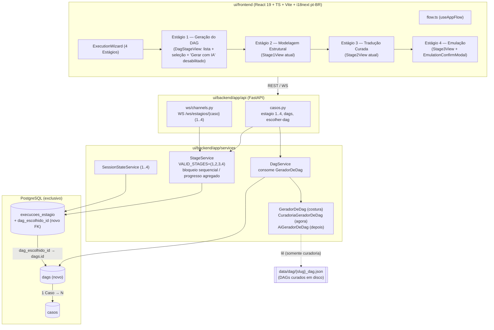
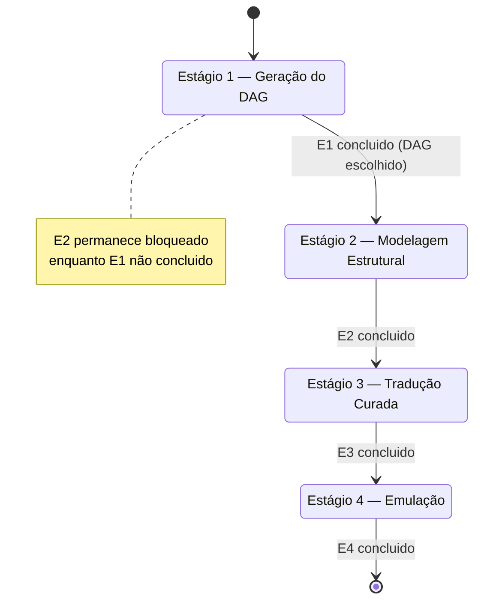
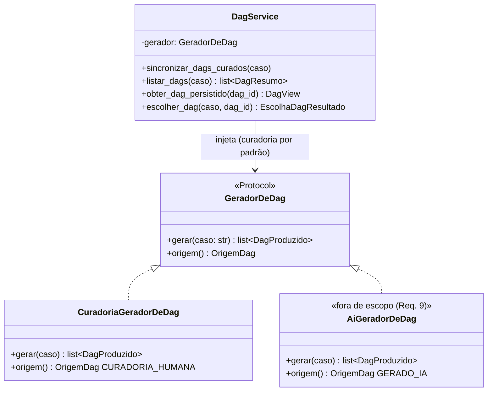
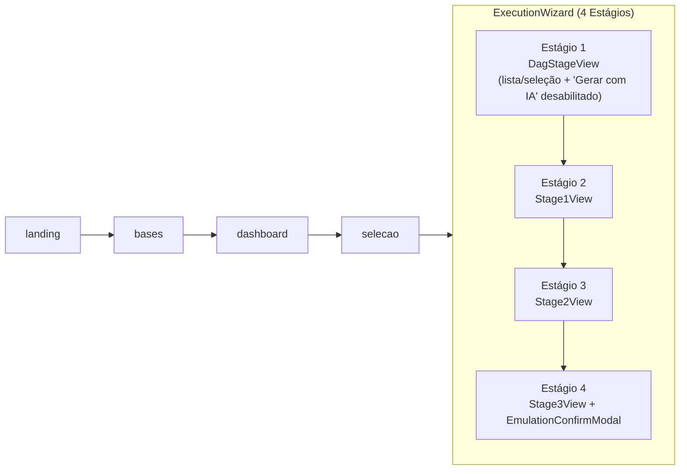
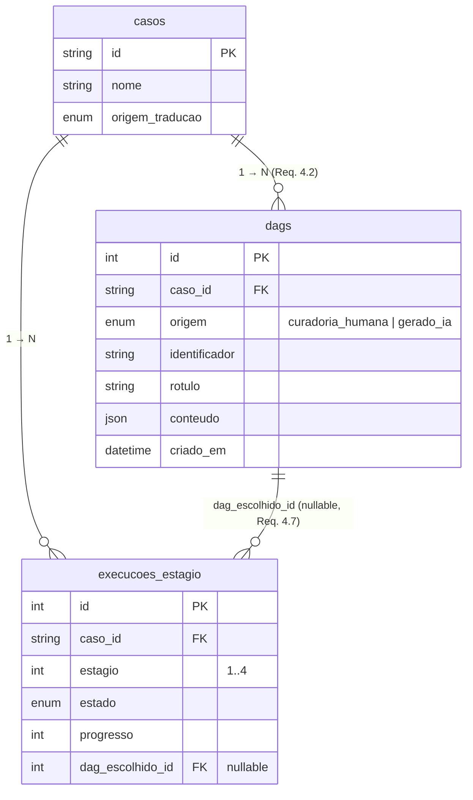
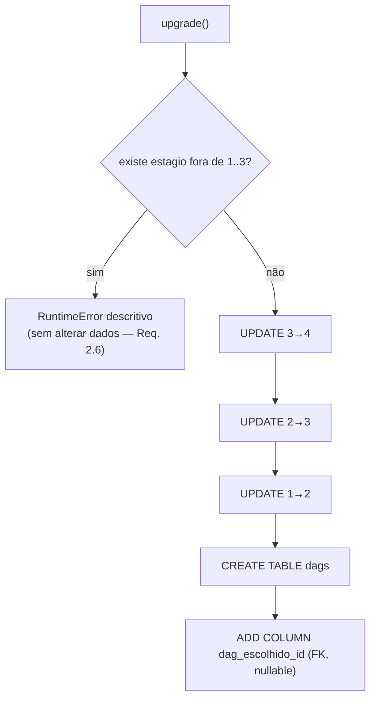

# Design Document

## Overview

Esta spec promove a geração do DAG a um **Estágio real e persistido** do pipeline do STICKS, renumerando o pipeline de três para **quatro Estágios**, e introduz o DAG como uma **entidade persistida de primeira classe e multi-origem** (1 Campanha → N DAGs). O design **reaproveita e estende** o código existente em `ui/backend` e `ui/frontend`, preservando a contenção da emulação e todas as telas já validadas. Ele **supersede** as partes relativas à fase do DAG da spec `fluxo-stix-dashboard`: a antiga "fase de visualização do DAG" (não persistida, antes do wizard) deixa de ser uma fase à parte e passa a ser o **Estágio 1** do pipeline.

Mapa da renumeração (origem → destino):

| Antes (3 Estágios)            | Depois (4 Estágios)                       |
| ----------------------------- | ----------------------------------------- |
| — (fase DAG não persistida)   | **Estágio 1 — Geração do DAG** (novo)     |
| Estágio 1 — Modelagem Estrutural | **Estágio 2 — Modelagem Estrutural**    |
| Estágio 2 — Tradução Curada   | **Estágio 3 — Tradução Curada**           |
| Estágio 3 — Emulação          | **Estágio 4 — Emulação**                  |

Objetivos desta iteração:

1. **Pipeline de quatro Estágios** com bloqueio sequencial 1→2→3→4, progresso agregado sobre 4, `Estado_de_Sessão` e canal WebSocket sobre 1..4 (Req. 1, 3).
2. **Migração Alembic** que renumera `execucoes_estagio.estagio` (1→2, 2→3, 3→4) preservando o estado persistido, com guarda e `downgrade` reversível (Req. 2).
3. **Entidade DAG persistida e multi-origem** com `OrigemDag` extensível (`curadoria_humana` | `gerado_ia`), seguindo o precedente de `TranslationSource`/`origem_traducao` (Req. 4).
4. **Costura `GeradorDeDag`** com implementação de curadoria agora e implementação de IA encaixável depois sem redesenho; botão "Gerar com IA" visível e desabilitado; bloqueio de avanço sem DAG; escolha entre DAGs quando houver ≥1 (Req. 5, 6).
5. **Preservação da contenção** do Estágio 4 e das telas de tradução/emulação/modal (Req. 7).
6. **Não-objetivo**: o gerador de IA não é implementado nesta iteração; o modelo de dados e o fluxo ficam prontos para `gerado_ia` sem alteração de esquema (Req. 9).

### Diagrama de arquitetura de alto nível

O diagrama mostra os quatro Estágios, onde a entidade DAG persistida e a costura `GeradorDeDag` se encaixam, e o fluxo de leitura/escrita entre frontend, API, serviços e banco.



A geração por IA (`AiGeradorDeDag`) é mostrada apenas como ponto de extensão: **não é implementada** nesta iteração (Req. 9), mas o modelo e a costura já a acomodam.

## Architecture

### Renumeração dos Estágios (1..4)

Hoje o backend fixa três Estágios em `stage_service.py`:

```python
FIRST_STAGE: int = 1
LAST_STAGE: int = 3
VALID_STAGES: tuple[int, ...] = (1, 2, 3)
```

A evolução generaliza essas constantes para quatro Estágios, mantendo intacta a lógica que já é escrita em termos delas:

```python
FIRST_STAGE: int = 1
LAST_STAGE: int = 4
VALID_STAGES: tuple[int, ...] = (1, 2, 3, 4)
```

Como `get_stage_states`, `is_stage_startable`, `_build_stage_state_view`, `_is_case_fully_completed`, `aggregate_progress`, `stage_progress_event` e `_validate_stage` **já iteram sobre `VALID_STAGES`** e usam `FIRST_STAGE`/`estagio - 1` para o gate sequencial, ampliar o conjunto para `(1,2,3,4)` propaga a renumeração sem reescrever o algoritmo (Req. 1.3, 1.5, 1.6). A mensagem de erro de `_validate_stage` passa a citar `(1, 2, 3, 4)`.

Papéis dos Estágios após a renumeração:

- **Estágio 1 — Geração do DAG** (novo): persiste um `StageRun` com `estagio=1`; a conclusão exige um DAG escolhido (`dag_escolhido_id`), conforme Req. 4.7 e 6.3.
- **Estágio 2 — Modelagem Estrutural**: a lógica da antiga `run_stage1`/`read_stage1` passa a operar em `estagio=2`.
- **Estágio 3 — Tradução Curada**: a antiga `assemble_stage2`/`concluir_estagio2` passa a operar em `estagio=3`.
- **Estágio 4 — Emulação**: a antiga `assemble_stage3`/`run_stage3` passa a operar em `estagio=4`, preservando a contenção (Req. 7).

### Bloqueio sequencial generalizado para 1..4

O gate sequencial já é puramente baseado no Estágio imediatamente anterior:

```python
if estagio == FIRST_STAGE:
    iniciavel = True
else:
    iniciavel = states.get(estagio - 1, StageState.NOT_STARTED) is StageState.COMPLETED
```

Com `VALID_STAGES=(1,2,3,4)`, isso vale para cada par adjacente `(1,2)`, `(2,3)`, `(3,4)` (Req. 1.4, 1.5). O Estágio 1 nunca é bloqueado por um Estágio anterior, mas seu **avanço** (concluir e liberar o Estágio 2) depende de um DAG escolhido — tratado como regra do Estágio 1 (Req. 6.2, 6.3), não como gate anterior.



### Progresso agregado sobre 4 Estágios

`_is_case_fully_completed` já verifica `all(states.get(e) is COMPLETED for e in VALID_STAGES)`, portanto, com quatro Estágios, um Caso só conta como totalmente concluído quando os **quatro** `StageRun` estão `concluido` (Req. 1.6). `aggregate_progress` permanece inalterado em lógica (conta Casos totalmente concluídos sobre o universo de Casos curados).

### Estado_de_Sessão sobre 4 Estágios

`SessionStateService.get_completed_stages` deriva os Estágios concluídos lendo `StageRun` com `estado == concluido` — sem fixar número de Estágios — logo passa a reportar números no intervalo 1..4 automaticamente (Req. 1.8). `persist_stage_completion(caso_id, estagio)` aceita `estagio` 1..4 (apenas atualiza a docstring que hoje diz "1, 2 ou 3").

### Canal WebSocket sobre 4 Estágios

`run_stage_progress_channel` recebe `estagio: int` e delega a `StageService.stage_progress_event`, que valida contra `VALID_STAGES`. Ampliar `VALID_STAGES` habilita `estagio` 1..4 no canal (Req. 1.7). O frontend (`casos.ts::connectEstagios`) passa a aceitar `NumeroEstagio = 1 | 2 | 3 | 4`.

### A costura `GeradorDeDag` e como `DagService` a consome

`GeradorDeDag` é um `Protocol`/ABC no backend com uma única operação: produzir um ou mais DAGs para uma Campanha. A implementação de curadoria lê `data/dag/{slug}_dag.json` (via `CaseService`, exatamente como `DagService` já faz) e devolve um DAG com `origem = curadoria_humana`. A implementação de IA (`AiGeradorDeDag`) é **fora de escopo** (Req. 9) e encaixa-se depois sem alterar a assinatura nem a entidade `Dag`.

`DagService` é refatorado para:

1. **Persistir** DAGs curados via `CuradoriaGeradorDeDag` (backfill idempotente — um `Dag` `origem=curadoria_humana` por Caso curado, Req. 4.5).
2. **Listar** os DAGs persistidos de uma Campanha (Req. 4.8).
3. **Montar** o grafo + Mermaid de um DAG persistido (reaproveitando `montar_mermaid`/`_derivar_arestas`, que hoje operam sobre `DagData`).



### Composição do fluxo/wizard no frontend (terminologia unificada "Estágio")

**Decisão.** O `DagStageView` deixa de ser uma view roteada separada (`view: "dag"`) e passa a ser o **corpo do Estágio 1 dentro do `ExecutionWizard`**, que cresce de 3 para 4 Estágios. Justificativa:

- Satisfaz diretamente Req. 3.2 ("exibir a geração do DAG como o Estágio 1 do pipeline, e não como fase separada") e Req. 3.1 (termo único "Estágio").
- Reaproveita o `ExecutionWizard` existente (trilha de badges, navegação Avançar/Voltar, bloqueio sequencial derivado do backend) e as telas `Stage1View`/`Stage2View`/`Stage3View` — que apenas **mudam de rótulo** para Estágios 2/3/4 — mantendo intactos o `EmulationConfirmModal` e as telas de tradução/emulação (Req. 7.5).
- Simplifica `flow.ts`: a view `"dag"` é removida; o fluxo passa de `selecao → dag → wizard` para `selecao → wizard`, e o wizard começa no Estágio 1 (DAG).



O reducer `flowReducer` perde os eventos `DAG_PRONTO`/`AVANCAR` ligados à view `"dag"`; o controle de "pode avançar do Estágio 1" migra para dentro do wizard, derivado do backend (há `dag_escolhido_id` ⇒ Estágio 1 concluído ⇒ Estágio 2 liberado). Isso mantém o reducer puro e testável por fast-check sobre as views `landing | bases | dashboard | selecao | wizard`.

## Components and Interfaces

### Backend — enum `OrigemDag` (novo)

Segue **exatamente** o padrão de `TranslationSource` em `ui/backend/app/models/enums.py`: `str` Enum, valores em pt-BR, extensível sem alteração de esquema (porque é persistido com `native_enum=False`, isto é, `VARCHAR` + `CHECK`).

```python
class OrigemDag(str, enum.Enum):
    """Origem de um DAG — atributo explícito e extensível (Req. 4.3, 4.6, 9.4).

    Segue o precedente de ``TranslationSource``: ``str`` Enum, valores pt-BR,
    persistido com ``native_enum=False`` (VARCHAR + CHECK), de modo que adicionar
    um novo valor NÃO exige migração de esquema.
    """

    CURADORIA_HUMANA = "curadoria_humana"  # DAGs produzidos por curadoria
    GERADO_IA = "gerado_ia"                 # produzido por agente de IA (Req. 9)
```

> Nota de esquema: ao incluir `GERADO_IA` já na definição do enum, o `CHECK` gerado por `_portable_enum(OrigemDag, "origem_dag")` **já aceita** `"gerado_ia"` desde a primeira migração — inserir um DAG `gerado_ia` no futuro não requer alteração de esquema (Req. 4.6, 9.4).

### Backend — modelo `Dag` (novo, persistido)

Espelha as convenções de `domain.py` (SQLAlchemy 2.x `Mapped`/`mapped_column`, `_portable_enum`, tipos portáveis, FK para `casos.id`). Relação 1 Caso → N Dags (Req. 4.1, 4.2).

```python
class Dag(Base):
    """DAG persistido de primeira classe, multi-origem (Req. 4).

    Uma Campanha (Caso) pode ter N DAGs. ``origem`` é explícita e extensível
    (OrigemDag). O conteúdo gráfico (structural_nodes + arestas) é guardado em
    uma coluna JSON portável, equivalente ao conteúdo de data/dag/{slug}_dag.json.
    """

    __tablename__ = "dags"

    id: Mapped[int] = mapped_column(Integer, primary_key=True)
    caso_id: Mapped[str] = mapped_column(
        String, ForeignKey("casos.id"), nullable=False
    )
    origem: Mapped[OrigemDag] = mapped_column(
        _portable_enum(OrigemDag, "origem_dag"),
        default=OrigemDag.CURADORIA_HUMANA,
        nullable=False,
    )
    # identificador/versão legível do DAG (Req. 4.4). Para curadoria:
    # derivado do arquivo (ex.: "curadoria-v1").
    identificador: Mapped[str] = mapped_column(String, nullable=False)
    rotulo: Mapped[Optional[str]] = mapped_column(String, nullable=True)
    # conteúdo gráfico: {"structural_nodes": [...], "arestas": [{"de","para"}]}
    conteudo: Mapped[Any] = mapped_column(JSON, nullable=False)
    criado_em: Mapped[dt.datetime] = mapped_column(DateTime, nullable=False)
```

Decisão de modelagem do conteúdo: guardamos `conteudo` como um único JSON portável contendo `structural_nodes` e `arestas` (`{de, para}`), que é exatamente o que `DagService._derivar_arestas` já produz a partir de `DagData`. Isso evita uma tabela de nós/arestas normalizada (desnecessária para o caso de uso de leitura/renderização) e mantém a migração mínima.

### Backend — referência do DAG escolhido no Estágio 1

**Decisão (justificada): coluna `dag_escolhido_id` em `StageRun`.** Adicionamos uma coluna nullable `dag_escolhido_id: FK → dags.id` à tabela `execucoes_estagio`. Alternativa considerada (tabela de seleção separada) foi descartada por ser mais pesada e migração mais arriscada: a seleção é 1:1 com a execução do Estágio 1, cabe naturalmente no `StageRun` daquele Estágio, e `nullable=True` mantém a migração segura (nenhuma linha existente precisa de valor).

```python
class StageRun(Base):
    __tablename__ = "execucoes_estagio"
    # ... colunas existentes ...
    # DAG escolhido para esta execução (preenchido no Estágio 1 — Req. 4.7, 6.3).
    # Nullable: Estágios 2/3/4 e execuções antigas não têm valor.
    dag_escolhido_id: Mapped[Optional[int]] = mapped_column(
        Integer, ForeignKey("dags.id"), nullable=True
    )
```

Semântica: no Estágio 1, escolher um DAG grava `dag_escolhido_id` no `StageRun` de `estagio=1` do Caso e marca esse `StageRun` como `concluido` (progresso 100), liberando o Estágio 2 pelo gate sequencial (Req. 6.3).

### Backend — costura `GeradorDeDag` e `CuradoriaGeradorDeDag`

```python
@runtime_checkable
class GeradorDeDag(Protocol):
    """Costura de extensão de geração de DAG (Req. 5.1, 5.3).

    Uma implementação de IA pode ser adicionada depois SEM alterar esta
    assinatura nem a entidade Dag (Req. 5.3, 9.3).
    """

    def origem(self) -> OrigemDag: ...

    def gerar(self, caso: str) -> list["DagProduzido"]: ...


class DagProduzido(BaseModel):
    """DAG produzido por um GeradorDeDag, pronto para persistência."""
    origem: OrigemDag
    identificador: str
    rotulo: Optional[str] = None
    conteudo: dict  # {"structural_nodes": [...], "arestas": [{"de","para"}]}


class CuradoriaGeradorDeDag:
    """Implementação de curadoria (Req. 5.2, 5.4, 5.5).

    Lê data/dag/{slug}_dag.json via CaseService e devolve um DAG
    origem=curadoria_humana. NÃO acessa a rede e NÃO invoca IA (Req. 5.5).
    """

    def __init__(self, case_service: Optional[CaseService] = None) -> None:
        self._case_service = case_service or CaseService()

    def origem(self) -> OrigemDag:
        return OrigemDag.CURADORIA_HUMANA

    def gerar(self, caso: str) -> list[DagProduzido]:
        resultado = self._case_service.try_load_case(caso)
        # ... deriva structural_nodes + arestas (reaproveita _derivar_arestas) ...
        # devolve exatamente um DagProduzido com origem=CURADORIA_HUMANA
```

### Backend — `DagService` refatorado

```python
class DagService:
    def __init__(
        self,
        session: Session,
        case_service: Optional[CaseService] = None,
        gerador: Optional[GeradorDeDag] = None,
    ) -> None:
        self._session = session
        self._case_service = case_service or CaseService()
        self._gerador = gerador or CuradoriaGeradorDeDag(self._case_service)

    def sincronizar_dags_curados(self, caso: str) -> None:
        """Backfill idempotente: persiste 1 Dag curadoria_humana por Caso curado
        a partir de data/dag/{slug}_dag.json, se ainda não existir (Req. 4.5)."""

    def listar_dags(self, caso: str) -> list[DagResumo]:
        """DAGs persistidos da Campanha: id, origem, identificador, criado_em
        (Req. 4.8)."""

    def obter_dag_persistido(self, dag_id: int) -> DagView:
        """Grafo + Mermaid de um DAG persistido (reaproveita montar_mermaid)."""

    def escolher_dag(self, caso: str, dag_id: int) -> EscolhaDagResultado:
        """Grava dag_escolhido_id no StageRun do Estágio 1 e o conclui,
        liberando o Estágio 2 (Req. 6.3). 404 se dag_id não pertence ao Caso."""
```

`montar_mermaid`/`_derivar_arestas` são reaproveitados: hoje operam sobre `DagData`; passam a aceitar também o `conteudo` persistido (que carrega os mesmos `structural_nodes`), mantendo o `securityLevel: "strict"` do `MermaidDiagram`.

### Backend — contratos REST (JSON em pt-BR)

Todos os endpoints ficam em `ui/backend/app/api/casos.py`, consistentes com os contratos existentes.

**Listar DAGs de uma Campanha** — Req. 4.8

```
GET /api/casos/{caso}/dags
200 OK
{
  "caso_id": "shadowray",
  "dags": [
    {
      "id": 1,
      "origem": "curadoria_humana",
      "identificador": "curadoria-v1",
      "rotulo": "DAG curado (ShadowRay)",
      "criado_em": "2026-09-27T20:54:39"
    }
  ]
}
```

**Obter o grafo + Mermaid de um DAG** — Req. 4.4 (reusa a forma de `DagView`)

```
GET /api/casos/{caso}/dags/{dag_id}
200 OK
{
  "caso_id": "shadowray",
  "dag_id": 1,
  "origem": "curadoria_humana",
  "identificador": "curadoria-v1",
  "nos": [{ "node_id": "n1", "technique_id": "T1102", "technique_name": "...", "tactic": "..." }],
  "arestas": [{ "de": "n1", "para": "n2" }],
  "mermaid": "flowchart TD\n  n_n1[...]\n  n_n1 --> n_n2"
}
404 Not Found  // dag_id inexistente ou não pertencente ao Caso
```

> O endpoint legado `GET /api/casos/{caso}/dag` é mantido para compatibilidade, mas passa a resolver **o DAG escolhido** (ou, na ausência de escolha, o único DAG curado), delegando a `DagService.obter_dag_persistido`. Não há mais o ramo "passa-direto" não persistido nesta spec.

**Escolher um DAG para a execução (conclui o Estágio 1)** — Req. 6.3

```
POST /api/casos/{caso}/estagio/1/escolher-dag
{ "dag_id": 1 }
200 OK  // devolve o estado por Estágio já com o Estágio 1 concluido e o 2 liberado
{
  "caso_id": "shadowray",
  "estagios": [
    { "estagio": 1, "estado": "concluido", "progresso": 100, "bloqueado": false, "iniciavel": true },
    { "estagio": 2, "estado": "nao_iniciado", "progresso": 0, "bloqueado": false, "iniciavel": true },
    { "estagio": 3, "estado": "nao_iniciado", "progresso": 0, "bloqueado": true, "iniciavel": false },
    { "estagio": 4, "estado": "nao_iniciado", "progresso": 0, "bloqueado": true, "iniciavel": false }
  ],
  "concluido_total": false
}
409 Conflict  // nenhum DAG persistido para a Campanha (avanço bloqueado — Req. 6.2)
404 Not Found // dag_id inexistente/não pertencente ao Caso (Req. erro)
```

**Endpoints de Estágio renumerados (1..4)** — Req. 1

Os endpoints existentes passam a cobrir 1..4, com os papéis renumerados:

```
GET  /api/casos/{caso}/estagio/1   // Geração do DAG (lista + DAG escolhido)
GET  /api/casos/{caso}/estagio/2   // Modelagem Estrutural (antigo estagio/1)
POST /api/casos/{caso}/estagio/2/executar   // dispara modelagem (antigo .../1/executar)
GET  /api/casos/{caso}/estagio/3   // Tradução Curada (antigo estagio/2)
POST /api/casos/{caso}/estagio/3/concluir   // conclui tradução (antigo .../2/concluir)
GET  /api/casos/{caso}/estagio/4   // Emulação (antigo estagio/3)
POST /api/casos/{caso}/reset       // reinicia a campanha (inalterado em intenção)
```

`GET /api/casos` e `GET /api/casos/{caso}` continuam retornando `estados` (agora com 4 Estágios por Caso, via `CaseStageStates`).

### Frontend — componentes tocados

- **`DagStageView.tsx`** — passa a ser o corpo do **Estágio 1** dentro do wizard. Em vez da dicotomia curado/passa-direto, exibe:
  - a **lista de DAGs** da Campanha (`GET /api/casos/{caso}/dags`), com seleção quando há ≥1 DAG (Req. 6.4);
  - o grafo do DAG selecionado via `MermaidDiagram` (reaproveitado);
  - o botão **"Gerar com IA" visível e desabilitado** com rótulo "em breve" (Req. 6.1); acioná-lo é no-op (Req. 6.5);
  - o avanço bloqueado enquanto não houver DAG escolhido (Req. 6.2); escolher um DAG chama `POST .../estagio/1/escolher-dag` e libera o Estágio 2 (Req. 6.3).
- **`ExecutionWizard.tsx`** — cresce para **4 Estágios**: a trilha de badges itera 1..4, `stepIndicator` usa `total: 4`, o Estágio 1 renderiza `DagStageView`, e os Estágios 2/3/4 renderizam `Stage1View`/`Stage2View`/`Stage3View` (apenas rótulos mudam). O `EmulationConfirmModal` do Estágio 4 permanece intacto (Req. 7.2, 7.5).
- **`flow.ts`** — remove a view `"dag"` e os eventos ligados a ela; `View = "landing" | "bases" | "dashboard" | "selecao" | "wizard"`; `selecao → wizard`.
- **`casos.ts` / `estagios.ts`** — `NumeroEstagio = 1 | 2 | 3 | 4`; `PIPELINE_STAGES = [1,2,3,4]`; novos wrappers `getDags(caso)`, `getDagPorId(caso, dagId)`, `escolherDag(caso, dagId)`; tipo `OrigemDag = "curadoria_humana" | "gerado_ia" | (string & {})` (extensível).
- **`dag.ts`** — adiciona os tipos `DagResumo`/`DagDetalhe` e os wrappers de listagem/escolha; mantém `MermaidDiagram` como renderizador.
- **i18n (`pt-BR`/`en`)** — chaves unificadas em "Estágio": `stages.1.name = "Geração do DAG"`, `stages.2.name = "Modelagem Estrutural"`, `stages.3.name = "Tradução Curada"`, `stages.4.name = "Emulação"`; `dag.gerarComIa`, `dag.emBreve`, `dag.selecionar`, `dag.semDag` (Req. 3.3).

## Data Models

### Nova tabela `dags`

Criada pela nova migração (ver "Plano de migração"). Modelo SQLAlchemy em `domain.py` conforme a seção Components; o `CHECK` da coluna `origem` já inclui `gerado_ia` (Req. 4.6, 9.4).

| Coluna          | Tipo (portável)                               | Nulo | Observação                                          |
| --------------- | --------------------------------------------- | ---- | --------------------------------------------------- |
| `id`            | Integer PK                                    | não  | identidade                                          |
| `caso_id`       | String FK→`casos.id`                          | não  | 1 Caso → N Dags (Req. 4.1, 4.2)                     |
| `origem`        | Enum `origem_dag` (`VARCHAR`+`CHECK`)         | não  | `curadoria_humana` \| `gerado_ia` (Req. 4.3, 4.6)   |
| `identificador` | String                                        | não  | identificador/versão (Req. 4.4)                     |
| `rotulo`        | String                                        | sim  | rótulo legível opcional                             |
| `conteudo`      | JSON                                          | não  | `structural_nodes` + `arestas` (Req. 4.4)           |
| `criado_em`     | DateTime                                      | não  | instante de criação (Req. 4.4)                      |

### Alteração em `execucoes_estagio` (StageRun)

Nova coluna `dag_escolhido_id` Integer FK→`dags.id`, **nullable** (Req. 4.7). Nenhuma outra coluna muda; o significado de `estagio` passa a cobrir 1..4.

### Relação 1 Caso → N Dags e extensibilidade de origem



Como `origem` é um `VARCHAR` + `CHECK` que já contempla `gerado_ia`, inserir no futuro um DAG `origem=gerado_ia` **não exige alteração de esquema** (Req. 4.6, 9.4).

### Backfill dos DAGs curados

Passo de dados (não de esquema): no primeiro carregamento/seed, `DagService.sincronizar_dags_curados(caso)` chama `CuradoriaGeradorDeDag.gerar(caso)` e persiste um `Dag` `origem=curadoria_humana` por Caso curado, derivado de `data/dag/{slug}_dag.json` (Req. 4.5). O passo é **idempotente**: se já existe um `Dag` curado para o Caso, não duplica. É acionado de forma preguiçosa quando a lista de DAGs do Caso é solicitada (ou por um comando de seed), evitando acoplar o backfill à migração de esquema.

### Plano de migração (renumerar + criar tabela)

Uma **única migração Alembic nova** (encadeada sobre `a28d8c1ae4aa`), PostgreSQL-only, em uma transação:

**upgrade():**

1. **Guarda (Req. 2.6):** antes de qualquer alteração, verificar se existe alguma linha de `execucoes_estagio` com `estagio` fora de 1..3. Se existir, **abortar** com erro descritivo, sem alterar dados.
   ```python
   fora = bind.execute(sa.text(
       "SELECT COUNT(*) FROM execucoes_estagio WHERE estagio NOT BETWEEN 1 AND 3"
   )).scalar_one()
   if fora:
       raise RuntimeError(
           f"Migração abortada: {fora} linha(s) de execucoes_estagio com "
           "estagio fora de 1..3. Nenhum dado foi alterado."
       )
   ```
2. **Renumerar em ordem decrescente** para não colidir (Req. 2.1, 2.3): `3→4`, depois `2→3`, depois `1→2`. Cada `UPDATE` preserva `estado`, `progresso`, `mensagem_erro`, `etapa_falha`, `caso_id` (só altera `estagio`) (Req. 2.2).
   ```python
   for antigo in (3, 2, 1):   # descendente evita colisão
       bind.execute(
           sa.text("UPDATE execucoes_estagio SET estagio = :novo WHERE estagio = :antigo"),
           {"novo": antigo + 1, "antigo": antigo},
       )
   ```
3. **Criar a tabela `dags`** (tipos portáveis, `origem` via `sa.Enum('curadoria_humana','gerado_ia', name='origem_dag', native_enum=False)`), com FK `caso_id → casos.id`.
4. **Adicionar a coluna** `execucoes_estagio.dag_escolhido_id` Integer nullable com FK → `dags.id` (adicionada após criar `dags`).

**downgrade() (Req. 2.4):**

1. Remover a coluna `dag_escolhido_id`.
2. Remover a tabela `dags`.
3. Renumerar de volta em ordem **crescente** (`2→1`, `3→2`, `4→3`), preservando os demais atributos.
   ```python
   for antigo in (2, 3, 4):   # crescente evita colisão no sentido inverso
       bind.execute(
           sa.text("UPDATE execucoes_estagio SET estagio = :novo WHERE estagio = :antigo"),
           {"novo": antigo - 1, "antigo": antigo},
       )
   ```

A migração usa `op.get_bind()` e SQL textual padrão (sem recorrer a SQLite — Req. 2.5, 7.3). Tudo em uma transação Alembic: a guarda que aborta deixa os dados intactos.



## Error Handling

- **Guarda da migração (Req. 2.6):** valor de `estagio` fora de 1..3 antes do `upgrade` ⇒ `RuntimeError` com mensagem descritiva e **nenhuma** alteração de dados (a guarda roda antes de qualquer `UPDATE`, dentro da transação).
- **Campanha sem DAG (Req. 6.1, 6.2):** quando a Campanha não tem nenhum `Dag` persistido, a UI mostra o botão "Gerar com IA" **visível e desabilitado** ("em breve") e **bloqueia o avanço** para além do Estágio 1; `POST .../estagio/1/escolher-dag` sem DAG retorna `409 Conflict`.
- **Botão "Gerar com IA" acionado enquanto desabilitado (Req. 6.5):** no-op na UI — o Estágio 1 fica inalterado e nenhuma geração é iniciada (não há cliente de IA neste caminho).
- **Arquivo de DAG curado ausente/malformado (Req. 4.5):** `CuradoriaGeradorDeDag.gerar` reaproveita `CaseService.try_load_case`, que já distingue `arquivo_ausente` / `json_malformado` / `estrutura_invalida`. O backfill ignora o Caso problemático com mensagem descritiva (não persiste `Dag` inválido) e não derruba os demais Casos — mesmo padrão de isolamento por Caso já usado em `GET /api/casos`.
- **Escolher um `dag_id` inexistente/alheio ao Caso:** `escolher_dag` retorna `404 Not Found` com detalhe pt-BR; o `StageRun` do Estágio 1 **não** é alterado.
- **Falha ao persistir a escolha:** reaproveita o padrão transacional de `SessionStateService.persist_stage_completion` (commit único; rollback preserva o estado anterior; resultado tipado `saved=False`).

## Security/containment

- **Contenção do Estágio 4 inalterada (Req. 7.1, 7.2):** a emulação continua passando pelo `OperationRunner` com confirmação explícita (`EmulationConfirmModal`) e redes Docker `internal: true`; a renumeração só muda o **número** do Estágio (3→4), não o fluxo de execução.
- **Sem nova rede de saída (Req. 5.5, 9.1):** `CuradoriaGeradorDeDag` lê somente o disco local via `CaseService`; não há cliente de IA nem acesso à rede em nenhum caminho desta iteração.
- **Persistência local apenas:** a entidade `Dag` vive exclusivamente no PostgreSQL do produto (Req. 7.3); nada é enviado a terceiros.
- **PostgreSQL exclusivo (Req. 7.3, 7.4):** migração e serviços operam contra o PostgreSQL em contêiner; o dev segue com `npm run dev` e recarga a quente.
- **Mermaid seguro:** o `MermaidDiagram` mantém `securityLevel: "strict"`; `montar_mermaid` continua sanitizando ids e removendo aspas dos rótulos (sem scripts embutidos).

## Correctness Properties

*Uma propriedade é uma característica ou comportamento que deve valer em todas as execuções válidas de um sistema — essencialmente, uma afirmação formal sobre o que o sistema deve fazer. As propriedades servem de ponte entre especificações legíveis por humanos e garantias de correção verificáveis por máquina.*

As propriedades abaixo resultam da análise de prework (classificação por critério e consolidação de redundâncias). Cada uma é universalmente quantificada e mapeada aos requisitos que valida.

### Property 1: Bloqueio sequencial em todo par adjacente de 1..4

*Para todo* Caso e *para todo* mapa de estados persistidos dos Estágios 1..4, e *para todo* número de Estágio `n` em 2..4, o Estágio `n` é iniciável se e somente se o Estágio `n-1` está no estado `concluido`; o Estágio 1 é sempre iniciável.

**Validates: Requirements 1.4, 1.5, 8.2**

### Property 2: Caso totalmente concluído sse os quatro Estágios concluido

*Para todo* Caso e *para toda* distribuição de estados dos seus Estágios 1..4, o Caso é contado como totalmente concluído no progresso agregado se e somente se os quatro Estágios estão no estado `concluido`.

**Validates: Requirements 1.6, 8.2**

### Property 3: Derivação de estado por StageRun em 1..4

*Para todo* conjunto de linhas `StageRun` (`estagio` em 1..4, estados arbitrários, vários Casos), a derivação de estado por Estágio reflete exatamente o `StageRun` correspondente (e `nao_iniciado` quando não há linha), e os Estágios concluídos por Caso no `Estado_de_Sessão` são exatamente os `StageRun` com `estado = concluido`, considerando números em 1..4.

**Validates: Requirements 1.3, 1.7, 1.8**

### Property 4: Renumeração do upgrade desloca e preserva

*Para toda* população inicial de `execucoes_estagio` com `estagio` em 1..3 e valores arbitrários de `estado`, `progresso`, `mensagem_erro`, `etapa_falha` e `caso_id`, aplicar o `upgrade` resulta, para cada linha, em `estagio` incrementado em 1 (1→2, 2→3, 3→4) e nos demais campos inalterados, sem perda nem colisão de linhas (o multiset de linhas, exceto por `estagio` deslocado, é preservado).

**Validates: Requirements 2.1, 2.2, 2.3, 8.3**

### Property 5: Round-trip up∘down da migração é identidade

*Para toda* população inicial de `execucoes_estagio` com `estagio` em 1..3, aplicar `upgrade` e em seguida `downgrade` restaura cada linha exatamente ao seu estado inicial (identidade em `estagio` e em todos os demais atributos).

**Validates: Requirements 2.4, 8.3**

### Property 6: Guarda da migração aborta sem alterar dados

*Para toda* população inicial de `execucoes_estagio` que contenha ao menos uma linha com `estagio` fora de 1..3, o `upgrade` interrompe com erro descritivo e o estado persistido permanece idêntico ao anterior (nenhuma linha é alterada).

**Validates: Requirements 2.6**

### Property 7: Entidade DAG — 1 Caso → N, origem no domínio, round-trip do conteúdo

*Para todo* Caso e *para todo* `N` ≥ 0, persistir `N` DAGs no Caso faz `listar_dags` retornar exatamente `N` entradas, cada uma associada ao `caso_id` do Caso; *para todo* DAG persistido, `origem` pertence a `{curadoria_humana, gerado_ia}`, cada entrada da listagem inclui `origem`, `identificador`/versão e `criado_em`, e ler o conteúdo persistido devolve `structural_nodes` + `arestas` equivalentes ao conteúdo gravado.

**Validates: Requirements 4.1, 4.2, 4.3, 4.4, 4.8, 8.4**

### Property 8: Gerador de curadoria sempre produz curadoria_humana sem rede/IA

*Para todo* Caso curado, `CuradoriaGeradorDeDag.gerar` devolve um DAG com `origem = curadoria_humana` derivado de `data/dag/{slug}_dag.json`, e durante qualquer execução nenhum cliente de rede ou serviço de IA é invocado (um espião que falha se chamado nunca é acionado).

**Validates: Requirements 5.2, 5.4, 5.5**

### Property 9: Escolher um DAG conclui o Estágio 1 e libera o Estágio 2

*Para todo* Caso com ao menos um DAG persistido e *para todo* DAG válido desse Caso, escolher esse DAG grava `dag_escolhido_id` apontando para ele no `StageRun` do Estágio 1, marca o Estágio 1 como `concluido` e torna o Estágio 2 iniciável.

**Validates: Requirements 4.7, 6.3**

### Property 10: Sem DAG, o avanço além do Estágio 1 permanece bloqueado

*Para todo* Caso sem nenhum DAG persistido (e sem DAG escolhido), o Estágio 2 permanece bloqueado (não iniciável) e a tentativa de escolher um DAG é recusada sem alterar o Estágio 1.

**Validates: Requirements 6.2**

### Property 11: Backfill de DAGs curados é idempotente

*Para todo* Caso curado, aplicar `sincronizar_dags_curados` uma vez ou repetidamente produz o mesmo conjunto persistido: exatamente um DAG `origem = curadoria_humana` por Caso, sem duplicação em execuções subsequentes.

**Validates: Requirements 4.5**

### Property 12: Reducer de fluxo preserva a seleção e é determinístico sobre as views renumeradas

*Para toda* sequência de eventos aplicada ao `flowReducer` sobre as views `landing | bases | dashboard | selecao | wizard`, eventos inválidos para a view atual são no-ops (mesmo objeto de estado) e `campanhaSelecionada`, uma vez definida, é preservada em toda transição.

**Validates: Requirements 3.1, 3.2**

## Testing Strategy

Abordagem dupla, reaproveitando as ferramentas já presentes no repositório. Testes de propriedade usam **Hypothesis** (backend) e **fast-check** (frontend), ambos com **mínimo de 100 iterações** por propriedade; testes de exemplo/integração cobrem casos concretos, UI e infraestrutura. Cada teste de propriedade referencia a propriedade de design que implementa.

Formato da tag (comentário em cada teste de propriedade):
`Feature: dag-estagio-multi-origem, Property {número}: {texto da propriedade}`

### Backend — pytest + Hypothesis

Biblioteca de PBT: **Hypothesis** (não implementar PBT do zero). As propriedades usam a `Session` injetável já suportada pelos serviços; os testes de migração usam o engine de teste.

- **Bloqueio sequencial e progresso agregado (Propriedades 1, 2, 3):** gerar mapas de estado por Estágio sobre 1..4 e verificar `is_stage_startable`, `_is_case_fully_completed`/`aggregate_progress` e `get_stage_states`/`get_completed_stages`. ≥100 iterações.
- **Migração de renumeração (Propriedades 4, 5, 6):** semear `execucoes_estagio` com linhas arbitrárias e verificar: upgrade desloca e preserva; `up` seguido de `down` é identidade (round-trip); população com `estagio` fora de 1..3 aborta sem alterar dados. Executar contra o **engine PostgreSQL de teste** (Req. 2.5, 7.3); quando o PostgreSQL não estiver disponível no CI, o teste é marcado/skipado com a dependência documentada, nunca recorrendo a SQLite para a migração.
- **Entidade DAG multi-origem (Propriedade 7):** gerar `N` DAGs com origem arbitrária em `{curadoria_humana, gerado_ia}` e conteúdo gráfico aleatório; verificar `listar_dags` (contagem, campos) e o round-trip do `conteudo` persistido.
- **Gerador de curadoria (Propriedade 8):** para todo Caso curado, verificar `origem = curadoria_humana`; injetar espiões de rede/IA que **levantam** se chamados e confirmar que nunca são acionados.
- **Escolha de DAG e gate do Estágio 1 (Propriedades 9, 10):** verificar que `escolher_dag` grava `dag_escolhido_id`, conclui o Estágio 1 e libera o Estágio 2; e que, sem DAG, o Estágio 2 fica bloqueado e a escolha é recusada.
- **Backfill idempotente (Propriedade 11):** rodar `sincronizar_dags_curados` 1× e 2× e comparar o conjunto persistido.
- **Testes de exemplo/integração:** `VALID_STAGES == (1,2,3,4)` e nomes dos 4 Estágios (1.1); persistência do `StageRun` do Estágio 1 (1.2); `CuradoriaGeradorDeDag` satisfaz o `Protocol` e um stub `gerado_ia` também (5.1, 5.3, 9.2); persistir um `Dag` `origem=gerado_ia` **sem nova migração** e lê-lo de volta (4.6, 9.4); endpoints renumerados respondem em 1..4; `escolher-dag` retorna 404 para `dag_id` alheio e 409 sem DAG.

### Frontend — Vitest + fast-check + Playwright

Biblioteca de PBT: **fast-check** (≥100 iterações).

- **Reducer de fluxo (Propriedade 12):** fast-check sobre sequências de eventos nas views renumeradas (`landing|bases|dashboard|selecao|wizard`), verificando no-ops e preservação de `campanhaSelecionada`.
- **Vitest (exemplos de UI):** `DagStageView` sem DAG mostra "Gerar com IA" visível e desabilitado ("em breve") (6.1); clicar no botão desabilitado é no-op (6.5); com ≥1 DAG, a lista permite seleção (6.4); escolher chama `escolherDag` e libera o avanço (6.3); chaves i18n `stages.1..4.name` existem em pt-BR/en e usam "Estágio" (3.1, 3.3).
- **Playwright (e2e, Req. 9.1):** fluxo completo de 4 Estágios com um Caso curado — Estágio 1 (escolher DAG curado) → Estágio 2 (modelagem) → Estágio 3 (tradução) → Estágio 4 (emulação com `EmulationConfirmModal` antes da execução); confirmar que o DAG é o **Estágio 1** do wizard e não uma fase separada (3.2), e que as telas de tradução/emulação e o modal permanecem após a renumeração (7.2, 7.5).

### Regressão e contenção

- Manter **verdes** as suítes existentes de backend e frontend após a renumeração (Req. 8.1): os testes de Stage1/2/3 passam a referir-se aos Estágios 2/3/4; ajustar apenas os números de Estágio e rótulos, não a lógica.
- A contenção do Estágio 4 (redes `internal: true`, confirmação explícita, auditoria por comando) é verificada pelas suítes de contenção existentes aplicadas ao Estágio renumerado (Req. 7.1), que devem continuar passando sem alteração de comportamento.

### Balanceamento

- **Testes de propriedade** cobrem as regras universais (bloqueio sequencial, progresso agregado, round-trip da migração, invariantes da entidade DAG, idempotência do backfill, pureza do gerador de curadoria).
- **Testes de exemplo/integração** cobrem UI, configuração, infraestrutura (PostgreSQL/dev), e-mail de contratos REST (status 404/409) e o fluxo e2e — evitando iterações redundantes onde o comportamento não varia com o input.
