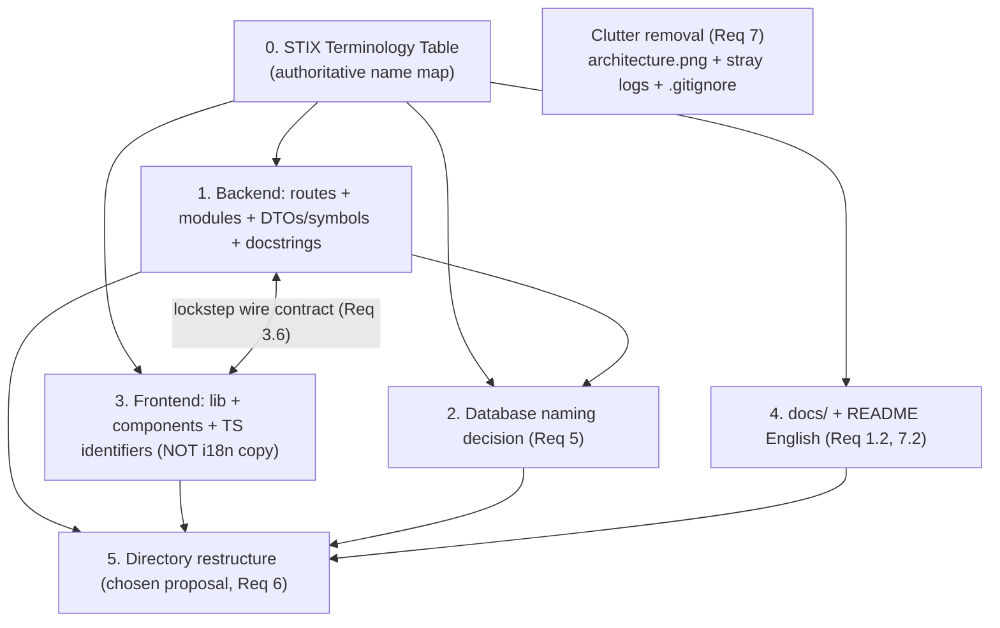

# Design Document

## Overview

This spec is a **mechanical, non-behavioral refactor** that makes the entire STICKS
project English-only (STIX-aligned), reorganizes the repository into a cleaner,
publicly-presentable layout, and removes obsolete clutter — all without changing a
single line of runtime behavior. The repository will be published publicly on GitHub,
so every artifact a reader sees must read in English.

The work spans four surfaces — backend (FastAPI + SQLAlchemy + Alembic), frontend
(React + TypeScript + Vite + i18next), the PostgreSQL schema, and the docs/layout —
and it ties them together with one authoritative **STIX terminology mapping** and a
set of **rename rules**. The design's job is to fix the *rules*, the *representative
tables*, and the *decisions the Maintainer must make* (DB strategy, directory layout,
legacy-CLI scope). The exhaustive, line-level rename list is produced and applied
during the tasks phase; the design makes that work deterministic.

This design intentionally avoids a Correctness Properties / property-based-testing
section: the change set is a rename-and-move refactor (file/dir names, identifiers,
route strings, human-language text, physical table/column names). There is no new
pure function or transformation with a "for all inputs" invariant to validate.
Behavior preservation is proven by the **pre-existing** test suites plus the
end-to-end flow — see Testing Strategy. This matches the Requirement 8 verification
model, which asks that the existing `pytest`/`vitest`/ShadowRay checks still pass,
not that new behavior be specified.

### Guiding principles

- **English-only default (Req 1).** File names, directory names, code identifiers,
  API route paths, docstrings, and inline comments default to English everywhere.
- **The single exception (Req 1.3, 1.4, 4.5, 9.4).** The rendered UI copy and the
  i18n resource files under `ui/frontend/src/i18n/` stay bilingual (pt-BR + en). They
  are **not** renamed, removed, or translated away. No other non-English artifact is
  introduced.
- **STIX vocabulary is the source of truth (Req 2).** When choosing an English
  replacement, prefer the STIX-standard term over a literal translation. Flagship:
  `caso`/`casos` → `campaign`/`campaigns`. Terms already correct and STIX-consistent
  are left unchanged to avoid churn (Req 2.5).
- **Behavior-preserving / mechanical (Req 8, Req 9).** Only names, locations, and
  human-language text change. Emulation logic, DAG generation, operationalization,
  provisioning, the containment gates, the sequential-locking pipeline semantics, and
  the recently fixed Stage 6 behavior are untouched.
- **Lockstep backend ↔ frontend contract (Req 3.6).** Every route-path or JSON
  field rename is a breaking API-contract change applied to the backend and its
  frontend wrappers in the same change, so the two sides never drift.

### Decisions locked by the Maintainer (design review)

The three open decisions in this design have been made by the Maintainer and are now
**fixed**. The sections that presented them as options are kept for rationale, but the
tasks phase implements exactly these choices:

- **Directory layout: Proposal 2 (`apps/` + `packages/` monorepo-style).** `ui/backend`
  -> `apps/backend`, `ui/frontend` -> `apps/frontend`, `docker/` -> `infra/docker/`,
  legacy CLI -> `packages/cli/`, `scripts/` and `docs/` stay at root. Root
  `package.json` workspaces and `scripts/*.mjs` paths are updated accordingly.
- **Database naming: Option A (full English physical schema).** The Portuguese
  tables/columns are renamed to English/STIX names via a new, reversible Alembic
  migration (pure `ALTER ... RENAME`, no data movement, working `downgrade`), verified
  by an `upgrade`->`downgrade`->`upgrade` round-trip on a seeded DB. No ORM `name=`
  mapping fallback.
- **Legacy CLI (`sticks/`): kept, relocated, not renamed.** It is small
  (~3,000 LOC across 16 Python files, already mostly English) and still useful for a
  colleague to run the old commands, so it is **relocated** to `packages/cli/` and its
  obsolete `architecture.png` reference is fixed, but its identifiers are **not**
  renamed in this effort. If it becomes obsolete later, it can be removed in a separate
  change.
- **Service interruption during the refactor is authorized** — the dev stack may be
  stopped to apply renames, run the migration, and move directories.

## Architecture

The refactor proceeds in named layers, each independently verifiable. The arrows show
the lockstep contract coupling (backend ↔ frontend) and the one-way dependency of
everything on the terminology table.



The i18n layer sits deliberately outside the rename flow: the frontend's bilingual
capability must remain functional (Req 1.6), and the i18n parity/terminology tests
pin the rendered stage vocabulary and must keep passing unweakened.

## Components and Interfaces

The "components" of this refactor are the rename rules per surface and the two
Maintainer decisions. Each sub-section below ties to its requirement by number. The
authoritative mapping lives in the STIX Terminology Table; the rename sub-sections
apply that table to concrete artifacts.

### Rule: how a Portuguese artifact becomes English

1. Look up the domain concept in the **STIX Terminology Table**.
2. If a STIX-standard term applies, use it (Req 2.1, 2.3). Otherwise use the plain
   English translation.
3. If the STIX term diverges from a literal translation, record the divergence with a
   short rationale in the rename map (Req 2.4) — e.g. `atores` → `adversaries`
   (intrusion-set), not the literal `actors`.
4. If the term is already correct English and STIX-consistent, leave it (Req 2.5).
5. When the artifact is a route path or JSON field, change backend and frontend
   together (Req 3.6).
6. Never touch rendered UI copy or `ui/frontend/src/i18n/**` (Req 1.3, 4.5, 9.4).

## Data Models

The only data-model concern in this refactor is the **physical database schema**:
whether the Portuguese table/column names are renamed or merely mapped to English in
the ORM. That decision is Requirement 5 and is presented in full in the "Database
naming decision" section below. No new tables, columns, enums, or relationships are
introduced by this spec. The ORM lives in a single file today
(`ui/backend/app/models/domain.py`) with enums in `ui/backend/app/models/enums.py`;
whichever DB option is chosen, the application-visible attribute names and the API
contract become English (Req 5.4).

---

## 2. STIX Terminology Mapping Table (Req 2)

This is the authoritative map. Every rename across backend, frontend, DB, and docs
resolves through it. The flagship entry is first.

| Portuguese concept | English / STIX term | STIX note / rationale |
|--------------------|---------------------|------------------------|
| **`caso` / `casos`** | **`campaign` / `campaigns`** | **Flagship.** A STIX **Campaign** is the operation run by an adversary group. Replaces `caso` everywhere (code, files, routes, DTO/field names, docs) subject to the Req 5 DB decision. |
| `versao` | `version` | STIX bundle version. |
| `estagio` | `stage` | Pipeline stage. |
| `concluido` | `completed` (prefer `completed`; `done` acceptable where terser reads better) | Pick one and apply consistently; `completed` is the default. |
| `relatorio` | `report` | Execution report. |
| `operacao` | `operation` | STIX/Caldera operation (an execution run). |
| `auditoria` | `audit` | Per-command audit log. |
| `preferencias` | `preferences` | UI/user preferences. |
| `estado_sessao` | `session_state` (route: `session-state`) | Wizard session state. |
| `topologia` | `topology` | Network topology view. |
| `provisionar` | `provision` | Provision the environment. |
| `provisionador` | `provisioner` | — |
| `operacionalizacao` | `operationalization` | Stage 4 role. |
| `operacionalizador` | `operationalizer` | — |
| `conclusao` | `completion` | Stage 6 completion/teardown. |
| `execucao` | `execution` | — |
| `medicao` | `measurement` | Procedural-sufficiency metrics. |
| `saude` | `health` | Health check. |
| `isolamento` | `isolation` | Containment isolation verdict. |
| `redes` | `networks` | Lab internal networks. |
| `hosts` | `hosts` | Already English — leave unchanged (Req 2.5). |
| `campanhas` | `campaigns` | STIX Campaign listing (bundle sub-path). |
| `atores` | `adversaries` (STIX **Intrusion Set**) | **Divergence (Req 2.4).** Not the literal `actors`. STIX models the group as an **Intrusion Set**; the project's established English term is `adversary`/`adversaries`. Record rationale in the rename map. |
| `ability` / `abilities` | `ability` / `abilities` (STIX **Attack Pattern** / Caldera ability) | Already English — leave unchanged. The Caldera "ability" realizes a STIX Attack Pattern/technique. |
| `adversary` / `adversaries` | unchanged | Already English + STIX-aligned. |
| `topologia_builder` | `topology_builder` | — |
| `parametros_ambiente` | `environment_parameters` | Stage 4 environment params. |
| `ambiente_provisionado` | `provisioned_environment` | Stage 5 output. |
| `relatorios_execucao` | `execution_reports` | — |
| `resultados_ability` | `ability_results` | — |
| `execucoes_estagio` | `stage_runs` | — |
| `versoes_stix` | `stix_versions` | — |
| `baixar` / `baixada` | `download` / `downloaded` | See route reconciliation (3a): the project already exposes `/download` in `stix.py`; standardize on `download`. |
| `mensagem_erro` | `error_message` | — |
| `etapa_falha` | `failed_step` | — |
| `escolher-dag` | `choose-dag` (or `select-dag`) | Pick one; `choose-dag` is the default. |
| `selecionar` | `select` | — |
| `concluir` | `complete` | Route verb for stage completion. |

---

## 3. The Rename Map (rules + representative tables)

**Scope statement (applies to all of §3).** The tables below are *representative*,
not exhaustive. They fix the scheme and the hard decisions. The complete,
line-by-line rename list is produced and applied during the **tasks** phase, where
every remaining Portuguese identifier is resolved deterministically through the §2
terminology table and the §3 rules. This keeps the design readable while leaving no
ambiguity for implementation (Req 2, Req 3, Req 4).

### 3a. Backend API route paths (Req 3.3, 3.6)

Chosen English scheme: STIX-aligned nouns, `kebab-case` for multi-word segments,
stage expressed as `/stage/{n}`. The `/casos` family becomes the `/campaigns` family.
Everything here is a **breaking API-contract change**; frontend wrappers (§3d/§3e)
change in the same commit (Req 3.6).

| Old route | New route |
|-----------|-----------|
| `/casos` | `/campaigns` |
| `/casos/{caso}` | `/campaigns/{campaign}` |
| `/casos/{caso}/estagio/{n}` | `/campaigns/{campaign}/stage/{n}` |
| `/casos/{caso}/estagio/{n}/provisionar` | `/campaigns/{campaign}/stage/{n}/provision` |
| `/casos/{caso}/estagio/{n}/concluir` | `/campaigns/{campaign}/stage/{n}/complete` |
| `/casos/{caso}/estagio/{n}/escolher-dag` | `/campaigns/{campaign}/stage/{n}/choose-dag` |
| `/casos/{caso}/estagio/{n}/operacao` | `/campaigns/{campaign}/stage/{n}/operation` |
| `/casos/{caso}/estagio/{n}/relatorio` | `/campaigns/{campaign}/stage/{n}/report` |
| `/casos/{caso}/relatorio` | `/campaigns/{campaign}/report` |
| `/casos/{caso}/reset` | `/campaigns/{campaign}/reset` |
| `/casos/{caso}/dag` | `/campaigns/{campaign}/dag` |
| `/casos/{caso}/dags` | `/campaigns/{campaign}/dags` |
| `/casos/{caso}/dags/{dag_id}` | `/campaigns/{campaign}/dags/{dag_id}` |
| `/casos/{caso}/topologia` | `/campaigns/{campaign}/topology` |
| `/auditoria/{operacao}` | `/audit/{operation}` |
| `/preferencias` | `/preferences` |
| `/estado-sessao` | `/session-state` |
| `/stix/bases/{versao}/dashboard` | `/stix/bases/{version}/dashboard` |
| `/stix/bases/{versao}/campanhas` | `/stix/bases/{version}/campaigns` |
| `/stix/bases/{versao}/atores` | `/stix/bases/{version}/actors` *(see note)* |
| `/stix/bases/{versao}/baixar` *(casos.py)* | **removed — folded into `/download`** |
| `/stix/bases/{versao}/download` *(stix.py)* | `/stix/bases/{version}/download` *(canonical)* |

**`/baixar` vs `/download` reconciliation (flagged inconsistency).** The repo today
exposes **both** a Portuguese `.../baixar` download in `casos.py` and an English
`/stix/bases/{versao}/download` in `stix.py`. These are two spellings of the same
"download the bundle" action. The design **reconciles them onto the single canonical
`/stix/bases/{version}/download`** (already English, already STIX-scoped). The
`/baixar` route is removed and any caller is pointed at `/download`. This is a
behavior-preserving consolidation of a duplicated surface, not a new feature.

**`atores` path note (Req 2.4 divergence).** The *path segment* is standardized to
`actors` to stay literal and predictable in the URL, while the *returned data and
DTOs* use `adversaries` (STIX Intrusion Set) per §2. The divergence (path `actors`
vs. domain `adversaries`) is recorded in the rename map with this rationale. If the
Maintainer prefers a single word end-to-end, `/adversaries` is the alternative — a
one-line change flagged for the design review.

### 3b. Backend module file renames (Req 3.1, 3.2)

API modules in `ui/backend/app/api/`:

| Old file | New file |
|----------|----------|
| `casos.py` | `campaigns.py` |
| `emulacao.py` | `emulation.py` |
| `auditoria.py` | `audit.py` |
| `preferencias.py` | `preferences.py` |
| `topologia.py` | `topology.py` |
| `estado_sessao.py` | `session_state.py` |
| `stix.py`, `health.py`, `router.py` | *(already English — unchanged)* |

Environment service modules in `ui/backend/app/services/environment/`:

| Old file | New file |
|----------|----------|
| `provisionador.py` | `provisioner.py` |
| `operacionalizacao.py` | `operationalization.py` |
| `operacionalizador.py` | `operationalizer.py` |
| `conclusao.py` | `completion.py` |
| `execucao.py` | `execution.py` |
| `medicao.py` | `measurement.py` |
| `relatorio.py` | `report.py` |
| `saude.py` | `health.py` |
| `topologia_builder.py` | `topology_builder.py` |
| `compose_executor.py`, `log_buffer.py`, `stage_service.py` | *(already English — unchanged)* |

All imports and the `router.py` registration are updated accordingly (Req 3.1, 3.2).
The other service subpackages (`audit`, `caldera`, `containment`, `dag`, `operation`,
`session`, `stage`, `stix`) already have English directory names and keep them;
`case_service.py` is renamed to `campaign_service.py` under the flagship rule.

### 3c. Backend Python symbols / DTOs / functions / fields (Req 3.4, 3.5)

**Rule for the long tail:** every Portuguese identifier not listed here is renamed by
resolving each of its morphemes through the §2 table (e.g. `*Estagio*` → `*Stage*`,
`*Resultado*` → `*Result*`, `*Campanha*` → `*Campaign*`, `caso_id` → `campaign_id`),
preserving the surrounding casing convention (PascalCase for classes, snake_case for
functions/fields). Docstrings and inline comments are rewritten into English
(Req 3.5).

Representative DTO/class renames:

| Old symbol | New symbol |
|-----------|-----------|
| `ResultadoEstagio1` | `Stage1Result` |
| `Estagio2Response` | `Stage2Response` |
| `ResultadoSelecaoCampanha` | `CampaignSelectionResult` |
| `ProvisionarEstagio5Response` | `ProvisionStage5Response` |
| `ConclusaoEstagio6Result` | `CompletionStage6Result` |
| `RelatorioExecucao` | `ExecutionReport` |
| `Stage4ProvisionamentoResponse` | `Stage4ProvisioningResponse` |
| `Estagio5LogsResponse` | `Stage5LogsResponse` |

Representative function renames:

| Old function | New function |
|-------------|-------------|
| `obter_auditoria` | `get_audit` |
| `obter_topologia` | `get_topology` |
| `listar_casos` | `list_campaigns` |

Representative JSON/field renames (**wire-contract changes — Req 3.4, 3.6**):

| Old field | New field |
|-----------|-----------|
| `caso_id` | `campaign_id` |
| `versao` | `version` |
| `estagio` | `stage` |
| `concluido` | `completed` |
| `mensagem_erro` | `error_message` |
| `etapa_falha` | `failed_step` |
| `saude` | `health` |
| `isolamento` | `isolation` |
| `redes` | `networks` |
| `hosts` | `hosts` *(unchanged)* |
| `atores` | `adversaries` |
| `campanhas` | `campaigns` |

**Wire-contract note.** Renaming a Pydantic field changes the serialized JSON key the
frontend consumes. Each such rename is applied to the backend DTO and the matching
frontend type/wrapper in the same change (Req 3.6). No `alias=` shims are introduced:
the goal is a clean English contract, and the frontend is the only consumer and is
updated in lockstep.

### 3d. Frontend lib + component + test-file renames (Req 4.1, 4.2, 4.3)

`ui/frontend/src/lib/`:

| Old file | New file |
|----------|----------|
| `casos.ts` | `campaigns.ts` |
| `emulacao.ts` | `emulation.ts` |
| `estagios.ts` | `stages.ts` |
| `preferencias.ts` | `preferences.ts` |
| `api.ts`, `dag.ts`, `stix.ts`, `flow.ts`, `wizard.ts`, `ws.ts`, `utils.ts`, `theme-storage.ts` | *(already English — unchanged)* |

`ui/frontend/src/components/`:

| Old file | New file |
|----------|----------|
| `CampanhaView.tsx` | `CampaignView.tsx` |
| `ParametrosAmbienteView.tsx` | `EnvironmentParametersView.tsx` |
| `RelatorioView.tsx` | `ReportView.tsx` |

Portuguese test-file suffixes:

| Old file | New file |
|----------|----------|
| `ExecutionWizard.navegacao.test.tsx` | `ExecutionWizard.navigation.test.tsx` |
| `ExecutionWizard.propagacao.test.tsx` | `ExecutionWizard.propagation.test.tsx` |

All imports and references are updated (Req 4.1, 4.2, 4.3).

### 3e. Frontend TypeScript identifiers / types (Req 4.4)

Portuguese TS identifiers and types — including those mirroring backend DTOs and
fields — are renamed to the matching English/STIX names from §2 and kept consistent
with the §3c backend symbols (so the mirrored types stay structurally identical to
the DTOs they shadow). This covers type names (`CampanhaView` type props,
`ResultadoSelecaoCampanha`-mirroring interfaces), variable names (`caso`, `versao`,
`estagio`, `concluido`), and object field keys that mirror the renamed JSON contract.

**Hard boundary (Req 4.5, 9.4):** nothing under `ui/frontend/src/i18n/**` is renamed,
removed, or translated. The rendered UI copy stays bilingual. Portuguese identifiers
*in TS code* are in scope; Portuguese *translation strings and i18n keys* are not.

### 3f. docs/ file renames (Req 1.2)

| Old file | New file |
|----------|----------|
| `docs/apresentacao-progresso.md` | `docs/progress-presentation.md` |
| `docs/status-projeto.md` | `docs/project-status.md` |
| `docs/diario/` | `docs/journal/` |

The *contents* of these docs are also rewritten into English (Req 1.2), as are all
README files, with the single exception that any intentionally bilingual
project-facing copy is preserved only where it is UI copy (not the case for `docs/`).

---

## 4. Database naming decision (Req 5)

The physical schema is Portuguese today. Affected tables:
`casos`, `dags`, `execucoes_estagio`, `abilities`, `adversaries`, `operacoes`,
`resultados_ability`, `auditoria`, `estado_sessao`, `preferencias`, `versoes_stix`,
`parametros_ambiente`, `ambiente_provisionado`, `relatorios_execucao`. Alembic
migrations live under `ui/backend/alembic/`. Regardless of the option chosen, the
API contract and all application code expose only English, STIX-aligned names
(Req 5.4), and the migration/test suite must pass against the configured DB (Req 5.5).

### Option A — Rename the physical schema (full English)

Add a new Alembic migration that renames tables and columns to the English/STIX names
(`casos` → `campaigns`, `execucoes_estagio` → `stage_runs`, `resultados_ability`
→ `ability_results`, `operacoes` → `operations`, `relatorios_execucao`
→ `execution_reports`, `versoes_stix` → `stix_versions`, `parametros_ambiente`
→ `environment_parameters`, `ambiente_provisionado` → `provisioned_environment`,
`auditoria` → `audit`, `estado_sessao` → `session_state`, `preferencias`
→ `preferences`, plus the Portuguese columns). The ORM `__tablename__`/`mapped_column`
names become English and map 1:1 to the physical names.

- **Pros:** Purist, fully English physical schema — nothing Portuguese survives, even
  in a `psql` session or a schema dump. Best fit for a public release and for anyone
  inspecting the DB directly.
- **Cons:** Migration risk. The rename migration must be **data-loss-free** and
  **reversible** (`ALTER TABLE ... RENAME` / `RENAME COLUMN`, no drops). Existing dev
  databases must re-migrate. Index/constraint/FK names that embed the old table names
  are renamed too, so the migration must be verified end-to-end.

### Option B — Keep physical names, map to English in the ORM

Leave the physical tables/columns Portuguese; expose English everywhere above the DB
by setting `__tablename__` to the existing Portuguese name and giving each attribute
an English Python name with `mapped_column(name="<portuguese_column>")`.

- **Pros:** Zero migration risk; no DB change at all. Application code and the API
  contract are fully English (Req 5.3, 5.4).
- **Cons:** The physical names stay Portuguese. Invisible to the API and to normal
  code, but present to anyone reading the schema directly — a small blemish on an
  otherwise fully-English public project. The ORM gains a layer of `name=` mappings
  that must be kept correct.

### Recommendation

**Option A (full English physical schema), with hard guardrails.** Given the
public-release goal and that STICKS is a research tool with reproducible, seeded data
(dev DBs can be re-migrated or re-seeded cheaply), the purist option is worth the
contained risk. The migration MUST be a pure rename (no data movement), MUST be
reversible (`downgrade` restores the Portuguese names), and MUST be verified by
running `alembic upgrade head` then `downgrade` on a seeded DB and re-running the
backend suite. If the Maintainer judges the migration risk unacceptable for any
production-like data, Option B is the safe fallback and still satisfies Req 5.3/5.4.

**DECISION (locked): Option A.** The Maintainer chose the full English physical
schema via a reversible Alembic migration; the DB tasks implement Option A.

---

## 5. Directory-tree proposals (Req 6) — Maintainer chooses one

Requirement 6.2 requires **at least three distinct** candidate layouts, presented
here, with trade-offs and migration impact for the record. **DECISION (locked):
Proposal 2** (`apps/` + `packages/` monorepo-style) — the Maintainer's choice; the
restructure tasks implement Proposal 2. All three cleanly separate frontend, backend,
scripts, Docker assets, and docs (Req 6.1); Proposals 1 and 3 are retained below only
for rationale.

Common breakage surface (relevant to every proposal that moves `ui/`):
- root `package.json` `workspaces: ["ui/frontend"]` path,
- `scripts/{dev,migrate,setup}.mjs` which hard-code `ui/backend` and `ui/frontend`
  (see `dev.mjs`: `path.join(root, "ui", "backend")` and the Vite workspace),
- Dockerfiles / compose build contexts,
- Alembic working directory (scripts run `alembic` with `cwd: backendDir`),
- Vite / `tsconfig` path roots and any import aliases,
- README directory-tree snippets.

### Legacy CLI scope decision (Req 6.4)

The top-level `sticks/` CLI package (`main.py`, `lib/{ability,agent,campaign,
intrusionSet,operation,stix,tools}.py`, `config/`, `data/`, `tools/`, README,
`requirements.txt`) predates the consolidated UI and is **mostly English already**.
**DECISION (locked): keep, relocate to `packages/cli/`, do not rename.** The package is
small (~3,000 LOC, 16 Python files, already mostly English) and still useful for a
colleague to run the old commands, so it is relocated to `packages/cli/` (per Proposal
2) and its `architecture.png` reference is fixed (Req 7.2), but its already-English
identifiers are **not** renamed in this effort (that would be churn with no
public-readability gain). If it becomes obsolete later, it can be removed separately.

### Proposal 1 — Minimal / keep `ui/` (lowest churn)

Keep the current top-level shape; only rename files (per §3) and remove clutter.

```
sticks/
├── ui/
│   ├── backend/        # FastAPI app + alembic/
│   └── frontend/       # React + Vite + src/i18n (bilingual)
├── docker/             # lab environment + compose
├── scripts/            # dev.mjs, migrate.mjs, setup.mjs (paths unchanged)
├── docs/               # English docs (renamed files)
├── cli/                # legacy sticks/ CLI relocated here (clutter review)
├── package.json
└── README.md
```

- **Trade-offs:** Smallest, safest change. `scripts/*.mjs`, `package.json`
  workspaces, Dockerfiles, Alembic cwd, and Vite/tsconfig roots all keep working
  because `ui/backend` and `ui/frontend` stay put. The only move is the legacy CLI
  from root `sticks/` → `cli/`.
- **Migration impact:** Near-zero for imports/config. Update only: the one legacy-CLI
  move and its README refs, plus README tree snippets.

### Proposal 2 — `apps/` + `packages/` monorepo style

Adopt a conventional JS/TS monorepo shape.

```
sticks/
├── apps/
│   ├── backend/        # was ui/backend
│   └── frontend/       # was ui/frontend (src/i18n stays bilingual)
├── packages/
│   └── cli/            # legacy sticks/ CLI (or legacy/ if truly archival)
├── infra/
│   └── docker/         # was docker/
├── scripts/
├── docs/
├── package.json        # workspaces: ["apps/frontend", "packages/*"]
└── README.md
```

- **Trade-offs:** Familiar to the JS/TS ecosystem; clear app vs. shared-package split.
  Heaviest churn of the three.
- **Migration impact:** Update `package.json` workspaces (`apps/frontend`,
  `packages/*`); rewrite every `ui/backend`/`ui/frontend` path in
  `scripts/{dev,migrate,setup}.mjs`; move `docker/` → `infra/docker/` and fix compose
  build contexts and any `docker/README.md` relative paths; adjust Alembic cwd to
  `apps/backend`; check Vite/tsconfig roots. `infra/docker` relocation is the riskiest
  single change (compose context + the many `docker/.docker/**` relative assets).

### Proposal 3 — Flatten `ui/` → top-level `backend/` + `frontend/` (simplest to read)

Remove the `ui/` wrapper so the two apps sit at the root — easiest for newcomers.

```
sticks/
├── backend/            # was ui/backend
├── frontend/           # was ui/frontend (src/i18n stays bilingual)
├── docker/             # unchanged location
├── scripts/
├── docs/
├── cli/                # legacy sticks/ CLI (clutter review); or removed if archival
├── package.json        # workspaces: ["frontend"]
└── README.md
```

- **Trade-offs:** Cleanest mental model for a public reader — "backend here, frontend
  there." Moderate churn, less than Proposal 2 because `docker/` and `scripts/` keep
  their locations.
- **Migration impact:** Update `package.json` workspaces (`frontend`); change
  `ui/backend`→`backend` and `ui/frontend`→`frontend` in `scripts/*.mjs`; set Alembic
  cwd to `backend`; adjust Vite/tsconfig roots and README tree. Docker/compose
  contexts referencing `../ui/...` (if any) are retargeted.

### Mitigation common to all proposals

Do the directory move **last** (after all renames land and tests are green), as a
single mechanical step, then immediately re-run both suites and the ShadowRay flow to
catch any missed path. Keep the move in one commit so it is easy to review and revert.

---

## 6. Clutter / obsolete-asset removal plan (Req 7)

- **Remove `architecture.png`** at the repository root (Req 7.1).
- **Fix its three references (Req 7.2).** Confirmed by grep, `architecture.png` is
  referenced in `README.md`, `docker/README.md`, and `sticks/README.md` (both an
  `` and a directory-tree line in each). Remove the image
  tag and the tree line in each so no README links to a missing file.
- **Delete the stray root logs (Req 7.3):** `backend-dev.err.log`,
  `backend-dev.out.log`, `backend-run.log`, `dev-app.log`, `dev-run.err.log`,
  `dev-run.out.log`.
- **Prevent recurrence via `.gitignore` (Req 7.4).** The existing `.gitignore`
  already has `*.log` under a Portuguese comment; it does catch these files, but they
  are tracked, so they must be `git rm` first. Add explicit globs for the dev-runner
  shapes so equivalent clutter can't reappear and the intent is documented in English:
  `*-dev.*.log`, `*-run.log`, `dev-*.log`, `dev-run.*.log`. (The pre-existing
  `.gitignore` Portuguese comments are also rewritten to English under Req 1.1.)

---

## Error Handling

This refactor introduces no new runtime error paths; it preserves existing ones. The
error-handling concerns are about the *refactor process*, not request handling:

- **Wire-contract drift.** A route or field renamed on one side but not the other
  produces 404s or `undefined` fields at runtime. Mitigation: apply each §3a/§3c
  rename to backend and frontend in the same change (Req 3.6) and run both suites
  before moving on.
- **Alembic rename failure (Option A).** A rename migration that isn't a pure,
  reversible `ALTER` risks data. Mitigation: rename-only operations, a working
  `downgrade`, and an `upgrade`→`downgrade`→`upgrade` round-trip on seeded data before
  acceptance (Req 5.2, 5.5).
- **Import-path breakage on the directory move.** Mitigation: move last, in one
  commit, then re-run everything (§5 mitigation).
- **Missed Portuguese artifact.** Mitigation: a final repository-wide grep for the §2
  Portuguese terms (outside `ui/frontend/src/i18n/**`) as a tasks-phase gate.

The containment gates in `ui/backend/app/services/containment/` are left functionally
unchanged (Req 8.5); only Portuguese names/comments inside them, if any, are
translated mechanically.

## Testing Strategy

Property-based testing is deliberately **not** used here (see Overview): a
rename-and-move refactor has no "for all inputs, property P holds" invariant to
assert. Correctness is proven by the pre-existing suites plus the end-to-end flow, run
after each layer.

- **Backend `pytest`** (run from `ui/backend` with the project venv) must pass after
  the backend layer and after the DB layer, with no behavioral change to request
  handling (Req 3.7, 5.5, 8.2).
- **Frontend `vitest`** must pass after the frontend layer with no behavioral change
  to the rendered UI (Req 4.6, 8.3).
- **i18n parity / terminology tests must keep passing and MUST NOT be weakened**
  (`i18n.property.test.ts`, `pipeline-i18n-parity.property.test.ts`,
  `pipeline-parity.test.ts`, `stages.terminology.test.ts`). They pin the bilingual UI
  stage vocabulary; because the i18n resources are out of scope for renaming, these
  tests should pass unchanged and act as a guard that the UI copy was not disturbed
  (Req 1.6, 4.5).
- **End-to-end six-stage ShadowRay flow** through the UI must complete successfully
  (Req 8.4). This is the acceptance path for behavior preservation across the renamed
  routes and fields.
- **Stage 6 behavior must be preserved (Req 8.6, 9.3).** The recently fixed Stage 6
  behavior — the topology lookup that resolves to the `/stage/5` equivalent after the
  route rename (formerly `getTopologia` → `topologia`), and the `HOST_CONTAINERS`
  isolation resolution — must survive the rename intact. When `/casos/.../topologia`
  becomes `/campaigns/.../topology`, the frontend's topology call is retargeted in the
  same change so the Stage 6 fix keeps working.
- **Per-layer gating.** After each layer (backend, DB, frontend, docs, directory
  move), run the relevant suite(s) before proceeding; run the full set plus ShadowRay
  after the directory move.

## 8. Risks & recommended sequencing

Recommended execution order (minimizes churn and keeps each step verifiable):

1. **Terminology table first.** Freeze §2 as the single source of truth so every
   later rename is deterministic.
2. **Backend code + routes + DTOs, with frontend wrappers in lockstep.** Rename
   modules (§3b), symbols/fields (§3c), and routes (§3a); update the mirrored frontend
   wrappers/types in the same changes (Req 3.6). Run `pytest` + `vitest`.
3. **Database (chosen Req 5 option).** If Option A, add and verify the reversible
   rename migration; re-run `pytest`.
4. **Frontend files / components / test suffixes (§3d, §3e).** Run `vitest`; confirm
   i18n parity tests still pass untouched.
5. **docs/ + README English (§3f, §6 reference fixes).**
6. **Directory restructure last (chosen Req 6 proposal).** One commit; then run both
   suites + ShadowRay.
7. **Clutter removal (§6) — anytime**, independent of the above.

Principal risks:

- **Wire-contract drift between frontend and backend** — the highest-frequency risk.
  Mitigated by lockstep changes (Req 3.6) and running both suites per layer.
- **Alembic migration correctness (Option A)** — reversible, data-loss-free
  rename-only migration, verified by a round-trip on seeded data.
- **Import-path breakage on the directory move** — mitigated by doing the move last,
  in a single commit, with a full re-run afterward.
- **i18n tests** — must pass unweakened; they are the guard that the bilingual UI copy
  was not disturbed. Treat any need to edit them as a signal that something in scope
  leaked into the i18n layer.

If gaps are identified during implementation (e.g., an unexpected Portuguese artifact
category, or a route that resists clean reconciliation), return to the requirements or
this design to record the decision before proceeding — the rename map must stay the
authoritative, complete reference.
