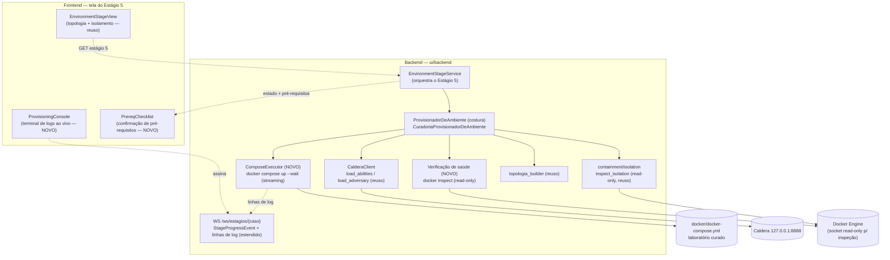

# Design Document

## Overview

Esta spec aprofunda o **Estágio 5 — Criação do ambiente de simulação** do pipeline de seis
Estágios, transformando-o de uma **verificação read-only** da topologia/isolamento (o que
`CuradoriaProvisionadorDeAmbiente.provisionar` faz hoje em
`ui/backend/app/services/environment/provisionador.py`) em um **provisionamento ativo e
automático** que (1) **sobe** os contêineres do laboratório contido, (2) **transmite logs ao vivo**
para um terminal na tela, (3) **carrega as Abilities no Caldera**, (4) **verifica todos os
pré-requisitos** (contêineres saudáveis + Abilities carregadas + isolamento aprovado) antes de
concluir, e (5) **desprovisiona** ao término da campanha no Estágio 6.

O desenho **constrói sobre** o que já existe e **reusa ao máximo**: a costura
`ProvisionadorDeAmbiente` (ponto de extensão por `origem`), o pacote `containment/` (isolamento
read-only), o `topologia_builder` (fonte única de hosts/IPs/sub-redes), o `CalderaClient`
(carga de Abilities/Adversary) e o canal WebSocket de Estágios (`WS /ws/estagios/{caso}`). O
**delta** novo é: um executor de provisionamento que roda `docker compose up` **em streaming**, um
canal de linhas de log ao vivo, uma verificação de **saúde dos contêineres**, a composição desses
passos como pré-condição de conclusão, e um terminal no frontend.

### Decisões centrais

- **Provisionar é um pipeline de etapas em streaming, não uma inspeção pontual.** O
  provisionamento vira uma sequência ordenada e observável de etapas — `subir_conteineres` →
  `aguardar_saude` → `carregar_abilities` → `verificar_isolamento` → `concluir` — cada uma emitindo
  linhas de log. O resultado por etapa alimenta tanto o terminal (Req. 2) quanto a verificação de
  pré-requisitos (Req. 5) e as mensagens de falha (Req. 7).
- **Automático ao entrar no Estágio 5.** Não há botão "provisionar"; o backend dispara o
  provisionamento quando o Estágio 5 é iniciado (Req. 1.1). O frontend abre a tela, assina o canal
  ao vivo e observa o progresso. Idempotência: se o ambiente já está provisionado e pronto, reusa
  (Req. 1.6).
- **Reuso da costura por origem.** O provisionamento ativo é uma evolução de
  `CuradoriaProvisionadorDeAmbiente` sob a **mesma** assinatura `ProvisionadorDeAmbiente`
  (`origem`/`provisionar`/`desprovisionar`). Uma futura `AiProvisionadorDeAmbiente` que **cria** a
  topologia (Compose/Vagrant) encaixa sem redesenho (Req. 10).
- **Logs ao vivo pelo canal de Estágios já existente.** Em vez de um novo transporte,
  estende-se o frame `StageProgressEvent` do `WS /ws/estagios/{caso}` para carregar as linhas de log
  do provisionamento, mantendo um buffer no servidor para reconexão (Req. 2.5, 2.7).
- **Fail-closed e bloqueante.** Qualquer etapa que falhe mantém o Estágio 5 não concluído, registra
  `etapa_falha` + causa, e bloqueia o Estágio 6 — a mesma mecânica de bloqueio sequencial já
  implementada (`is_stage_startable`).
- **Transição.** Para ShadowRay (e as 8 campanhas curadas), o ambiente é o laboratório estático do
  `docker/docker-compose.yml`; o provisionamento **sobe** esse laboratório. Sem IA, sem rede pública
  (o único egresso é a carga no Caldera local).

## Steering compliance

- **Backend:** FastAPI + SQLAlchemy + Alembic, **PostgreSQL exclusivamente**. Timestamps naive-UTC
  (`_utcnow`), serviços recebem `Session` injetada, dependências externas (inspector Docker, cliente
  Caldera, executor de compose) **injetáveis** com defaults de produção resolvidos preguiçosamente —
  o padrão já usado em `CuradoriaProvisionadorDeAmbiente`. Enums portáveis via `_portable_enum`
  (`native_enum=False`).
- **Contenção/isolamento read-only:** a verificação de isolamento continua usando somente
  `inspect_isolation` (read-only); o provisionamento **cria** contêineres via `docker compose up`,
  mas a **verificação** jamais inicia/para/modifica recursos (Req. 9.2).
- **Frontend:** React 19 + TS + Vite + i18next; contratos pt-BR como fonte da verdade; componentes
  finos consumindo wrappers tipados em `src/lib`; paridade de chaves pt-BR/en (property test de
  i18n).

## Architecture



### Pipeline de provisionamento (etapas e streaming)

```mermaid
stateDiagram-v2
  [*] --> SubirConteineres
  SubirConteineres: subir_conteineres (docker compose up --wait, streaming)
  AguardarSaude: aguardar_saude (running + healthy)
  CarregarAbilities: carregar_abilities (Caldera, ordem do DAG)
  VerificarIsolamento: verificar_isolamento (inspect_isolation, read-only)
  Concluido: concluido (pré-requisitos verificados)
  Falha: falha (etapa_falha + causa; Estágio 6 bloqueado)

  SubirConteineres --> AguardarSaude: todos subiram
  AguardarSaude --> CarregarAbilities: todos saudáveis
  CarregarAbilities --> VerificarIsolamento: carga ok
  VerificarIsolamento --> Concluido: isolamento aprovado
  SubirConteineres --> Falha: erro ao subir
  AguardarSaude --> Falha: timeout / unhealthy
  CarregarAbilities --> Falha: Caldera indisponível / artefato ausente
  VerificarIsolamento --> Falha: reprovado / daemon indisponível
  Concluido --> [*]
  Falha --> [*]
```



Cada transição emite uma ou mais **linhas de log** (o comando e sua saída) para o terminal da tela.
O `StageRun(caso_id, estagio=5, estado, progresso, mensagem_erro, etapa_falha)` reflete o estado
agregado; o Estágio 6 só desbloqueia quando o Estágio 5 fica `concluido` (bloqueio sequencial já
implementado).

## Components and Interfaces

### Backend — `ComposeExecutor` (NOVO): subir o laboratório em streaming

Encapsula a execução do `docker compose` contra o `docker/docker-compose.yml` curado, emitindo cada
linha de stdout/stderr para um callback (que o serviço reencaminha ao canal de logs). É
**injetável** (um fake nos testes, o real em produção), seguindo o padrão de injeção do pacote.

```python
# app/services/environment/compose_executor.py (NOVO)
from collections.abc import Iterable
from dataclasses import dataclass
from typing import Callable, Optional, Protocol, runtime_checkable


@dataclass(frozen=True)
class LinhaLog:
    """Uma linha de log do provisionamento, para o terminal da tela (Req. 2)."""
    etapa: str                 # "subir_conteineres" | "aguardar_saude" | ...
    fluxo: str                 # "comando" | "stdout" | "stderr" | "info"
    texto: str
    # timestamp é adicionado pelo serviço ao bufferizar/transmitir.


@dataclass(frozen=True)
class ResultadoComando:
    """Resultado de um comando de compose: código de saída + linhas emitidas."""
    codigo: int
    linhas: list[LinhaLog]


@runtime_checkable
class ComposeExecutor(Protocol):
    """Executa o laboratório Docker em streaming (ponto de injeção — Req. 3)."""

    def subir(
        self, compose_file: str, *, on_log: Callable[[LinhaLog], None]
    ) -> ResultadoComando:
        """`docker compose -f <compose_file> up -d --wait`, streamando os logs.

        Usa `--wait` para que o Compose aguarde os `healthcheck` do compose; cada
        linha de stdout/stderr vira uma `LinhaLog(etapa="subir_conteineres", ...)`
        empurrada por `on_log`. `codigo != 0` indica falha ao subir (Req. 3.5).
        """
        ...

    def derrubar(
        self, compose_file: str, *, on_log: Callable[[LinhaLog], None]
    ) -> ResultadoComando:
        """`docker compose -f <compose_file> down` (sem `--rmi`), para o desprovisionamento (Req. 8).

        Para/remove os contêineres e a rede do projeto, mas **preserva as imagens** construídas,
        de modo que a próxima campanha as reaproveite sem novo build (Req. 11.6).
        """
        ...


class DockerComposeExecutor:
    """Implementação de produção: subprocess `docker compose`, saída em streaming.

    Lê stdout/stderr linha a linha e invoca `on_log` em tempo quase real (Req. 2.2).
    NÃO sobe os serviços da camada de aplicação da Pipeline_UI: o `up` nomeia
    explicitamente os serviços do laboratório de ataque (caldera-attacker,
    kali-attacker, nginx-target, mariadb-target), nunca o perfil `containers`
    (frontend/backend) nem `postgres` (Req. 3.4).
    """
```

> **Segurança do comando (steering):** o caminho do compose e os nomes de serviço são **fixos**
> (constantes do backend), nunca interpolados a partir de entrada do usuário, fechando injeção de
> comando. O executor usa a forma de lista de argumentos (sem shell).

### Backend — reuso de imagem e build condicional (Req. 11)

O `DockerComposeExecutor.subir` passa a ser **build-condicional**: antes de subir, inspeciona (read-only)
se as imagens dos serviços do laboratório já existem na Docker Engine local, por um **nome de imagem
estável** por serviço. A decisão:

- **Todas as imagens existem** → `docker compose up -d --wait <serviços> --no-build` (reaproveita; sem
  internet, sem rebuild — Req. 11.2). É o caminho normal quando o laboratório já foi preparado antes.
- **Falta alguma imagem** → primeiro `docker compose build <serviços faltantes>` (etapa que exige
  internet para instalar pacotes/ferramentas; cada linha vai ao terminal — Req. 11.3), depois o `up`.

**Nome de imagem estável (Req. 11.4).** Cada serviço do laboratório ganha um `image:` fixo no
`docker/docker-compose.yml` ao lado do `build:` (ex.: `image: sticks-kali-attacker:latest`,
`sticks-caldera-attacker`, `sticks-nginx-target`, `sticks-mariadb-target`). Sem o `image:` explícito, o
Compose deriva o nome da imagem do **nome do projeto + serviço** (ex.: `sticks-kali-attacker` quando
`name: sticks`), que pode não bater com uma imagem já construída em outra pasta/projeto — o que faz o
Compose rebuildar à toa. Fixar o `image:` torna o reconhecimento/reaproveitamento determinístico entre
campanhas e máquinas. A verificação de existência usa `docker image inspect <nome>` (read-only).

**Abilities por API, não por imagem (Req. 11.5).** Trocar de campanha afeta apenas os parâmetros/comandos
inseridos em runtime: as Abilities entram no Caldera via `POST /api/v2/abilities` (etapa `carregar_abilities`,
reuso de `CalderaClient`), **sem** reconstruir a imagem do Caldera. A imagem do Caldera sobe pronta; a
campanha é "inserida" por API.

**Teardown preserva a imagem (Req. 8, 11.6).** O `derrubar` executa `docker compose down` **sem** `--rmi`
e **sem** `-v` para os volumes de dados que não devem ser perdidos: para/remove os contêineres e a rede do
projeto, mas **mantém as imagens** construídas/reaproveitadas, de modo que a próxima campanha as reuse sem
novo build. Uma falha de teardown continua reportando `recursos_remanescentes` (Req. 8.4).

> **Transição build × provisionamento.** O build exige internet (instala pacotes); o provisionamento por
> campanha, quando a imagem já existe, não. O runtime do laboratório permanece contido (`internal: true`)
> — `internal` afeta só o runtime; `docker build` usa a rede default do Docker. Assim, "precisa de internet
> para preparar, mas fica isolado para atacar" é resolvido pela separação build (1ª vez) × up (reuso).

### Backend — verificação de saúde dos contêineres (NOVO, read-only)

Reusa o inspector Docker read-only (o mesmo adaptador que `inspect_isolation` usa) para checar que
cada contêiner-alvo está `running` e, quando o serviço define `healthcheck`, `healthy` (Req. 5.1).
É uma inspeção read-only — não inicia/para/modifica contêineres (Req. 9.2). O `up -d --wait` já
espera a saúde pelo próprio Compose; esta verificação **confirma** o estado antes de prosseguir e
produz a linha do checklist de pré-requisitos.

```python
# app/services/environment/saude.py (NOVO)
class VereditoSaude(BaseModel):
    container: str
    rodando: bool = False
    saudavel: Optional[bool] = None   # None quando o serviço não define healthcheck
    razao: Optional[str] = None       # causa quando não rodando/unhealthy

class ResumoSaude(BaseModel):
    aprovado: bool = False
    veredictos: list[VereditoSaude] = Field(default_factory=list)
```

### Backend — `CuradoriaProvisionadorDeAmbiente.provisionar` (EVOLUÇÃO)

A implementação de curadoria passa a **subir** o laboratório antes de carregar/verificar, e a
emitir linhas de log por etapa. A assinatura `ProvisionadorDeAmbiente` **não muda** (Req. 10.1); o
que muda é o corpo de `provisionar`, que agora recebe um callback de log e orquestra as etapas:

```python
def provisionar(
    self,
    params: ParametrosDeAmbiente,
    *,
    on_log: Callable[[LinhaLog], None] = lambda _l: None,  # default no-op p/ compat
) -> AmbienteProvisionado:
    # 1. subir_conteineres: ComposeExecutor.subir(compose, on_log) — Req. 3.
    #    codigo != 0 -> falha, etapa_falha="subir_conteineres".
    # 2. aguardar_saude: ResumoSaude dos containers-alvo (running + healthy) — Req. 5.1.
    #    reprovado -> falha, etapa_falha="aguardar_saude".
    # 3. carregar_abilities: reuso de _carregar_abilities (Caldera, ordem do DAG) — Req. 4.
    #    False -> falha, etapa_falha="carregar_abilities".
    # 4. verificar_isolamento: inspect_isolation (read-only) — Req. 5.3.
    #    reprovado -> falha, etapa_falha="verificar_isolamento".
    # 5. monta AmbienteProvisionado com isolamento, abilities_carregadas=True,
    #    containers_alvo, compose_file, origem=curadoria_humana — Req. 6.1.
```

`AmbienteProvisionado` (já existente) é a Saída tipada do Estágio 5 (Req. 6.1). Acrescenta-se o
`ResumoSaude` à Saída para o checklist da tela. O `desprovisionar` passa a chamar
`ComposeExecutor.derrubar` para o laboratório curado (Req. 8.2, 8.3) e devolver
`DesprovisionamentoResult` (já existente), identificando recursos remanescentes em falha (Req. 8.4).

### Backend — `EnvironmentStageService` (orquestração do Estágio 5)

Dispara o provisionamento ao iniciar o Estágio 5 (Req. 1.1), encaminha cada `LinhaLog` ao buffer de
logs e ao canal WebSocket, atualiza o `StageRun` (progresso por etapa; `etapa_falha` + mensagem em
falha), e conclui o Estágio 5 somente quando os três pré-requisitos passam (Req. 5.5). Mantém um
**buffer de linhas de log por caso** (em memória, com limite) para que uma tela aberta tarde ou uma
reconexão recuperem o histórico (Req. 2.5, 2.7). Idempotência: se já há um `AmbienteProvisionado`
pronto, reusa (Req. 1.6).

### Backend — frame `StageProgressEvent` estendido + buffer de logs

O frame atual (`stage_service.py`) é `{caso_id, estagio, estado, progresso, estado_anterior,
mensagem_erro, etapa_falha}`. Estende-se com um bloco opcional de logs, sem quebrar os consumidores
existentes dos outros Estágios:

```python
class LinhaLogView(BaseModel):
    seq: int                 # sequência monotônica por caso (para dedupe/reordenar)
    etapa: str
    fluxo: str               # comando | stdout | stderr | info
    texto: str
    em: dt.datetime          # naive-UTC

class StageProgressEvent(BaseModel):
    caso_id: str
    estagio: int
    estado: StageState
    progresso: int = 0
    estado_anterior: Optional[StageState] = None
    mensagem_erro: Optional[str] = None
    etapa_falha: Optional[str] = None
    # DELTA (Estágio 5):
    logs: list[LinhaLogView] = Field(default_factory=list)   # linhas novas desde o último frame
```

O canal (`ws/channels.py`) passa a enviar as linhas de log acumuladas desde o último frame do caso;
no `GET` do Estágio 5 e no connect do WebSocket, envia o **buffer completo** para recuperar o
histórico (Req. 2.5, 2.7). Para os Estágios 1–4 e 6 o campo `logs` fica vazio (compatível).

### Backend — endpoints REST do Estágio 5

Consistentes com os contratos existentes (`casos.py`, JSON pt-BR):

```
GET  /api/casos/{caso}/estagio/5                 // estado + topologia + isolamento + saúde + logs (buffer)
POST /api/casos/{caso}/estagio/5/provisionar     // (idempotente) garante/inicia o provisionamento
GET  /api/casos/{caso}/estagio/5/logs            // buffer de logs do provisionamento corrente
```

> `provisionar` continua existindo como endpoint para re-disparo/idempotência e testes, mas o fluxo
> normal **não exige** o clique: o serviço dispara ao iniciar o Estágio 5 (Req. 1.1). O endpoint é
> idempotente (Req. 1.6).

### Frontend — tela do Estágio 5

A tela passa a ter três blocos. Reusa a `EnvironmentStageView` existente (topologia + isolamento) e
adiciona dois componentes finos:

| Bloco | Componente | Papel |
|-------|-----------|-------|
| Topologia + isolamento | `EnvironmentStageView` (reuso) | Diagrama Mermaid, redes internas, hosts, veredito de isolamento |
| Terminal de logs ao vivo | `ProvisioningConsole` (NOVO) | Console monoespaçado que assina o canal e renderiza as `LinhaLogView` em ordem (`seq`), com rótulo de etapa e cor por `fluxo` (comando/stdout/stderr/erro); auto-scroll; recupera o buffer ao montar (Req. 2) |
| Confirmação de pré-requisitos | `PrereqChecklist` (NOVO) | Lista os três pré-requisitos (contêineres saudáveis, Abilities carregadas, isolamento aprovado) com estado pendente/ok/falha; em falha mostra a causa e indica o Estágio 6 bloqueado (Req. 5.6, 7) |

- **Logs ao vivo (Req. 2):** `ProvisioningConsole` consome o `useEstagioChannel` existente (o hook
  do `WS /ws/estagios/{caso}`), acumulando `event.logs` por `seq`. Ao montar, chama
  `GET .../estagio/5/logs` para preencher o histórico antes de o canal continuar ao vivo (Req. 2.5).
- **Falha bloqueante (Req. 7):** quando `estado === "falhou"`, exibe o `mensagem_erro`/`etapa_falha`
  no `PrereqChecklist` e no console; o controle "Próximo" do wizard permanece bloqueado enquanto o
  Estágio 5 não está `concluido` (bloqueio sequencial já implementado no `ExecutionWizard`).
- **Confirmação de sucesso (Req. 5.6):** quando `estado === "concluido"`, o `PrereqChecklist` marca
  os três itens como verificados e libera o "Próximo".

### Frontend — i18n (namespace `pipeline`)

Novas chaves sob `stage5.*` (reusa as `stage4.*`/`stage5.*` existentes da renumeração de seis
Estágios conforme a spec `pipeline-seis-estagios`): `provisionamento.console.*` (título, etapas,
rótulos de fluxo, vazio), `provisionamento.prerequisitos.*` (contêineres saudáveis, Abilities
carregadas, isolamento aprovado, pendente/ok/falha), `provisionamento.falha.*` (título, bloqueado).
Paridade pt-BR/en exigida pelo property test de i18n.

## Data Models

### `StageRun` (reuso, sem migração de intervalo)

`execucoes_estagio.estagio` já cobre 1..6 (coluna `Integer` pura, sem CHECK de intervalo). O
Estágio 5 usa `estado`/`progresso`/`mensagem_erro`/`etapa_falha` como os demais; nenhuma coluna
nova é exigida no `StageRun`.

### Persistência da Saída do Estágio 5 (`AmbienteProvisionado`)

Persistida como JSON portável (como `Dag.conteudo` e `parametros_ambiente.conteudo`), associada ao
caso, para o Estágio 6 e a tela consumirem após a conclusão (Req. 6.3). Carrega plataforma,
contêineres-alvo, `compose_file`, `isolamento` (resumo), `ResumoSaude`, `abilities_carregadas` e
`origem`.

### Buffer de logs de provisionamento

Mantido **em memória** no serviço, por caso (lista limitada de `LinhaLogView` com `seq` monotônico).
É efêmero por design — serve ao acompanhamento ao vivo e à reconexão da execução corrente (Req.
2.5, 2.7), não a um histórico persistente de auditoria (a auditoria por comando da **execução** é
do Estágio 6, via `AuditLogEntry`, fora do escopo desta spec).

## Error Handling

- **Falha ao subir contêineres (Req. 3.5):** `ComposeExecutor.subir` com `codigo != 0` → Estágio 5
  `falhou`, `etapa_falha="subir_conteineres"`, `mensagem_erro` com as últimas linhas de stderr; o(s)
  contêiner(es) que não subiram são identificados. Console e checklist exibem a causa.
- **Timeout / unhealthy (Req. 5.1):** `ResumoSaude.aprovado == False` → `falhou`,
  `etapa_falha="aguardar_saude"`, identificando o contêiner não saudável e a razão.
- **Caldera indisponível / artefato ausente (Req. 4.4):** `_carregar_abilities` devolve `False` →
  `falhou`, `etapa_falha="carregar_abilities"`, com a causa.
- **Isolamento reprovado (Req. 5.3, 7.4):** `inspect_isolation` reprova (ou daemon indisponível,
  fail-closed) → `falhou`, `etapa_falha="verificar_isolamento"`, identificando o contêiner não
  isolado e a razão.
- **Falha de desprovisionamento (Req. 8.4):** `DesprovisionamentoResult.desprovisionado == False` →
  reporta ao Pesquisador com os `recursos_remanescentes`.
- **Consistência tela ↔ console (Req. 7.5):** a `mensagem_erro` do `StageRun` é derivada da última
  `LinhaLog` de erro da etapa que falhou, garantindo que o checklist e o console contem a mesma
  história.

## Testing Strategy

- **Backend (pytest):**
  - `DockerComposeExecutor` com um fake que emite linhas pré-roteiradas e um `codigo` configurável —
    cobre sucesso, falha ao subir, e o streaming de `on_log` em ordem.
  - `provisionar` com `ComposeExecutor` fake + inspector de saúde fake + `CalderaLoader` fake +
    inspector de isolamento fake: cada etapa falhando isoladamente produz o `etapa_falha` correto e
    bloqueia a conclusão; o caminho feliz conclui com os três pré-requisitos.
  - `desprovisionar` chama `derrubar` e mapeia falha → `recursos_remanescentes`.
  - `EnvironmentStageService`: provisionamento automático ao iniciar; idempotência (Req. 1.6);
    buffer de logs e recuperação por `GET .../logs`; frame `StageProgressEvent` com `logs`.
  - **Garantias de contenção:** nenhum teste toca a rede pública; a verificação de isolamento é
    read-only; o `up` nunca inclui os serviços da camada de aplicação (Req. 3.4) — asserção sobre a
    lista de argumentos do executor.
- **Frontend (vitest + testing-library):**
  - `ProvisioningConsole`: renderiza linhas na ordem de `seq`, cores por `fluxo`, auto-scroll,
    recuperação do buffer ao montar, e comportamento em reconexão.
  - `PrereqChecklist`: três estados por item (pendente/ok/falha); em falha mostra causa e bloqueio.
  - Property test de i18n: paridade de chaves pt-BR/en para as novas chaves `stage5.*`.

## Plano de migração / relação com `pipeline-seis-estagios`

Esta spec **refina** o Estágio 5 definido em `pipeline-seis-estagios` (Req. 9 daquela spec) sem
contradizê-lo: a verificação de isolamento como pré-condição de conclusão (Req. 9.6 lá) é
**preservada**; o **delta** é a subida ativa dos contêineres, a verificação de saúde, o terminal de
logs ao vivo e a confirmação de pré-requisitos. A costura `ProvisionadorDeAmbiente`, a Saída
`AmbienteProvisionado` e o `topologia_builder` são **reusados**; nenhuma classe `Stage*` histórica é
renomeada. O desprovisionamento ao final do Estágio 6 (Req. 12 lá) passa a executar `compose down`
de fato (hoje é um teardown trivial do laboratório estático).
