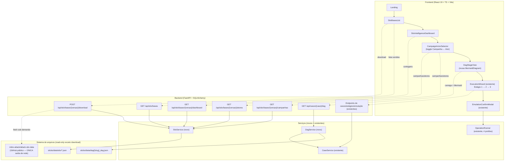
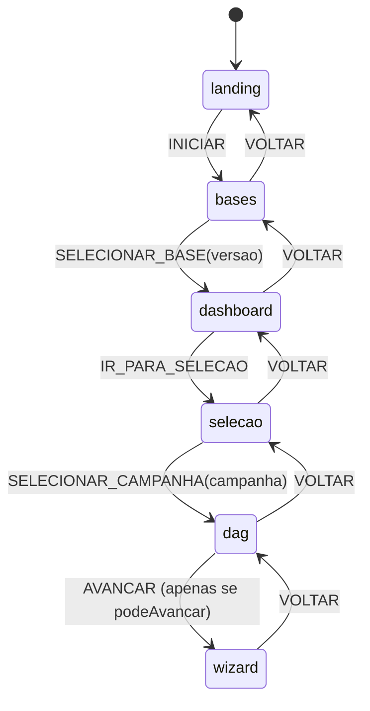
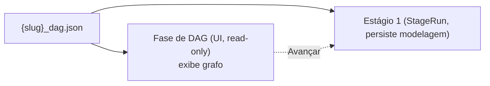

# Documento de Design — Fluxo STIX + Dashboard

## Overview

Esta feature reorganiza a experiência do STICKS para que a jornada do Pesquisador comece pela inteligência bruta (os pacotes STIX do MITRE ATT&CK) e avance, passo a passo, até a emulação contida de uma campanha de adversário no laboratório Docker local. A sequência completa é:

**Landing → Listagem de Bases STIX → Dashboard de Inteligência → Seleção de Campanha/Ator → Geração/Visualização do DAG → Tradução Curada → Emulação Contida.**

O princípio arquitetural desta iteração é **estender, não reescrever**. A aplicação atual (`ui/`) já entrega um wizard de 3 estágios maduro — Estágio 1 (modelagem estrutural), Estágio 2 (tradução curada) e Estágio 3 (emulação contida) — com garantias de contenção já implementadas (redes `internal: true`, pré-voo de 4 portões, modal de confirmação explícita). O design abaixo **envolve** esse wizard com uma nova sequência de telas que o antecede, reaproveitando componentes e padrões já existentes:

- O `MermaidDiagram` existente (`securityLevel: "strict"`, lazy-load, theme-aware) é reutilizado para visualizar o DAG (Req. 6).
- O padrão de `app/api/topologia.py` (endpoint read-only que constrói um `flowchart` Mermaid a partir de dados estáticos) é replicado para construir o Mermaid do DAG no backend.
- O `ExecutionWizard`, `Stage2View`, `Stage3View` e `EmulationConfirmModal` são reaproveitados sem reescrita (Req. 7.1, 9.3).
- A estratégia de resolução de caminhos de `CaseService` / `sticks_config._repo_root()` e o padrão de serviços finos chamados por handlers finos permanecem.

Três decisões de design centrais, detalhadas adiante:

1. **A Geração do DAG vira uma fase explícita de fluxo** (Req. 5), posicionada **antes** do Estágio 1 do wizard. Ela **não renumera** os estágios do `StageRun` (estágios 1/2/3 persistidos permanecem idênticos). É uma camada de UI/fluxo que lê o mesmo `{slug}_dag.json` que o Estágio 1 já consome.
2. **Nenhuma tabela nova é introduzida.** Bases são derivadas do sistema de arquivos; o dashboard é computado sob demanda; a fase de DAG é read-only. Todo estado de seleção/navegação do novo fluxo vive no cliente.
3. **Todos os novos endpoints de inspeção são GET side-effect-free.** A única ação de saída de rede é o download de uma base STIX, disparado apenas por ação explícita do Pesquisador, escrevendo somente em `sticks/data/stix`.

### Diagrama de arquitetura do fluxo ponta a ponta



## Architecture

### Camadas e responsabilidades

| Camada | Novo nesta feature | Reaproveitado |
| --- | --- | --- |
| Telas (React) | `Landing`, `StixBasesList`, `StixIntelligenceDashboard`, `CampaignActorSelector`, `DagStageView` | `AppLayout`, `NavBar`, `ExecutionWizard`, `Stage2View`, `Stage3View`, `EmulationConfirmModal`, `MermaidDiagram`, `ThemeProvider` |
| Orquestração (React) | máquina de estados de view (`useAppFlow`) | `App.tsx` (estendido, não reescrito) |
| Cliente HTTP (TS) | `lib/stix.ts`, `lib/dag.ts` | `lib/api.ts`, `lib/casos.ts`, `lib/wizard.ts` |
| API (FastAPI) | `app/api/stix.py`, rota `GET /api/casos/{caso}/dag` | `app/api/casos.py`, `app/api/topologia.py`, `app/api/emulacao.py`, `router.py` |
| Serviços (Python) | `StixService`, `DagService` | `CaseService`, `StageService`, `OperationRunner`, `sticks_config` |
| Dados | — (sem tabelas novas) | `sticks/data/stix`, `sticks/data/dag`, `sticks/config/config.py` |

### Decisão: roteamento no frontend

Hoje `App.tsx` é uma página única sem roteador. O novo fluxo tem seis telas lineares com um estado de seleção compartilhado (versão STIX escolhida, campanha escolhida, slug curado resolvido). 

**Decisão:** usar uma **máquina de estados de view em memória** (um `useReducer` encapsulado em um hook `useAppFlow`), **sem** introduzir `react-router`. Justificativa:

- O fluxo é estritamente linear com Avançar/Voltar; não há URLs profundas, deep-linking nem necessidade de histórico do navegador nesta iteração.
- Preserva o setup de bundle único atual (um único entrypoint, nenhuma dependência pesada nova — alinhado à diretriz de não introduzir deps desnecessárias).
- Um reducer puro é trivialmente testável por propriedade (transições determinísticas — Req. 1.3, 7.4) sem montar o DOM.

Se, em iterações futuras, deep-linking para uma campanha específica for necessário, a troca para `react-router` é localizada ao `useAppFlow` sem tocar nas telas.



O evento `AVANCAR` a partir de `dag` só é aceito quando a fase de DAG reportou `podeAvancar: true` (ou seja, caso curado com DAG renderizado — Req. 6.3). Para caso não curado, `AVANCAR` é inválido e ignorado (Req. 5.5, 9.1).

### Decisão: Mermaid do DAG construído no backend

Há duas opções para transformar `{slug}_dag.json` em um `flowchart` Mermaid: (a) construir no backend (como `topologia.py` já faz para a topologia) ou (b) construir no cliente.

**Decisão:** construir no **backend**, dentro do `DagService`, e devolver a string Mermaid pronta no payload de `GET /api/casos/{caso}/dag`. Justificativa:

- Segue o precedente já estabelecido por `app/api/topologia.py` (uma única fonte de verdade para a montagem do diagrama, com testes de backend diretos sobre a string gerada).
- Mantém o frontend fino: `DagStageView` apenas entrega a `definition` ao `MermaidDiagram` existente, que já renderiza com `securityLevel: "strict"` (Req. 6.2) — zero lógica de grafo no cliente.
- Permite marcar `curado` vs `stub` e detectar DAG ilegível/malformado no servidor (Req. 5.3, 5.4), com erro tipado em pt-BR, antes de qualquer renderização.

A detecção de aciclicidade e a montagem do Mermaid tornam-se funções puras do `DagService`, ideais para teste por propriedade (Req. 6.1).

## Components and Interfaces

### Frontend

#### `useAppFlow` (hook / reducer da máquina de estados)

Responsabilidade: deter o estado de navegação linear e o estado de seleção compartilhado. Reducer puro e exportado para teste.

```ts
// lib/flow.ts
export type View = "landing" | "bases" | "dashboard" | "selecao" | "dag" | "wizard"

export interface FlowState {
  view: View
  versaoSelecionada?: string      // ex.: "19.1"
  campanhaSelecionada?: {
    stix_id: string               // ex.: "campaign--..."
    nome: string
    slug_curado?: string | null   // preenchido quando a campanha é um Caso_Curado (Req. 4.5)
  }
  dagPodeAvancar: boolean         // reflete Req. 6.3 / 5.5
}

export type FlowEvent =
  | { tipo: "INICIAR" }
  | { tipo: "SELECIONAR_BASE"; versao: string }
  | { tipo: "IR_PARA_SELECAO" }
  | { tipo: "SELECIONAR_CAMPANHA"; campanha: FlowState["campanhaSelecionada"] }
  | { tipo: "DAG_PRONTO"; podeAvancar: boolean }   // DagStageView reporta Req. 6.3/6.4/5.5
  | { tipo: "AVANCAR" }
  | { tipo: "VOLTAR" }

export function flowReducer(estado: FlowState, evento: FlowEvent): FlowState
```

Invariantes do reducer:

- `INICIAR` só transiciona `landing → bases` (Req. 1.3).
- `AVANCAR` a partir de `dag` só transiciona para `wizard` se `estado.dagPodeAvancar === true` (Req. 5.5, 6.3). Caso contrário, no-op.
- `VOLTAR` a partir de `wizard` sempre volta para `dag` com a **mesma** campanha selecionada (Req. 7.4) — propriedade de ida e volta.

#### `Landing`

Responsabilidade: ponto de entrada com a marca STICKS e CTA (Req. 1.1, 1.2). Reaproveita a wordmark/logo já existentes (`public/sticks-logomarca-*.png`, `public/sticks-logo-mais-fina.png`) e o padrão de logo adaptável ao tema do `NavBar`. O botão de início dispara `INICIAR`.

Animações (Req. 1.4, 1.5):

- Transições de entrada com `duration <= 600ms` definidas por uma constante única `LANDING_TRANSITION_MS = 600` e classes utilitárias Tailwind limitadas por ela.
- Respeito a `prefers-reduced-motion`: um hook `usePrefersReducedMotion()` (via `window.matchMedia("(prefers-reduced-motion: reduce)")`) desliga as classes de animação quando o usuário prefere movimento reduzido. Padrão de tema é claro (`resolveInitialTheme()` → `"claro"`), já respeitado pelo `ThemeProvider`.

#### `StixBasesList`

Responsabilidade: listar as versões do MITRE ATT&CK da mais nova para a mais antiga, marcar as já baixadas, habilitar seleção apenas das baixadas e oferecer download das não baixadas (Req. 2). Consome `GET /api/stix/bases`; dispara `POST /api/stix/bases/{versao}/download`; ao selecionar uma base baixada, dispara `SELECIONAR_BASE`.

- Base baixada: badge "já baixada" e card selecionável (Req. 2.2, 2.3, 2.8).
- Base não baixada: botão "Baixar" (Req. 2.4). Enquanto baixa, estado de carregamento; ao concluir, relê a lista para refletir `baixada: true` (Req. 2.6). Em falha, exibe a mensagem de erro descritiva e mantém a base não baixada (Req. 2.7).

#### `StixIntelligenceDashboard`

Responsabilidade: dashboard analítico da base selecionada (Req. 3). Consome `GET /api/stix/bases/{versao}/dashboard`. Mostra a identificação da base com a versão (Req. 3.1), os cards de contagem por tipo de objeto (campanhas, técnicas, táticas, intrusion sets, malware, relacionamentos — Req. 3.2) e, em cada card, a descrição do significado daquele tipo (Req. 3.3). Botão "Selecionar campanha/ator" dispara `IR_PARA_SELECAO` (Req. 3.6). Em bundle ilegível/malformado, exibe erro descritivo e **não** mostra contagens parciais (Req. 3.5).

#### `CampaignActorSelector`

Responsabilidade: alternar entre a visão por Campanha e a visão por Ator de Ameaça (Req. 4.1). Consome `GET /api/stix/bases/{versao}/campanhas` e `GET /api/stix/bases/{versao}/atores`.

- Visão Campanha: lista as campanhas da base (Req. 4.2). Campanhas que são Caso_Curado recebem distinção visual "já curada" (badge), com base no `slug_curado` vindo do backend (Req. 4.5).
- Visão Ator: lista os intrusion-sets e, aninhadas, as campanhas associadas a cada ator (Req. 4.3).
- Selecionar uma campanha dispara `SELECIONAR_CAMPANHA` (carregando `stix_id`, `nome`, `slug_curado`) e transiciona para `dag` (Req. 4.4).

#### `DagStageView`

Responsabilidade: a fase explícita de Geração/Visualização do DAG (Req. 5, 6). Consome `GET /api/casos/{caso}/dag` quando a campanha é curada (`slug_curado` presente). Reaproveita o `MermaidDiagram` existente para desenhar o grafo (Req. 6.1, 6.2).

- Caso curado com DAG válido: renderiza o Mermaid; ao renderizar com sucesso, dispara `DAG_PRONTO({ podeAvancar: true })` e habilita o botão "Avançar" para a tradução curada (Req. 6.3).
- DAG ilegível/malformado (erro tipado do backend) ou falha de renderização: exibe mensagem de erro descritiva e dispara `DAG_PRONTO({ podeAvancar: false })`, mantendo "Avançar" desabilitado (Req. 5.3, 6.4).
- Campanha não curada (`slug_curado` ausente): exibe o estado de "passa-direto" indicando indisponibilidade da geração automática, **sem** chamar o backend de DAG nem qualquer serviço de IA, e dispara `DAG_PRONTO({ podeAvancar: false })` (Req. 5.4, 5.5, 9.1, 9.2).

#### Integração com `App.tsx` (sem reescrita das telas de tradução/emulação)

`App.tsx` passa a renderizar o `AppLayout` com o conteúdo determinado pelo `view` do `useAppFlow`. Quando `view === "wizard"`, renderiza o `ExecutionWizard` **existente** para a campanha curada (via `casoId = slug_curado`), mantendo intactos `Stage2View`, `Stage3View` e o `EmulationConfirmModal` (Req. 7.1, 9.3). O estado de tema e preferências permanece como está. O botão "Voltar" do Estágio 1 do wizard, quando no primeiro estágio, dispara `VOLTAR` do fluxo para retornar à `DagStageView` (Req. 7.4) — um pequeno seam de callback opcional (`onVoltarAntesDoEstagio1`) adicionado ao `ExecutionWizard` sem alterar seu comportamento interno de navegação entre estágios.

### Backend

Todos os endpoints novos de inspeção são GET e **side-effect-free**, preservando o invariante já estabelecido (ex.: `StageService.read_stage1` é read-only; só `POST .../estagio/1/executar` persiste). O único endpoint com efeito é o `POST` de download.

Novo módulo `app/api/stix.py` (incluído em `router.py` como os demais), e uma nova rota `GET /api/casos/{caso}/dag` (em `app/api/casos.py` ou em um `app/api/dag.py` dedicado — preferir `casos.py` pela coesão com o slug). Handlers finos delegando a `StixService` / `DagService`, retornando modelos Pydantic tipados, com nomes de campo em pt-BR consistentes com a API existente.

#### `StixService`

Responsabilidade: localizar, listar, baixar e analisar bundles STIX 2.x.

Resolução de caminho: `<repo>/sticks/data/stix`, via `sticks_config._repo_root()` (mesma estratégia do `CaseService`). A URL base e o diretório vêm de `sticks/config/config.py` (`STIX_URL`, `STIX_DIR`), carregado via `load_sticks_config()`.

```python
class StixService:
    def __init__(self, data_dir: Path | None = None, http_client=None) -> None: ...

    def listar_bases(self) -> list[BaseStixInfo]:
        """Versões disponíveis (do index do attack-stix-data) ordenadas
        da mais nova para a mais antiga, cada uma marcada baixada=True
        quando o arquivo existe em disco (Req. 2.1, 2.2, 2.3)."""

    def baixar_base(self, versao: str) -> BaseStixInfo:
        """Obtém enterprise-attack-{versao}.json do repositório
        mitre-attack/attack-stix-data e persiste em sticks/data/stix.
        ÚNICA ação de saída de rede, só por pedido explícito (Req. 2.5,
        2.6, 2.7). Em falha, não deixa arquivo parcial e sinaliza erro."""

    def ler_bundle(self, versao: str) -> dict:
        """Lê e faz parse do bundle da base baixada; erro tipado se
        ausente/malformado (Req. 3.5)."""

    def dashboard(self, versao: str) -> DashboardStix:
        """Contagens por tipo (campaign, attack-pattern, x-mitre-tactic,
        intrusion-set, malware, relationship, …) + descrições (Req. 3)."""

    def listar_campanhas(self, versao: str) -> list[CampanhaStix]:
        """Objetos type==campaign + flag curada via mapeamento (Req. 4.2, 4.5)."""

    def listar_atores(self, versao: str) -> list[AtorStix]:
        """Objetos type==intrusion-set, cada um com as campanhas
        associadas resolvidas por relationships (Req. 4.3)."""
```

Parse do bundle STIX 2.x: iterar `bundle["objects"]`, agrupar por `type`. As contagens cobrem ao menos: `campaign` → campanhas, `attack-pattern` → técnicas, `x-mitre-tactic` → táticas, `intrusion-set` → intrusion sets, `malware` → malware, `relationship` → relacionamentos (Req. 3.2). O mapa de descrições por tipo é um dicionário estático em pt-BR (Req. 3.3).

Resolução Campanha ↔ Ator (Req. 4.3): o ATT&CK modela a atribuição por objetos `relationship` com `relationship_type == "attributed-to"` ligando um `campaign` (`source_ref`) a um `intrusion-set` (`target_ref`). O `StixService` indexa os relationships e, para cada intrusion-set, agrega as campanhas cujo `attributed-to` aponta para ele. Campanhas sem atribuição ficam sob um grupo "sem ator associado".

**Versões (fonte da listagem).** O repositório `mitre-attack/attack-stix-data` publica arquivos versionados `enterprise-attack/enterprise-attack-{versao}.json` e um `index.json` que enumera as coleções/versões (ver [mitre-attack/attack-stix-data](https://github.com/mitre-attack/attack-stix-data)). A listagem usa esse índice para enumerar versões conhecidas (ordenação semântica decrescente — Req. 2.1) e marca `baixada` conforme a presença do arquivo em `sticks/data/stix`. _Conteúdo rephrasado para conformidade de licenciamento._ Para evitar acoplar a listagem a uma chamada de rede em um GET (que deve ser read-only e barato), o índice de versões conhecidas é mantido como uma lista versionada no backend (constante `VERSOES_CONHECIDAS`), atualizável; a presença em disco é sempre verificada ao vivo. Assim, `GET /api/stix/bases` nunca faz saída de rede — apenas o `POST .../download` faz.

**Mapeamento Caso_Curado ↔ campanha STIX (Req. 4.5).** Existem exatamente 8 slugs curados (`CaseService.CURATED_CASES`). Nem toda versão STIX conterá um objeto `campaign` correspondente a cada slug (campanhas foram adicionadas ao ATT&CK em versões diferentes; alguns slugs — ex. `shadowray` — podem não existir como `campaign` em uma dada versão). O design define um mapa explícito `SLUG_PARA_STIX` em `StixService` com, por slug, o(s) identificador(es) de campanha STIX conhecidos (ex. `c0010`, `c0026`) e/ou um nome canônico. A resolução é tolerante:

1. Casa por `external_references` do objeto campaign (ex. `C0010`) quando presente;
2. Senão, casa por nome canônico normalizado;
3. Se nenhuma campanha STIX da versão casa com um slug, aquele caso simplesmente não aparece marcado como curado naquela base (fallback silencioso — nenhuma campanha é inventada). A `DagStageView` ainda consegue carregar o DAG curado via `slug_curado` quando a campanha foi reconhecida.

#### `DagService`

Responsabilidade: carregar `{slug}_dag.json`, montar o Mermaid do grafo acíclico e distinguir curado vs stub. Reaproveita `CaseService` para resolução de caminho e parsing tipado (`DagData`, `DagNode`), e segue o padrão de montagem de `topologia.py`.

```python
class DagService:
    def __init__(self, case_service: CaseService | None = None) -> None: ...

    def obter_dag(self, caso: str) -> DagView:
        """Para um slug curado: carrega structural_nodes + edges do
        {slug}_dag.json e monta um flowchart Mermaid acíclico
        (curado=True, pode_avancar=True). Para slug não curado:
        retorna estado 'passa-direto' (curado=False, pode_avancar=False)
        SEM invocar IA. DAG ausente/malformado -> erro tipado
        (curado=True, pode_avancar=False) (Req. 5, 6, 9)."""

    @staticmethod
    def montar_mermaid(dag: DagData) -> str:
        """flowchart TD puro: um nó por structural_node (rotulado com
        technique_id/technique_name/tactic) e uma aresta por edge
        {from,to} (node_id). Função pura, acíclica por construção."""
```

Montagem do Mermaid (função pura, análoga a `topologia._mermaid`): cada `structural_node` vira um nó `n_{node_id}["{technique_id}<br/>{technique_name}<br/>{tactic}"]`; cada entrada de `edges` (`{from, to}` por `node_id`) vira `n_{from} --> n_{to}`. O grafo é um DAG por construção (os arquivos já carregam `metadata.validation.is_dag == true`), e a montagem não cria arestas adicionais, preservando a aciclicidade (Req. 6.1). Nenhum script é embutido; a renderização usa `securityLevel: "strict"` no cliente (Req. 6.2).

#### Endpoints REST (contratos em pt-BR)

```
GET /api/stix/bases
```
```jsonc
{
  "bases": [
    { "versao": "19.1", "nome": "Enterprise ATT&CK v19.1", "baixada": true,  "selecionavel": true,  "arquivo": "sticks/data/stix/enterprise-attack-19.1.json" },
    { "versao": "18.0", "nome": "Enterprise ATT&CK v18.0", "baixada": false, "selecionavel": false, "arquivo": null }
  ]
}
```
Ordenação sempre da mais nova para a mais antiga (Req. 2.1). `selecionavel == baixada` (Req. 2.3). Read-only.

```
POST /api/stix/bases/{versao}/download
```
Sucesso `200`:
```jsonc
{ "versao": "18.0", "baixada": true, "arquivo": "sticks/data/stix/enterprise-attack-18.0.json" }
```
Falha `502`/`422` (erro descritivo, base permanece não baixada — Req. 2.7):
```jsonc
{ "detail": { "motivo": "falha_download", "mensagem": "Não foi possível obter a base v18.0 do repositório MITRE ATT&CK: <causa>." } }
```

```
GET /api/stix/bases/{versao}/dashboard
```
```jsonc
{
  "versao": "19.1",
  "nome": "Enterprise ATT&CK v19.1",
  "contagens": [
    { "tipo": "campanhas",       "stix_type": "campaign",       "quantidade": 32, "descricao": "Campanhas de adversário observadas no mundo real." },
    { "tipo": "tecnicas",        "stix_type": "attack-pattern", "quantidade": 652, "descricao": "Técnicas e subtécnicas de ataque do ATT&CK." },
    { "tipo": "taticas",         "stix_type": "x-mitre-tactic", "quantidade": 14, "descricao": "Objetivos táticos do adversário (fases)." },
    { "tipo": "intrusion_sets",  "stix_type": "intrusion-set",  "quantidade": 160, "descricao": "Grupos/atores de ameaça associados a campanhas." },
    { "tipo": "malware",         "stix_type": "malware",        "quantidade": 790, "descricao": "Software malicioso catalogado." },
    { "tipo": "relacionamentos", "stix_type": "relationship",   "quantidade": 23000, "descricao": "Ligações entre objetos (ex.: atribuição campanha→ator)." }
  ]
}
```
Erro de leitura/malformação `422` (sem contagens parciais — Req. 3.5):
```jsonc
{ "detail": { "motivo": "bundle_invalido", "mensagem": "A base v19.1 não pôde ser lida ou está malformada." } }
```

```
GET /api/stix/bases/{versao}/campanhas
```
```jsonc
{
  "versao": "19.1",
  "campanhas": [
    { "stix_id": "campaign--...", "nome": "C0010", "descricao": "…", "curada": true,  "slug_curado": "c0010" },
    { "stix_id": "campaign--...", "nome": "…",     "descricao": "…", "curada": false, "slug_curado": null }
  ]
}
```

```
GET /api/stix/bases/{versao}/atores
```
```jsonc
{
  "versao": "19.1",
  "atores": [
    {
      "stix_id": "intrusion-set--...", "nome": "APT41",
      "campanhas": [ { "stix_id": "campaign--...", "nome": "C0010", "curada": true, "slug_curado": "c0010" } ]
    }
  ]
}
```

```
GET /api/casos/{caso}/dag
```
Caso curado (Req. 5.2, 6.1, 6.3):
```jsonc
{
  "caso_id": "shadowray",
  "nome": "ShadowRay",
  "curado": true,
  "pode_avancar": true,
  "nos": [ { "node_id": "1012…", "technique_id": "T1190", "technique_name": "Exploit Public-Facing Application", "tactic": "initial-access" } ],
  "arestas": [ { "de": "1012…", "para": "43aa…" } ],
  "mermaid": "flowchart TD\n  n_1012[\"T1190<br/>Exploit Public-Facing Application<br/>initial-access\"]\n  n_1012 --> n_43aa\n …"
}
```
Caso não curado — "passa-direto" (Req. 5.4, 5.5, 9.1, 9.2):
```jsonc
{ "caso_id": "<id>", "nome": "<nome>", "curado": false, "pode_avancar": false, "indisponivel": true,
  "mensagem": "A geração automática do DAG ainda não está disponível para esta campanha." }
```
DAG ausente/malformado de um caso curado (Req. 5.3, 6.4):
```jsonc
{ "detail": { "motivo": "dag_invalido", "mensagem": "O DAG de 'shadowray' não pôde ser lido ou está malformado." } }
```
_(ou payload com `curado:true, pode_avancar:false, erro:"…"` — a UI mantém "Avançar" desabilitado em ambos os casos.)_

#### Cliente HTTP (frontend)

`lib/stix.ts` e `lib/dag.ts` espelham estes contratos com tipos TS (nomes de campo idênticos aos JSON em pt-BR), reutilizando o `api` de `lib/api.ts` (tratamento de `ApiError`, parsing seguro), no mesmo estilo de `lib/casos.ts`.

## Data Models

**Nenhuma tabela nova é introduzida nesta iteração.** Justificativa por requisito:

- **Bases STIX** (Req. 2): derivadas do sistema de arquivos. A existência de `sticks/data/stix/enterprise-attack-{versao}.json` é a única fonte de verdade de "baixada"; a listagem de versões conhecidas é uma constante versionada do backend. Persistir isso em banco só duplicaria estado e arriscaria divergência com o disco.
- **Dashboard** (Req. 3): computado sob demanda a partir do bundle. É uma projeção pura; cache opcional pode ser adicionado depois sem schema.
- **Fase de DAG** (Req. 5, 6): read-only sobre `{slug}_dag.json`. Não há estado a persistir — a visualização não altera nada.
- **Estado de fluxo/seleção** (view atual, versão escolhida, campanha escolhida): efêmero de UI, vive no `useAppFlow` do cliente. Não requer persistência cross-reload nesta iteração; recomeçar pela Landing é aceitável e barato.

**Relação da fase de DAG com o `StageRun` existente (Req. 5.1).** A geração do DAG é um conceito de **fluxo/UI** sobreposto **antes** do Estágio 1 do wizard. Ela **não** cria nem renumera `StageRun` (tabela `execucoes_estagio`, estágios 1/2/3 permanecem com a mesma semântica). O Estágio 1 já deriva os elementos estruturais do mesmo `{slug}_dag.json`; a nova fase apenas **exibe** o grafo desse arquivo antes de o Pesquisador entrar no Estágio 1. Em termos de dados: a fase de DAG e o Estágio 1 leem a mesma fonte (`DagData`), mas a fase de DAG é puramente visual e o Estágio 1 continua sendo o passo que persiste a modelagem via `POST .../estagio/1/executar`.



## Correctness Properties

*Uma propriedade é uma característica ou comportamento que deve valer para todas as execuções válidas de um sistema — essencialmente uma afirmação formal sobre o que o sistema deve fazer. Propriedades servem de ponte entre especificações legíveis por humanos e garantias de correção verificáveis por máquina.*

As propriedades abaixo resultam da análise de prework e da reflexão de consolidação (contagem derivada do bundle 3.4 foi subsumida por 3.2; marcação baixada/selecionável 2.2/2.3 foi unificada; invariantes de caso não curado 5.4/5.5/9.1/9.2 foram consolidadas; invariantes de caso curado 5.2/6.1/6.3 foram consolidadas).

### Property 1: Bases sempre ordenadas da mais nova para a mais antiga

*Para qualquer* conjunto de versões STIX conhecidas, a lista produzida por `listar_bases` está ordenada de forma monotonicamente decrescente por versão semântica (a mais nova primeiro).

**Validates: Requirements 2.1**

### Property 2: "Baixada" e "selecionável" refletem exatamente a presença em disco

*Para qualquer* conjunto de versões e qualquer subconjunto de arquivos presentes em `sticks/data/stix`, cada base tem `baixada == (arquivo presente em disco)` e `selecionavel == baixada`.

**Validates: Requirements 2.2, 2.3**

### Property 3: Contagem por tipo igual ao número de objetos daquele tipo no bundle

*Para qualquer* bundle STIX 2.x válido, para cada tipo contabilizado a quantidade reportada no dashboard é igual ao número de objetos em `bundle.objects` cujo `type` corresponde àquele tipo.

**Validates: Requirements 3.2, 3.4**

### Property 4: Todo tipo contabilizado tem descrição não vazia

*Para qualquer* dashboard produzido, todo item de contagem possui uma `descricao` não vazia associada ao seu tipo.

**Validates: Requirements 3.3**

### Property 5: Lista de campanhas igual aos objetos campaign do bundle

*Para qualquer* bundle STIX, a lista de campanhas retornada corresponde exatamente ao conjunto de objetos com `type == "campaign"` do bundle (sem perder nem duplicar).

**Validates: Requirements 4.2**

### Property 6: Agrupamento Ator → Campanhas reflete os relationships

*Para qualquer* bundle com intrusion-sets, campanhas e relationships `attributed-to`, cada campanha aparece sob o ator para o qual existe um relacionamento de atribuição, e apenas sob esse ator; nenhuma campanha atribuída é perdida nem duplicada.

**Validates: Requirements 4.3**

### Property 7: Flag "curada" corresponde exatamente ao mapeamento de casos curados

*Para qualquer* lista de campanhas de uma base, uma campanha tem `curada == true` (com `slug_curado` preenchido) se e somente se ela casa com o mapeamento dos 8 casos curados; caso contrário `curada == false` e `slug_curado == null`.

**Validates: Requirements 4.5**

### Property 8: Caso curado produz Mermaid acíclico não vazio e habilita avanço

*Para qualquer* caso curado com `{slug}_dag.json` válido, `obter_dag` retorna `curado == true`, `pode_avancar == true`, um Mermaid não vazio com exatamente um nó por `structural_node` e exatamente uma aresta por entrada de `edges`, preservando a aciclicidade (nenhuma aresta extra é introduzida).

**Validates: Requirements 5.2, 6.1, 6.3**

### Property 9: Caso não curado é sempre "passa-direto", sem IA e sem avanço

*Para qualquer* campanha que não é um caso curado, a fase de DAG retorna `curado == false`, `pode_avancar == false` e um estado de indisponibilidade, sem jamais invocar qualquer serviço de Inteligência Artificial.

**Validates: Requirements 5.4, 5.5, 9.1, 9.2**

### Property 10: Ida e volta de navegação DAG ↔ tradução preserva a campanha

*Para qualquer* campanha curada na view `dag` com `dagPodeAvancar == true`, aplicar `AVANCAR` seguido de `VOLTAR` retorna à view `dag` com a mesma campanha selecionada (round trip).

**Validates: Requirements 7.4**

### Property 11: Transição inicial da Landing

*Para qualquer* estado de fluxo na view `landing`, aplicar o evento `INICIAR` resulta na view `bases`.

**Validates: Requirements 1.3**

## Error Handling

| Situação | Requisito | Comportamento |
| --- | --- | --- |
| Bundle STIX ausente/malformado ao abrir o dashboard | 3.5 | `StixService.ler_bundle` levanta erro tipado; endpoint retorna `422` com `motivo: "bundle_invalido"` e mensagem descritiva; a UI mostra o erro e **não** renderiza contagens parciais como completas. |
| Falha no download de uma base | 2.5, 2.7 | `StixService.baixar_base` captura erro de rede/escrita, **não** deixa arquivo parcial (escreve em arquivo temporário e só move/renomeia em sucesso), retorna `502`/`422` com `motivo: "falha_download"`; a base permanece `baixada == false`. |
| `{slug}_dag.json` ausente/malformado de um caso curado | 5.3, 6.4 | `DagService.obter_dag` reaproveita o parsing tipado de `CaseService` (distingue arquivo ausente de JSON malformado); retorna erro tipado (`422 dag_invalido`) ou payload `curado:true, pode_avancar:false, erro`; a UI mantém "Avançar" desabilitado. |
| Falha de renderização Mermaid no cliente | 6.4 | `MermaidDiagram` já cai para o fonte do diagrama em `<pre>`; `DagStageView` trata o estado de erro e dispara `DAG_PRONTO({ podeAvancar: false })`. |
| Campanha não curada na fase de DAG | 5.4, 5.5, 9.1, 9.2 | `DagStageView` nem chama o backend de DAG: exibe o "passa-direto" e mantém `pode_avancar: false`. Nenhum serviço de IA é tocado (não há cliente de IA no caminho). |
| Slug desconhecido em `GET /api/casos/{caso}/dag` | — | `404` (mesmo padrão de `casos.py`/`topologia.py`). |
| Base selecionada não baixada | 2.3 | Seleção desabilitada no cliente; o dashboard só é alcançável para bases baixadas. |

Todos os erros usam o padrão `{ "detail": { "motivo": "...", "mensagem": "..." } }` já praticado em `casos.py`, com mensagens em pt-BR.

## Segurança e Contenção

A contenção é restrição inegociável (Req. 8) e **não é enfraquecida** por esta feature. As novas fases (Landing, Bases, Dashboard, Seleção, DAG) são de **inspeção read-only** e não tocam o caminho de execução. Reafirmações:

- **Emulação permanece contida** (Req. 8.1, 8.2, 8.5): toda emulação continua passando exclusivamente pelo `OperationRunner` existente, com o pré-voo de 4 portões e redes de ataque `internal: true` (sem rota ao host ou à internet). As rotas novas não criam, iniciam nem reconfiguram nada no Docker.
- **Confirmação explícita preservada** (Req. 8.3, 9.3): a emulação só executa após o `EmulationConfirmModal` existente — reaproveitado sem reescrita.
- **Recusa por contenção não confirmada preservada** (Req. 8.4): o pré-voo existente continua recusando e exibindo o motivo quando o isolamento não é confirmado.
- **GETs side-effect-free**: `GET /api/stix/bases`, `/dashboard`, `/campanhas`, `/atores` e `GET /api/casos/{caso}/dag` não fazem saída de rede nem escrita, preservando o invariante já aplicado a `read_stage1` e `topologia.py`.

**Única ação de saída de rede.** `POST /api/stix/bases/{versao}/download` é a **única** operação que faz uma requisição externa — um `GET` ao GitHub público do `mitre-attack/attack-stix-data` para obter `enterprise-attack-{versao}.json`. Ela é disparada **somente** por pedido explícito do Pesquisador (clique em "Baixar"), **escreve somente** em `sticks/data/stix` (via arquivo temporário + rename atômico, sem deixar parcial em falha) e **não envia** nenhum código, segredo ou dado do host para fora. A validação da `versao` (lista de versões conhecidas, sem interpolação arbitrária de caminho/URL) evita path/URL injection. CORS permissivo permanece apenas em dev, como hoje.

## Testing Strategy

A feature preserva as suítes existentes (Req. 10.1, 10.2) e adiciona cobertura para os novos pontos (Req. 10.3). Abordagem dupla: testes de exemplo/edge para casos concretos e caminhos de erro; testes por propriedade para invariantes universais.

### Backend (pytest + Hypothesis para propriedades)

- **StixService — contagens (Property 3, 4):** com Hypothesis, gerar bundles STIX sintéticos com N objetos aleatórios por `type` e verificar que `dashboard` reporta `quantidade[tipo] == N` para cada tipo exigido e que toda contagem tem descrição não vazia. (Req. 3.2, 3.3)
- **StixService — campanhas/atores (Property 5, 6):** gerar campanhas, intrusion-sets e relationships `attributed-to` aleatórios; verificar que a lista de campanhas iguala os objetos `campaign` e que o agrupamento ator→campanhas reflete exatamente os relationships. (Req. 4.2, 4.3)
- **StixService — marcação curada (Property 7):** gerar listas de campanhas (curadas e não); verificar `curada`/`slug_curado` conforme o mapeamento. (Req. 4.5)
- **StixService — ordenação/baixada (Property 1, 2):** gerar conjuntos de versões e subconjuntos "em disco" (via `tmp_path`); verificar ordenação decrescente e `baixada == arquivo presente`, `selecionavel == baixada`. (Req. 2.1, 2.2, 2.3)
- **StixService — download (exemplo/edge, Req. 2.5, 2.7):** HTTP **mockado** (sem rede real). Sucesso: GET à URL versionada correta e escrita atômica em `sticks/data/stix`. Falha (timeout/404/erro de escrita): erro descritivo, nenhum arquivo parcial, base permanece não baixada.
- **StixService — bundle inválido (edge, Req. 3.5):** JSON malformado/estrutura inválida → erro tipado; garantir que nenhum objeto de contagens "completo" é retornado.
- **DagService — Mermaid/curado (Property 8):** gerar DAGs acíclicos aleatórios; verificar `|nós| == |structural_nodes|`, `|arestas| == |edges|`, aciclicidade preservada, `curado==true`, `pode_avancar==true`. Exemplo real: `shadowray_dag.json` carregado produz Mermaid não vazio. (Req. 5.2, 6.1, 6.3, 10.3)
- **DagService — não curado (Property 9):** para slug fora dos 8 curados, `obter_dag` retorna stub `curado==false, pode_avancar==false` e **nenhuma** chamada a serviço de IA (garantido por ausência de dependência; teste assegura o contrato e, se houver seam, verifica que não é chamado). (Req. 5.4, 5.5, 9.1, 9.2, 10.3)
- **DagService — DAG inválido (edge, Req. 5.3, 6.4):** arquivo ausente/malformado de caso curado → erro tipado, `pode_avancar==false`.
- **Regressão de contenção (Req. 8, 10.1):** suíte existente do `OperationRunner`/pré-voo permanece verde; as novas rotas não a tocam.

### Frontend (Vitest + Testing Library; fast-check para propriedades do reducer)

- **Reducer `flowReducer` (Property 10, 11):** com fast-check, verificar `landing --INICIAR--> bases`; e o round trip `dag --AVANCAR--> wizard --VOLTAR--> dag` preservando a campanha quando `dagPodeAvancar`. (Req. 1.3, 7.4)
- **Landing (exemplo, Req. 1.1, 1.2, 1.4, 1.5):** renderiza marca + CTA; clique transiciona; duração de transição `<= 600ms`; com `matchMedia(prefers-reduced-motion: reduce)` mockado, renderiza sem animações.
- **StixBasesList (exemplo, Req. 2):** ordenação da mais nova para a mais antiga; badge "já baixada" e card selecionável apenas em baixadas; botão "Baixar" apenas em não baixadas; pós-download relê e marca baixada; falha mostra erro e mantém não baixada.
- **StixIntelligenceDashboard (exemplo/edge, Req. 3, 10.3):** renderiza versão + cards de contagem com descrições; em erro de bundle, mostra erro e não renderiza contagens parciais.
- **CampaignActorSelector (exemplo, Req. 4):** toggle alterna visões; campanhas curadas recebem badge; ator lista campanhas associadas; selecionar campanha transiciona para `dag`.
- **DagStageView (exemplo, Req. 5, 6, 10.3):** caso curado renderiza via `MermaidDiagram` e habilita "Avançar"; caso não curado mostra "passa-direto" e mantém "Avançar" desabilitado; erro de DAG desabilita "Avançar".
- **Integração do fluxo (exemplo, Req. 7.1, 9.3):** avançar de `dag` curado monta o `ExecutionWizard` existente no Estágio 1; `Stage2View`/`Stage3View`/`EmulationConfirmModal` seguem reutilizados sem alteração de contrato.
- **Regressão (Req. 10.2):** suíte atual (wizard, tema, i18n, case selector) permanece verde.

### Configuração de testes por propriedade

- Mínimo de **100 iterações** por teste de propriedade (randomização).
- Cada teste de propriedade referencia a propriedade do design por comentário/tag no formato: **Feature: fluxo-stix-dashboard, Property {número}: {texto}**.
- Cada propriedade do design é implementada por **um único** teste de propriedade (Hypothesis no backend, fast-check no frontend).
- Oportunidades de PBT destacadas: invariantes de contagem STIX (Property 3), preservação de aciclicidade no Mermaid gerado (Property 8), agrupamento ator↔campanha por relationships (Property 6) e as transições puras do reducer (Property 10, 11).

---

_Fontes externas: estrutura e versionamento dos bundles em [mitre-attack/attack-stix-data](https://github.com/mitre-attack/attack-stix-data). Conteúdo rephrasado para conformidade de licenciamento._
