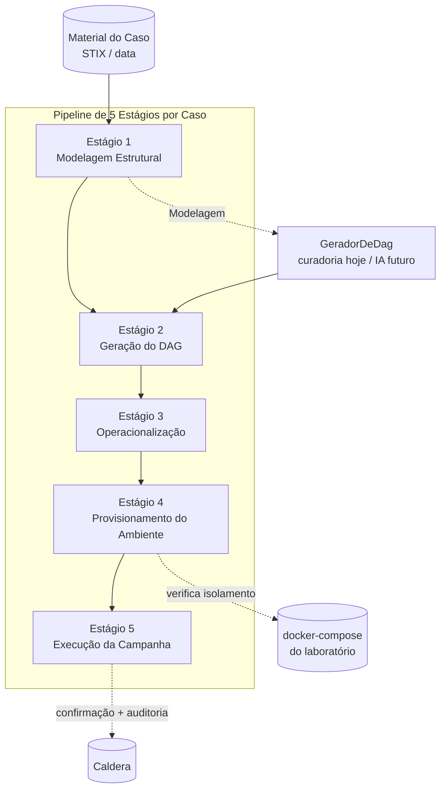

# Design Document

## Overview

Esta spec evolui o pipeline de STICKS de **quatro** para **cinco Estágios**, corrigindo a ordem dos dois primeiros e dividindo a antiga "Emulação" em dois Estágios. O pipeline final, na ordem de condução:

| Nº | Estágio | Responsabilidade | `StageRun.estagio` |
|----|---------|------------------|--------------------|
| 1 | Modelagem Estrutural | Extrai técnicas ATT&CK + correlações do STIX | 1 |
| 2 | Geração do DAG | Ordena as técnicas num grafo, a partir da Modelagem | 2 |
| 3 | Operacionalização | Técnicas abstratas → Abilities executáveis | 3 |
| 4 | Provisionamento do Ambiente | Prepara/verifica o laboratório isolado | 4 |
| 5 | Execução da Campanha | Roda a emulação real + avalia sucesso/falha | 5 |

O mapeamento a partir do esquema **anterior** (spec `dag-estagio-multi-origem`, que estava em 1..4):

| Antigo (1..4) | Papel antigo | Novo (1..5) | Papel novo |
|---------------|--------------|-------------|------------|
| 1 | Geração do DAG | **2** | Geração do DAG |
| 2 | Modelagem Estrutural | **1** | Modelagem Estrutural |
| 3 | Tradução Curada | **3** | Operacionalização (renome) |
| 4 | Emulação | **4 + 5** | dividido em Provisionamento (4) + Execução (5) |

Decisões centrais:

- **A Modelagem (1) alimenta a Geração do DAG (2).** A costura `GeradorDeDag.gerar(...)` passa a receber a Modelagem Estrutural como entrada. A implementação de curadoria **ignora** essa entrada (lê o DAG do arquivo, que o humano já produziu); a futura implementação de IA a **usa**. Isso torna a dependência de dados explícita sem quebrar a curadoria.
- **Casos curados pré-concluem Estágios 2 e 4.** Assim que o Estágio anterior conclui, o Backend carrega o DAG curado (Estágio 2) e verifica o ambiente curado (Estágio 4), marcando-os `concluido` automaticamente — respeitando o gate sequencial.
- **A antiga Emulação se divide por natureza.** A verificação de isolamento + a topologia do ambiente vão para o Estágio 4 (Provisionamento). A confirmação explícita + a execução na Caldera + a auditoria por comando vão para o Estágio 5 (Execução).
- **"Transição", não destino final.** Enquanto não há agente de IA, o sistema roda sobre curadoria. As costuras (DAG, Operacionalização, Provisionamento) são desenhadas para a IA encaixar depois, mas a IA é **não-objetivo** desta iteração.

Esta spec **supersede** as partes de ordenação e de "Emulação" de `dag-estagio-multi-origem`; a spec anterior permanece como histórico.

## Steering compliance

- **Backend:** FastAPI + SQLAlchemy + Alembic, **PostgreSQL exclusivamente**. Timestamps naive-UTC, serviços recebem `Session` injetada (mesmo padrão de `StageService`/`SessionStateService`/`DagService`). Sem acesso à rede nos caminhos de leitura/curadoria; sem invocação de IA.
- **Frontend:** React 19 + TS + Vite + i18next pt-BR; contratos pt-BR como fonte da verdade; componentes finos consumindo wrappers tipados em `src/lib`.
- **Convenções existentes preservadas:** enum portável (`native_enum=False` → VARCHAR + CHECK), isolamento por Caso em erros de carga, costuras `@runtime_checkable Protocol`.

## Architecture



Cada Estágio é uma linha `StageRun(caso_id, estagio ∈ 1..5, estado, progresso, ...)`. O bloqueio sequencial, o progresso agregado e a derivação de estado são **puros sobre as linhas `StageRun`**, parametrizados por `VALID_STAGES`.

## Components and Interfaces

### Backend — constantes de Estágio (`stage_service.py`)

Generalizar o intervalo para 1..5 e nomear os papéis, eliminando literais:

```python
FIRST_STAGE: int = 1
LAST_STAGE: int = 5
VALID_STAGES: tuple[int, ...] = (1, 2, 3, 4, 5)

ESTAGIO_MODELAGEM: int = 1
ESTAGIO_GERACAO_DAG: int = 2
ESTAGIO_OPERACIONALIZACAO: int = 3
ESTAGIO_PROVISIONAMENTO: int = 4
ESTAGIO_EXECUCAO: int = 5
```

O bloqueio sequencial (`is_stage_startable`/`get_stage_states`), o progresso agregado (`aggregate_progress`) e a derivação por `StageRun` já são range-agnósticos (derivam de `VALID_STAGES`); passam a cobrir 1..5 automaticamente. O `_validate_stage` passa a aceitar 1..5.

### Backend — Modelagem Estrutural (Estágio 1)

A lógica atual de modelagem (`run_stage1`/`read_stage1`/`_persist`/`_fail`) é **mantida** mas passa a operar em `estagio = ESTAGIO_MODELAGEM` (=1). Hoje ela já lê `data/dag/{slug}_dag.json` e extrai técnicas + relações; isso não muda, só o número do Estágio.

### Backend — costura `GeradorDeDag` recebe a Modelagem (Estágio 2)

A assinatura passa a receber a Modelagem Estrutural como entrada:

```python
@runtime_checkable
class GeradorDeDag(Protocol):
    def origem(self) -> OrigemDag: ...
    def gerar(self, caso: str, modelagem: ModelagemEstrutural) -> list[DagProduzido]: ...
```

Onde `ModelagemEstrutural` é um DTO tipado com as técnicas + relações produzidas pelo Estágio 1 (reaproveitando os elementos de `Stage1Output`). A implementação de curadoria:

```python
class CuradoriaGeradorDeDag:
    def origem(self) -> OrigemDag: return OrigemDag.CURADORIA_HUMANA
    def gerar(self, caso: str, modelagem: ModelagemEstrutural) -> list[DagProduzido]:
        # Ignora `modelagem`: o grafo curado já existe em disco. Lê o DAG curado
        # via CaseService (sem rede, sem IA) e devolve exatamente um DagProduzido
        # com origem=curadoria_humana. A entrada `modelagem` existe para a futura
        # implementação de IA (AiGeradorDeDag) que a usará para gerar o grafo.
        ...
```

**Compatibilidade:** a entidade `Dag` persistida (multi-origem, `origem` ∈ {curadoria_humana, gerado_ia}) é mantida como está. Só a *entrada* do gerador muda.

### Backend — conclusão automática do Estágio 2 (DAG curado)

Quando o Estágio 1 de um Caso curado está `concluido`, o Backend:
1. Executa `GeradorDeDag.gerar(caso, modelagem)` (curadoria), persistindo o DAG curado (backfill idempotente por `(caso_id, origem, identificador)`, como já existe).
2. Marca o `StageRun` de `estagio=2` como `concluido`.

Para um Caso **sem** DAG derivável, o Estágio 2 permanece não concluído; a UI mostra o botão "Gerar DAG" desabilitado e o avanço fica bloqueado.

### Backend — Operacionalização (Estágio 3)

A lógica atual de "Tradução Curada" (`assemble_stage2`) é **mantida** mas renomeada no vocabulário para "Operacionalização" e passa a operar em `estagio = ESTAGIO_OPERACIONALIZACAO` (=3). A conclusão (análoga ao `concluir` atual) persiste o `StageRun` de `estagio=3`. O atributo `origem_traducao`/`TranslationSource` é preservado (é o precedente de extensibilidade).

### Backend — Provisionamento do Ambiente (Estágio 4)

Novo Estágio, montado reaproveitando o que já existe:
- A **topologia** do ambiente contido já é exposta por `app/api/topologia.py` (`TopologyResponse`: hosts, redes internas, Mermaid).
- A **verificação de isolamento** já existe em `app/services/containment` (`inspect_isolation`/`IsolationVerifier`), hoje acoplada ao runner da emulação.

Design: o Estágio 4 **move a verificação de isolamento para a conclusão do ambiente**. Para um Caso curado com arquivo de ambiente disponível e Estágio 3 `concluido`, o Backend verifica o isolamento e marca o `StageRun` de `estagio=4` como `concluido` automaticamente. A tela do Estágio 4 exibe a topologia. Se o ambiente não puder ser verificado como isolado, o Estágio 4 não conclui e o Estágio 5 fica bloqueado.

Costura de provisionamento (para a IA futura): uma interface `ProvisionadorDeAmbiente` (Protocol) com uma implementação de curadoria agora (verifica o docker-compose existente) e espaço para uma implementação de IA depois (cria contêineres/VMs/redes). Esta iteração implementa só a de curadoria.

### Backend — Execução da Campanha (Estágio 5)

A execução real (antiga `run_stage3`/`OperationRunner`) é **mantida** mas passa a operar em `estagio = ESTAGIO_EXECUCAO` (=5). As quatro verificações do pré-voo são **repartidas**:
- **Isolamento do ambiente** → já verificado no Estágio 4 (Provisionamento). O Estágio 5 assume o ambiente provisionado.
- **Confirmação explícita + destinos (contenção) + disponibilidade da Caldera + auditoria por comando** → permanecem no Estágio 5.

A conclusão com sucesso marca o `StageRun` de `estagio=5` como `concluido` (a conclusão da emulação já é persistida hoje via `persist_stage_completion`; o número passa de 3→5... ver nota de migração).

### Backend — endpoints REST renumerados (1..5)

```
GET  /api/casos/{caso}/estagio/1            // Modelagem Estrutural (read-only)
POST /api/casos/{caso}/estagio/1/executar   // dispara a modelagem
GET  /api/casos/{caso}/estagio/2            // Geração do DAG (lista + DAG escolhido)
GET  /api/casos/{caso}/dags                 // DAGs persistidos (backfill curado)
GET  /api/casos/{caso}/dags/{dag_id}        // DAG persistido (grafo + Mermaid)
GET  /api/casos/{caso}/estagio/3            // Operacionalização
POST /api/casos/{caso}/estagio/3/concluir   // conclui a operacionalização
GET  /api/casos/{caso}/estagio/4            // Provisionamento (topologia + isolamento)
GET  /api/casos/{caso}/estagio/5            // Execução (entrada + saída acumulada)
POST /api/casos/{caso}/estagio/5/emulacao/preview
POST /api/casos/{caso}/estagio/5/emulacao   // confirmação + execução
GET  /api/casos/{caso}/operacao             // resultado por Ability + agregado
POST /api/casos/{caso}/reset
```

Observação: o botão "Gerar DAG" (desabilitado hoje) não precisa de endpoint ativo; o endpoint de geração por IA é não-objetivo. O endpoint legado `GET /api/casos/{caso}/dag` (DagView read-only) é mantido.

### Backend — WebSocket de Estágios

`WS /ws/estagios/{caso}` já valida o `estagio` contra `VALID_STAGES`; passa a cobrir 1..5 automaticamente.

### Frontend — wizard de 5 Estágios

O `ExecutionWizard` passa a conduzir 5 Estágios. Mapeamento Estágio → corpo:

| Estágio | Corpo (componente) |
|---------|--------------------|
| 1 Modelagem | `Stage1View` (modelagem, com "Executar modelagem") |
| 2 Geração do DAG | `DagStageView` (DAG curado auto-concluído; ou "Gerar DAG" desabilitado) |
| 3 Operacionalização | `Stage2View` |
| 4 Provisionamento | `EnvironmentStageView` (nova: topologia + isolamento; curado auto-concluído) |
| 5 Execução | `Stage3View` + `EmulationConfirmModal` |

O indicador vira "Passo X de 5"; a trilha tem 5 badges. O bloqueio sequencial é derivado do backend. Os wrappers em `src/lib/wizard.ts`/`estagios.ts`/`dag.ts` são renumerados para apontar aos endpoints 1..5.

### Frontend — i18n

Chaves dos cinco Estágios (`stages.1..5`), em pt-BR e en, com os nomes de design:

| Nº | pt-BR | en |
|----|-------|----|
| 1 | Modelagem Estrutural | Structural Modeling |
| 2 | Geração do DAG | DAG Generation |
| 3 | Operacionalização | Operationalization |
| 4 | Provisionamento do Ambiente | Environment Provisioning |
| 5 | Execução da Campanha | Campaign Execution |

Paridade de chaves pt-BR/en mantida (o property test de i18n exige).

## Data Models

Nenhuma mudança estrutural de tabela além do intervalo de `estagio`:
- `execucoes_estagio.estagio` passa a aceitar 1..5 (ajustar o `CHECK` se existir).
- `dags` e `execucoes_estagio.dag_escolhido_id` permanecem como estão (criados na migração anterior).
- A entidade `Dag` (multi-origem, `origem` ∈ {curadoria_humana, gerado_ia}) é mantida.

### Plano de migração (Alembic)

Nova revisão encadeada em `c348c9e36422`. PostgreSQL-only, dentro da transação do Alembic.

**Guarda:** antes de qualquer alteração, abortar com `RuntimeError` se existir `estagio` fora de 1..4 (o intervalo esperado do esquema anterior).

**Upgrade — remapeamento dos `StageRun`:**
- Antigo 2 (Modelagem) → novo 1
- Antigo 1 (Geração do DAG) → novo 2
- Antigo 3 (Tradução) → novo 3 (sem mudança de número; só muda o nome no produto)
- Antigo 4 (Emulação) → novo **5** (Execução)

O novo Estágio 4 (Provisionamento) **não tem equivalente** no esquema antigo (a emulação antiga não separava ambiente de execução). Decisão de design: para cada Caso que tinha o antigo Estágio 4 (Emulação) `concluido`, a migração **cria** uma linha de Provisionamento (novo Estágio 4) já `concluido` — pois, se a emulação concluiu, o ambiente estava necessariamente provisionado/isolado. Para casos onde a emulação não estava concluída, nenhuma linha de Provisionamento é criada (ela será derivada/auto-concluída pela lógica de runtime quando o Estágio 3 concluir).

Para evitar colisão de números durante o UPDATE (a inversão 1↔2 colide), o remapeamento usa um deslocamento temporário (ex.: mover para uma faixa alta e depois para o destino) ou uma tabela de tradução — detalhe a cravar na implementação, garantindo que nenhuma linha seja perdida/duplicada.

**Downgrade — simétrico:** inverter o remapeamento (novo 1→antigo 2, novo 2→antigo 1, novo 3→antigo 3, novo 5→antigo 4) e **remover** as linhas de Provisionamento (novo Estágio 4) criadas no upgrade, restaurando o esquema de 1..4. up∘down = identidade sobre os dados remapeáveis.

**CHECK de intervalo:** se a migração anterior criou um `CHECK (estagio BETWEEN 1 AND 4)` (ou enum), ajustar para 1..5 no upgrade e reverter no downgrade.

## Error Handling

- **Modelagem falha (Estágio 1):** `StageRun` `erro` com causa/etapa; sem extração parcial; Estágio 2 bloqueado.
- **Caso sem DAG (Estágio 2):** "Gerar DAG" desabilitado; avanço bloqueado; nenhum DAG inválido persistido.
- **Ambiente não isolado (Estágio 4):** Estágio 4 não conclui; Estágio 5 bloqueado; topologia ainda é exibida com a razão.
- **Contenção/indisponibilidade/não-confirmação (Estágio 5):** execução recusada/abortada/não iniciada, com o contrato HTTP existente (409/503/200-não-iniciada); estado anterior preservado.
- **Migração:** guarda aborta sem mutar dados se houver `estagio` inesperado.

## Correctness Properties

Propriedades que a implementação deve satisfazer (verificadas por property tests).

### Property 1: Bloqueio sequencial em 1..5
Para qualquer distribuição de estados dos cinco Estágios de um Caso, o Estágio N (2..5) é iniciável se e somente se o Estágio N-1 está `concluido`; o Estágio 1 nunca é bloqueado.
**Validates: Requirements 1.4, 1.5**

### Property 2: Caso totalmente concluído sse os cinco Estágios concluido
Um Caso conta no progresso agregado se e somente se os cinco Estágios estão `concluido`.
**Validates: Requirements 1.6**

### Property 3: Derivação de estado por StageRun em 1..5
Para qualquer conjunto de linhas `StageRun` (estagio em 1..5), a derivação produz exatamente um StageStateView por Estágio, refletindo a linha correspondente (ou `nao_iniciado`/0 quando ausente).
**Validates: Requirements 1.3, 1.8, 8.1**

### Property 4: Remapeamento do upgrade preserva e traduz
Aplicar o `upgrade()` remapeia os `StageRun` do esquema antigo (1..4) para o novo (1..5) com a inversão 1↔2, Tradução→3 e Emulação→5, preservando `estado`/`progresso`/`mensagem_erro`/`etapa_falha`/`caso_id`, e cria a linha de Provisionamento (novo 4) `concluido` quando a antiga Emulação estava `concluido`.
**Validates: Requirements 7.2, 7.3**

### Property 5: Round-trip up∘down da migração é identidade
Para qualquer estado válido anterior, `upgrade()` seguido de `downgrade()` restaura exatamente o esquema de 1..4 sobre os dados remapeáveis.
**Validates: Requirements 7.4**

### Property 6: Guarda da migração aborta sem alterar dados
Qualquer `estagio` fora de 1..4 antes do upgrade faz o `upgrade()` abortar com erro descritivo e sem alterar dados.
**Validates: Requirements 7.5**

### Property 7: Gerador de curadoria produz curadoria_humana a partir da Modelagem
Para qualquer Caso curado com DAG derivável, `gerar(caso, modelagem)` devolve exatamente um `DagProduzido` com `origem = curadoria_humana`, ignorando a Modelagem (lê o arquivo), sem rede/IA; sem DAG derivável devolve lista vazia.
**Validates: Requirements 3.1, 3.6**

### Property 8: Entidade DAG multi-origem round-trip
Uma entidade `Dag` persiste e lê de volta corretamente para qualquer `origem` (`curadoria_humana` e `gerado_ia`), com round-trip byte-a-byte de `conteudo`/identidade; `gerado_ia` persiste sem migração nova.
**Validates: Requirements 3.7, 10.4**

### Property 9: Conclusão automática dos Estágios 2 e 4
Para um Caso curado, assim que o Estágio 1 conclui o Estágio 2 (DAG curado) auto-conclui; assim que o Estágio 3 conclui e o ambiente é verificado isolado, o Estágio 4 auto-conclui. Respeita o gate sequencial e não ocorre sem o material curado.
**Validates: Requirements 9.1, 9.2, 9.3, 9.4**

### Property 10: Contenção da Execução no Estágio 5
No Estágio 5, um destino externo recusa a execução, a indisponibilidade da Caldera não inicia a Operação, e a não-confirmação não inicia nada.
**Validates: Requirements 6.4, 6.5, 6.6**

## Testing Strategy

Property tests (Hypothesis no backend, fast-check no frontend) e exemplos:

- **Bloqueio sequencial em 1..5:** para qualquer distribuição de estados, Estágio N (2..5) iniciável sse N-1 `concluido`; Estágio 1 nunca bloqueado.
- **Progresso agregado sobre 5 Estágios:** conta exatamente os Casos com os cinco Estágios `concluido`.
- **Derivação de estado por `StageRun` em 1..5:** um StageStateView por Estágio; `nao_iniciado`/0 quando não há linha.
- **Migração:** remapeamento do upgrade (inversão 1↔2 + divisão 4→4,5) preserva atributos; round-trip up∘down identidade; guarda aborta sem mutar; criação/remoção da linha de Provisionamento.
- **GeradorDeDag recebe Modelagem:** curadoria produz 1 DAG curadoria_humana ignorando a Modelagem; conformidade do Protocol; `gerado_ia` persiste sem migração nova.
- **Conclusão automática 2 e 4:** caso curado com DAG → Estágio 2 auto-concluído após Estágio 1; caso curado com ambiente → Estágio 4 auto-concluído após Estágio 3; respeita o gate; não ocorre sem o material.
- **Execução (Estágio 5):** contenção recusa destino externo; indisponibilidade da Caldera não inicia; não-confirmação não inicia; sucesso conclui o Estágio 5.
- **Contratos REST 1..5** (TestClient) e **i18n** (paridade de chaves pt-BR/en, termos "Estágio"/"Stage", cinco Estágios).
- **UI (Vitest):** wizard "Passo X de 5", 5 badges, mapeamento dos corpos, Estágio 2 DAG curado auto-concluído e "Gerar DAG" desabilitado sem DAG, Estágio 4 topologia + auto-conclusão.
- **E2E (Playwright):** fluxo landing → … → wizard de 5 Estágios.

Todas as suítes (backend pytest, frontend Vitest + typecheck, e2e quando a stack estiver no ar) devem ficar verdes.
