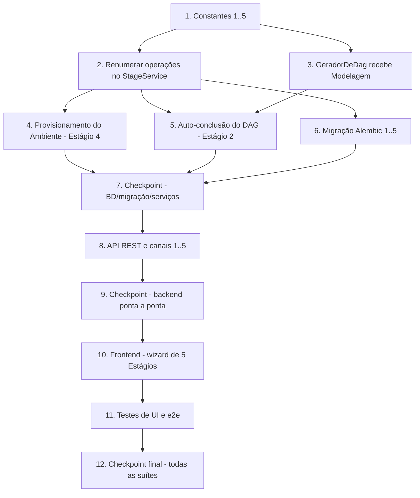

# Implementation Plan

## Overview

Plano de implementação da spec `pipeline-cinco-estagios`: evolui o pipeline de 4 para 5 Estágios, corrige a ordem (Modelagem antes do DAG) e divide a antiga Emulação em Provisionamento do Ambiente (4) e Execução da Campanha (5). O trabalho vai do backend (constantes, serviços, costuras, migração) para a API/canais e então para o frontend, com checkpoints verificando que as suítes permanecem verdes. Casos curados pré-concluem os Estágios 2 (DAG) e 4 (Ambiente). O agente de IA é não-objetivo; as costuras ficam prontas para encaixá-lo depois.

## Task Dependency Graph




```json
{
  "waves": [
    { "wave": 1, "tasks": ["1"] },
    { "wave": 2, "tasks": ["2", "3"] },
    { "wave": 3, "tasks": ["4", "5", "6"] },
    { "wave": 4, "tasks": ["7"] },
    { "wave": 5, "tasks": ["8"] },
    { "wave": 6, "tasks": ["9"] },
    { "wave": 7, "tasks": ["10"] },
    { "wave": 8, "tasks": ["11"] },
    { "wave": 9, "tasks": ["12"] }
  ],
  "dependencies": {
    "1": [],
    "2": ["1"],
    "3": ["1"],
    "4": ["2"],
    "5": ["2", "3"],
    "6": ["2"],
    "7": ["4", "5", "6"],
    "8": ["7"],
    "9": ["8"],
    "10": ["9"],
    "11": ["10"],
    "12": ["11"]
  }
}
```

## Tasks

- [x] 1. Generalizar as constantes de Estágio para 1..5 e nomear os papéis
  - [x] 1.1 Atualizar as constantes em `ui/backend/app/services/stage/stage_service.py`
    - Definir `LAST_STAGE=5`, `VALID_STAGES=(1,2,3,4,5)` e as constantes nomeadas `ESTAGIO_MODELAGEM=1`, `ESTAGIO_GERACAO_DAG=2`, `ESTAGIO_OPERACIONALIZACAO=3`, `ESTAGIO_PROVISIONAMENTO=4`, `ESTAGIO_EXECUCAO=5`; exportar em `__all__`. Garantir que bloqueio sequencial, progresso agregado, derivação por `StageRun` e `_validate_stage` passem a cobrir 1..5 sem literais espalhados.
    - _Requirements: 1.1, 1.3, 1.4, 1.6, 8.1_
  - [x] 1.2 Escrever testes de exemplo das constantes e `_validate_stage`
    - Verificar `FIRST_STAGE==1`, `LAST_STAGE==5`, `VALID_STAGES==(1,2,3,4,5)` e que `_validate_stage` aceita 1..5 e rejeita 0/6.
    - _Requirements: 1.1, 8.1_

- [x] 2. Renumerar as operações de Estágio no `StageService` para a ordem correta
  - [x] 2.1 Modelagem Estrutural passa a operar em `estagio=1`
    - Ajustar `run_stage1`/`read_stage1`/`_persist`/`_fail` para persistir/ler o `StageRun` de `ESTAGIO_MODELAGEM` (=1). Atualizar docstrings "Stage-1"/"estagio=1" conforme o papel (Modelagem é o Estágio 1).
    - _Requirements: 2.1, 2.2, 2.3, 2.4, 2.5, 8.2_
  - [x] 2.2 Operacionalização passa a operar em `estagio=3`
    - Ajustar a montagem/conclusão da antiga "Tradução Curada" (`assemble_stage2` e o caminho de conclusão) para o `StageRun` de `ESTAGIO_OPERACIONALIZACAO` (=3); renomear o vocabulário para "Operacionalização" preservando `origem_traducao`/`TranslationSource`.
    - _Requirements: 4.1, 4.2, 4.3, 4.4, 4.5, 8.4_
  - [x] 2.3 Execução da Campanha passa a operar em `estagio=5`
    - Ajustar a execução (antiga `run_stage3`/`OperationRunner` + `persist_stage_completion` da emulação) para o `StageRun` de `ESTAGIO_EXECUCAO` (=5). Mover a verificação de isolamento para fora do caminho de execução (ver tarefa 4) e manter confirmação/contenção/disponibilidade/auditoria no Estágio 5.
    - _Requirements: 6.1, 6.2, 6.3, 6.4, 6.5, 6.6, 6.7, 8.6_
  - [x] 2.4 Atualizar testes do StageService afetados pela renumeração
    - Atualizar os testes existentes (ex.: `test_stage1_integration.py`) para asserir os novos números (Modelagem=1, Operacionalização=3, Execução=5), sem enfraquecer as propriedades.
    - _Requirements: 2.2, 4.4, 6.7, 8.2, 8.4, 8.6_

- [x] 3. Costura `GeradorDeDag` recebendo a Modelagem Estrutural (Estágio 2)
  - [x] 3.1 Definir o DTO `ModelagemEstrutural` e atualizar a assinatura do Protocol
    - Em `ui/backend/app/services/dag/gerador.py`, definir `ModelagemEstrutural` (técnicas + relações, reaproveitando os elementos de `Stage1Output`) e mudar `GeradorDeDag.gerar(caso, modelagem)`; manter `@runtime_checkable`.
    - _Requirements: 3.1, 10.1_
  - [x] 3.2 Atualizar `CuradoriaGeradorDeDag` para a nova assinatura
    - Receber `modelagem` e ignorá-la (ler o DAG curado do disco via `CaseService`, sem rede/IA); devolver 1 `DagProduzido` `curadoria_humana` ou lista vazia quando não há DAG derivável.
    - _Requirements: 3.6, 3.7_
  - [x] 3.3 Property test do gerador de curadoria a partir da Modelagem
    - Para qualquer Caso curado com DAG derivável, `gerar(caso, modelagem)` devolve 1 `DagProduzido` `curadoria_humana` ignorando a Modelagem; sem DAG → lista vazia; sem rede/IA. (Property 7)
    - _Requirements: 3.1, 3.6_
  - [x] 3.4 Teste de conformidade do Protocol com a nova assinatura
    - `CuradoriaGeradorDeDag` satisfaz `GeradorDeDag`; um stub `gerado_ia` que recebe `modelagem` também satisfaz; objeto sem `origem`/`gerar` não satisfaz. (Property 7/8)
    - _Requirements: 3.1, 10.1_

- [x] 4. Provisionamento do Ambiente como Estágio 4 (verificação de isolamento + topologia)
  - [x] 4.1 Definir a costura `ProvisionadorDeAmbiente` e a implementação de curadoria
    - Em `ui/backend/app/services/` (pacote de ambiente), definir um `Protocol` com uma operação de preparar/verificar o ambiente de um Caso, e uma implementação de curadoria que verifica o isolamento do ambiente existente (reusando `app/services/containment` `inspect_isolation`/`IsolationVerifier`) e expõe a topologia (reusando o que há em `app/api/topologia.py`). Desenhar para IA futura encaixar sem redesenho.
    - _Requirements: 5.1, 5.4, 5.5, 5.7, 10.2_
  - [x] 4.2 Conclusão automática do Estágio 4 para casos curados
    - Quando o Estágio 3 de um Caso curado está `concluido` e o arquivo de ambiente existe e é verificado isolado, marcar o `StageRun` de `ESTAGIO_PROVISIONAMENTO` (=4) como `concluido`; se não puder verificar isolamento, não concluir (Estágio 5 fica bloqueado). Respeitar o gate sequencial.
    - _Requirements: 5.2, 5.3, 5.6, 9.2, 9.3, 9.4_
  - [x] 4.3 Property test da conclusão automática do Estágio 4
    - Caso curado com ambiente verificado isolado + Estágio 3 concluido → Estágio 4 auto-conclui; sem arquivo de ambiente ou sem isolamento → não conclui; respeita o gate. (Property 9, parte ambiente)
    - _Requirements: 9.2, 9.3, 9.4_

- [x] 5. Conclusão automática do Estágio 2 (DAG curado) sobre a Modelagem
  - [x] 5.1 Ajustar o `DagService` para a nova ordem e auto-conclusão
    - A escolha/carga do DAG passa a gravar o `StageRun` de `ESTAGIO_GERACAO_DAG` (=2). Quando o Estágio 1 (Modelagem) de um Caso curado está `concluido`, executar o backfill curado (`sincronizar_dags_curados`) e marcar o Estágio 2 como `concluido`; sem DAG derivável, manter não concluído (botão "Gerar DAG" desabilitado, avanço bloqueado). Passar a Modelagem ao `GeradorDeDag`.
    - _Requirements: 3.2, 3.3, 3.4, 3.5, 8.3, 9.1, 9.3, 9.4_
  - [x] 5.2 Property test da conclusão automática do Estágio 2
    - Caso curado com DAG + Estágio 1 concluido → Estágio 2 auto-conclui carregando o DAG; sem DAG → não conclui e avanço bloqueado; respeita o gate; backfill idempotente. (Property 9, parte DAG)
    - _Requirements: 9.1, 9.3, 9.4_
  - [x] 5.3 Property test da entidade DAG multi-origem (reconfirmar sob a nova ordem)
    - `Dag` round-trip para `curadoria_humana` e `gerado_ia`; `gerado_ia` sem migração nova. (Property 8)
    - _Requirements: 3.7, 10.4_

- [x] 6. Migração Alembic: renumerar para 1..5 preservando o estado
  - [x] 6.1 Criar a migração encadeada em `ui/backend/alembic/versions`
    - `down_revision = c348c9e36422`. Upgrade: guarda (aborta se `estagio` fora de 1..4), remapear 2→1, 1→2, 3→3, 4→5 (com deslocamento temporário para evitar colisão), e criar linha de Provisionamento (novo 4) `concluido` para cada Caso cujo antigo Estágio 4 (Emulação) estava `concluido`. Ajustar o `CHECK`/intervalo de `estagio` para 1..5. Downgrade simétrico (inverter o remapeamento, remover as linhas de Provisionamento criadas, reverter o CHECK para 1..4).
    - _Requirements: 7.1, 7.2, 7.3, 7.4, 7.5, 7.6_
  - [x] 6.2 Property test do remapeamento do upgrade
    - Para qualquer conjunto de `StageRun` válido (1..4), o upgrade aplica o remapeamento preservando atributos e criando a linha de Provisionamento quando a Emulação estava concluida. (Property 4)
    - _Requirements: 7.2, 7.3_
  - [x] 6.3 Property test do round-trip up∘down
    - up∘down restaura exatamente o esquema 1..4 sobre os dados remapeáveis. (Property 5)
    - _Requirements: 7.4_
  - [x] 6.4 Property test da guarda da migração
    - `estagio` fora de 1..4 ⇒ upgrade aborta com `RuntimeError` sem mutar dados. (Property 6)
    - _Requirements: 7.5_

- [x] 7. Checkpoint - base de dados, migração e serviços verdes
  - Rodar a suíte do backend (modelos, migração, DAG, StageService, Operacionalização, Provisionamento, Execução) e confirmar verde; `import app.main` ok; migração aplica/reverte (property tests e, se houver Postgres, live).
  - _Requirements: 1.x, 2.x, 3.x, 4.x, 5.x, 6.x, 7.x, 8.1-8.6, 9.x_

- [x] 8. API REST renumerada e canais em 1..5
  - [x] 8.1 Renumerar as rotas de Estágio em `ui/backend/app/api/casos.py`
    - Mapear `estagio/1` para Modelagem (executar incluso), `estagio/2` para Geração do DAG (+ `/dags`, `/dags/{dag_id}`), `estagio/3` para Operacionalização (+ concluir), `estagio/4` para Provisionamento (topologia + isolamento), `estagio/5` para Execução. `GET /api/casos` e `/api/casos/{caso}` retornam 5 Estágios. Ajustar os gates de conclusão (Operacionalização exige Estágio 2; etc.) e os números passados a `persist_stage_completion`.
    - _Requirements: 8.7, 1.4, 5.4_
  - [x] 8.2 Endpoints de Execução (Estágio 5) e preview/confirmação
    - Mover as rotas de emulação para `estagio/5` (preview + confirmação), preservando o contrato HTTP de contenção (409), indisponibilidade (503) e não-confirmação (200 não-iniciada), e a auditoria por comando.
    - _Requirements: 6.3, 6.4, 6.5, 6.6, 6.7, 8.7_
  - [x] 8.3 Habilitar o canal WebSocket de Estágios em 1..5
    - Validar `estagio` contra `VALID_STAGES` (1..5); atualizar docstrings/limites.
    - _Requirements: 1.7, 8.8_
  - [x] 8.4 Testes de integração dos contratos REST (1..5)
    - `GET /api/casos` → 5 Estágios por Caso; cada `GET .../estagio/{1..5}` responde o contrato correto; executar Modelagem (estagio/1); Estágio 2 DAG curado auto-concluído; Estágio 4 topologia/isolamento; Execução (estagio/5) com os gates; bloqueio sequencial em `concluir`/avanço. Atualizar os testes de endpoint do esquema anterior.
    - _Requirements: 1.x, 5.x, 6.x, 8.7, 9.x_

- [x] 9. Checkpoint - backend verde ponta a ponta
  - Rodar a suíte completa do backend e confirmar 0 falhas; `import app.main` ok.
  - _Requirements: todos de backend_

- [x] 10. Frontend: tipos, wrappers e wizard de 5 Estágios
  - [x] 10.1 Atualizar tipos e wrappers em `ui/frontend/src/lib`
    - `NumeroEstagio = 1|2|3|4|5`, `PIPELINE_STAGES=[1,2,3,4,5]`; wrappers para as rotas renumeradas (Modelagem=estagio/1, DAG=estagio/2 + `/dags`, Operacionalização=estagio/3, Provisionamento=estagio/4, Execução=estagio/5); `derivarEstados` cobrindo 1..5.
    - _Requirements: 8.7, 8.9_
  - [x] 10.2 Novo componente `EnvironmentStageView` (Estágio 4)
    - Exibir a topologia do ambiente contido (hosts, redes internas, Mermaid) e o estado de isolamento; para caso curado auto-concluído, mostrar como pronto; para ambiente não isolado, mostrar a razão e bloquear o avanço.
    - _Requirements: 5.4, 5.6, 8.9_
  - [x] 10.3 Expandir `ExecutionWizard.tsx` para 5 Estágios e costurar os corpos
    - Mapeamento: 1 Modelagem (`Stage1View` + executar), 2 Geração do DAG (`DagStageView`), 3 Operacionalização (`Stage2View`), 4 Provisionamento (`EnvironmentStageView`), 5 Execução (`Stage3View` + `EmulationConfirmModal`). Indicador "Passo X de 5", trilha de 5 badges, bloqueio sequencial do backend, botão "Gerar DAG" único e desabilitado no Estágio 2 sem DAG.
    - _Requirements: 3.3, 3.4, 3.5, 8.9_
  - [x] 10.4 Unificar as chaves i18n dos cinco Estágios (pt-BR/en)
    - `stages.1..5` com os nomes de design (Modelagem Estrutural / Geração do DAG / Operacionalização / Provisionamento do Ambiente / Execução da Campanha) e equivalentes em inglês; chaves do Estágio 4 (ambiente/topologia) e do botão "Gerar DAG"; manter paridade pt-BR/en.
    - _Requirements: 8.10, 4.5_
  - [x] 10.5 Atualizar o property test do reducer de fluxo e os testes de UI
    - Ajustar o reducer de fluxo (se necessário) e os property tests; `CaseSelector`/wizard para 5 Estágios.
    - _Requirements: 8.9, 8.10_

- [x] 11. Testes de UI e e2e do fluxo de 5 Estágios
  - [x] 11.1 Testes de UI (Vitest) dos cinco Estágios e i18n
    - Wizard "Passo X de 5", 5 badges, mapeamento dos corpos, Estágio 2 DAG curado auto-concluído e "Gerar DAG" desabilitado sem DAG, Estágio 4 topologia + auto-conclusão; terminologia "Estágio"/"Stage" e os cinco nomes; atualizar testes do esquema anterior para a suíte Vitest ficar verde.
    - _Requirements: 3.4, 5.4, 8.9, 8.10, 9.1, 9.2_
  - [x] 11.2 Teste e2e (Playwright) do fluxo de 5 Estágios
    - landing → bases → dashboard → selecao → wizard; wizard com 5 badges e "Passo 1 de 5"; Estágio 1 Modelagem; Estágio 2 DAG; Estágio 4 topologia; sem confirmar emulação. Atualizar o spec e2e existente.
    - _Requirements: 8.9_

- [x] 12. Final checkpoint - todas as suítes verdes
  - Backend pytest, frontend Vitest + typecheck, e e2e (quando a stack estiver no ar) verdes ponta a ponta.
  - _Requirements: todos_

## Notes

- **PostgreSQL exclusivamente.** A migração roda contra o Postgres do produto; os property tests da migração a exercitam in-process (SQLite efêmero isolado) dirigindo o `upgrade()`/`downgrade()` reais.
- **Supersede parcial.** Esta spec supersede a ordenação de Estágios e a "Emulação" de `dag-estagio-multi-origem`; a spec anterior permanece como histórico, não é apagada.
- **Casos curados.** Estágios 2 (DAG) e 4 (Ambiente) auto-concluem para casos curados, respeitando o gate sequencial; nunca concluem sem o material curado correspondente.
- **Não-objetivo (futuro).** Agente de IA, remoção da curadoria e provisionamento/operacionalização/geração dinâmicos por IA ficam fora desta iteração; as costuras (`GeradorDeDag`, `ProvisionadorDeAmbiente`) são desenhadas para encaixá-los sem redesenho.
- **Property tests.** Cada tarefa de property test referencia as Properties 1..10 do design; não enfraquecer propriedades para passar — corrigir código ou teste conforme o design.
- **Verde contínuo.** Testes do esquema anterior (1..4) que colidirem com a renumeração devem ser atualizados dentro da tarefa que causa a mudança, para os checkpoints ficarem verdes.
