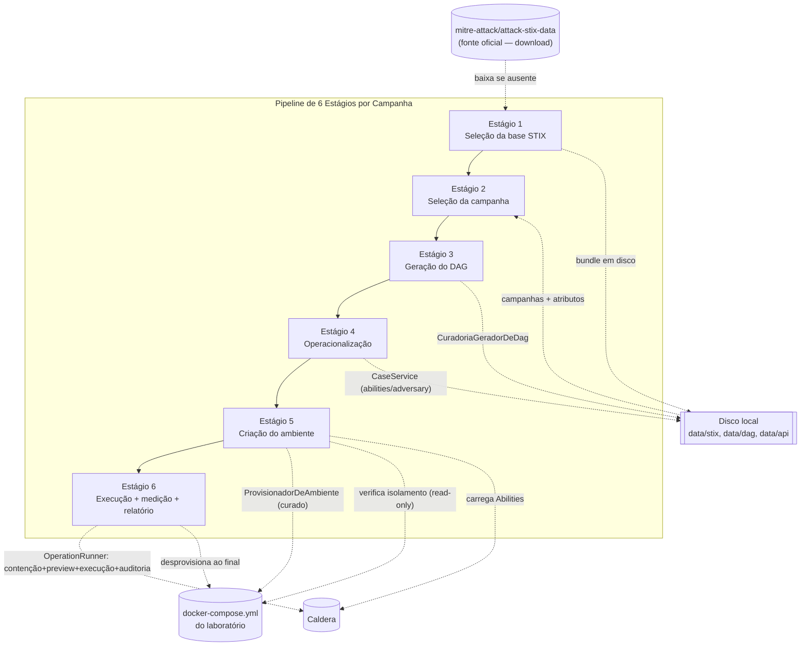
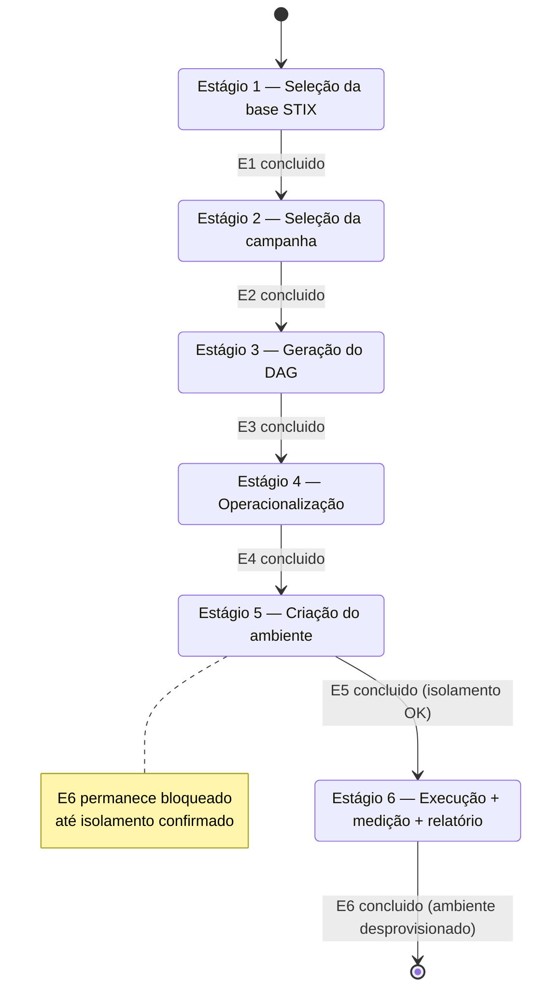
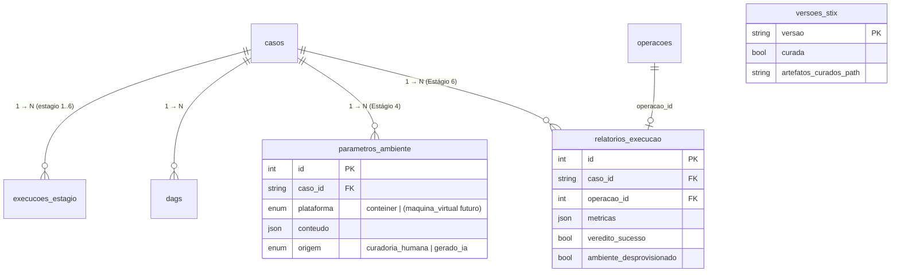
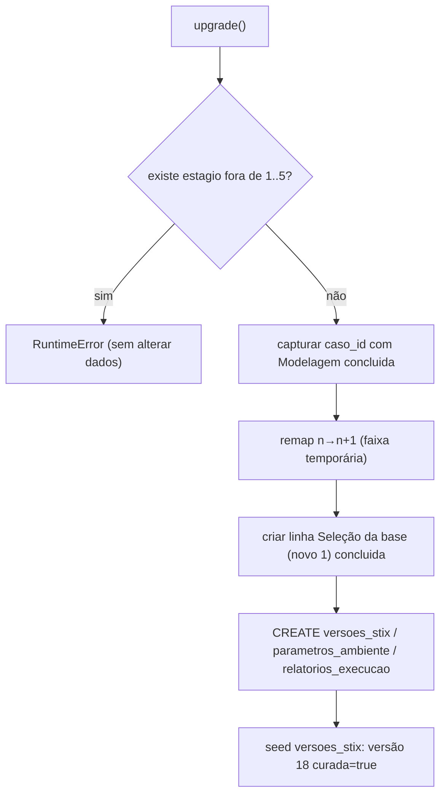

# Design Document

## Overview

Esta spec reestrutura o pipeline de STICKS de **cinco** para **seis Estágios**, redistribuindo os papéis para refletir o fluxo real de dados que o Pesquisador segue ao reproduzir uma campanha curada. O pipeline final, na ordem de condução:

| Nº | Estágio | Responsabilidade | `StageRun.estagio` |
|----|---------|------------------|--------------------|
| 1 | Seleção da base STIX | Escolhe a versão do bundle; baixa da fonte oficial MITRE se ausente; dashboard do bundle | 1 |
| 2 | Seleção da campanha | Lista campanhas do bundle; extrai os atributos da campanha escolhida | 2 |
| 3 | Geração do DAG | Produz o grafo ordenado de técnicas a partir dos atributos da campanha | 3 |
| 4 | Operacionalização | Abilities ordenadas pelo DAG **+** parâmetros de ambiente derivados dos comandos | 4 |
| 5 | Criação do ambiente de simulação | Provisiona contêineres; carrega Abilities no Caldera; **verifica isolamento** | 5 |
| 6 | Execução, medição e relatório | Executa (contenção + preview); mede suficiência procedural; relatório; **desprovisiona** | 6 |

O mapeamento a partir do esquema **anterior** (`pipeline-cinco-estagios`, 1..5) está na seção "Plano de migração". A alavanca principal, como o código já é escrito em termos de `VALID_STAGES`/`FIRST_STAGE`/`LAST_STAGE` **sem literais de estágio** (ver `stage_service.py`), é **ampliar o intervalo de 1..5 para 1..6**: o bloqueio sequencial, o progresso agregado e a derivação de estado por `StageRun` passam a cobrir seis Estágios automaticamente.

### Decisões centrais

- **Ampliar o range é a alavanca.** `FIRST_STAGE=1`, `LAST_STAGE=6`, `VALID_STAGES=(1,2,3,4,5,6)`. As funções de bloqueio (`is_stage_startable`/`get_stage_states`), progresso (`aggregate_progress`), derivação (`_build_stage_state_view`) e `_validate_stage` já iteram sobre essas constantes — não há reescrita de algoritmo.
- **Conviver com os nomes históricos das classes `Stage*` (dívida técnica, não-objetivo renomear).** Após a renumeração, os números de Estágio **não batem** com os nomes de classe. O mapeamento número→classe é explícito (ver "Mapeamento número→classe") e nenhuma classe é renomeada nesta spec (Req. 18.5).
- **Reuso massivo do que existe.** `StixService` já baixa o bundle da fonte oficial MITRE, lista bases com flag `baixada`/`selecionavel` e marca campanhas curadas (`curada`/`slug_curado`); `DagService`/`GeradorDeDag`/`CuradoriaGeradorDeDag` já produzem o DAG curado; `CaseService` já lê as Abilities/Adversary curados; o pacote `containment/` já faz parser/validação/isolamento/preview; `OperationRunner` já faz o pré-flight de contenção, as chamadas Caldera, a auditoria por comando e a agregação. O **delta** novo é: um DTO tipado de parâmetros de ambiente (Estágio 4), uma costura `ProvisionadorDeAmbiente` e a verificação de isolamento como conclusão do Estágio 5, e o modelo de métricas/relatório do Estágio 6 — além da migração 1..6.
- **Costura por origem nos Estágios 3, 4 e 5.** Seguindo o precedente `OrigemDag` (`curadoria_humana` | `gerado_ia`) e `TranslationSource`/`origem_traducao`, cada um desses Estágios expõe um ponto de extensão por `origem` com implementação de curadoria agora e espaço para `gerado_ia` sem redesenho (Req. 16). O agente de IA é **não-objetivo** (Req. 18.1).
- **"Transição", não destino final.** Para as 8 campanhas curadas (somente na versão 18), os Estágios 3, 4 e 5 consomem artefatos curados lidos de disco, sem IA e sem rede (Req. 11).

Esta spec **constrói sobre** e **supersede** a ordenação e os papéis de Estágio de `pipeline-cinco-estagios`; a spec anterior permanece como histórico.

### Mapeamento número→classe (dívida técnica preservada)

Os DTOs tipados mantêm os nomes históricos `Stage1*`/`Stage2*`/`Stage3*` de `stage_service.py`. Após a renumeração para seis Estágios, o mapeamento é:

| Papel novo (Estágio) | Classe DTO histórica (nome **não** muda) | Observação |
|----------------------|------------------------------------------|------------|
| Estágio 1 — Seleção da base STIX | *(sem DTO `Stage*`; reusa `StixService`/`BaseStixInfo`)* | Novo papel; nenhuma classe `Stage*` envolvida |
| Estágio 2 — Seleção da campanha | `Stage1Input`/`CampanhaStixEntrada` (bloco `campanha_stix`) e `Stage1Output` | `Stage1*` passa a servir "Seleção da campanha / atributos" |
| Estágio 3 — Geração do DAG | `DagProduzido`/`DagView` (pacote `dag`) + `ModelagemEstrutural` | Reuso direto da costura `GeradorDeDag` |
| Estágio 4 — Operacionalização | `Stage2*` (Abilities/Adversary) **+** `ParametrosDeAmbiente` (novo) | `Stage2*` histórico = Abilities; parâmetros de ambiente são DTO novo |
| Estágio 5 — Criação do ambiente | *(costura nova `ProvisionadorDeAmbiente`)* + `IsolationResult` | Reusa `containment/isolation` |
| Estágio 6 — Execução, medição e relatório | `Stage3*` (execução) **+** `RelatorioExecucao`/`MetricasSuficiencia` (novo) | `Stage3*` histórico = execução via `OperationRunner` |

> **Importante:** o nome de classe `Stage1*` hoje descreve "Modelagem"; `Stage2*` "Operacionalização"; `Stage3*` "Execução". Esses nomes **permanecem** e passam a servir os números acima. A inconsistência nome↔número é dívida técnica explicitamente fora do escopo (Req. 18.5). Toda referência de código abaixo usa o nome histórico real e indica o Estágio que ele serve.

## Steering compliance

- **Backend:** FastAPI + SQLAlchemy + Alembic, **PostgreSQL exclusivamente**. Timestamps naive-UTC (`_utcnow`), serviços recebem `Session` injetada (padrão de `StageService`/`DagService`/`OperationRunner`). Enums portáveis via `_portable_enum` (`native_enum=False` → VARCHAR + CHECK). Os caminhos curados dos Estágios 3/4/5 **não acessam a rede** e **não invocam IA** (Req. 11.3, 11.4); o único egresso de rede é o download do bundle no Estágio 1 (Req. 5.2), já isolado em `StixService.baixar_base`.
- **Frontend:** React 19 + TS + Vite + i18next pt-BR; contratos pt-BR como fonte da verdade; componentes finos consumindo wrappers tipados em `src/lib`; paridade de chaves pt-BR/en (property test de i18n).
- **Isolamento read-only:** a verificação de isolamento usa somente inspeção read-only do Docker (`inspect_isolation`), nunca inicia/para/cria/modifica contêineres (Req. 14.1).

## Architecture



Cada Estágio é uma linha `StageRun(caso_id, estagio ∈ 1..6, estado, progresso, mensagem_erro, etapa_falha, dag_escolhido_id)`. O bloqueio sequencial, o progresso agregado e a derivação de estado são **puros sobre as linhas `StageRun`**, parametrizados por `VALID_STAGES`.

### Fluxo de estados e bloqueio sequencial (1..6)



O gate é o mesmo já implementado: `estagio == FIRST_STAGE ⇒ iniciável; senão iniciável sse estado(estagio-1) == concluido`. Com `VALID_STAGES=(1..6)` vale para cada par adjacente `(1,2)…(5,6)` (Req. 3.1, 3.2, 3.3).

## Components and Interfaces

### Backend — constantes de Estágio (`stage_service.py`) — DELTA mínimo

Generalizar o intervalo para 1..6 e nomear os papéis novos, eliminando literais:

```python
FIRST_STAGE: int = 1
LAST_STAGE: int = 6
VALID_STAGES: tuple[int, ...] = (1, 2, 3, 4, 5, 6)

# Papéis dos seis Estágios (fonte única por número; sem literais espalhados).
ESTAGIO_SELECAO_BASE: int = 1       # Seleção da base STIX
ESTAGIO_SELECAO_CAMPANHA: int = 2   # Seleção da campanha
ESTAGIO_GERACAO_DAG: int = 3        # Geração do DAG
ESTAGIO_OPERACIONALIZACAO: int = 4  # Operacionalização (Abilities + parâmetros de ambiente)
ESTAGIO_AMBIENTE: int = 5           # Criação do ambiente de simulação
ESTAGIO_EXECUCAO: int = 6           # Execução + medição + relatório
```

> **Nota de dívida técnica:** as constantes anteriores (`ESTAGIO_MODELAGEM`, `ESTAGIO_PROVISIONAMENTO`, etc.) e os nomes de classe `Stage*` **não** são renomeados (Req. 18.5). Introduzimos os novos nomes de constante por clareza e mantemos aliases onde necessário para não quebrar imports — sem tocar nas classes DTO.

`is_stage_startable`/`get_stage_states`, `aggregate_progress`, `_build_stage_state_view`, `stage_progress_event` e `_validate_stage` **já são range-agnósticos** (derivam de `VALID_STAGES`/`FIRST_STAGE`/`LAST_STAGE`); passam a cobrir 1..6 sem mudança de lógica. A mensagem de `_validate_stage` passa a citar `(1, 2, 3, 4, 5, 6)`.

### Backend — Estágio 1: Seleção da base STIX — REUSO de `StixService`

Reaproveita integralmente o que já existe em `app/services/stix/stix_service.py`:

- `listar_bases()` → lista `BaseStixInfo(versao, baixada, selecionavel, arquivo)`. Nenhuma versão vem baixada por padrão (Req. 5.4): `baixada` é checado contra disco a cada chamada.
- `baixar_base(versao)` → **único egresso de rede**, baixa `enterprise-attack-{versao}.json` da fonte oficial `mitre-attack/attack-stix-data` (valida `versao` contra `VERSOES_CONHECIDAS` **antes** de tocar disco/rede, fechando injeção de path/URL; escrita atômica; `StixDownloadError` em falha, sem arquivo parcial) (Req. 5.2, 5.9).
- `ler_bundle(versao)` / dashboard → contagens por tipo e campanhas do bundle para o dashboard (Req. 5.7).

**DELTA — flag de versão curada (Req. 5.5, 5.6).** A marcação de que a versão 18 contém os casos curados é uma constante do backend (fonte única), não um dado por request:

```python
# app/services/stix/stix_service.py (ou módulo de constantes STIX)
VERSAO_CURADA: str = "18.0"  # a única versão com os 8 casos curados (Req. 5.5, 11.5)

def versao_eh_curada(versao: str) -> bool:
    """True sse a versão carrega a flag de versão curada (Req. 5.5, 5.6)."""
    return versao == VERSAO_CURADA
```

A flag é persistida/consultável por versão (ver "Data Models — `versoes_stix`"), e o apontamento dos artefatos curados fica associado à versão 18 (Req. 5.6): para a versão curada, os Estágios 3/4/5 resolvem seus artefatos pelos diretórios curados em disco (`data/dag`, `data/api`, `docker-compose.yml`).

Orquestração do Estágio 1 (serviço fino, novo, reusando `StixService`): escolher versão → se não baixada, `baixar_base`; exibir dashboard; permitir concluir quando o bundle está em disco e o dashboard foi exibido (Req. 5.8, 5.10). A Saída (bundle em disco + dashboard) é a Entrada do Estágio 2 (Req. 2.2).

### Backend — Estágio 2: Seleção da campanha — REUSO de `StixService` + `Stage1*`

- Listar campanhas do bundle: `StixService` já expõe a listagem de campanhas por bundle, marcando cada uma com `curada`/`slug_curado` via `SLUG_PARA_STIX` (Req. 6.2). Para a versão 18 (curada), as 8 campanhas curadas ficam selecionáveis (Req. 6.5).
- Extrair atributos da campanha selecionada: reusa `StixService.obter_campanha_por_slug(versao, slug)` e o DTO histórico `CampanhaStixEntrada` (bloco `campanha_stix` já montado por `StageService._build_campanha_stix`, defensivo e sem rede nos caminhos curados). A Saída do Estágio 2 são os atributos extraídos (`CampanhaStixEntrada` + técnicas associadas), que alimentam o Estágio 3 (Req. 6.3, 6.4, 2.3).
- Conclusão quando os atributos são extraídos com sucesso; falha de extração mantém o Estágio não concluído com causa reportada (Req. 6.6, 6.7).

> **Mapeamento número→classe:** o DTO `Stage1Input`/`Stage1Output` (nome histórico "Modelagem") passa a servir o Estágio 2. A extração estrutural já derivada do DAG curado (`_extract_techniques`/`_extract_relationships` etc.) é reusada aqui como "atributos da campanha" — sem renomear.

### Backend — Estágio 3: Geração do DAG — REUSO da costura `GeradorDeDag`

Reaproveita integralmente `app/services/dag/`:

```python
@runtime_checkable
class GeradorDeDag(Protocol):
    def origem(self) -> OrigemDag: ...
    def gerar(self, caso: str, modelagem: ModelagemEstrutural) -> list[DagProduzido]: ...
```

- `CuradoriaGeradorDeDag.gerar(caso, modelagem)` **ignora** `modelagem` (o grafo curado já existe), lê `data/dag/{slug}_dag.json` via `CaseService` e devolve exatamente um `DagProduzido` com `origem=curadoria_humana`, **sem rede e sem IA** (Req. 7.4, 7.5, 11.3, 11.4).
- `DagService` persiste o DAG (backfill idempotente), lista e monta `DagView`/`DagDetalhe` (nós/arestas/Mermaid) para a tela.
- A Entrada é os atributos da campanha (Estágio 2); a Saída é o DAG pronto, com `origem` explícita (Req. 7.1, 7.2, 7.3, 7.5). Conclusão quando o DAG é produzido com sucesso (Req. 7.6).

**Costura por origem (Req. 16.1):** uma futura `AiGeradorDeDag` (origem `gerado_ia`) encaixa sem alterar a assinatura nem a entidade `Dag` — já contemplado pelo `OrigemDag` com CHECK que inclui `gerado_ia`. **Não-objetivo** implementá-la (Req. 18.1).

### Backend — Estágio 4: Operacionalização (Abilities **+** parâmetros de ambiente) — REUSO `Stage2*`/`CaseService` + DTO novo

**Saída dupla, dois artefatos tipados separados (Req. 8.4, 8.7):**

**(a) Abilities ordenadas (REUSO).** `assemble_stage2` já monta, a partir dos arquivos curados `data/api/{slug}_dag-ability.json` e `{slug}_dag-adversary.json` (via `CaseService`), o `Stage2Output` com as Abilities (comando por executor), a ordem (`atomic_ordering` do Adversary) e `origem_traducao`/`TranslationSource` (`curadoria_humana`) — o precedente de extensibilidade por origem (Req. 8.2, 8.5, 8.6). Para a IA futura, uma costura de operacionalização por origem:

```python
@runtime_checkable
class OperacionalizadorPorOrigem(Protocol):
    """Costura do Estágio 4 por origem (curadoria hoje; gerado_ia futuro — Req. 16.2)."""
    def origem(self) -> TranslationSource: ...
    def operacionalizar(self, caso: str, dag: DagView) -> OperacionalizacaoProduzida: ...

class CuradoriaOperacionalizador:
    """Lê as Abilities/Adversary curados de disco (sem rede, sem IA — Req. 11.3/11.4)."""
    def origem(self) -> TranslationSource: return TranslationSource.HUMAN_CURATION
    def operacionalizar(self, caso, dag): ...  # reusa assemble_stage2 + deriva parâmetros
```

**(b) Parâmetros de ambiente (DELTA — DTO novo e tipado, Req. 8.3).** Os parâmetros são derivados **dos nós do DAG curado**, onde já estão embutidos: `attacker_commands`, `target_vuln_host_a`/`target_vuln_host_b`, `source_host_type`, `target_host_type`, `network_context`, `tactic`, `provides`. A plataforma é, neste primeiro momento, sempre **contêiner** (Req. 17.1). Hosts-alvo e serviços/vulnerabilidades são derivados dos destinos dos comandos (reusando o `command_parser` da contenção, já usado por `_extract_indicators`) e dos blocos `target_vuln_host_*`:

```python
class PlataformaAmbiente(str, enum.Enum):
    """Plataforma do ambiente — contêiner hoje; VM admitida sem redesenho (Req. 17)."""
    CONTAINER = "conteiner"
    # VM = "maquina_virtual"  # futuro (Req. 17.2) — não implementado nesta spec

class HostAlvo(BaseModel):
    """Um host-alvo derivado dos comandos/nós do DAG (Req. 8.3)."""
    rotulo: str                      # ex.: "host_a", "host_b"
    endereco: Optional[str] = None   # IP interno quando resolvido (ex.: 192.168.20.30)
    container: Optional[str] = None  # container do laboratório (via subnets.container_for_ip)
    host_type: Optional[str] = None  # source/target_host_type do nó
    vulnerabilidades: list[str] = Field(default_factory=list)  # comandos target_vuln_host_*

class ServicoRequerido(BaseModel):
    """Serviço/vulnerabilidade a provisionar, inferido dos comandos (Req. 8.3)."""
    descricao: str                   # ex.: "ssh root login", "flask na porta 5000"
    tecnica_origem: Optional[str] = None

class ParametrosDeAmbiente(BaseModel):
    """Parâmetros de ambiente — 2ª Saída do Estágio 4 (Req. 8.3, 8.4, 8.7).

    Artefato tipado SEPARADO das Abilities, destinado ao Estágio 5. Derivado dos
    campos curados embutidos nos nós do DAG (target_vuln_host_a/b, network_context,
    source_host_type/target_host_type) e dos destinos dos attacker_commands.
    """
    caso_id: str
    plataforma: PlataformaAmbiente = PlataformaAmbiente.CONTAINER
    hosts: list[HostAlvo] = Field(default_factory=list)
    servicos: list[ServicoRequerido] = Field(default_factory=list)
    network_context: list[str] = Field(default_factory=list)  # notas de rede por nó
    origem: TranslationSource = TranslationSource.HUMAN_CURATION
```

Derivação (pura, sem rede/IA): para cada nó do DAG curado,
1. `attacker_commands` → `parse_command` → destinos internos → `container_for_ip` resolve o container-alvo e o endereço;
2. `target_vuln_host_a`/`_b` → `vulnerabilidades` do host correspondente;
3. `source_host_type`/`target_host_type` → `host_type`;
4. `network_context` → nota de rede;
5. serviços inferidos dos comandos de vulnerabilidade (ex.: Flask/porta, SSH root).

A Entrada do Estágio 4 é o DAG (Estágio 3); a Saída são **as Abilities ordenadas e os `ParametrosDeAmbiente`** (Req. 8.1, 8.7). Conclusão quando ambos são produzidos (Req. 8.8).

### Backend — Estágio 5: Criação do ambiente de simulação — costura nova + REUSO `containment/isolation` + Caldera

**DELTA — costura `ProvisionadorDeAmbiente` por origem (Req. 16.3):**

```python
class AmbienteProvisionado(BaseModel):
    """Saída do Estágio 5 — ambiente pronto e isolado (Req. 9.8)."""
    caso_id: str
    plataforma: PlataformaAmbiente
    containers_alvo: list[str] = Field(default_factory=list)
    compose_file: Optional[str] = None
    isolamento: "IsolationResumo"            # veredito por container + geral
    abilities_carregadas: bool = False
    origem: TranslationSource = TranslationSource.HUMAN_CURATION

@runtime_checkable
class ProvisionadorDeAmbiente(Protocol):
    """Costura do Estágio 5 por origem (curadoria hoje; gerado_ia futuro — Req. 16.3)."""
    def origem(self) -> TranslationSource: ...
    def provisionar(self, params: ParametrosDeAmbiente) -> AmbienteProvisionado: ...

class CuradoriaProvisionadorDeAmbiente:
    """Usa o ambiente curado (docker/docker-compose.yml do laboratório) — Req. 9.4.

    Não cria contêineres sob medida: o laboratório curado já define os hosts e as
    três redes internas. Resolve os containers-alvo a partir dos ParametrosDeAmbiente,
    carrega as Abilities ordenadas no Caldera na ordem do DAG (Req. 9.5) e verifica
    o isolamento (read-only) ANTES de concluir (Req. 9.6).
    """
    def origem(self): return TranslationSource.HUMAN_CURATION
    def provisionar(self, params): ...
```

- Cria o ambiente respeitando os parâmetros, **apenas contêineres** neste momento (Req. 9.2, 9.3); no caso curado usa o `docker/docker-compose.yml` existente, com as três redes internas (Req. 9.4). O desenho admite VM futura via `PlataformaAmbiente` sem redesenho (Req. 17.2).
- Carrega as Abilities ordenadas no Caldera na ordem do DAG (Req. 9.5) — reusa `CalderaClient.load_abilities`/`load_adversary`.
- **Verificação de isolamento como pré-condição de conclusão (Req. 9.6, 9.7, 14):** reusa `inspect_isolation(containers_alvo, inspector)` (read-only). Produz `IsolationResult` com veredito por container e geral (pass/fail). Se algum container-alvo não estiver isolado, o Estágio 5 **não conclui** e o container é reportado (Req. 9.7, 14.4, 14.5); o Estágio 6 fica bloqueado. Fail-closed: lista vazia ou daemon indisponível reprova.
- A Saída é o ambiente pronto e isolado com as Abilities carregadas (Req. 9.8); conclusão quando tudo isso vale (Req. 9.9).

> **Posicionamento da contenção/isolamento:** o **isolamento é pré-condição de conclusão do Estágio 5** (não da execução). A contenção de destinos (sem destino externo) + o preview são pré-condição da **execução** no Estágio 6 (abaixo).

### Backend — Estágio 6: Execução + medição + relatório — REUSO `OperationRunner` + modelo de métricas novo

**Execução (REUSO total do `OperationRunner`, `Stage3*`):** o `OperationRunner.run(...)` já aplica, na ordem do design, os quatro gates: (1) confirmação explícita; (2) **contenção de destinos** (`validate_abilities` → recusa se houver destino externo, Req. 13.3, 13.4, 13.5); (3) **isolamento** dos containers-alvo (read-only, Req. 14); (4) disponibilidade do Caldera. Depois cria a Operação, faz polling, persiste `AbilityResult` por Ability, agrega `total_sucesso`/`total_falha` e grava uma linha de `AuditLogEntry` por comando. **Execução única** no caso curado (Req. 10.3) — sem retry automático (não-objetivo, Req. 18.3). O **preview** (`preview_abilities`) + modal de confirmação é a pré-condição visível antes de qualquer execução (Req. 13.6).

**DELTA — métricas de suficiência procedural + relatório (Req. 15, 10.4–10.7).** Modelo **proposta inicial a refinar** (Req. 15.8), derivado dos `AbilityResult`/links e do DAG:

```python
class MetricaTecnica(BaseModel):
    """Medição por técnica/nó do DAG (Req. 15.2, 15.4, 15.5)."""
    technique_id: Optional[str] = None
    node_id: Optional[str] = None
    status: AbilityResultStatus = AbilityResultStatus.PENDING
    etapa_falha: Optional[str] = None            # etapa do DAG onde falhou (Req. 15.2)
    tempo_execucao_s: Optional[float] = None     # tempo por técnica (Req. 15.4)
    telemetria: list[str] = Field(default_factory=list)  # processo/rede/auth/arquivo (Req. 15.5)

class MetricasSuficiencia(BaseModel):
    """Métricas de suficiência procedural — PROPOSTA INICIAL (Req. 15.8)."""
    total_tecnicas_dag: int = 0
    tecnicas_sucesso: int = 0
    taxa_sucesso: float = 0.0                    # sucesso / total do DAG (Req. 15.1)
    cobertura_procedural: float = 0.0            # proporção do DAG executável (Req. 15.3)
    tempo_total_s: Optional[float] = None        # tempo total (Req. 15.4)
    por_tecnica: list[MetricaTecnica] = Field(default_factory=list)
    nos_falhos: list[str] = Field(default_factory=list)   # nós/técnicas que falharam (Req. 15.2)
    veredito_sucesso: bool = False               # veredito geral (Req. 15.6, 10.5)

class RelatorioExecucao(BaseModel):
    """Saída do Estágio 6 — relatório consolidado (Req. 10.6, 10.7, 15.7)."""
    caso_id: str
    metricas: MetricasSuficiencia
    resultados: list[Stage3AbilityResult] = Field(default_factory=list)  # reuso Stage3*
    ambiente_desprovisionado: bool = False       # Req. 12
    gerado_em: dt.datetime
```

**Desprovisionamento ao final (Req. 12, 10.8):** após medir e gerar o relatório, o Estágio 6 **sempre** desprovisiona o ambiente da campanha (remove os contêineres criados). Falha de desprovisionamento é reportada identificando os recursos remanescentes (Req. 12.3). O teardown é via a mesma costura `ProvisionadorDeAmbiente` (método `desprovisionar`) para manter a origem coesa. **Não-objetivo** otimizar provisionamento/teardown por execução (Req. 18.4).

Conclusão quando a execução conclui, o ambiente é desprovisionado e os resultados + relatório são persistidos (Req. 10.9).

### Backend — endpoints REST renumerados (1..6)

Em `app/api/casos.py`, consistentes com os contratos existentes (JSON pt-BR):

```
GET  /api/stix/bases                               // Estágio 1: lista versões (baixada/selecionavel)
POST /api/stix/bases/{versao}/baixar               // Estágio 1: download (único egresso de rede)
GET  /api/casos/{caso}/estagio/1                   // Seleção da base STIX (dashboard do bundle)
GET  /api/casos/{caso}/estagio/2                   // Seleção da campanha (lista + atributos)
POST /api/casos/{caso}/estagio/2/selecionar        // seleciona campanha → extrai atributos
GET  /api/casos/{caso}/estagio/3                   // Geração do DAG (DagView/Mermaid)
GET  /api/casos/{caso}/dags                        // DAGs persistidos
GET  /api/casos/{caso}/dags/{dag_id}               // DAG persistido (grafo + Mermaid)
GET  /api/casos/{caso}/estagio/4                   // Operacionalização (Abilities + ParametrosDeAmbiente)
POST /api/casos/{caso}/estagio/4/concluir          // conclui a operacionalização
GET  /api/casos/{caso}/estagio/5                   // Ambiente (topologia + isolamento)
POST /api/casos/{caso}/estagio/5/provisionar       // provisiona + carrega Abilities + verifica isolamento
GET  /api/casos/{caso}/estagio/6                   // Execução (entrada + saída acumulada)
POST /api/casos/{caso}/estagio/6/execucao/preview  // preview dos comandos + container-alvo
POST /api/casos/{caso}/estagio/6/execucao          // confirmação + execução (gates do runner)
GET  /api/casos/{caso}/relatorio                   // relatório + métricas (Req. 15.7)
POST /api/casos/{caso}/reset
```

### Backend — WebSocket de Estágios

`WS /ws/estagios/{caso}` já valida `estagio` contra `VALID_STAGES` e empurra `StageProgressEvent`; passa a cobrir **1..6** automaticamente (Req. extensão de progresso). O frontend aceita `NumeroEstagio = 1|2|3|4|5|6`.

### Frontend — telas por Estágio + navegação Próximo/Voltar

O `ExecutionWizard` passa a conduzir **6 Estágios**, uma tela por Estágio (Req. 4.1), com `stepIndicator` `total: 6` e trilha de 6 badges. Mapeamento Estágio → corpo (reusando telas existentes onde cabe):

| Estágio | Corpo (componente) |
|---------|--------------------|
| 1 Seleção da base STIX | `BaseStixView` (nova: lista de versões, baixar, dashboard do bundle) — reusa a tela de bases/dashboard do fluxo `fluxo-stix-dashboard` |
| 2 Seleção da campanha | `CampanhaView` (nova: lista de campanhas do bundle + atributos) — reusa `Stage1View` para exibir os atributos |
| 3 Geração do DAG | `DagStageView` (DAG curado + Mermaid) |
| 4 Operacionalização | `Stage2View` (Abilities) **+** painel `ParametrosAmbienteView` (novo) |
| 5 Criação do ambiente | `EnvironmentStageView` (topologia + isolamento; conclui quando isolado) |
| 6 Execução + relatório | `Stage3View` + `EmulationConfirmModal` + `RelatorioView` (novo) |

- **Próximo/Voltar (Req. 4.2, 4.3):** "Próximo" avança; "Voltar" retorna ao Estágio anterior para alterar a seleção.
- **Reseleção ao Voltar (Req. 4.4, 4.5, 4.6):** enquanto o Pesquisador não aciona "Voltar", a seleção confirmada permanece inalterada; ao Voltar, alterar e acionar "Próximo" adota a nova seleção; o Backend **recalcula os Estágios seguintes** a partir da nova seleção (invalida/reseta os `StageRun` dependentes). Isso é derivado do backend: alterar a seleção de um Estágio anterior reseta os `StageRun` dos Estágios posteriores para `nao_iniciado`, restaurando o bloqueio sequencial.

### Frontend — i18n (namespace `pipeline`)

Chaves dos seis Estágios (`stages.1..6`), paridade pt-BR/en (property test exige). Nomes de design:

| Nº | pt-BR (`stages.{n}.name`) | en |
|----|---------------------------|----|
| 1 | Estágio 1 — Seleção da base STIX | Stage 1 — STIX Base Selection |
| 2 | Estágio 2 — Seleção da campanha | Stage 2 — Campaign Selection |
| 3 | Estágio 3 — Geração do DAG | Stage 3 — DAG Generation |
| 4 | Estágio 4 — Operacionalização | Stage 4 — Operationalization |
| 5 | Estágio 5 — Criação do ambiente de simulação | Stage 5 — Simulation Environment Creation |
| 6 | Estágio 6 — Execução, medição e relatório | Stage 6 — Execution, Measurement and Report |

O arquivo `pipeline.json` atual tem `stages.1..5` com os nomes antigos; esta spec **substitui** os rótulos pelos nomes de seis Estágios acima e adiciona `stages.6`, mais chaves novas (`parametrosAmbiente.*`, `relatorio.*`, `metricas.*`).

## Data Models

### Alterações de `estagio` (StageRun)

`execucoes_estagio.estagio` passa a cobrir **1..6**. Como `StageRun.estagio` é `Integer` puro (sem enum, sem `CHECK` de intervalo — confirmado nas migrações 1a4/1a5), **não há constraint de intervalo a ajustar**: o intervalo 1..6 é acomodado pela própria coluna. A docstring "1, 2 ou 3" / "1..5" é atualizada para "1..6".

### Novas colunas/tabelas (DELTA)

**Flag de versão curada por versão STIX (Req. 5.5, 5.6).** Tabela nova `versoes_stix` (fonte persistível da flag; a constante `VERSAO_CURADA` é a fonte única em código e semeia a tabela):

| Coluna | Tipo (portável) | Nulo | Observação |
|--------|-----------------|------|------------|
| `versao` | String PK | não | ex.: `"18.0"` |
| `curada` | Boolean | não | flag de versão curada; `True` para a versão 18 (Req. 5.5) |
| `artefatos_curados_path` | String | sim | apontamento dos artefatos curados (Req. 5.6) |

**Parâmetros de ambiente do Estágio 4 (Req. 8.3).** Persistidos em uma coluna JSON portável (como `Dag.conteudo`), evitando normalização desnecessária. Nova tabela `parametros_ambiente`:

| Coluna | Tipo | Nulo | Observação |
|--------|------|------|------------|
| `id` | Integer PK | não | |
| `caso_id` | String FK→`casos.id` | não | |
| `plataforma` | Enum `plataforma_ambiente` (VARCHAR+CHECK) | não | `conteiner` (VM futura no CHECK, Req. 17.2) |
| `conteudo` | JSON | não | `ParametrosDeAmbiente` serializado (hosts/serviços/network_context) |
| `origem` | Enum `translation_source` | não | `curadoria_humana` \| `gerado_ia` (Req. 16.2, 16.4) |
| `criado_em` | DateTime | não | |

**Relatório/métricas do Estágio 6 (Req. 15.7).** Nova tabela `relatorios_execucao`:

| Coluna | Tipo | Nulo | Observação |
|--------|------|------|------------|
| `id` | Integer PK | não | |
| `caso_id` | String FK→`casos.id` | não | |
| `operacao_id` | Integer FK→`operacoes.id` | sim | liga à Operação executada |
| `metricas` | JSON | não | `MetricasSuficiencia` serializada (proposta inicial, Req. 15.8) |
| `veredito_sucesso` | Boolean | não | veredito geral (Req. 15.6) |
| `ambiente_desprovisionado` | Boolean | não | Req. 12 |
| `gerado_em` | DateTime | não | |

Enums novos seguem o padrão `_portable_enum` (VARCHAR + CHECK), com todos os valores declarados desde já (ex.: `PlataformaAmbiente.CONTAINER` + comentário para VM) para que valores futuros não exijam migração de esquema (precedente `OrigemDag`/`gerado_ia`).



### Plano de migração (Alembic)

Uma **única migração nova**, encadeada sobre `1cc7b8b24bd2` (a migração 1a5), PostgreSQL-only, dentro da transação do Alembic, usando `op.get_bind()` + SQL textual portável — seguindo o padrão de `1cc7b8b24bd2`.

**Mapeamento de renumeração (esquema 1..5 → 1..6).** A redistribuição de papéis **não** é um deslocamento uniforme: os papéis mudam de natureza. Decisão de design para preservar o estado persistido de forma segura:

| Antigo (1..5, `pipeline-cinco-estagios`) | Papel antigo | Novo (1..6) | Papel novo |
|-------------------------------------------|--------------|-------------|------------|
| 1 | Modelagem Estrutural | **2** | Seleção da campanha (atributos) |
| 2 | Geração do DAG | **3** | Geração do DAG |
| 3 | Operacionalização | **4** | Operacionalização |
| 4 | Provisionamento | **5** | Criação do ambiente |
| 5 | Execução | **6** | Execução + medição + relatório |
| — | *(sem equivalente)* | **1** | Seleção da base STIX (criado) |

Ou seja: cada antigo Estágio `n` vira `n+1`, e o **novo Estágio 1 (Seleção da base STIX) não tem equivalente** no esquema de cinco Estágios — é **criado**. A antiga Modelagem (1) deixa de ser Estágio independente e seus dados são absorvidos pela Seleção da campanha (novo 2), coerente com o fato de a extração de atributos reusar a mesma lógica.

**upgrade():**
1. **Guarda (Req. análogo a migrações anteriores):** abortar com `RuntimeError` descritivo, sem alterar dados, se existir `estagio` fora de 1..5.
2. **Capturar antes do remapeamento:** os `caso_id` cujo antigo Estágio 1 (Modelagem) estava `concluido` — essas Campanhas ganham uma linha de **Seleção da base STIX (novo 1)** `concluido`/`progresso=100` (se a Modelagem concluiu, a base já estava selecionada/baixada).
3. **Remapear `n → n+1`** com a faixa temporária (`+100` e depois `-100`, como em `_remap_estagio`) para não colidir, em ordem decrescente de origem; cada `UPDATE` altera só `estagio`, preservando `estado`/`progresso`/`mensagem_erro`/`etapa_falha`/`caso_id`/`dag_escolhido_id`.
4. **Criar a linha de Seleção da base STIX (novo 1)** `concluido` para cada `caso_id` capturado em (2).
5. **Criar as tabelas novas** `versoes_stix`, `parametros_ambiente`, `relatorios_execucao` (tipos portáveis, enums via `sa.Enum(..., native_enum=False)`), e **semear** `versoes_stix` com a flag curada da versão 18 (`VERSAO_CURADA`).
6. **CHECK de `estagio`:** inexistente (coluna `Integer` pura) — nada a ajustar; o intervalo 1..6 é acomodado pela coluna.

**downgrade() (simétrico):**
1. Remover as linhas de **Seleção da base STIX (novo 1)** criadas no upgrade — e somente essas (no esquema 1..5 não havia Estágio de seleção de base; toda linha em `estagio=1` no esquema novo foi criada pelo upgrade).
2. Inverter o remapeamento `n → n-1` com a mesma faixa temporária.
3. Remover as tabelas `relatorios_execucao`, `parametros_ambiente`, `versoes_stix`.
4. Nada a reverter em `CHECK` de `estagio`.

`up∘down` é identidade sobre os dados remapeáveis.



## Correctness Properties

*Uma propriedade é uma característica ou comportamento que deve valer para todas as execuções válidas do sistema — uma afirmação formal sobre o que o sistema deve fazer. Propriedades são a ponte entre a especificação legível por humanos e as garantias verificáveis por máquina.*

As propriedades abaixo são verificadas por property-based testing (Hypothesis no backend, fast-check no frontend). As áreas puramente de infraestrutura/UI (download de bundle, rendering, docker-compose) são cobertas por testes de exemplo/integração/snapshot, não por PBT.

### Property 1: Bloqueio sequencial em 1..6
Para qualquer distribuição de estados dos seis Estágios de uma campanha, o Estágio N (2..6) é iniciável se e somente se o Estágio N-1 está `concluido`; o Estágio 1 nunca é bloqueado por um Estágio anterior.
**Validates: Requirements 1.3, 3.1, 3.2, 3.3**

### Property 2: Campanha totalmente concluída sse os seis Estágios concluido
Uma campanha conta como totalmente concluída no progresso agregado se e somente se os seis Estágios estão `concluido`.
**Validates: Requirements 1.5**

### Property 3: Derivação de estado por StageRun em 1..6
Para qualquer conjunto de linhas `StageRun` (estagio em 1..6), a derivação produz exatamente um `StageStateView` por Estágio, refletindo a linha correspondente (ou `nao_iniciado`/0 quando ausente), sem quebrar com o range ampliado.
**Validates: Requirements 1.2, 1.4**

### Property 4: Encadeamento Entrada → Saída preservado
Para qualquer campanha curada conduzida, a Saída de cada Estágio N (1..5) é exatamente a Entrada consumida pelo Estágio N+1 (bundle→campanha→atributos→DAG→Abilities+parâmetros→ambiente), sem perda ou alteração de conteúdo entre os limites de Estágio.
**Validates: Requirements 2.1, 2.2, 2.3, 2.4, 2.5, 2.6**

### Property 5: Idempotência da leitura dos artefatos curados
Para qualquer campanha curada, ler os artefatos curados dos Estágios 3 (DAG), 4 (Abilities/parâmetros) e 5 (ambiente) duas ou mais vezes produz resultados equivalentes, sem rede e sem IA, e o backfill de persistência não duplica linhas.
**Validates: Requirements 7.4, 8.5, 9.4, 11.1, 11.3, 11.4**

### Property 6: Derivação dos parâmetros de ambiente a partir dos nós curados
Para qualquer DAG curado, derivar `ParametrosDeAmbiente` produz um host-alvo por host referenciado nos nós (com `vulnerabilidades` iguais aos blocos `target_vuln_host_*`, `host_type` igual a `source/target_host_type` e `endereco`/`container` resolvidos dos destinos internos dos `attacker_commands`), com `plataforma = conteiner`.
**Validates: Requirements 8.3, 8.4, 17.1**

### Property 7: Nenhuma execução com destino externo ou contêiner não isolado (segurança)
Para qualquer conjunto de Abilities, se ao menos um comando tem destino externo OU ao menos um contêiner-alvo não está isolado, então a execução do Estágio 6 é recusada/abortada e nenhuma Operação é iniciada; só executa quando todos os destinos são internos e todos os contêineres-alvo estão isolados.
**Validates: Requirements 10.2, 13.4, 13.5, 14.2, 14.4, 14.5, 9.6, 9.7**

### Property 8: Isolamento é pré-condição de conclusão do Estágio 5
Para qualquer ambiente provisionado, o Estágio 5 só conclui quando o `IsolationResult` geral é aprovado (todos os contêineres-alvo exclusivamente em redes `internal:true`, sem bridge externo e sem DNS externo); qualquer reprovação mantém o Estágio 5 não concluído e identifica o contêiner com a razão.
**Validates: Requirements 9.6, 9.7, 14.1, 14.2, 14.3**

### Property 9: Desprovisionamento sempre ocorre após a execução
Para qualquer execução que conclui no Estágio 6 (sucesso ou falha de técnicas), o ambiente da campanha é desprovisionado antes de o Estágio 6 ser marcado `concluido`; os contêineres criados para o ambiente são removidos.
**Validates: Requirements 10.8, 12.1, 12.2**

### Property 10: Métricas de suficiência consistentes com os resultados
Para qualquer conjunto de resultados por Ability sobre um DAG, `taxa_sucesso = tecnicas_sucesso / total_tecnicas_dag`, `cobertura_procedural ∈ [0,1]`, `nos_falhos` contém exatamente os nós com status `falha`, e `veredito_sucesso` é verdadeiro apenas quando a taxa atinge o critério definido — e o relatório consolida todas essas medições.
**Validates: Requirements 15.1, 15.2, 15.3, 15.6, 15.7, 10.4, 10.5, 10.6**

### Property 11: Ampliar o range para 6 não quebra a derivação de estado/progresso
Para qualquer estado válido do esquema anterior (1..5), aplicar `upgrade()` remapeia cada Estágio `n → n+1` preservando `estado`/`progresso`/`mensagem_erro`/`etapa_falha`/`caso_id`/`dag_escolhido_id`, cria a linha de Seleção da base (novo 1) `concluido` quando a antiga Modelagem estava `concluido`, e a derivação de estado/progresso continua produzindo exatamente seis views por campanha; `upgrade()`∘`downgrade()` é identidade sobre os dados remapeáveis, e a guarda aborta sem alterar dados quando há `estagio` fora de 1..5.
**Validates: Requirements 1.2, 1.5**

### Property 12: Reseleção ao Voltar recalcula os Estágios seguintes
Para qualquer campanha com Estágios concluídos, se a seleção de um Estágio anterior é alterada após "Voltar", então os `StageRun` de todos os Estágios posteriores são resetados para `nao_iniciado`, restaurando o bloqueio sequencial a partir do Estágio alterado.
**Validates: Requirements 4.4, 4.5, 4.6**

### Property 13: Origem explícita e extensível nos Estágios 3, 4 e 5
Para os artefatos dos Estágios 3 (DAG), 4 (Abilities/parâmetros) e 5 (ambiente), a `origem` é persistida como VARCHAR+CHECK que já aceita `gerado_ia`; persistir um artefato `gerado_ia` não exige alteração de esquema, e a implementação de curadoria sempre carimba `curadoria_humana`.
**Validates: Requirements 7.5, 8.6, 16.1, 16.2, 16.3, 16.4**

## Error Handling

- **Download do bundle falha (Estágio 1):** `StixDownloadError` → Estágio 1 não concluído, causa reportada ao Pesquisador, nenhum arquivo parcial em disco (Req. 5.9).
- **Extração de atributos falha (Estágio 2):** Estágio 2 não concluído, causa reportada (Req. 6.7); o bloco `campanha_stix` é defensivo e nunca derruba o Estágio.
- **Artefato curado ausente (Estágios 3/4/5):** o Estágio correspondente permanece não concluído e a ausência do artefato é reportada (Req. 11.6), com isolamento por campanha (mesmo padrão de `CaseService.try_load_case` → `arquivo_ausente`/`json_malformado`/`estrutura_invalida`).
- **Ambiente não isolado (Estágio 5):** Estágio 5 não conclui; Estágio 6 bloqueado; a topologia ainda é exibida com a razão (Req. 9.7, 14.4); fail-closed quando o daemon Docker está indisponível.
- **Contenção / isolamento / indisponibilidade / não-confirmação (Estágio 6):** o `OperationRunner` recusa/aborta/não inicia conforme o gate, com o contrato HTTP existente (contenção/isolamento → 409; Caldera indisponível → 503; não confirmada → 200 não-iniciada); estado anterior preservado (Req. 10.2, 13.5, 14.5).
- **Desprovisionamento falha (Estágio 6):** falha reportada identificando os recursos que permaneceram provisionados (Req. 12.3).
- **Migração:** guarda aborta sem mutar dados se houver `estagio` fora de 1..5.

## Testing Strategy

**Abordagem dupla:** testes de exemplo/edge cases + property tests, complementares.

**Property tests (Hypothesis — backend; fast-check — frontend), mínimo 100 iterações cada, uma propriedade por teste**, com tag `**Feature: pipeline-seis-estagios, Property {n}: {texto}**`:

- **Bloqueio sequencial 1..6 / progresso agregado / derivação de estado** (Properties 1, 2, 3) — sobre distribuições aleatórias de `StageRun`.
- **Encadeamento Entrada→Saída** (Property 4) — gera campanhas curadas e verifica a igualdade Saída(N) = Entrada(N+1).
- **Idempotência dos artefatos curados** (Property 5) — múltiplas leituras equivalentes; backfill não duplica.
- **Derivação de `ParametrosDeAmbiente`** (Property 6) — gera DAGs com nós variados (hosts, `target_vuln_host_*`, destinos internos) e verifica a derivação.
- **Segurança/contenção** (Property 7) — gera Abilities com destinos internos/externos e contêineres isolados/não isolados; nenhuma execução quando há destino externo ou contêiner não isolado (reusa os testes já existentes do `OperationRunner`/`containment`).
- **Isolamento pré-condição do Estágio 5** (Property 8) — inspector fake com configs isolado/with-bridge/with-external-dns.
- **Desprovisionamento sempre após execução** (Property 9) — mock de provisionador; teardown chamado antes de concluir, em sucesso e em falha.
- **Métricas consistentes** (Property 10) — gera resultados por Ability e verifica invariantes de taxa/cobertura/veredito.
- **Migração 1..6** (Property 11) — remap `n→n+1` preserva atributos; `up∘down` identidade; guarda aborta sem mutar; criação/remoção da linha de Seleção da base.
- **Reseleção ao Voltar** (Property 12) — altera seleção anterior e verifica reset dos posteriores.
- **Origem extensível** (Property 13) — persiste `gerado_ia` sem migração; conformidade dos `Protocol` (`GeradorDeDag`, `OperacionalizadorPorOrigem`, `ProvisionadorDeAmbiente`).

**Testes de exemplo / integração / snapshot (não-PBT):**
- **Download do bundle (Estágio 1):** `StixService.baixar_base` com `http_client` mockado (sucesso, versão desconhecida, HTTP erro, conteúdo inválido, falha de escrita) — já existente; estender para a flag curada.
- **Dashboard do bundle:** exemplos de contagem por tipo e listagem de campanhas.
- **Caldera/Docker (Estágios 5 e 6):** integração com mocks (carga de Abilities, polling, auditoria) — reuso dos testes do `OperationRunner`.
- **Contratos REST 1..6** (TestClient) e **i18n** (paridade pt-BR/en, seis Estágios, termos "Estágio"/"Stage").
- **UI (Vitest):** `ExecutionWizard` "Passo X de 6", 6 badges, mapeamento dos corpos, Próximo/Voltar, reseleção; `ParametrosAmbienteView`, `EnvironmentStageView` (isolamento), `RelatorioView`.
- **E2E (Playwright):** fluxo landing → base STIX (18) → campanha curada → DAG → operacionalização → ambiente isolado → execução + relatório, com teardown ao final.

Todas as suítes (backend pytest, frontend Vitest + typecheck, e2e quando a stack estiver no ar) devem ficar verdes.
