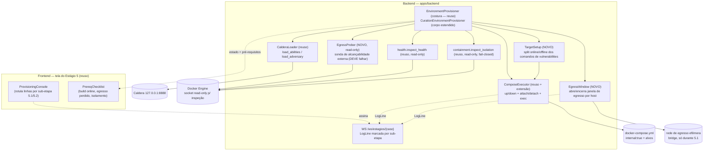

# Design Document

## Overview

Esta spec **estende** o Estágio 5 — Criação do ambiente de emulação — que a spec irmã
`estagio5-provisionamento-ambiente` já transformou de uma inspeção read-only em um **pipeline de
provisionamento ativo, observável e em streaming**. Aquela spec entregou a costura
`EnvironmentProvisioner`/`CurationEnvironmentProvisioner`
(`apps/backend/app/services/environment/provisioner.py`), um `ComposeExecutor` que streama
`docker compose up`/`down`, as linhas de log ao vivo (`LogLine`/`on_log`) sobre o WebSocket de
Estágios, a verificação de saúde (`health.inspect_health`) e o **portão de isolamento** read-only e
fail-closed (`containment/isolation.inspect_isolation`), com a sequência de etapas:

```
subir_conteineres → aguardar_saude → carregar_abilities → verificar_isolamento → concluir
```

O **problema que esta spec resolve** é concreto e está registrado no diário
(`docs/journal/2026-10-01.md`): o Estágio 5 de hoje **nunca aplica** o setup que cada host-alvo
precisa. Os parâmetros já fluem do Estágio 4 — o `EnvironmentParameters`
(`operationalization.py`) carrega, por host, `label`/`address`/`container`/`host_type` e
`vulnerabilities` (os comandos `target_vuln_host_a`/`target_vuln_host_b` derivados dos nós do DAG
curado) além de `services`. Mas quando uma técnica exige **baixar/instalar da internet** (nmap,
`xmrig` via `wget`/`git`/`apt`/`pip`), o setup **falha**, porque as redes de ataque são
`internal: true` — sem egresso. A equipe contornou isso movendo a instalação para o **build-time**
da imagem Docker; esta spec substitui esse contorno por uma orquestração correta.

A **funcionalidade nova** subdivide o Estágio 5 em duas sub-etapas inseridas **dentro** do pipeline
existente, sem reinventá-lo:

- **5.1 Build (online):** com uma **janela de egresso controlada** por host-alvo, executa os
  pré-requisitos **online** (apt/pip/wget/git/binários) derivados de `EnvironmentParameters`.
- **5.2 Runtime (isolado):** **re-isola** os alvos nas redes `internal: true`, **verifica
  positivamente** que o egresso desapareceu, aplica o setup **offline** (usuários, serviços,
  payloads), carrega as Abilities/Adversary no Caldera e executa o portão de isolamento existente.

O **invariante crítico de contenção** (Req. 5) é o esqueleto do desenho: em nenhum instante um alvo
pode estar simultaneamente com internet **e** anexado às redes de ataque com os demais alvos. A
janela de build e a janela de ataque são **mutuamente exclusivas** e a **perda de egresso é
positivamente verificada**, nunca presumida.

### O que é reusado da spec irmã (não reinventar)

| Peça existente | Papel nesta spec |
|---|---|
| `EnvironmentProvisioner` (Protocol) + `CurationEnvironmentProvisioner` | **Mesma** costura por `origem`; apenas o corpo de `provision`/`deprovision` ganha as sub-etapas 5.1/5.2. A assinatura não muda (Req. 9.2). |
| `ComposeExecutor`/`DockerComposeExecutor` (`up`/`down`, `LAB_SERVICES`, `LAB_IMAGES`, build condicional) | Reusado para subir/derrubar o laboratório; estendido com operações de rede (anexar/desanexar) e `exec` de setup — ver Componentes. |
| `LogLine`/`on_log` + canal WS de Estágios | **Mesmo** canal de observabilidade; cada linha ganha a marcação de sub-etapa (5.1/5.2) e etapa (Req. 6). |
| `containment/isolation.inspect_isolation` + `IsolationResult` (read-only, fail-closed) | **Mesmo** portão de isolamento como pré-condição de conclusão (Req. 4), **inalterado**. |
| `containment/subnets` (`INTERNAL_SUBNET_CIDRS`, `container_for_ip`) | Fonte única das sub-redes internas e do mapa IP→contêiner. |
| `EnvironmentParameters`/`TargetHost` (Estágio 4) | **Entrada** da 5.1: `vulnerabilities`/`services` por host. |
| `ProvisionedEnvironment`/`DeprovisioningResult` + `failed_step`/`origin` | Saída tipada estendida com os desfechos das sub-etapas e os novos valores de `failed_step`. |
| `health.inspect_health`/`HealthSummary` | Confirmação read-only de `running`/`healthy`, preservada antes do build. |

### Decisões centrais

- **As sub-etapas são uma decomposição do pipeline existente, não um pipeline paralelo.** 5.1 e 5.2
  são inseridas **entre** `aguardar_saude` e o `verificar_isolamento` final, reusando a mesma
  estrutura de "etapa que emite `LogLine` e, em falha, retorna cedo com `failed_step` + causa".
- **A janela de egresso é o problema central e é resolvida por anexar/desanexar rede, uma via por
  vez, com re-verificação positiva.** Adotamos a opção (c) com salvaguardas: durante a 5.1 o alvo
  fica **exclusivamente** em uma rede de egresso efêmera (desanexado das redes de ataque); a 5.2 só
  reanexa as redes de ataque **depois** de desanexar a de egresso e **comprovar** que o egresso
  caiu. Ver "Mecânica da janela de egresso".
- **A perda de egresso é verificada por uma sonda de alcançabilidade read-only que DEVE falhar.**
  Uma tentativa de alcançar um endpoint externo de dentro do alvo precisa **falhar** (sem rota); se
  o resultado for inconclusivo, trata-se como egresso presente (fail-closed, Req. 5.4/5.5).
- **O split online/offline do setup é determinístico e heurístico.** Os comandos de
  `vulnerabilities` são classificados por padrões estáveis: `apt`/`apt-get`/`pip`/`pip3`/`wget`/
  `curl`-download/`git clone` → **online**; criação de usuário, escrita de payload e start de
  serviço → **offline**. É uma decisão de desenho com trade-offs (os scripts curados são
  monolíticos hoje) — ver "Split online/offline".
- **Fail-closed e estado final seguro.** Qualquer falha deixa o ambiente **isolado (sem egresso)**
  ou **totalmente desprovisionado** — nunca um alvo com egresso (Req. 8).
- **Escopo CONTAINER e origem coesa.** Só `EnvironmentPlatform.CONTAINER`; a origem
  (`curadoria_humana` hoje, `gerado_ia` depois) permanece coesa entre 5.1/5.2 e o teardown.

## Steering compliance

- **Backend:** FastAPI + SQLAlchemy + Alembic, **PostgreSQL exclusivamente**. As dependências
  externas novas (operações de rede do Compose, `exec` de setup, sonda de egresso) são
  **injetáveis** sob `Protocol`s `@runtime_checkable`, com defaults de produção resolvidos
  **preguiçosamente** (nunca na importação, nunca abrindo subprocess/socket no import) — exatamente
  o padrão já usado por `CurationEnvironmentProvisioner` (`inspector`, `caldera`,
  `compose_executor`, `state_inspector` são `None` em produção e construídos lazy).
- **Contenção/isolamento read-only:** o **portão de isolamento** (`inspect_isolation`) e a **sonda
  de egresso** são **somente leitura** — não iniciam/param/modificam contêineres ou redes
  (Req. 9.2 da spec irmã). A **mutação** de rede (anexar/desanexar) e o setup pertencem a
  sub-etapas explícitas (5.1/5.2), **separadas** da verificação; a verificação jamais muda estado.
- **Frontend:** React 19 + TS + Vite + i18next; contratos pt-BR como fonte da verdade; o
  `ProvisioningConsole` existente apenas passa a rotular as linhas por sub-etapa (5.1/5.2). Paridade
  de chaves pt-BR/en exigida (property test de i18n).

## Architecture

### Componentes



### Sequência das novas sub-etapas (onde elas se encaixam)

A sequência da spec irmã é preservada; as novas etapas são **inseridas** entre `aguardar_saude` e o
`verificar_isolamento` final. A etapa `carregar_abilities` **move-se** para dentro da 5.2 (depois do
setup offline), porque a Req. 3.4 exige carregar as Abilities **após** o setup offline concluir.

```mermaid
stateDiagram-v2
  [*] --> SubirConteineres
  SubirConteineres: subir_conteineres (compose up --wait — reuso)
  AguardarSaude: aguardar_saude (running + healthy — reuso)

  state Sub51 {
    BuildOnline: build_online (5.1) — janela de egresso aberta; apt/pip/wget/git por host
    EncerrarEgresso: encerrar_egresso (5.1) — desanexa a rede de egresso de cada host
    BuildOnline --> EncerrarEgresso: pré-requisitos online obtidos
  }

  state Sub52 {
    Reisolar: reisolar (5.2) — reanexa redes de ataque internal:true
    VerificarEgresso: verificar_egresso (5.2) — sonda externa DEVE falhar (positivo)
    SetupOffline: setup_offline (5.2) — usuários/serviços/payloads, sem internet
    CarregarAbilities: carregar_abilities (5.2) — Caldera, ordem do DAG (reuso)
    Reisolar --> VerificarEgresso: redes de ataque reanexadas
    VerificarEgresso --> SetupOffline: egresso comprovadamente perdido
    SetupOffline --> CarregarAbilities: setup offline aplicado
  }

  VerificarIsolamento: verificar_isolamento (portão read-only, fail-closed — reuso)
  Concluido: concluido (Estágio 6 desbloqueado)
  Falha: falha (failed_step + causa; Estágio 6 bloqueado; estado seguro)

  SubirConteineres --> AguardarSaude: todos subiram
  AguardarSaude --> Sub51: todos saudáveis
  Sub51 --> Sub52: egresso encerrado para todos os alvos
  Sub52 --> VerificarIsolamento: Abilities carregadas
  VerificarIsolamento --> Concluido: isolamento aprovado

  SubirConteineres --> Falha
  AguardarSaude --> Falha
  Sub51 --> Falha: falha no build online
  VerificarEgresso --> Falha: egresso ainda presente / inconclusivo
  Sub52 --> Falha: setup offline / Abilities
  VerificarIsolamento --> Falha
  Falha --> [*]
  Concluido --> [*]
```



Mapeamento sobre a lista de etapas da spec irmã:

| Etapa (spec irmã) | Nesta spec |
|---|---|
| `subir_conteineres` | **inalterada** |
| `aguardar_saude` | **inalterada** |
| — | **`build_online`** (5.1 — nova) |
| — | **`encerrar_egresso`** (5.1 — nova) |
| — | **`reisolar`** (5.2 — nova) |
| — | **`verificar_egresso`** (5.2 — nova) |
| — | **`setup_offline`** (5.2 — nova) |
| `carregar_abilities` | **movida** para dentro da 5.2, após `setup_offline` |
| `verificar_isolamento` | **inalterada** (portão final) |

Cada transição emite uma ou mais `LogLine` marcadas com `substage` (`5.1`/`5.2`) e `step`, pelo
mesmo `on_log`/WS. O `failed_step` da `ProvisionedEnvironment` passa a admitir os novos valores.

## Mecânica da janela de egresso (o problema central)

O invariante duro (Req. 5): **nunca** internet **e** redes de ataque ao mesmo tempo; janelas
mutuamente exclusivas; perda de egresso **positivamente verificada**. Analisando as mecânicas do
Docker honestamente:

### Opção (a) — instalar no build-time da imagem (`docker build`)

É o contorno atual registrado no diário. `docker build` usa a rede default do Docker (tem egresso),
e o runtime fica `internal: true`. **Prós:** zero janela de egresso em runtime; o invariante é
trivialmente satisfeito (a internet só existe no build, antes de qualquer rede de ataque existir).
**Contras:** acopla a campanha à imagem — trocar/atualizar os pré-requisitos de um host exige
rebuild; os `vulnerabilities` do Estágio 4 (que variam por campanha e por nó do DAG) teriam de
virar camadas de imagem, o que contradiz o Req. 11.5 da spec irmã ("campanha inserida por API/
runtime, não por imagem") e o espírito desta spec (o sistema **aplica** os parâmetros do Estágio 4
em runtime). **Não recomendada** como mecanismo das sub-etapas, embora o build condicional da
imagem-base (já existente em `DockerComposeExecutor`) continue válido para dependências estáveis.

### Opção (b) — contêiner/rede de staging efêmero com egresso, descartado antes do ataque

Subir um contêiner de staging com egresso, baixar os artefatos para um volume, destruí-lo e montar
o volume no alvo isolado. **Prós:** o alvo de ataque **nunca** toca a internet — forte garantia do
invariante. **Contras:** o setup online de muitas técnicas não é "baixar um arquivo"; é
`apt install`/`pip install` que mutam o **filesystem do próprio alvo** (pacotes, libs, binários em
`/usr`), difíceis de materializar fielmente em um volume e remontar em outro contêiner sem
divergência. Alta complexidade e risco de infidelidade. **Não recomendada** como mecanismo geral.

### Opção (c) — anexar temporariamente a uma rede de egresso e desanexar antes das redes de ataque — RECOMENDADA

Durante a 5.1, o alvo fica anexado **exclusivamente** a uma **rede de egresso efêmera** (bridge, com
gateway/DNS externo) e **desanexado** das redes de ataque. Ao fim da 5.1, a rede de egresso é
**desanexada**; só então (5.2) as redes de ataque são **reanexadas**.

**Por que o toggling ingênuo é arriscado** — e como mitigamos:

1. **Janela de coexistência.** Se simplesmente anexássemos a rede de egresso *sem* desanexar as
   redes de ataque (ou reanexássemos o ataque *antes* de desanexar o egresso), existiria um instante
   em que o alvo tem internet **e** rede de ataque — exatamente o que o invariante proíbe.
   **Mitigação:** a 5.1 **só** começa depois de desanexar o alvo das redes de ataque; a 5.2 **só**
   reanexa o ataque depois de desanexar o egresso. Uma via por vez, com ordem estrita
   (Req. 5.3): `detach(ataque)` → `attach(egresso)` → *build* → `detach(egresso)` →
   `attach(ataque)` → *verificar egresso*.
2. **Resíduo de configuração.** DNS externo ou rotas default podem sobreviver à desanexação da rede.
   **Mitigação:** a perda de egresso **não é presumida** — a sonda (`EgressProber`) comprova
   ativamente que não há rota externa **antes** de qualquer setup offline e **antes** do portão de
   isolamento (que, aliás, reprova DNS externo e rede não-interna via `inspect_isolation`).
3. **Falha no meio.** Uma falha com a rede de egresso ainda anexada deixaria um alvo com internet.
   **Mitigação:** o tratamento de falha (Req. 8.3) **sempre** encerra a janela de egresso (ou
   desprovisiona) antes de retornar — nenhum caminho de erro sai com egresso aberto.

> **Garantia do invariante.** Em qualquer instante, o conjunto de redes anexadas ao alvo é **ou**
> `{rede_egresso}` (durante a 5.1) **ou** um subconjunto das redes de ataque `internal: true`
> (da 5.2 em diante) — **nunca a união dos dois**. A troca entre os dois conjuntos é sempre
> `detach` seguido de `attach`, nessa ordem, por host. A rede de egresso é efêmera: criada no início
> da 5.1 e removida no `encerrar_egresso`.

A rede de egresso efêmera recebe um nome determinístico (`sticks-egress-ephemeral`) e **não** é
`internal`; é a única fonte de egresso e existe apenas durante a 5.1. Como ela nunca coexiste com as
redes de ataque no mesmo alvo, o laboratório jamais fica roteável para fora enquanto os alvos estão
juntos no plano de ataque.

## Verificação positiva de perda de egresso

A `EgressProber` é uma sonda **read-only** que executa, de dentro de cada alvo, uma tentativa de
alcançar um endpoint externo (um IP público fixo, ex.: `1.1.1.1`, por TCP/ICMP com timeout curto) e
exige que ela **falhe**:

- **Falha de alcance (sem rota / timeout)** → `egresso perdido` → aprova (veredito positivo).
- **Sucesso de alcance** → `egresso presente` → **reprova** (o alvo ainda tem internet).
- **Inconclusivo** (não foi possível executar a sonda, daemon indisponível, erro de `exec`) →
  tratado como **egresso presente** → **reprova** (fail-closed, Req. 5.4/5.5).

A sonda é um `exec` de leitura (não altera o alvo): não instala nada, não escreve payload — apenas
tenta uma conexão e lê o resultado. É modelada como um `Protocol` injetável (`EgressProber`), com um
fake nos testes (devolve veredito roteirizado) e um adaptador real lazy em produção que roda o
`exec` via a extensão do `ComposeExecutor`. O resultado vira um `EgressVerdict` por host e alimenta
tanto o `failed_step="verificar_egresso"` quanto o `PrereqChecklist` da tela.

> A sonda é **complementar** ao portão de isolamento. O portão (`inspect_isolation`) prova, pela
> configuração de rede (redes internal, sem bridge, sem DNS externo), que o alvo **não deveria** ter
> egresso; a sonda prova, pelo comportamento, que o alvo **de fato** não alcança a internet. Juntos,
> cobrem configuração e comportamento — a verificação positiva que a Req. 5 exige.

## Split online/offline dos pré-requisitos (5.1 a partir da curadoria)

A 5.1 precisa saber **o que** rodar com egresso. A entrada é `EnvironmentParameters` do Estágio 4:
por host, `vulnerabilities` (os comandos `target_vuln_host_a`/`_b`) e `services`. O
`shadowray_suta.sh` mostra o problema: os scripts curados são **monolíticos** — misturam, no mesmo
arquivo, `apt-get install`, `pip3 install` (online) com `useradd`, escrita de `backdoor.py` e start
de serviços (offline).

**Decisão de desenho: classificação heurística determinística por comando.** O `TargetSetup`
classifica cada comando de `vulnerabilities` em `ONLINE` ou `OFFLINE` por padrões estáveis
(regex), aplicados comando a comando:

| Classificação | Padrões (regex, estáveis) |
|---|---|
| **ONLINE** (5.1, com egresso) | `\bapt(-get)?\s+(install\|update)`, `\bpip3?\s+install`, `\bwget\b`, `\bcurl\b.*\b(-O\|-o\|--output)\b`, `\bgit\s+clone\b`, download explícito de binário (`https?://` seguido de gravação em arquivo) |
| **OFFLINE** (5.2, sem internet) | `\buseradd\b`/`\busermod\b`/`\bchpasswd\b`/`\bsmbpasswd\b`, escrita de payload (`cat > ... << EOF`, `base64 >`), start de serviço (`sshd &`, `php-fpm`, `nginx`, `su ... -c "... &"`), `chmod`/`chown`, `mkdir` |

Regras de borda:

- Um comando que **não casa** nenhum padrão online é classificado como **OFFLINE** por padrão — o
  pior caso de uma classificação errada é tentar rodar algo offline que precisaria de internet, o
  que **falha de forma segura e contida** (nunca abre egresso indevido). Isso mantém o invariante
  mesmo diante de uma heurística imperfeita.
- O `apt-get install ... 2>/dev/null || true` curado (idempotente, ignora falha) continua válido:
  na 5.1 roda com egresso; se um host não tiver nada online, a 5.1 é um no-op para ele.
- **Trade-off assumido:** a heurística pode errar em comandos atípicos. A alternativa seria um
  **split declarativo** — os artefatos curados declarariam explicitamente `online:`/`offline:` por
  passo (ex.: estender o nó do DAG com `target_vuln_online_host_*`/`target_vuln_offline_host_*`).
  Isso é mais robusto porém exige mudar o formato curado e a derivação do Estágio 4. **Esta spec
  recomenda a heurística agora** (não altera a curadoria existente, destrava ShadowRay) e registra o
  split declarativo como evolução natural quando o agente de IA passar a gerar os parâmetros, sob a
  mesma `EnvironmentProvisioner` e sem redesenho (Req. 9.2).

A 5.1 executa a parte ONLINE de cada host dentro da janela de egresso; a 5.2 executa a parte OFFLINE
depois do `verificar_egresso`. A derivação é **pura e determinística** (sem rede, sem IA), coerente
com o `operationalizer.py`.

## Components and Interfaces

As novas peças seguem o padrão do pacote: `Protocol` `@runtime_checkable` + DTO simples + adaptador
de produção lazy. Nenhuma delas abre subprocess/socket na importação.

### `ComposeExecutor` — extensão de rede e `exec` (reuso + novo)

O `ComposeExecutor` existente (`up`/`down`, streaming, `LAB_SERVICES`/`LAB_IMAGES`, build
condicional) ganha as operações mínimas que as sub-etapas exigem, com a **mesma** disciplina de
segurança (forma de lista de argumentos, sem shell; nomes/paths são constantes do backend, nunca
interpolados de entrada do usuário):

```python
# compose_executor.py (extensão da costura — mesmas garantias de segurança)
class ComposeExecutor(Protocol):
    # ... up(...) / down(...) existentes, inalterados ...

    def attach_network(
        self, container: str, network: str, *, on_log: Callable[[LogLine], None]
    ) -> CommandResult:
        """`docker network connect <network> <container>` (muta rede — fora da verificação)."""
        ...

    def detach_network(
        self, container: str, network: str, *, on_log: Callable[[LogLine], None]
    ) -> CommandResult:
        """`docker network disconnect <network> <container>`."""
        ...

    def exec_in(
        self, container: str, argv: list[str], *, on_log: Callable[[LogLine], None]
    ) -> CommandResult:
        """`docker exec <container> <argv...>` (argv é lista; sem shell)."""
        ...
```

> Mutação de rede (`attach`/`detach`) e `exec` de setup pertencem às sub-etapas 5.1/5.2 — são
> **ações de provisionamento**, nunca de verificação. O portão de isolamento e a sonda de egresso
> permanecem read-only (Req. 9.2). Os comandos de setup vindos de `vulnerabilities` são curados
> (humano) e passados a `exec_in` como argumentos de um shell do contêiner (ex.:
> `["bash","-lc",<comando>]`) — a superfície de injeção fica contida ao conteúdo curado, não a
> entrada arbitrária de usuário final.

### `EgressWindow` — abertura/encerramento da janela (NOVO)

```python
# app/services/environment/egress.py (NOVO)
EGRESS_NETWORK = "sticks-egress-ephemeral"  # bridge, NÃO internal; só existe durante a 5.1

@dataclass(frozen=True)
class EgressWindowResult:
    container: str
    opened: bool = False       # janela aberta (alvo em rede de egresso, fora das de ataque)
    closed: bool = False       # janela encerrada (rede de egresso desanexada)
    reason: Optional[str] = None

class EgressWindow(Protocol):
    """Abre/encerra a janela de egresso de um alvo, uma via por vez (Req. 5.2, 5.3)."""

    def open(self, container: str, attack_networks: list[str], *, on_log) -> EgressWindowResult:
        """detach(redes de ataque) -> attach(EGRESS_NETWORK). NUNCA deixa as duas juntas."""
        ...

    def close(self, container: str, *, on_log) -> EgressWindowResult:
        """detach(EGRESS_NETWORK). Após isto o alvo fica sem nenhuma rede até a 5.2 reanexar."""
        ...
```

A implementação de produção usa o `ComposeExecutor.detach_network`/`attach_network` e as redes de
ataque conhecidas de `topology_builder`/`subnets`. A implementação é **injetável** (fake nos
testes). A ordem estrita `detach(ataque)` antes de `attach(egresso)` é o que garante o invariante.

### `EgressProber` — sonda positiva read-only (NOVO)

```python
# app/services/environment/egress.py (NOVO)
@dataclass(frozen=True)
class EgressVerdict:
    container: str
    egress_lost: bool = False   # True quando a sonda externa FALHOU (egresso perdido => aprovado)
    conclusive: bool = False    # False => inconclusivo => tratado como egresso presente (fail-closed)
    reason: Optional[str] = None

class EgressProber(Protocol):
    """Sonda read-only: tenta alcançar endpoint externo; DEVE falhar (Req. 3.2, 5.4)."""

    def probe(self, container: str, *, on_log) -> EgressVerdict:
        ...

def egress_lost(verdicts: list[EgressVerdict]) -> bool:
    """Fail-closed: aprova só quando TODOS perderam egresso de forma CONCLUSIVA."""
    return bool(verdicts) and all(v.egress_lost and v.conclusive for v in verdicts)
```

### `TargetSetup` — split e aplicação do setup (NOVO)

```python
# app/services/environment/target_setup.py (NOVO)
class SetupPhase(str, Enum):
    ONLINE = "online"
    OFFLINE = "offline"

@dataclass(frozen=True)
class ClassifiedCommand:
    command: str
    phase: SetupPhase

def classify_commands(vulnerabilities: list[str]) -> list[ClassifiedCommand]:
    """Classificação heurística determinística (ver 'Split online/offline'). Pura, sem rede."""
    ...

class TargetSetup(Protocol):
    def apply(
        self, container: str, commands: list[ClassifiedCommand], phase: SetupPhase, *, on_log
    ) -> CommandResult:
        """Roda os comandos da fase indicada via ComposeExecutor.exec_in, em ordem."""
        ...
```

### `CurationEnvironmentProvisioner.provision` (EVOLUÇÃO do corpo)

A assinatura `EnvironmentProvisioner.provision(params, *, on_log)` **não muda** (Req. 9.2). O corpo
passa a orquestrar as sub-etapas, reusando as etapas existentes e inserindo as novas. Esboço:

```python
def provision(self, params, *, on_log=lambda _l: None) -> ProvisionedEnvironment:
    containers = self._target_containers(params)
    hosts = params.hosts                     # TargetHost com vulnerabilities por alvo

    # 1-2. subir_conteineres + aguardar_saude  (REUSO, inalterado)
    #      up.code != 0 -> failed_step="subir_conteineres"
    #      not health.approved -> failed_step="aguardar_saude"

    # --- 5.1 Build (online) -------------------------------------------------
    attack_nets = attack_networks_for(containers)         # de topology_builder/subnets
    try:
        for host in hosts:                                 # Req. 2.2, 2.3
            cls = classify_commands(host.vulnerabilities)
            online = [c for c in cls if c.phase == SetupPhase.ONLINE]
            win = self._egress.open(host.container, attack_nets, on_log=on_log)   # detach ataque -> attach egresso
            if not win.opened:
                self._fail_safe(host, on_log)              # garante sem egresso remanescente (Req. 8.3)
                return _output(failed_step="build_online", error_message=win.reason)
            r = self._setup.apply(host.container, online, SetupPhase.ONLINE, on_log=on_log)
            closed = self._egress.close(host.container, on_log=on_log)            # encerra janela (Req. 2.5)
            if r.code != 0 or not closed.closed:
                self._fail_safe(host, on_log)
                step = "build_online" if r.code != 0 else "encerrar_egresso"
                return _output(failed_step=step, error_message=self._cause(r, closed))
    except Exception as exc:
        self._fail_safe_all(hosts, on_log)                 # nunca sair com egresso (Req. 8.3, 8.4)
        return _output(failed_step="build_online", error_message=str(exc))

    # --- 5.2 Runtime (isolado) ---------------------------------------------
    for host in hosts:                                     # reisolar: reanexa redes de ataque (Req. 3.1)
        self._egress... reattach_attack(host.container, attack_nets, on_log)
    verdicts = [self._prober.probe(h.container, on_log=on_log) for h in hosts]    # verificar_egresso (Req. 3.2)
    if not egress_lost(verdicts):
        return _output(failed_step="verificar_egresso", error_message=self._egress_cause(verdicts))
    for host in hosts:                                     # setup_offline (Req. 3.3)
        cls = classify_commands(host.vulnerabilities)
        offline = [c for c in cls if c.phase == SetupPhase.OFFLINE]
        r = self._setup.apply(host.container, offline, SetupPhase.OFFLINE, on_log=on_log)
        if r.code != 0:
            return _output(failed_step="setup_offline", error_message=self._cause(r))

    loaded = self._load_abilities(params)                  # carregar_abilities (REUSO) — Req. 3.4
    if not loaded:
        return _output(failed_step="carregar_abilities", error_message="...")

    # --- portão de isolamento (REUSO, read-only, fail-closed) — Req. 4 -----
    isolation = self._check_isolation(containers)
    if not isolation.passed:
        return _output(isolation=isolation, failed_step="verificar_isolamento", error_message="...")

    return _output(isolation=isolation, health=health, loaded_abilities=loaded,
                   substages=SubStageSummary(...))         # ready == True
```

`_fail_safe`/`_fail_safe_all` encerram a janela de egresso (ou desprovisionam) para que nenhuma
falha deixe um alvo com internet (Req. 8.3/8.4). Todas as linhas são emitidas com `substage`/`step`.

### `CurationEnvironmentProvisioner.deprovision` (EVOLUÇÃO)

Além do `compose down` existente, o teardown remove o que 5.1/5.2 criaram que não some com os
contêineres: a **rede de egresso efêmera** (se por algum erro tiver sobrevivido) e qualquer artefato
externo ao contêiner. Como o setup offline escreve **dentro** dos contêineres do laboratório, o
`compose down` (que remove os contêineres) já o descarta; o teardown apenas garante também a remoção
da `EGRESS_NETWORK` e reporta `remaining_resources` em falha (Req. 10).

### Frontend (reuso, ajuste leve)

- `ProvisioningConsole`: passa a renderizar o rótulo de **sub-etapa** (5.1 Build/online, 5.2
  Runtime/isolado) além do `step`, pela marcação nova em `LogLine`/`LogLineView` (Req. 6.3/6.4).
- `PrereqChecklist`: ganha os itens **"pré-requisitos online obtidos"**, **"egresso perdido
  (verificado)"** e mantém **"isolamento aprovado"**; em falha mostra `failed_step` + causa e
  Estágio 6 bloqueado (Req. 8.2).
- i18n: novas chaves sob `stage5.provisionamento.*` (sub-etapas e novos pré-requisitos), com
  paridade pt-BR/en.

## Data Models

### `LogLine`/`LogLineView` — marcação de sub-etapa

`LogLine` ganha um campo `substage` opcional (`"5.1"` | `"5.2"` | `None` para as etapas herdadas),
preservando a compatibilidade (default `None`). O `LogLineView` do canal WS propaga `substage` ao
frontend. A ordem e o `seq` monotônico já existentes são mantidos.

### `ProvisionedEnvironment` — desfechos das sub-etapas + novos `failed_step`

`ProvisionedEnvironment` (reuso) é estendida sem quebrar a forma existente:

```python
class SubStageSummary(BaseModel):
    build_online_ok: bool = False          # 5.1 concluída para todos os hosts
    egress_closed: bool = False            # janela de egresso encerrada para todos
    egress_lost_verified: bool = False     # perda de egresso positivamente verificada (Req. 5.4)
    offline_applied: bool = False          # setup offline aplicado
    egress_verdicts: list[EgressVerdictView] = Field(default_factory=list)

class ProvisionedEnvironment(BaseModel):
    # ... campos existentes (campaign_id, platform, target_containers, compose_file,
    #     isolation, health, loaded_abilities, origin, failed_step, error_message) ...
    substages: SubStageSummary = Field(default_factory=SubStageSummary)   # DELTA
```

`failed_step` passa a admitir, além dos valores herdados (`subir_conteineres`, `aguardar_saude`,
`carregar_abilities`, `verificar_isolamento`): **`build_online`**, **`encerrar_egresso`**,
**`reisolar`**, **`verificar_egresso`**, **`setup_offline`**. A propriedade `ready` passa a exigir
também `substages.build_online_ok`, `substages.egress_lost_verified` e `substages.offline_applied`,
além dos pré-requisitos herdados (`health.approved`, `loaded_abilities`, `isolation.approved`).

`origin` (`curadoria_humana`/`gerado_ia`) e `platform` (`CONTAINER`) permanecem como estão — escopo
e costura inalterados (Req. 9, 11).

### `EnvironmentParameters` — entrada (reuso, sem mudança)

Consumido como está: `hosts[].vulnerabilities`/`services`/`container`/`address`. A 5.1 deriva os
pré-requisitos online por `classify_commands(host.vulnerabilities)`; nenhuma mudança de modelo é
exigida no Estágio 4 (a opção declarativa fica como evolução futura).

## Correctness Properties

*Uma propriedade é uma característica que deve valer em toda execução válida do sistema — uma
afirmação formal do que o sistema deve fazer, servindo de ponte entre a especificação legível e
garantias verificáveis por máquina.*

### Property 1: Invariante de contenção — nunca egresso e redes de ataque juntos

*Para toda* sequência de sub-etapas aplicada a qualquer conjunto de hosts-alvo, em **nenhum
instante** o conjunto de redes anexadas a um alvo contém, ao mesmo tempo, a rede de egresso e
qualquer rede de ataque; as transições são sempre `detach` antes de `attach`.

**Validates: Requirements 5.1, 5.2, 5.3**

### Property 2: Perda de egresso positivamente verificada antes de qualquer setup offline

*Para todo* host-alvo, nenhum comando de setup offline é aplicado a ele antes de a sonda de egresso
devolver um veredito **conclusivo** de egresso perdido; verdito inconclusivo ou egresso presente
impede o setup offline e reprova o Estágio 5 (fail-closed).

**Validates: Requirements 3.2, 3.5, 5.4, 5.5**

### Property 3: Ordem estrita 5.1 antes de 5.2

*Para toda* execução, a sub-etapa 5.2 (reisolar/verificar/setup offline) só inicia quando a 5.1
(build online + encerrar egresso) concluiu com sucesso para **todos** os hosts; se a 5.1 falha, a
5.2 não executa.

**Validates: Requirements 1.2, 1.3, 2.6**

### Property 4: Falha nunca deixa um alvo com egresso

*Para toda* falha em qualquer ponto das sub-etapas, o estado final de cada host-alvo é **isolado
(sem egresso)** ou **desprovisionado** — jamais com a janela de egresso aberta.

**Validates: Requirements 8.3, 8.4**

### Property 5: Portão de isolamento fail-closed como pré-condição de conclusão

*Para todo* conjunto de hosts-alvo, o Estágio 5 só conclui (e o Estágio 6 só desbloqueia) quando
`inspect_isolation` aprova **todos**; lista vazia ou daemon indisponível reprova.

**Validates: Requirements 4.1, 4.3, 4.5**

### Property 6: Idempotência da re-execução

*Para todo* ambiente já provisionado com sucesso, re-executar o Estágio 5 resulta em um estado final
equivalente ao de uma execução única bem sucedida, sem duplicar recursos nem violar o invariante de
contenção.

**Validates: Requirements 7.1, 7.2, 7.3, 7.4**

### Property 7: Classificação determinística online/offline é estável e segura por padrão

*Para toda* lista de comandos de `vulnerabilities`, `classify_commands` é determinística (mesma
entrada → mesma saída) e todo comando que não casa um padrão online é classificado como offline (o
default seguro, que nunca abre egresso indevido).

**Validates: Requirements 2.2, 5.1**

## Error Handling

- **Falha no build online (Req. 2.6, 8):** `TargetSetup.apply(ONLINE)` com `code != 0` →
  `failed_step="build_online"`. **Antes de retornar**, `_fail_safe` encerra a janela de egresso do
  host → nenhum alvo fica com internet (Req. 8.3). A 5.2 **não** inicia (Req. 1.3).
- **Falha ao encerrar a janela (Req. 5.3, 8.3):** `EgressWindow.close` não confirmou →
  `failed_step="encerrar_egresso"`; o tratamento tenta novamente encerrar/desprovisionar o host, de
  modo que o estado final seja isolado ou desprovisionado (Req. 8.4) — nunca com egresso.
- **Egresso ainda presente / inconclusivo (Req. 3.5, 5.4, 5.5):** `egress_lost(verdicts) == False`
  → `failed_step="verificar_egresso"`, identificando o host e o motivo; **nenhum setup offline é
  aplicado**. Fail-closed: inconclusivo conta como egresso presente.
- **Falha no setup offline / Abilities (Req. 3.6):** `code != 0` → `failed_step="setup_offline"`;
  Caldera indisponível → `failed_step="carregar_abilities"` (reuso). O ambiente permanece isolado
  (as redes de ataque já estão reanexadas e o egresso foi verificado como perdido) — estado final
  seguro (Req. 8.4).
- **Isolamento reprovado (Req. 4.4):** `inspect_isolation` reprova (ou daemon indisponível,
  fail-closed) → `failed_step="verificar_isolamento"`, identificando o contêiner não isolado.
- **Re-execução (Req. 7):** `build_online`/`setup_offline` são escritos para serem **idempotentes**
  — os comandos curados já usam padrões idempotentes (`useradd` tolerante, `|| true`,
  `pgrep || start`, `cat >` que sobrescreve). A re-execução reaplica o setup chegando ao mesmo estado
  final; a janela de egresso é reaberta/encerrada do mesmo jeito, preservando o invariante em todos
  os momentos (Req. 7.4).
- **Consistência tela ↔ console (Req. 8.2):** o `error_message` deriva da última `LogLine` de erro
  da sub-etapa que falhou, com o mesmo `substage`/`step` exibido no console.

## Testing Strategy

Esta funcionalidade é **lógica de orquestração com invariantes de contenção** — adequada a testes
baseados em propriedade sobre fakes, **sem Docker real**. Todos os seams novos (`ComposeExecutor`
estendido, `EgressWindow`, `EgressProber`, `TargetSetup`) são `Protocol`s injetáveis, exatamente
como `ContainerInspector`/`CalderaLoader` já são — os testes injetam fakes que roteirizam
resultados, e nenhum teste toca a rede pública nem o daemon.

As sete propriedades a verificar estão em **## Correctness Properties** (acima); cada uma vira um
único teste de propriedade conforme abaixo.

### Property-based tests (biblioteca: Hypothesis)

- Biblioteca já em uso no backend (`apps/backend/.hypothesis`); **não** implementar PBT do zero.
- Mínimo **100 iterações** por propriedade.
- Cada teste tagueado: **Feature: stage5-target-provisioning, Property N: {texto}**.
- Cada propriedade acima é implementada por **um** teste de propriedade, gerando conjuntos
  aleatórios de hosts/comandos e um `ComposeExecutor`/`EgressWindow`/`EgressProber`/`TargetSetup`
  **fake** que registra a **ordem** de attach/detach/exec, para que a Property 1 verifique o
  invariante inspecionando o histórico de chamadas (nenhum Docker real).

### Unit tests (exemplos e casos de borda)

- `classify_commands` sobre o `shadowray_suta.sh` real: `apt`/`pip3` → ONLINE; `useradd`/`cat >`/
  `sshd &` → OFFLINE (exemplo concreto do split).
- Cada `failed_step` novo (`build_online`, `encerrar_egresso`, `reisolar`, `verificar_egresso`,
  `setup_offline`) produzido isoladamente por um fake que falha naquela etapa, e asserção de que o
  estado final não tem egresso.
- `EgressProber` fake: egresso perdido (aprova), egresso presente (reprova), inconclusivo (reprova,
  fail-closed).
- `deprovision` remove a `EGRESS_NETWORK` e mapeia falha → `remaining_resources`.
- Garantia read-only: a sonda e o portão só chamam APIs de leitura; attach/detach/exec só aparecem
  nas sub-etapas 5.1/5.2, nunca na verificação (asserção sobre as chamadas dos fakes).
- Compatibilidade: `provision(params)` sem `on_log` continua válido; `LogLine.substage` default
  `None` para as etapas herdadas.
- Frontend: `ProvisioningConsole` rotula sub-etapas; `PrereqChecklist` com os novos itens; property
  test de paridade i18n pt-BR/en das novas chaves.
