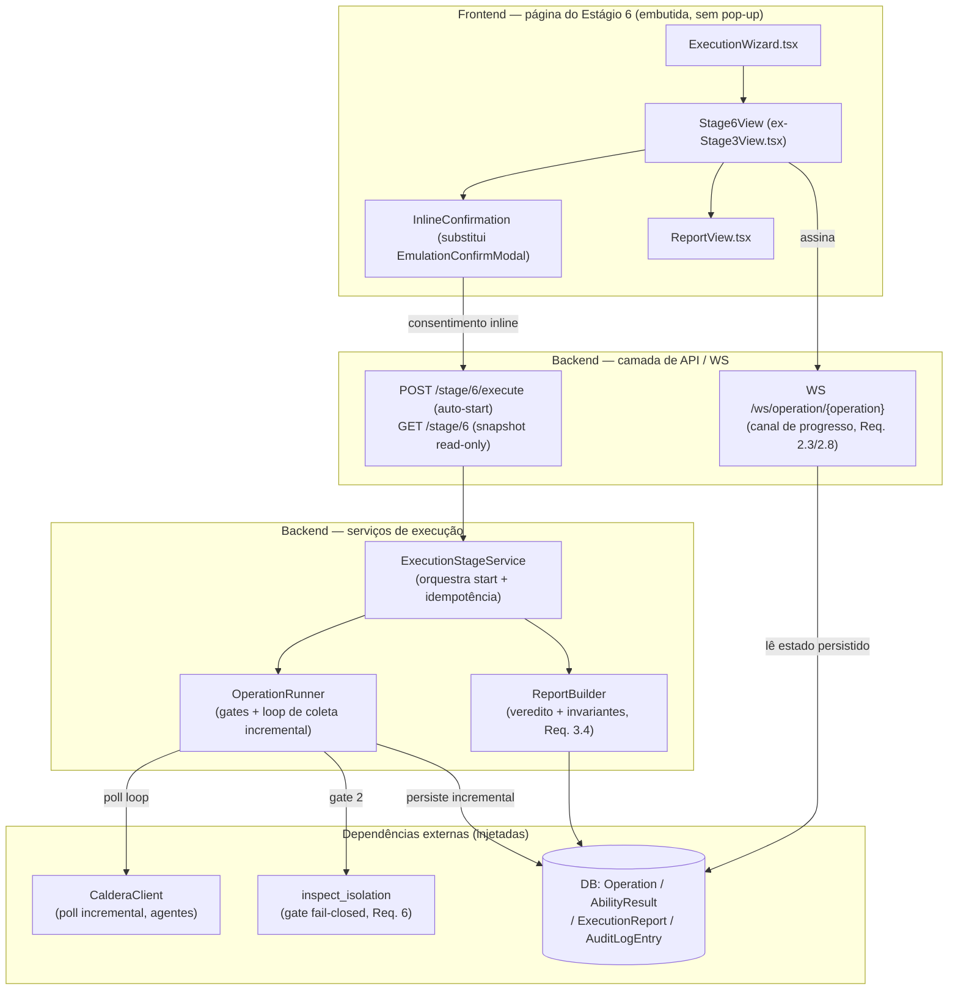
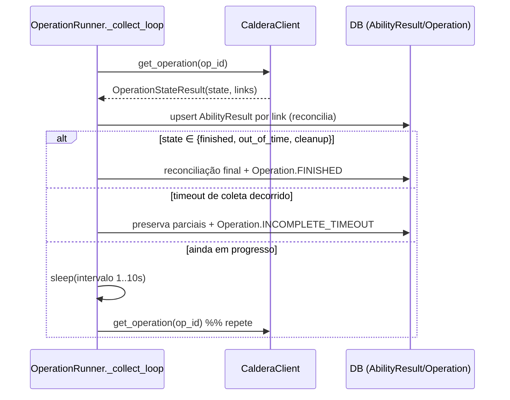

# Design Document

## Overview

Este design redesenha o **Estágio 6 — Execução, medição e relatório** do pipeline STICKS e
corrige o **bug de coleta** descrito nos requisitos: hoje o `OperationRunner._execute` chama
`CalderaClient.poll_until_complete(...)` **uma única vez** e, em seguida, itera
`state_result.links` **uma única vez** para persistir os `AbilityResult`. Quando o Caldera ainda
está avançando a cadeia (`chain`) no instante em que esse polling único retorna — ou quando o
snapshot do deadline ainda é não-terminal — somente resultados parciais são persistidos, mas a
Operação é marcada `FINISHED`. O relatório resultante fica inconsistente (ex.: veredito "Falha",
"0 nós falharam", técnicas eternamente "em execução"), exatamente o observado na execução real do
ShadowRay (`state=finished`, `chain=11`, mas apenas 6 resultados coletados).

O redesenho é guiado por três objetivos de produto e seis requisitos:

1. **Execução automática e embutida** ao entrar no Estágio 6, sem pop-up (Req. 1) — substituindo o
   atual `EmulationConfirmModal.tsx` por uma confirmação **inline** na própria página.
2. **Acompanhamento técnica por técnica, ao vivo** (Req. 2), reusando o canal
   `WS /ws/operation/{operation}` com latência de atualização ≤ 2s e indicador de conexão perdida.
3. **Coleta fiel até o estado terminal** (Req. 3) — o coração da correção do bug: coletar e
   persistir **incrementalmente** a cada poll, reconciliando os `AbilityResult`, até o Caldera
   atingir um estado terminal real (`finished` / `out_of_time` / `cleanup`) ou o timeout de coleta,
   caso em que a Operação recebe o **novo** estado `INCOMPLETE_TIMEOUT`.
4. **Agentes/ambiente saudáveis** verificados no Estágio 5 (Req. 4), incluindo detecção de agentes
   órfãos (`alive=false`) e uso dos endpoints/nomes atuais do Caldera.
5. **Fronteira Estágio 5 ↔ 6** (Req. 5): toda verificação de ambiente mora no Estágio 5; o Estágio
   6 assume ambiente pronto e exibe o resultado do Estágio 5 somente-leitura.
6. **Gate de isolamento inegociável, fail-closed** (Req. 6): nenhum comando dispara se o isolamento
   não estiver comprovado, com reverificação periódica (≤ 30s) durante a execução.

O design é fiel à arquitetura existente (FastAPI + SQLAlchemy no backend; React/TypeScript no
frontend) e reusa componentes já implementados: `OperationRunner`, `CalderaClient`
(`poll_until_complete`, `get_operation`, `ensure_available`), `inspect_isolation`,
`run_operation_progress_channel`, `Stage3View.tsx`, `lib/stages.ts`. As mudanças são cirúrgicas e
localizadas, preservando os quatro gates de pré-flight já existentes no runner.

## Architecture

### Visão em camadas

O fluxo do Estágio 6 atravessa quatro camadas, cada uma com uma responsabilidade bem definida:



### Decisão central: loop de coleta incremental (correção do bug — Req. 3)

A raiz do bug é o **polling de disparo único** seguido de **uma única iteração** sobre os links. O
redesenho troca isso por um **loop de coleta e reconciliação**:

- Em vez de `poll_until_complete` (que descarta todos os snapshots intermediários e só devolve o
  último), o runner passa a chamar `CalderaClient.get_operation(op_id)` repetidamente num laço
  próprio, com `intervalo` configurável (1–10s, padrão 2s — Req. 3.1).
- A **cada poll**, o runner reconcilia os `AbilityResult` persistidos com os links observados
  (upsert por `ability_id`/`link_id`): links novos são inseridos; links que avançaram de estado
  (`pendente`→`em_execucao`→`sucesso`/`falha`) são atualizados. Isso mantém o estado persistido
  sempre igual à melhor observação do Caldera, alimentando o canal WS em tempo real (Req. 2.3).
- O laço continua até o Caldera reportar um estado **terminal real** (`finished` / `out_of_time` /
  `cleanup`) **ou** até o `timeout` de coleta configurável contado a partir do início da Operação
  (Req. 3.1).
- Ao sair do laço:
  - **terminal atingido:** a contagem de `AbilityResult` persistidos é reconciliada uma última vez
    para igualar o número de links em estado terminal no Caldera (Req. 3.3); a Operação é marcada
    `FINISHED`.
  - **timeout sem terminal:** a Operação é marcada com o novo estado `INCOMPLETE_TIMEOUT`
    (Req. 3.2), **preservando** os resultados parciais já coletados e **não** contabilizando a
    Operação entre as execuções bem-sucedidas.



Esta mudança é **localizada em `OperationRunner._execute`**: os quatro gates de pré-flight
(confirmação, contenção de destinos, isolamento de contêineres, disponibilidade do Caldera)
permanecem intactos e na mesma ordem. Apenas o trecho pós-`create_operation` (hoje
`poll_until_complete` + loop único) é substituído pelo loop de coleta incremental.

### Decisão: auto-start embutido + confirmação inline (Req. 1, 6)

O start deixa de ser disparado por um clique num modal. Ao entrar no Estágio 6:

1. O frontend verifica, via snapshot `GET /stage/6`, se já existe resultado persistido
   (idempotência — Req. 1.5): se existir, **reexibe** sem reexecutar.
2. Caso contrário, renderiza a **confirmação de segurança inline** (quando exigida por política —
   Req. 1.6) na própria página. Sem pop-up/modal (Req. 1.3).
3. Após o consentimento explícito inline (ou imediatamente, se a política dispensar confirmação),
   dispara `POST /stage/6/execute` em até 3s da renderização (Req. 1.1).
4. O backend roda o **gate de isolamento primeiro** (Req. 6.1, 6.5): se não isolado/indisponível,
   não dispara comando e devolve a causa, exibida embutida (Req. 1.2, 6.2).
5. Se o Estágio 5 não estiver concluído, o Estágio 6 fica bloqueado e redireciona ao Estágio 5 em
   até 3s (Req. 1.4).

O `EmulationConfirmModal.tsx` é **removido**; sua lógica de preview/consentimento migra para um
componente inline dentro da página do Estágio 6 (seção da própria tela, não um `Dialog`).

### Decisão: ambiente verificado no Estágio 5 (Req. 4, 5)

Todas as verificações de ambiente (provisionamento, saúde dos contêineres, isolamento, saúde dos
agentes) são responsabilidade do Estágio 5. Para a saúde dos agentes (Req. 4), o `CalderaClient`
ganha capacidade de **listar agentes** e seu `alive`, usada pelo `EnvironmentStageService` (Estágio
5) para: exigir ≥ 1 agente `alive=true` no grupo esperado; detectar órfãos `alive=false`; e bloquear
o avanço com causa específica (ausência de agente, órfão, apontamento divergente). O Estágio 6
apenas **lê** o resultado do Estágio 5 (somente-leitura), sem reexecutar verificação (Req. 5.2, 5.4).

> **Nota de contenção (gate de isolamento, Req. 6.6):** embora o Estágio 5 verifique isolamento, o
> gate de isolamento do Estágio 6 **permanece** — é inegociável e fail-closed (Req. 6.5). Ele usa
> o **mesmo conjunto de contêineres-alvo e a mesma regra** do Estágio 5 (`inspect_isolation` sobre
> redes `internal: true`), garantindo resultado equivalente para o mesmo estado de ambiente
> (Req. 6.6). O design não remove a dupla verificação: a do Estágio 5 é a gate de avanço; a do
> Estágio 6 é a gate fail-closed imediatamente antes de qualquer comando e durante a execução.

## Components and Interfaces

### Backend

#### `OperationRunner` (modificado) — `app/services/operation/runner.py`

O ponto de modificação é o método `_execute`. Introduz-se um laço de coleta incremental e um novo
`RunOutcome.INCOMPLETE_TIMEOUT`.

- **Novo parâmetro de configuração de coleta** (injetável, com defaults):
  - `collection_interval: float = 2.0` — segundos entre polls (clamp 1..10 — Req. 3.1).
  - `collection_timeout: float` — timeout total de coleta a partir do início da Operação (Req. 3.1).
  - `sleeper`/`clock` injetáveis — para testes determinísticos (sem `time.sleep` real).
- **Novo método privado `_collect_until_terminal(operation_id, started_at) -> _CollectionResult`:**
  conduz o laço descrito na Arquitetura, retornando os `AbilityRunResult` finais, os totais e se
  terminou por **terminal** ou por **timeout**.
- **Novo método privado `_reconcile(operation_id, links)`:** upsert dos `AbilityResult` por link
  (insere novos, atualiza estados que avançaram), devolvendo a view atual por Ability. Também é o
  ponto onde o seam de auditoria (`_audit_command`) é chamado por comando (preservando o aborto por
  falha de auditoria — Req. 6.9).
- **Reverificação de isolamento durante a execução (Req. 6.3, 6.4):** a cada iteração do laço, se
  decorreram ≥ `isolation_recheck_interval` (≤ 30s), o runner chama `self._verify_isolation(...)`
  novamente; se o isolamento deixar de passar, **interrompe sem novos comandos**, preserva os
  parciais e marca quebra de contenção (`RunOutcome` dedicado + estado `ABORTED`).
- **`RunOutcome` ampliado:** adiciona `INCOMPLETE_TIMEOUT = "incompleta_timeout"` e
  `ISOLATION_BROKEN = "isolamento_quebrado"` (quebra durante execução, Req. 6.4).

O `OperationRunResult` ganha o estado final possível `INCOMPLETE_TIMEOUT` em `state` e mantém
`total_success`/`total_failure`/`ability_results` consistentes com o que foi coletado.

#### `CalderaClient` (ampliado) — `app/services/caldera/client.py`

- **`get_operation` / `poll_operation`** já existem e são reusados pelo loop incremental (devolvem
  `OperationStateResult` com `state` e `links`). O `poll_until_complete` existente deixa de ser o
  mecanismo de coleta do runner (pode permanecer para outros usos, mas o runner não depende mais
  dele para persistir).
- **Novo `list_agents(group: str | None = None) -> list[AgentRef]`** (Req. 4.1, 4.3): `GET
  /api/v2/agents`, mapeando cada agente para um `AgentRef` tipado com `paw`, `group`, `alive: bool`,
  `host`, `last_seen`. Usado pelo Estágio 5 para exigir ≥ 1 `alive=true` e detectar órfãos.
- **Novo `AgentRef`** (frozen dataclass) com `from_payload`, análogo a `AdversaryRef`/`AbilityRef`.
- Os terminais de estado `{"finished","out_of_time","cleanup"}` já estão centralizados em
  `poll_until_complete`; o design extrai essa constante para `TERMINAL_OPERATION_STATES` reutilizada
  pelo loop do runner.

#### `ExecutionStageService` — `app/services/stage/` (novo ou ampliando `stage_service`)

Orquestra o Estágio 6 isoladamente da execução propriamente dita:

- **`autostart(campaign_id, confirmed) -> Stage6StartResult`** (Req. 1.1, 1.4, 1.5): verifica pré-
  requisitos (Estágio 5 concluído), idempotência (resultado persistido → reexibe, não reexecuta) e
  delega ao `OperationRunner.run(...)` com o `confirmed` do consentimento inline.
- **Idempotência (Req. 1.5):** se já há `Operation` em estado terminal (`FINISHED`/`ABORTED`/
  `INCOMPLETE_TIMEOUT`) persistida para a campanha, retorna o snapshot sem novo `run`.
- **Delegação ao runner** via `OperationRunnerProtocol` já existente em `stage_service` (seam
  estrutural, injetável/mockável).

#### `ReportBuilder` — `app/services/operation/report.py` (novo)

Deriva o relatório final garantindo as invariantes de consistência do Req. 3.4:

- **`build_report(operation) -> ExecutionReportView`:** calcula a taxa de sucesso, deriva o
  **veredito deterministicamente** da taxa (a), garante que a soma de técnicas por estado iguala o
  total da campanha (b), que `nós_falharam == #técnicas em falha` (c) e que **nenhuma técnica
  permanece não-terminal** num relatório marcado como final (d).
- **Descartar e recomputar estado obsoleto (Req. 3.5):** se o estado persistido referencia uma
  execução cujo `operation_id`/esquema não corresponde à atual, descarta e recomputa antes de
  apresentar; nunca combina dados de execuções distintas.
- Persiste em `ExecutionReport` (já existente): `metrics`, `success_verdict`.

#### Canal de progresso — `app/ws/channels.py` / `app/ws/router.py` (reuso + ajuste)

- **`run_operation_progress_channel`** já empurra frames por Ability + agregado lendo o estado
  persistido; com a coleta incremental, o estado persistido avança de verdade e os frames refletem
  a progressão real (Req. 2.3). O `OPERATION_PUSH_INTERVAL_SECONDS` é reduzido para ≤ 2s de modo que
  a latência de atualização satisfaça o Req. 2.3/2.5.
- **Estado terminal ampliado:** `_OPERATION_TERMINAL_STATES` passa a incluir
  `OperationState.INCOMPLETE_TIMEOUT`, para o canal enviar o frame final e encerrar também nesse
  caso.
- O frame carrega, por Ability, os campos exigidos pela UI (Req. 2.4): comando concreto, alvo
  (contêiner + IP), host atacante e logs/saída — hoje o frame já carrega status + `command_output`;
  o design acrescenta `command`, `target_container` e `attacker_host` por Ability ao frame e à view
  persistida.

### Frontend

#### `Stage6View` (evolução de `Stage3View.tsx`)

- **Auto-start (Req. 1.1):** ao montar, após o snapshot `getStage6`, se não há resultado persistido
  e os pré-requisitos estão ok, dispara a execução (via consentimento inline) em até 3s.
- **Confirmação inline (Req. 1.3, 1.6):** nova seção embutida `InlineExecutionConfirmation`
  (substitui `EmulationConfirmModal`), com o preview de comandos/alvos e o botão de consentimento
  explícito. Nenhum `Dialog`/modal.
- **Acompanhamento ao vivo (Req. 2):** mantém a assinatura `connectOperation(operationId, ...)`;
  cada Ability exibe **exatamente um** dos quatro estados (Req. 2.1), indicador de atividade em
  `em_execucao` (Req. 2.2), comando/alvo/host/logs (Req. 2.4) com rótulo explícito de "não
  disponível" para dados ainda não coletados (Req. 2.5), na **ordem de execução** (atomic ordering —
  Req. 2.6), **sem duplicação canônica** (Req. 2.7).
- **Conexão perdida (Req. 2.8):** indicador de "conexão perdida" quando o WS cai e retomada sem
  recarregar a página (o `connectWs` já reconecta; a UI passa a refletir o estado de conexão).
- **Estágio 5 somente-leitura (Req. 5.4):** a seção de ambiente exibe o resultado do Estágio 5 sem
  controles acionáveis.

#### `ReportView.tsx` (ajuste — Req. 3.4)

Consome o relatório do `ReportBuilder` e nunca renderiza um relatório final com técnica em estado
não-terminal; as contagens exibidas respeitam as invariantes (soma = total; nós falhados = falhas).

#### `lib/stages.ts` (ajuste)

- `OperationState` ganha o literal `"incompleta_timeout"`.
- `AbilityResult`/`OperationAbilityFrame` ganham `command?`, `target_container?`, `attacker_host?`
  (opcionais, aditivos).
- `getStage3`/`connectOperation` permanecem; nova `startExecution(campaign, confirmed)` encapsula o
  `POST /stage/6/execute`.
- `EmulationConfirmModal` e seus wrappers de modal são descontinuados.

## Data Models

### Enum ampliado — `OperationState` (`app/models/enums.py`)

Adiciona o estado terminal de timeout de coleta (Req. 3.2):

```python
class OperationState(str, enum.Enum):
    NOT_STARTED = "nao_iniciada"
    RUNNING = "em_execucao"
    FINISHED = "finalizada"
    ABORTED = "abortada"
    INCOMPLETE_TIMEOUT = "incompleta_timeout"  # novo (Req. 3.2)
```

Como as colunas usam `native_enum=False` (VARCHAR + CHECK via `_portable_enum`), incluir o novo
valor exige uma migração Alembic que amplie o CHECK de `operation_state` — diferentemente dos enums
que já declararam valores futuros. A migração é aditiva (não altera linhas existentes).

### `AgentRef` (novo DTO — `app/services/caldera/client.py`)

```python
@dataclass(frozen=True)
class AgentRef:
    paw: str
    group: str | None
    alive: bool
    host: str | None
    last_seen: str | None
    raw: Mapping[str, Any]
```

Mapeia `GET /api/v2/agents`. `alive` é a flag central do Req. 4 (≥ 1 ativo; detecção de órfãos).

### `AbilityResult` enriquecido (frame + persistência)

Para o acompanhamento técnica por técnica (Req. 2.4), o resultado por Ability passa a carregar, além
de `status` e `command_output` já existentes, os campos exibidos na UI. O modelo persistido
`AbilityResult` (`app/models/domain.py`) é ampliado com colunas aditivas nullable:

| Campo | Tipo | Origem | Requisito |
| --- | --- | --- | --- |
| `command` | `Text?` | comando concreto do link | 2.4 |
| `target_container` | `String?` | ex.: `"nginx (192.168.20.30)"` | 2.4 |
| `attacker_host` | `String?` | host atacante (ex.: `kali`), via `link.paw`/agente | 2.4 |

O `OperationLink` já expõe `command`, `paw` e `output`; o `_reconcile` do runner mapeia esses campos
para as novas colunas. Dados ainda não coletados ficam `NULL` e a UI mostra "não disponível"
(Req. 2.5).

### `ExecutionReport` (reuso — `app/models/domain.py`)

Já existe com `metrics` (JSON), `success_verdict` (bool) e `operation_id`. O `ReportBuilder`
persiste aqui as métricas de suficiência e o veredito derivado deterministicamente (Req. 3.4).
Nenhuma mudança de esquema é necessária.

### Configuração de coleta — `app/core/config.py` (ajuste)

Dois parâmetros configuráveis (Req. 3.1):

| Setting | Default | Faixa | Requisito |
| --- | --- | --- | --- |
| `operation_poll_interval_seconds` | `2.0` | 1..10 | 3.1 |
| `operation_collection_timeout_seconds` | p.ex. `600.0` | > 0 | 3.1, 3.2 |

O valor-alvo do timeout permanece uma questão em aberto do requisito; o default é configurável e o
estado `INCOMPLETE_TIMEOUT` é fixo (Req. 3.2).

### Frames do canal de progresso (contrato WS)

Frame por Ability (ampliado, aditivo):

```json
{
  "type": "operation",
  "operation_id": 12,
  "state": "em_execucao",
  "final": false,
  "results": [
    {
      "ability_id": "…",
      "status": "em_execucao",
      "command": "curl http://192.168.20.30/…",
      "target_container": "nginx (192.168.20.30)",
      "attacker_host": "kali",
      "command_output": null
    }
  ],
  "aggregate": { "total_success": 0, "total_failure": 0 }
}
```

## Correctness Properties

*Uma propriedade é uma característica ou comportamento que deve valer para todas as execuções
válidas de um sistema — essencialmente, uma afirmação formal sobre o que o sistema deve fazer. As
propriedades são a ponte entre especificações legíveis por humanos e garantias de correção
verificáveis por máquina.*

As propriedades abaixo foram derivadas da análise de prework das critérios de aceitação. Critérios
puramente de temporização de UI/canal ao vivo (ex.: 2.3, 2.8, 4.2, 4.5) e requisitos arquiteturais
de forma/localização de UI (ex.: 1.3, 4.4, 5.1, 5.4) são cobertos por testes de exemplo/integração
(ver *Testing Strategy*), não por propriedades.

### Property 1: Contagem persistida iguala links terminais (correção do bug)

*Para qualquer* cadeia de links de uma Operação que atinge um estado terminal no Caldera, após o
laço de coleta incremental o número de `AbilityResult` persistidos é **igual** ao número de links em
estado terminal observados no Caldera, nunca inferior.

**Validates: Requirements 3.3**

### Property 2: Loop de coleta para no primeiro terminal e respeita o clamp de intervalo

*Para qualquer* sequência de snapshots de estado (zero ou mais não-terminais seguidos de um
terminal), o laço de coleta reconsulta até observar o primeiro estado terminal e então para; e *para
qualquer* intervalo configurado, o intervalo efetivo entre polls é `clamp(valor, 1, 10)` segundos.

**Validates: Requirements 3.1**

### Property 3: Timeout sem terminal produz INCOMPLETE_TIMEOUT e preserva parciais

*Para qualquer* execução cujos snapshots nunca atingem um estado terminal antes de decorrer o
timeout de coleta, o estado final da Operação é `INCOMPLETE_TIMEOUT`, todos os `AbilityResult`
parciais já coletados são preservados (nenhum descartado), e a Operação não é contabilizada entre as
execuções finalizadas com sucesso.

**Validates: Requirements 3.2**

### Property 4: Invariantes de consistência do relatório final

*Para qualquer* conjunto de resultados por Ability em estado terminal, o relatório construído
satisfaz simultaneamente: (a) o veredito é função determinística da taxa de sucesso calculada; (b)
`total_sucesso + total_falha` é igual ao total de técnicas da campanha; (c) a contagem de nós que
falharam é igual ao número de técnicas em estado `falha`; e (d) nenhuma técnica permanece em estado
não-terminal (`pendente` ou `em_execucao`).

**Validates: Requirements 3.4**

### Property 5: Estado obsoleto é descartado e recomputado (nunca mistura execuções)

*Para qualquer* par (estado persistido de execução anterior, execução atual) cujo `operation_id` ou
esquema divergem, o relatório apresentado deriva **exclusivamente** da execução atual (o estado
obsoleto é descartado e recomputado), e as invariantes da Property 4 continuam válidas.

**Validates: Requirements 3.5**

### Property 6: Fail-closed de disparo de comando (gate inegociável)

*Para qualquer* combinação de confirmação explícita e veredito de isolamento, se **algum** comando
de ataque é disparado, então necessariamente a confirmação é exatamente `True` **e** o veredito de
isolamento é `isolado` (passed). Equivalentemente (contrapositiva): se a confirmação não é `True`
**ou** o isolamento não é `isolado`/não pôde ser verificado, então **nenhum** comando é disparado e
o fluxo é interrompido antes de qualquer execução.

**Validates: Requirements 1.2, 1.6, 6.2, 6.5**

### Property 7: Idempotência da reentrada no Estágio 6

*Para qualquer* campanha que já possua uma Operação persistida em estado terminal
(`finalizada` / `abortada` / `incompleta_timeout`), o auto-start do Estágio 6 reexibe o resultado
persistido e **não** cria uma nova Operação nem dispara qualquer comando (a contagem de execuções do
runner permanece inalterada).

**Validates: Requirements 1.5**

### Property 8: Estado por Ability é exatamente um dos quatro

*Para qualquer* `status_code` de link do Caldera (inclusive ausente/`None`), a derivação de estado
produz **exatamente um** valor de `AbilityResultStatus` dentre `pendente`, `em_execucao`, `sucesso`
e `falha` — isto é, o mapeamento é total (cobre todo input) e disjunto (nunca dois estados para o
mesmo input).

**Validates: Requirements 2.1**

### Property 9: Completude dos dados por Ability na serialização

*Para qualquer* `AbilityResult` (com qualquer combinação de campos presentes ou nulos), o frame/view
serializado para a UI expõe as chaves `command`, `target_container`, `attacker_host` e
`command_output`; e para cada chave cujo valor é nulo/vazio, a projeção para a UI resolve o
indicador explícito de "não disponível" em vez de um valor em branco.

**Validates: Requirements 2.4, 2.5**

### Property 10: Preservação da ordem de execução (atomic ordering)

*Para qualquer* `atomic_ordering` da campanha e qualquer conjunto de resultados por Ability, a lista
canônica apresentada preserva exatamente a ordem de `atomic_ordering`, sem reordenar.

**Validates: Requirements 2.6**

### Property 11: Unicidade canônica das Abilities (sem duplicação)

*Para qualquer* conjunto de resultados por Ability, a projeção canônica apresentada contém cada
`ability_id` no máximo uma vez (os `ability_id` da projeção são distintos), garantindo que o
dado de alvo/estado de uma Ability não aparece duplicado em múltiplos blocos.

**Validates: Requirements 2.7**

### Property 12: Isolamento é "isolado" sse todos os alvos satisfazem a regra

*Para qualquer* conjunto de veredictos de isolamento por contêiner-alvo, o resultado agregado é
`isolado` se e somente se **todos** os contêineres-alvo satisfazem a regra de rede interna; se o
conjunto está vazio ou algum veredito é desconhecido/não-verificável, o resultado não é `isolado`
(fail-closed).

**Validates: Requirements 6.1**

### Property 13: Equivalência da verificação de isolamento entre Estágios 5 e 6

*Para qualquer* estado de ambiente, aplicar a verificação de isolamento sobre o mesmo conjunto de
contêineres-alvo com a mesma regra (a função `inspect_isolation` compartilhada) produz o mesmo
veredito `isolado` no Estágio 5 e no Estágio 6.

**Validates: Requirements 6.6**

### Property 14: Interrupção fail-closed na quebra de isolamento durante a execução

*Para qualquer* execução em que a reverificação periódica de isolamento passa em `k` polls e falha
no poll `k+1`, nenhum comando adicional é disparado após a falha, os `AbilityResult` já coletados são
preservados, e a Operação termina sinalizando a quebra de contenção com o contêiner afetado.

**Validates: Requirements 6.3, 6.4**

### Property 15: Liberação de avanço por saúde de agentes

*Para qualquer* lista de agentes do Caldera, o avanço do Estágio 5 para o Estágio 6 é liberado se e
somente se existe pelo menos um agente com `alive=true` no grupo esperado; a presença de agentes
órfãos (`alive=false`) é sinalizada e, na ausência de qualquer `alive=true`, o avanço é bloqueado.

**Validates: Requirements 4.1, 4.3**

### Property 16: Fail-closed do avanço do Estágio 5

*Para qualquer* conjunto de verificações de ambiente do Estágio 5, se ao menos uma verificação
falha, o avanço para o Estágio 6 é bloqueado (fail-closed) e o fluxo permanece no Estágio 5.

**Validates: Requirements 5.3**

## Error Handling

As falhas são tratadas de forma **fail-closed** e sempre com causa específica apresentada na tela
correta (Estágio 5 para ambiente; Estágio 6 para execução).

| Condição | Camada | Tratamento | HTTP/estado | Requisito |
| --- | --- | --- | --- | --- |
| Confirmação ausente/cancelada | runner (gate 1) | não executa; volta a `NOT_STARTED` | `RunOutcome.NOT_CONFIRMED` | 1.6, 6.5 |
| Destino externo detectado | runner (gate 2) | recusa; nenhum comando | `CONTAINMENT_REFUSED` / 409 | 6.2 |
| Alvo não isolado / não verificável | runner (gate 3) | aborta pré-flight; causa com contêiner | `ISOLATION_FAILED` / 409 | 6.1, 6.2 |
| Caldera indisponível (10s) | runner (gate 4) | não inicia | `CalderaUnavailable` / 503 | — |
| Isolamento quebra durante execução | runner (laço) | interrompe sem novos comandos; preserva parciais | `ISOLATION_BROKEN` / `ABORTED` | 6.4 |
| Timeout de coleta sem terminal | runner (laço) | preserva parciais; não conta como sucesso | `INCOMPLETE_TIMEOUT` | 3.2 |
| Falha ao persistir auditoria | runner (seam) | aborta a partir do comando; `AuditPersistenceError` | `ABORTED` | 6.9 |
| Estágio 5 incompleto ao chegar no 6 | serviço/UI | bloqueia; redireciona ao 5 em ≤ 3s | bloqueado | 1.4 |
| Sem agente `alive=true` / órfão / apontamento divergente | Estágio 5 | bloqueia avanço; causa específica na tela do 5 | bloqueado | 4.2, 4.3, 4.5, 4.6 |
| Estado persistido obsoleto (id/esquema divergente) | `ReportBuilder` | descarta e recomputa; nunca mistura execuções | recomputado | 3.5 |
| WebSocket cai durante execução | frontend | indicador de "conexão perdida"; reconecta sem reload | — | 2.8 |

Princípios:

- **Fail-closed em contenção/isolamento:** qualquer dúvida (ex.: daemon Docker indisponível) é
  tratada como "não isolado" e interrompe antes de qualquer comando (Req. 6.2).
- **Preservação de parciais:** aborto por timeout, quebra de isolamento ou falha de auditoria
  **nunca** descarta `AbilityResult` já coletados (Req. 3.2, 6.4).
- **Causa na tela certa:** causas de ambiente aparecem no Estágio 5; causas de execução, embutidas
  no Estágio 6 (Req. 4.6, 5.3, 6.2).
- **Erros tipados mapeados a HTTP:** `CalderaUnavailable` → 503; contenção/isolamento → 409; o canal
  WS envia um frame final e encerra em qualquer estado terminal (incl. `INCOMPLETE_TIMEOUT`).

## Testing Strategy

O projeto já usa **Hypothesis** (property-based testing em Python) e `pytest` no backend, e
testes de componente no frontend. A estratégia é dual: testes baseados em propriedades para a lógica
universal e testes de exemplo/integração para casos concretos, temporização e forma de UI.

### Property-based tests (Hypothesis — backend)

Cada propriedade da seção *Correctness Properties* é implementada por **um único** teste baseado em
propriedade, com no mínimo **100 iterações** (default do Hypothesis), usando dependências injetadas
(sem Caldera/Docker reais): `CalderaClient` com `httpx.MockTransport`, `inspect_isolation` com
inspetor fake, relógio/`sleeper` injetados para o laço de coleta, e sessão SQLite efêmera.

- Cada teste é anotado com um comentário referenciando a propriedade do design, no formato:
  `# Feature: stage6-execution-redesign, Property {N}: {texto da propriedade}`.
- Geradores (`strategies`): sequências de `OperationStateResult` com `status_code` de links
  arbitrários (incluindo `None`, `-3`, `0` e inteiros não-nulos), listas de `AgentRef` com `alive` e
  `group` variados, conjuntos de veredictos de isolamento por contêiner, `atomic_ordering`
  arbitrário, e combinações de campos nulos em `AbilityResult`.
- Foco por propriedade:
  - **P1/P3** (coleta): gerar cadeias de links que atingem terminal (P1) ou nunca atingem antes do
    timeout (P3); asserir contagem persistida == links terminais / estado `INCOMPLETE_TIMEOUT` com
    parciais preservados.
  - **P2** (laço/clamp): sequências de estados com relógio injetado; parar no primeiro terminal;
    intervalo efetivo == `clamp(v,1,10)`.
  - **P4/P5** (relatório): invariantes de consistência e descarte/recompute de estado obsoleto.
  - **P6** (fail-closed de comando): produto cartesiano `{confirmed} × {veredito de isolamento}`;
    comandos disparados > 0 ⇒ `confirmed and isolado`.
  - **P8** (particionamento de estado): `_derive_link_status` total e disjunto.
  - **P9/P10/P11** (view por Ability): completude de chaves + "não disponível"; preservação de
    ordem; unicidade de `ability_id`.
  - **P12/P13** (isolamento): agregação `all(...)` fail-closed; equivalência 5↔6 via a mesma função.
  - **P14** (quebra de isolamento): reverificação que falha no poll `k+1` ⇒ nenhum novo comando.
  - **P15/P16** (agentes/avanço): liberação sse ≥ 1 `alive=true`; fail-closed do avanço do Estágio 5.

### Unit tests (exemplo e borda — backend e frontend)

- `_derive_link_status` para os sentinelas específicos (`None`→pendente, `-3`→em_execucao,
  `0`→sucesso, outro→falha).
- `ReportBuilder` para o relatório ShadowRay (11 técnicas) reproduzindo o cenário do bug: terminal
  com todos os links coletados ⇒ relatório consistente.
- Migração Alembic que amplia o CHECK de `operation_state` para incluir `incompleta_timeout`.
- Frontend (componente): ausência de modal/`Dialog` no Estágio 6 (1.3), confirmação inline (1.6),
  indicador de atividade por status (2.2), rótulo "não disponível" (2.5), painel do Estágio 5
  somente-leitura (5.4).

### Integration tests (temporização, canal e serviços externos — 1 a 3 exemplos)

- **Auto-start (1.1) / bloqueio+redirect (1.4):** montar o Estágio 6 com Estágio 5 concluído/gate
  aprovado ⇒ `startExecution` chamado uma vez na janela de 3s; Estágio 5 incompleto ⇒ sem execução
  + redireciona.
- **Latência do canal (2.3) e reconexão (2.8):** mudança de estado persistido reflete em frame
  dentro do intervalo; queda/reconexão do WS exibe indicador e retoma sem reload.
- **Saúde de agentes temporizada (4.2) / apontamento divergente (4.5):** `list_agents` via
  `MockTransport` sem ativos no prazo ⇒ bloqueio + mensagem; rota 404/host não resolvível ⇒ mensagem
  de divergência.
- **Separação 5↔6 (5.1, 5.2):** executar o Estágio 6 com fakes das verificações de ambiente e
  asserir que não são chamadas (o gate de isolamento da execução, Req. 6, continua sendo exercido).
