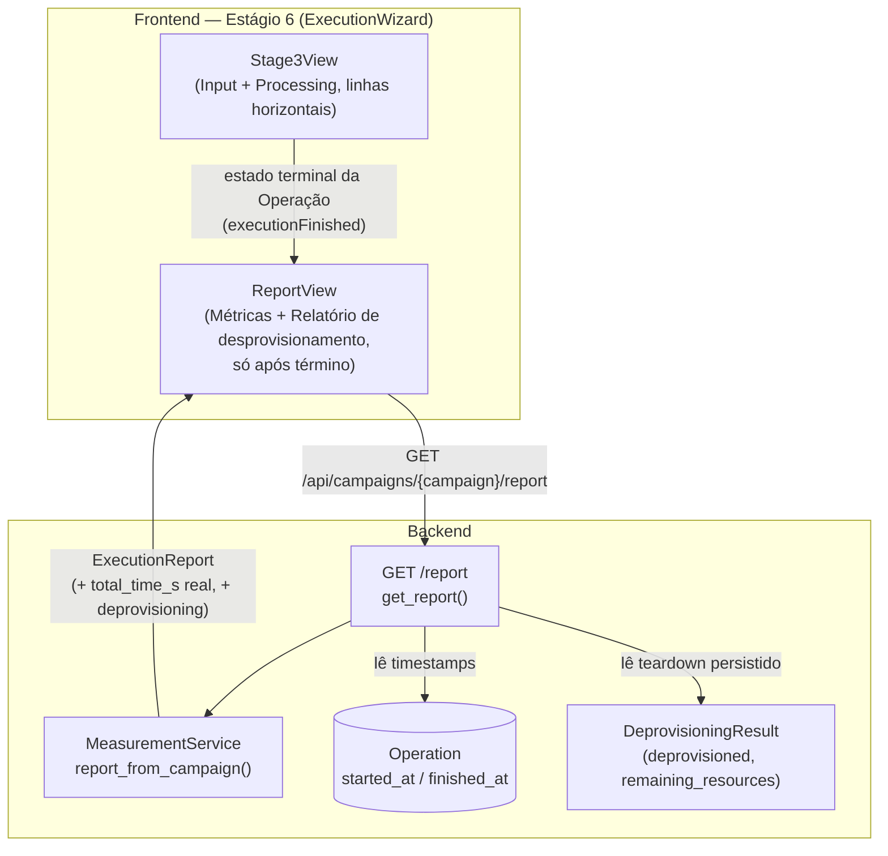

# Design Document

## Overview

Esta spec redesenha a **tela do Estágio 6 — Execução, medição e relatório**. Ela não altera o
motor de execução nem o acompanhamento ao vivo (de responsabilidade da spec
`stage6-execution-redesign`); reorganiza o **layout** e o **conjunto de componentes** da página
para remover redundância, revelar as métricas e o relatório de desprovisionamento **somente
após** o término da execução, coletar e exibir o **tempo total** real da Operação e transformar
o antigo "Execution Report" (veredito genérico) em um **relatório de desprovisionamento do
ambiente**.

O trabalho é majoritariamente de **frontend** (reorganização de `Stage3View` e `ReportView`,
ambos em `apps/frontend/src/components`), com um ajuste pontual de **backend** para:

1. preencher `metrics.total_time_s` com o tempo real da Operação (`finished_at - started_at`),
   já que o caminho real de execução nunca produz `execution_time_s` por técnica (o campo chega
   sempre `None`); e
2. expor no payload do `GET /report` o resultado de desprovisionamento (sucesso + recursos
   remanescentes), hoje reduzido a um único booleano `environment_deprovisioned`.

### Estado atual (verificado no código)

- `apps/frontend/src/components/ExecutionWizard.tsx` monta o Estágio 6 empilhando
  `<Stage3View />` e `<ReportView />` dentro de um `<div className="flex flex-col gap-4">`.
- `Stage3View` (`Stage3View.tsx`) renderiza **Input / Processing / Output** dentro de um
  `<div className="grid gap-4 md:grid-cols-3">` — três colunas. O bloco **Output**
  (`data-section="saida"`) mostra apenas os agregados `total_success` / `total_failure`. O
  componente já conhece o estado terminal da Operação (`TERMINAL_OPERATION_STATES`,
  `hasPersistedResult`, `phase`) e acompanha o ciclo de vida da execução ao vivo.
- `ReportView` (`ReportView.tsx`) carrega `GET /report` na montagem e renderiza quatro
  `StageSection`: **verdict** (`data-section="verdict"`, veredito + flag de desprovisionamento),
  **métricas** (`data-section="metricas"`: taxa de sucesso, cobertura procedural, tempo total,
  contagem de nós falhos), **Failed Nodes** (`data-section="failed-nodes"`) e **Telemetry by
  Technique** (`data-section="telemetry"`). Carrega sem conhecer o estado de execução — não há
  gating hoje.
- Backend: `GET /api/campaigns/{campaign}/report` (`apps/backend/app/api/campaigns.py`,
  `get_report`) deriva o `ExecutionReport` das Operations persistidas via
  `MeasurementService.report_from_campaign`. O `total_time_s` resulta da **soma** dos
  `execution_time_s` por técnica (`measurement.py`), que são sempre `None` no caminho real → o
  tempo total chega `None`. A entidade `Operation` (`domain.py`) persiste `started_at` e
  `finished_at`. O `DeprovisioningResult` (`provisioner.py`) carrega `deprovisioned`,
  `remaining_resources`, `origin`, `message`, mas **não é persistido** nem exposto no
  `GET /report` — a rota só infere `environment_deprovisioned = any_finished`.

### Objetivos de design

- Input e Processing passam de colunas (grid de 3) para **linhas horizontais** empilhadas.
- Remover os blocos **Output**, **Telemetry by Technique** e **Failed Nodes** (mantendo apenas
  a **contagem** de nós falhos como card de métrica).
- Substituir o bloco **verdict** por um **relatório de desprovisionamento**.
- **Gating**: métricas e relatório de desprovisionamento só aparecem após o término da execução
  (estado terminal da Operação).
- `total_time_s` = `finished_at - started_at` da Operação, formatado legível; "—" quando
  indisponível.
- Ordem final da página: Input → Processing → Métricas → Relatório de desprovisionamento; parar
  nesta tela.

## Architecture



### Decisões de arquitetura e justificativas

**D1 — Gating no frontend por estado terminal da Operação.** O `Stage3View` já deriva o estado
da execução (`phase`, `TERMINAL_OPERATION_STATES`, `hasPersistedResult`). Em vez de duplicar essa
lógica, o Estágio 6 eleva o conhecimento de "execução terminou" ao `ExecutionWizard` (ou a um
pequeno hook compartilhado) e passa um booleano `executionFinished` para o `ReportView`. O
`ReportView` só busca/renderiza métricas e desprovisionamento quando `executionFinished` é
`true`. Justificativa: mantém a fonte de verdade do ciclo de vida no componente que já a possui
(Processing/live), evitando duas máquinas de estado divergentes.

**D2 — Tempo total no backend, derivado da Operação.** O requisito 4 fixa a fórmula
`finished_at - started_at`. O `GET /report` já itera as `Operation` do caso; ele passa a calcular
a duração e a injetá-la em `metrics.total_time_s` **antes** de responder, substituindo a soma de
`execution_time_s` (sempre nula no caminho real). Justificativa: o dado é coletável sem tocar no
`OperationRunner`; concentra a correção na borda da API (pura, determinística) sem alterar o
motor de execução (fora de escopo).

**D3 — Desprovisionamento exposto no payload do relatório.** O `ExecutionReport` ganha um campo
estruturado `deprovisioning` (sucesso + recursos remanescentes), além do booleano legado
`environment_deprovisioned` (preservado para compatibilidade). Como o `GET /report` recomputa o
relatório a cada leitura e o `DeprovisioningResult` **não** é persistido hoje, o teardown passa a
ser persistido ao fim do Estágio 6 (na linha `execution_reports` ou numa coluna/linha associada à
Operação) para que a leitura o recupere. Justificativa: o requisito 7.3 exige identificar os
recursos remanescentes em caso de falha, informação que só existe no `DeprovisioningResult`
produzido na conclusão.

**D4 — Remoções são de renderização, não de dados.** Output, Telemetry by Technique e a lista de
Failed Nodes deixam de ser **renderizados**; os dados subjacentes (agregados, status por técnica,
contagem de falhas) continuam disponíveis via Processing (lista ao vivo) e via o card de contagem
nas métricas. Nenhuma informação única é perdida (Req. 2.2, 5.3, 6.2).

## Components and Interfaces

### Frontend

#### `ExecutionWizard.tsx` (composição do Estágio 6)

Hoje:
```tsx
<div className="flex flex-col gap-4">
  <Stage3View campaignId={campaignId} onRedirectToStage={...} />
  <ReportView campaignId={campaignId} />
</div>
```

Mudança: elevar o sinal de término da execução. Opções:

- **Opção escolhida:** `Stage3View` expõe um callback `onExecutionFinished(finished: boolean)`
  (disparado quando `phase` atinge `persisted`/terminal ou a Operação corrente está em
  `TERMINAL_OPERATION_STATES`). O `ExecutionWizard` guarda esse booleano em estado e o repassa ao
  `ReportView` como prop `executionFinished`. Mantém `Stage3View` como dono do ciclo de vida.

```tsx
const [executionFinished, setExecutionFinished] = useState(false)
// ...
<Stage3View
  campaignId={campaignId}
  onRedirectToStage={...}
  onExecutionFinished={setExecutionFinished}
/>
<ReportView campaignId={campaignId} executionFinished={executionFinished} />
```

#### `Stage3View.tsx` (Input + Processing em linhas)

- **Remover** o container `grid md:grid-cols-3`; envolver Input e Processing em um
  `flex flex-col gap-4` (ou `space-y-4`) para que cada seção ocupe a largura total como linha
  (Req. 1.1, 1.3).
- **Remover** o bloco Output inteiro (`data-section="saida"` e seu conteúdo de agregados) —
  Req. 2.1. Os agregados `liveAggregate` deixam de ser renderizados aqui; a contagem equivalente
  passa a viver na seção de métricas do `ReportView`.
- **Preservar** o conteúdo por Ability na seção Processing (`AbilityLiveCard`: comando, alvo,
  host atacante, estado, logs), sem duplicação (Req. 1.2).
- **Novo** callback `onExecutionFinished`: disparado em efeito quando a Operação corrente entra
  em estado terminal (`TERMINAL_OPERATION_STATES`) ou quando `phase === "persisted"`. Idempotente
  (dispara `true` uma vez; volta a `false` ao recarregar outra campanha).

Interface (props adicionadas):
```ts
export function Stage3View({
  campaignId,
  onRedirectToStage,
  onExecutionFinished, // novo: (finished: boolean) => void
}: {
  campaignId: string
  onRedirectToStage?: (stage: number) => void
  onExecutionFinished?: (finished: boolean) => void
}): JSX.Element
```

#### `ReportView.tsx` (métricas + relatório de desprovisionamento, com gating)

- **Nova prop** `executionFinished: boolean`.
- **Gating (Req. 3.1, 7.1, 8.2):** enquanto `!executionFinished`, o componente **não** renderiza
  métricas nem relatório de desprovisionamento (e não precisa exibir nada — ou um estado vazio
  neutro). O `GET /report` só é disparado quando `executionFinished` vira `true` (evita métricas
  zeradas/parciais em tela).
- **Remover** o bloco `data-section="verdict"` (veredito genérico — Req. 7.4).
- **Remover** o bloco `data-section="failed-nodes"` (lista — Req. 5.1). A **contagem**
  (`metrics.failed_nodes.length`) permanece como card em métricas (Req. 3.4, 5.2).
- **Remover** o bloco `data-section="telemetry"` (Telemetry by Technique — Req. 6.1) e o
  `TechniqueCard`/`StatusBadge` associados que só servem a ele.
- **Métricas (Req. 3.2, 3.3):** manter os quatro cards — taxa de sucesso, cobertura procedural,
  **tempo total** (agora real), contagem de nós falhos.
- **Novo bloco "Relatório de desprovisionamento" (Req. 7.2, 7.3):** renderizado **por último**,
  após as métricas. Indica sucesso/falha do teardown e, em falha, lista os
  `deprovisioning.remaining_resources` (usa `relatorio.ambiente.desprovisionado` /
  `naoDesprovisionado` / `recursosRemanescentes`, chaves já presentes no i18n).

Interface:
```ts
export function ReportView({
  campaignId,
  executionFinished, // novo
}: {
  campaignId: string
  executionFinished: boolean
}): JSX.Element
```

Ordem de renderização final da página (Req. 8.1):

1. `Stage3View` → Input (linha), Processing (linha).
2. `ReportView` (só quando `executionFinished`) → Métricas, depois Relatório de
   desprovisionamento.

#### `stages.ts` (tipos do cliente)

- `SufficiencyMetrics.total_time_s` já existe (`number | null`); nenhum campo novo — apenas passa
  a vir preenchido com o tempo real.
- `ExecutionReport` ganha um campo opcional `deprovisioning?: DeprovisioningView` espelhando o
  backend. O tipo `DeprovisioningResult` já existe no cliente
  (`deprovisioned`, `remaining_resources`, `origin`, `message`) e pode ser reutilizado/aliased.

```ts
export interface ExecutionReport {
  campaign_id: string
  metrics: SufficiencyMetrics
  results: ReportAbilityResult[]
  environment_deprovisioned: boolean // legado, preservado
  deprovisioning?: DeprovisioningResult // novo (sucesso + recursos remanescentes)
  generated_at: string
}
```

### Backend

#### `GET /report` (`campaigns.py :: get_report`)

- Após montar as Operations, calcular `total_time_s`:
  - Para a(s) Operation(s) finalizada(s), `duration = finished_at - started_at` (em segundos).
  - Na prática há uma única Operation por campanha curada; se houver mais de uma finalizada,
    somam-se as durações válidas (consistente com o resto do código, que consolida todas).
  - Injetar o valor em `metrics.total_time_s` **após** `report_from_campaign` (ou passar o tempo
    ao `MeasurementService` como override).
- `environment_deprovisioned` permanece; adicionar o objeto `deprovisioning` ao payload a partir
  do teardown persistido (ver D3). Quando não houver teardown registrado (execução não terminou),
  `deprovisioning` é omitido/`None`.

A duração exige os timestamps da `Operation`. O `OperationResultView` atual **não** os carrega;
o `get_report` lê as Operations via `SessionStateService.get_operation_results`, que retorna
views sem timestamps. Design: o `get_report` consulta diretamente as `Operation` ORM (ou a view é
estendida com `started_at`/`finished_at`) para ter acesso aos instantes. Preferência: estender
`OperationResultView` com os dois campos (nulos por padrão), mantendo uma única porta de leitura.

#### Persistência do desprovisionamento (D3)

O `DeprovisioningResult` produzido na conclusão do Estágio 6
(`CompletionStage6Service` / `completion.py`) passa a ser persistido para que o `GET /report`
o recupere. Opção de menor impacto: adicionar colunas `deprovisioned` (bool) e
`remaining_resources` (JSON) à tabela `execution_reports` (já associada à campanha/Operação),
preenchidas no `_persist` do relatório. Uma migração Alembic acompanha a mudança de schema.

## Data Models

### Tipo compartilhado — visão de desprovisionamento no relatório

Reaproveita o `DeprovisioningResult` já existente (backend `provisioner.py`, frontend
`stages.ts`):

| Campo                 | Tipo       | Significado                                                        |
| --------------------- | ---------- | ------------------------------------------------------------------ |
| `deprovisioned`       | `bool`     | `true` se o ambiente foi removido com sucesso (Req. 7.3).          |
| `remaining_resources` | `string[]` | Recursos que sobraram quando `deprovisioned=false` (Req. 7.3).     |
| `origin`              | enum       | Origem da tradução/campanha (já existente).                        |
| `message`             | `string`   | Mensagem legível do teardown.                                      |

### `SufficiencyMetrics` (sem mudança de forma; semântica de `total_time_s`)

| Campo                  | Tipo             | Observação                                                   |
| ---------------------- | ---------------- | ------------------------------------------------------------ |
| `total_dag_techniques` | `int`            | Denominador da taxa de sucesso.                              |
| `successful_techniques`| `int`            | Técnicas em `sucesso`.                                       |
| `success_rate`         | `float` [0,1]    | Exibido como %.                                              |
| `procedural_coverage`  | `float` [0,1]    | Exibido como %.                                              |
| `total_time_s`         | `float \| null`  | **Agora** = `finished_at - started_at` (Req. 4.1); `null`/"—" quando indisponível (Req. 4.3). |
| `failed_nodes`         | `string[]`       | Contagem (`.length`) exibida como card; lista **não** renderizada (Req. 5.1, 5.2). |
| `per_technique`        | `TechniqueMetric[]` | Não mais renderizado como telemetria (Req. 6.1).          |
| `success_verdict`      | `bool`           | Não mais exibido como "verdict" (Req. 7.4).                  |

### `ExecutionReport` (campo novo opcional)

| Campo                      | Tipo                    | Observação                                   |
| -------------------------- | ----------------------- | -------------------------------------------- |
| `campaign_id`              | `string`                | —                                            |
| `metrics`                  | `SufficiencyMetrics`    | Com `total_time_s` real.                     |
| `results`                  | `ReportAbilityResult[]` | Reusado; não renderizado em blocos removidos.|
| `environment_deprovisioned`| `bool`                  | Legado, preservado.                          |
| `deprovisioning`           | `DeprovisioningResult?` | **Novo**; presente após o término (Req. 7.3).|
| `generated_at`             | `string` (ISO)          | —                                            |

### Estado de gating (frontend)

| Estado              | Fonte                                                        | Efeito                                                            |
| ------------------- | ----------------------------------------------------------- | ----------------------------------------------------------------- |
| `executionFinished` | `Stage3View` (Operação terminal / `phase === "persisted"`)  | `false` → esconde métricas e desprovisionamento; `true` → busca `GET /report` e renderiza ambos (Req. 3.1, 3.2, 7.1, 7.2, 8.2). |

## Correctness Properties

*A property is a characteristic or behavior that should hold true across all valid executions of
a system — essentially, a formal statement about what the system should do. Properties serve as
the bridge between human-readable specifications and machine-verifiable correctness guarantees.*

A maior parte deste redesign é renderização condicional e layout (ver Testing Strategy), mais
adequada a testes por exemplo/snapshot. Há, porém, duas peças com lógica genuína e espaço de
entrada amplo — o cálculo do tempo total a partir dos instantes da Operação e o gating das seções
pós-término — para as quais escrevemos propriedades universais.

### Property 1: Tempo total deriva dos instantes da Operação

*Para toda* Operação com `started_at` e `finished_at` disponíveis e `finished_at >= started_at`,
o `total_time_s` exibido deve ser igual a `(finished_at - started_at)` em segundos; e *para toda*
Operação em que `started_at` ou `finished_at` esteja ausente, o `total_time_s` deve indicar
ausência (ex.: `null` → "—"), sem erro.

**Validates: Requirements 4.1, 4.3**

### Property 2: Gating das seções pós-término

*Para todo* estado de execução, as seções de **métricas** e de **relatório de desprovisionamento**
são renderizadas **se e somente se** a execução está em estado terminal (`executionFinished`); em
qualquer estado não terminal ambas permanecem ocultas e apenas Input e Processing são exibidos.

**Validates: Requirements 3.1, 3.2, 7.1, 7.2, 8.2**

## Error Handling

- **Timestamps ausentes (Req. 4.3):** se `started_at` ou `finished_at` for `null`, o backend
  deixa `total_time_s = null` e o `ReportView` exibe "—" via `formatTime(null)` (já implementado),
  sem lançar erro.
- **Falha ao carregar o relatório:** o `ReportView` mantém o tratamento atual
  (`getReport().catch` → `EmptyNote` com `stageView.loadError`) e o estado de carregamento
  (`stageView.loading`).
- **Desprovisionamento com falha (Req. 7.3):** quando `deprovisioning.deprovisioned === false`, o
  bloco de desprovisionamento sinaliza a falha e lista `remaining_resources` (via
  `relatorio.ambiente.recursosRemanescentes`); nunca oculta a falha.
- **`deprovisioning` ausente:** quando o teardown ainda não foi registrado (execução não
  terminou), o gating já impede a renderização do bloco; se mesmo assim o campo chegar ausente, o
  bloco cai no estado "não desprovisionado" neutro sem erro.
- **Payload divergente/legado:** o `ReportView` continua defensivo (clamp de percentuais,
  normalização de métricas), de modo que um payload sem `deprovisioning` (API antiga) não quebra
  a tela.

## Testing Strategy

### Abordagem

O redesign é predominantemente de **UI** (layout em linhas, remoção de componentes, renderização
condicional). Para esses critérios usamos **testes por exemplo** (React Testing Library, no
padrão já existente em `Stage3View.test.tsx` / `ReportView.test.tsx`) e asserções de
presença/ausência de seções via `data-section` / `data-testid`. Para as duas peças com lógica
genuína (cálculo de tempo total e gating), complementamos com **testes de propriedade**.

### Testes por exemplo (UI e remoções)

- **Layout horizontal (Req. 1.1, 1.3):** Input e Processing empilhados (sem `md:grid-cols-3`),
  cada um ocupando a largura — asserção de ausência do container de grid e presença das duas
  seções como linhas.
- **Conteúdo preservado em Processing (Req. 1.2):** `AbilityLiveCard` mantém comando/alvo/host/
  estado/logs, sem duplicação.
- **Output removido (Req. 2.1, 2.2):** `data-section="saida"` ausente em qualquer estado; a
  contagem equivalente aparece em métricas.
- **Métricas só após término (Req. 3.1, 3.2):** com `executionFinished=false`, `data-section=
  "metricas"` ausente e `getReport` não chamado; com `true`, presente com os quatro cards
  (Req. 3.3), incluindo a contagem de nós falhos (Req. 3.4).
- **Lista de nós falhos removida (Req. 5.1, 5.2):** `data-section="failed-nodes"` ausente; card de
  contagem presente.
- **Telemetria removida (Req. 6.1, 6.2):** `data-section="telemetry"` ausente; status por técnica
  segue na lista ao vivo.
- **Verdict removido / relatório de desprovisionamento presente (Req. 7.2, 7.3, 7.4):**
  `data-section="verdict"` ausente; bloco de desprovisionamento presente por último, com
  sucesso/falha e, na falha, os recursos remanescentes.
- **Ordem e integridade (Req. 8.1, 8.2):** ordem Input → Processing → Métricas →
  Desprovisionamento; em andamento, apenas Input e Processing.
- **Sem modal/pop-up (Req. 8.3):** nenhum `role="dialog"` introduzido (mantém o padrão já
  testado).
- **Backend `GET /report`:** teste de API cobrindo `total_time_s` derivado de `started_at`/
  `finished_at`, caso de timestamp ausente (→ `null`) e presença de `deprovisioning` com recursos
  remanescentes em falha de teardown.

### Testes de propriedade

Biblioteca: **fast-check** para o frontend (TypeScript) e **Hypothesis** para o backend (Python)
— ambas já presentes no repositório (ver `apps/backend/.hypothesis`). Não implementar PBT do zero.

- Mínimo de **100 iterações** por teste de propriedade.
- Cada teste anotado com o comentário:
  `Feature: stage6-screen-redesign, Property {número}: {texto da propriedade}`.
- Cada propriedade implementada por **um único** teste de propriedade:
  - **Property 1** (tempo total) — preferir o backend (Hypothesis): gerar pares de instantes
    `(started_at, finished_at)` (incluindo ausências) e verificar a derivação/indicador de
    ausência. É pura e determinística.
  - **Property 2** (gating) — frontend (fast-check): gerar estados de execução (terminal e não
    terminal) e verificar o bicondicional presença-de-seções ↔ `executionFinished`.

### Equilíbrio

Testes por exemplo cobrem os critérios de layout/remoção/ordem (comportamento concreto de UI);
os dois testes de propriedade cobrem a lógica computável com amplo espaço de entrada (tempo,
gating). Juntos dão cobertura completa dos requisitos testáveis.
