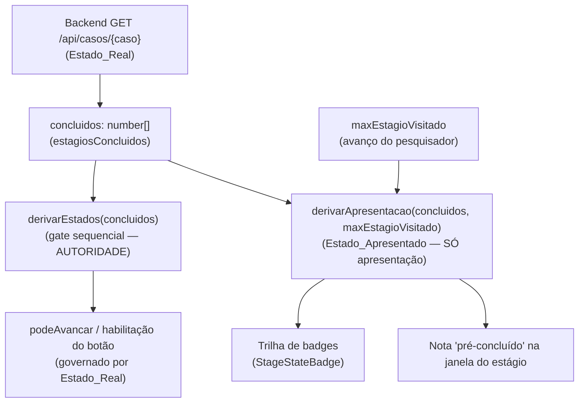
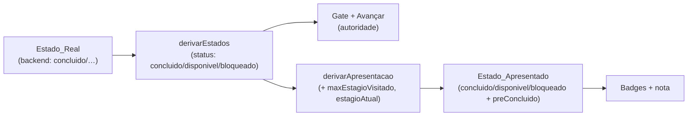

# Design Document

## Overview

Esta melhoria resolve uma estranheza de UX no `ExecutionWizard`: para um
**Caso_Curado**, ao concluir o Estágio 1 (Modelagem Estrutural) o backend
auto-conclui o Estágio 2 (Geração do DAG) imediatamente
(`DagService.auto_concluir_estagio2`), e a trilha de badges passa a mostrar o
Estágio 2 já "concluído" — um estágio adiante daquele em que o pesquisador está.
O comportamento é funcionalmente correto, mas quebra a sensação de progresso
passo a passo.

A solução é inteiramente de **camada de apresentação**. Introduzimos uma noção
derivada e efêmera, o **Estado_Apresentado**, calculado a partir de dois
insumos já disponíveis no wizard:

1. **Estado_Real** — o estado por estágio reportado pelo backend (fonte da
   verdade sobre conclusão real), hoje materializado em `concluidos: number[]`.
2. **Avanço do pesquisador** — quão longe o pesquisador já navegou pelas
   janelas, que passamos a rastrear como `maxEstagioVisitado: NumeroEstagio`.

O backend não muda. `derivarEstados(concluidos)` continua sendo a autoridade do
**gate sequencial** e da habilitação de "Avançar"; o Estado_Apresentado afeta
**somente** o que a badge mostra, nunca o que o botão permite.

### Decisão de design (R7)

O Requisito 7 deixou em aberto a escolha entre três mecanismos. **A opção
escolhida é a (A) — revelação gradual apenas na apresentação**, combinada com um
toque leve da **(C)** para a comunicação do estágio pré-concluído.

- **(A) Revelação gradual (escolhida).** Um estágio que está `concluido` no
  Estado_Real mas que o pesquisador ainda não alcançou é apresentado em um
  estado não-"concluído" (um visual "pronto/disponível") até ele navegar até
  lá. Quando alcançado, passa a "concluído". Isso faz a trilha refletir a
  jornada passo a passo (R1) sem tocar no backend nem no gate (R3).
- **(C) Comunicação da origem (incorporada como complemento).** Quando o estágio
  alcançado foi pré-concluído pelo sistema (curadoria), a badge o marca como
  **"pré-concluído (curado)"** e a janela do estágio exibe uma nota
  explicativa (R2). Em vez de um quarto estado concorrente, (C) entra como um
  _refinamento visual_ do estado "concluído" quando a origem é a
  Auto_Conclusao_Estagio2.
- **(B) Etapa explícita de confirmação (considerada e rejeitada).** Exigir que o
  pesquisador "revise/confirme o DAG curado" na janela do Estágio 2 antes de
  marcá-lo concluído resolveria a estranheza, mas é mais pesada: muda o modelo
  de interação (adiciona um passo e um clique obrigatório), acopla a correção de
  UX a uma mudança de fluxo, e cria o risco de o botão de confirmação divergir
  do gate real. A opção (A) entrega o mesmo ganho perceptivo sem alterar o
  modelo de interação nem introduzir um controle que possa divergir do
  Estado_Real. **Trade-off assumido:** com (A), a trilha mostra temporariamente
  um estágio como "não concluído" embora ele já esteja `concluido` no backend —
  uma divergência _deliberada_ e restrita à apresentação, documentada e
  governada pela regra do Estado_Apresentado abaixo. Se o usuário preferir a
  transparência total do estado real (nunca "esconder" uma conclusão), a
  redireção natural é a opção (C) pura; registramos (A) como recomendação.

## Architecture

Toda a mudança vive no frontend, em dois arquivos (mais os dois JSON de i18n):

```
ui/frontend/src/lib/wizard.ts          (+ função pura derivarApresentacao)
ui/frontend/src/components/ExecutionWizard.tsx  (estado maxEstagioVisitado + uso)
ui/frontend/src/components/StageStateBadge.tsx  (novo adorno "pré-concluído")
ui/frontend/src/i18n/locales/pt-BR/pipeline.json
ui/frontend/src/i18n/locales/en/pipeline.json
```

### Fluxo de dados (quem decide o quê)



Pontos-chave da arquitetura:

- **Separação de responsabilidades.** `derivarEstados` (inalterada) governa
  avanço e bloqueio. `derivarApresentacao` (nova, pura) governa apenas o rótulo
  da badge e a nota explicativa. As duas consomem o mesmo `concluidos`; só a
  segunda consome `maxEstagioVisitado`.
- **Sem fonte de verdade concorrente.** `maxEstagioVisitado` não registra
  "conclusão": registra "até onde o pesquisador navegou". A conclusão real
  continua lida do backend a cada `relerEstado`.
- **Recomputação em cada releitura.** O Estado_Apresentado é derivado em cada
  render a partir de `concluidos` (relido) e `maxEstagioVisitado` (estado local),
  então releitura/transição recomputam-no automaticamente (R6.1).

### Mudanças de estado no `ExecutionWizard`

Hoje o componente tem `estagioAtual`, `concluidos`, `busy`, `erro`, `refreshKey`.
Adicionamos **um** estado:

```ts
const [maxEstagioVisitado, setMaxEstagioVisitado] = useState<NumeroEstagio>(1)
```

Regras de atualização:

- **Avançar** (`handleNext`): após incrementar `estagioAtual`, atualizar
  `maxEstagioVisitado = max(maxEstagioVisitado, novoEstagioAtual)`.
- **Voltar** (`handleBack`): **não** diminui `maxEstagioVisitado` — "visitado" é
  monotônico; voltar e reavançar não des-revela um estágio já alcançado (R1.3,
  ordem não decrescente).
- **Troca de caso** (`useEffect` em `casoId`): resetar
  `maxEstagioVisitado = 1` junto com `setEstagioAtual(1)` (R6.2).
- **Reiniciar campanha** (`handleRestart`): resetar `maxEstagioVisitado = 1`
  junto com `setEstagioAtual(1)` (R6.3).

> Observação de monotonicidade: como o pesquisador só pode navegar
> sequencialmente (o gate impede saltos), `maxEstagioVisitado` é sempre
> `>= estagioAtual` e cresce de 1 em 1. Mantê-lo monotônico garante R1.3 (ordem
> não decrescente de progresso durante a navegação 1→5).

## Components and Interfaces

### 1. `lib/wizard.ts` — nova derivação pura `derivarApresentacao`

Função pura, sem efeitos, totalmente unit-testável. Produz, para cada estágio,
o **Estado_Apresentado** e um sinalizador de origem pré-concluída.

```ts
/** Como a badge de um estágio deve ser apresentada (camada de apresentação). */
export type EstadoApresentado =
  | "concluido"      // alcançado e concluído no backend
  | "disponivel"     // pronto/alcançável, ainda não "concluído" visualmente
  | "bloqueado"      // predecessor não concluído

export interface EstagioApresentado {
  estagio: NumeroEstagio
  apresentado: EstadoApresentado
  /** True quando a badge deve marcar "pré-concluído (curado)". */
  preConcluido: boolean
}

export interface ApresentacaoDerivada {
  estagios: EstagioApresentado[]
}

/**
 * Deriva o Estado_Apresentado de cada estágio a partir do Estado_Real
 * (`concluidos`) e do avanço do pesquisador (`maxEstagioVisitado`).
 *
 * Regra por estágio (seja `status` = derivarEstados(concluidos).status):
 *   - status === "concluido" E estagio <= maxEstagioVisitado  → "concluido"
 *   - status === "concluido" E estagio  > maxEstagioVisitado  → "disponivel"
 *       (conclusão real ainda não revelada — revelação gradual, opção A)
 *   - caso contrário                                           → status
 *       ("disponivel" ou "bloqueado", repassado de derivarEstados)
 *
 * preConcluido é true quando o estágio é apresentado "concluido" por efeito da
 * Auto_Conclusao_Estagio2 — detectado pela heurística abaixo.
 */
export function derivarApresentacao(
  concluidos: number[],
  maxEstagioVisitado: NumeroEstagio,
): ApresentacaoDerivada
```

A implementação **reutiliza** `derivarEstados(concluidos)` para o `status` base
(nunca reimplementa o gate), garantindo que a apresentação jamais contradiga o
gate: um estágio `bloqueado` no gate é sempre `bloqueado` na apresentação.

#### Heurística de `preConcluido` (sem mudança de backend)

O objetivo é distinguir, **apenas na apresentação**, um estágio concluído pelo
sistema (curadoria) de um concluído por ação do pesquisador — sem persistir nada
e sem sinal do backend. A heurística:

> Um estágio é `preConcluido` quando é apresentado como `concluido`
> **e** está `concluido` no Estado_Real **sem** que o pesquisador o tenha
> "trabalhado": concretamente, o estágio ficou `concluido` no mesmo Estado_Real
> em que seu predecessor concluiu, i.e. é um estágio N>1 que já está `concluido`
> enquanto `estagioAtual <= N` (o pesquisador ainda não agiu dentro da janela N).

Na prática, no fluxo real isso recai sobre o **Estágio 2 de um Caso_Curado**:
assim que o Estágio 1 conclui, o backend devolve `{1,2}` concluídos de uma vez.
Para o Estágio 2, `concluido` sem o pesquisador ter "gerado/escolhido" o DAG na
janela ⇒ pré-concluído. Para um Caso_Nao_Curado o backend devolve só `{1}`, o
Estágio 2 **não** está `concluido`, logo `preConcluido=false` — o comportamento
não regride (R4).

A função pura recebe o contexto mínimo para aplicar a heurística de forma
determinística. Assinatura concreta:

```ts
export function derivarApresentacao(
  concluidos: number[],
  maxEstagioVisitado: NumeroEstagio,
  estagioAtual: NumeroEstagio,
): ApresentacaoDerivada
```

`preConcluido(N)` ≙ `apresentado(N) === "concluido"` **e** `N > 1` **e**
`concluidos.includes(N)` **e** `concluidos.includes(N-1)` **e**
`estagioAtual <= N` (o pesquisador ainda não passou da janela N agindo nela).

> **Opção de sinal de backend (mantida opcional, fora de escopo).** Um caminho
> mais limpo seria o backend marcar explicitamente a origem da conclusão (ex.:
> um campo `origem: "auto" | "usuario"` ou `pre_concluido: boolean` por estágio
> no contrato `GET /api/casos/{caso}`). Isso removeria a heurística, mas exige
> mudança de contrato de backend, o que esta spec declara fora de escopo
> (Introdução). Registrado como melhoria futura; **não** adotado aqui.

### 2. `ExecutionWizard.tsx` — uso da apresentação

- Adicionar o estado `maxEstagioVisitado` e as regras de atualização
  (Architecture acima).
- Substituir o mapeamento inline que hoje colapsa tudo em `concluido` /
  `nao_iniciado` na trilha de badges por um consumo de
  `derivarApresentacao(concluidos, maxEstagioVisitado, estagioAtual)`.
- Para cada badge, mapear `apresentado` → props de `StageStateBadge`:
  - `"concluido"` → `estado="concluido"`, com `preConcluido` passado adiante
    quando verdadeiro.
  - `"disponivel"` → `estado="nao_iniciado"`, `bloqueado={false}`.
  - `"bloqueado"` → `estado="nao_iniciado"`, `bloqueado={true}`.
- A habilitação de "Avançar" (`podeAvancar`) continua **exatamente** como hoje:
  derivada de `derivarEstados` + o caso especial do Estágio 3. Nenhuma linha do
  gate muda.
- Quando a janela aberta (`estagioAtual`) corresponde a um estágio
  `preConcluido`, renderizar a **nota explicativa** (R2.2) acima/junto ao corpo
  do estágio, com texto do i18n.

### 3. `StageStateBadge.tsx` — adorno "pré-concluído"

Adicionar uma prop opcional:

```ts
export function StageStateBadge({
  estado,
  bloqueado = false,
  preConcluido = false,   // novo
  className,
}: { estado: EstadoEstagio; bloqueado?: boolean; preConcluido?: boolean; className?: string })
```

Quando `estado === "concluido"` e `preConcluido`, a badge:

- usa o rótulo i18n `state.preConcluido` ("Pré-concluído (curado)" /
  "Pre-completed (curated)") em vez de `state.concluido`;
- aplica um estilo distinguível do "concluído por você" (ex.: variação de cor
  team-blue + ícone `Sparkles`/`Wand2` em vez do `CheckCircle2`), mantendo o
  `aria-label` no texto do novo rótulo (acessibilidade);
- expõe `data-state="pre_concluido"` para testes de componente.

`preConcluido` só tem efeito quando `estado === "concluido"`; nos demais estados
é ignorado (sem risco de regressão nos estados existentes).

## Data Models

Nenhum modelo persistido novo. Os tipos novos são de apresentação, locais ao
frontend:

| Tipo | Local | Papel |
| --- | --- | --- |
| `EstadoApresentado` | `lib/wizard.ts` | União `"concluido" \| "disponivel" \| "bloqueado"` do que a badge mostra. |
| `EstagioApresentado` | `lib/wizard.ts` | `{ estagio, apresentado, preConcluido }` por estágio. |
| `ApresentacaoDerivada` | `lib/wizard.ts` | `{ estagios: EstagioApresentado[] }`, saída de `derivarApresentacao`. |
| `maxEstagioVisitado` | estado do `ExecutionWizard` | `NumeroEstagio`, avanço do pesquisador; não persistido. |

Reaproveitados sem alteração: `NumeroEstagio`, `EstadoEstagio`
(`lib/casos.ts`), `WizardStageStatus`/`derivarEstados` (`lib/wizard.ts`),
`CasoEstados`/`estagiosConcluidos` (contrato de backend intacto).

A relação entre as três noções de estado:



## Correctness Properties

*A property is a characteristic or behavior that should hold true across all
valid executions of a system — essentially, a formal statement about what the
system should do. Properties serve as the bridge between human-readable
specifications and machine-verifiable correctness guarantees.*

As propriedades abaixo recaem sobre a **função pura** `derivarApresentacao`
(e sobre a inalterada `derivarEstados`), que é exatamente o lugar onde a lógica
de negócio desta melhoria vive. A camada de componente (notas, i18n, reset na
troca de caso) é coberta por testes de componente/exemplo, não por propriedades
(ver Testing Strategy).

### Property 1: Apresentação de "concluído" exige conclusão real E alcance

*Para todo* conjunto `concluidos`, todo `maxEstagioVisitado` e todo
`estagioAtual`, um estágio N é apresentado como `"concluido"` se e somente se N
está `concluido` no Estado_Real **e** `N <= maxEstagioVisitado`. Consequências
diretas: um estágio concluído no real porém ainda não alcançado
(`N > maxEstagioVisitado`) é apresentado como `"disponivel"` (nunca
`"concluido"`); e um estágio **não** concluído no real nunca é apresentado como
`"concluido"`.

**Validates: Requirements 1.1, 1.2, 4.1**

### Property 2: Revelação monotônica ao avançar

*Para todo* `concluidos` e todo par `max1 <= max2`, a apresentação em `max2` é
não decrescente em progresso, estágio a estágio, em relação à de `max1`:
nenhum estágio apresentado `"concluido"` em `max1` deixa de sê-lo em `max2`, e
nenhum estágio além do visitado é apresentado `"concluido"`. Avançar (crescer
`maxEstagioVisitado`) só pode revelar conclusões, nunca escondê-las nem
antecipar um estágio não alcançado.

**Validates: Requirements 1.3**

### Property 3: Avanço governado pelo Estado_Real, não pela apresentação

*Para todo* `concluidos`, a habilitação de avanço de um estágio — calculada por
`derivarEstados(concluidos).podeAvancar(...)` — é **invariante** a
`maxEstagioVisitado`. Isto é, para quaisquer dois valores de
`maxEstagioVisitado`, o mesmo `concluidos` produz a mesma decisão de avanço.
A divergência temporária entre Estado_Apresentado e Estado_Real jamais altera a
habilitação do botão.

**Validates: Requirements 3.4, 7.3**

### Property 4: `preConcluido` só marca conclusões automáticas do sistema

*Para todo* `concluidos`, `maxEstagioVisitado` e `estagioAtual`, se um estágio N
é marcado `preConcluido` então N está `concluido` no Estado_Real, N > 1, N−1
está `concluido` no Estado_Real, N é apresentado `"concluido"`, e o pesquisador
ainda não agiu além da janela N (`estagioAtual <= N`). Em particular, um estágio
não concluído no real (ex.: Estágio 2 de um Caso_Nao_Curado) nunca é
`preConcluido`.

**Validates: Requirements 2.1, 4.3, 7.4**

### Property 5: `derivarApresentacao` é pura e determinística

*Para toda* tripla de entradas `(concluidos, maxEstagioVisitado, estagioAtual)`,
`derivarApresentacao` produz a mesma saída em invocações repetidas, sem efeitos
colaterais e sem depender de estado anterior. Recomputar após uma releitura do
backend depende apenas das entradas atuais.

**Validates: Requirements 6.1**

> **Invariantes preservados (não reescritos).** O gate sequencial (R3.2, R3.3,
> R4.2) já é verificado exaustivamente em `wizard.test.ts` sobre `derivarEstados`
> (varredura de todos os 32 subconjuntos de {1..5}). Esta melhoria **não altera**
> `derivarEstados`; os testes existentes devem permanecer verdes como garantia de
> que o gate e o bloqueio sequencial seguem intactos.

## Error Handling

A melhoria não introduz novos caminhos de erro de rede ou de I/O — toda a lógica
nova é pura e local. Os erros existentes seguem inalterados:

- **Falha ao reler o estado** (`relerEstado`/`getCaso`): mantém o tratamento
  atual (`setErro(t("stageView.loadError"))`). Nesse caso `concluidos` não é
  atualizado; `derivarApresentacao` opera sobre o último `concluidos` conhecido —
  sem crash, badges permanecem consistentes com o último estado válido.
- **Entradas defensivas na função pura.** `derivarApresentacao` nunca lança:
  `concluidos` com números fora de 1..5 são ignorados pela base
  `derivarEstados` (que itera sobre `STAGES`); `maxEstagioVisitado` é tipado
  `NumeroEstagio` (1..5). Um `concluidos` vazio produz apresentação toda
  `disponivel`/`bloqueado` conforme o gate.
- **Monotonicidade de `maxEstagioVisitado`.** As atualizações usam
  `Math.max`/comparação, de modo que `handleBack` nunca o reduz; não há estado
  intermediário inconsistente.
- **Reset consistente.** Troca de caso e reinício resetam `maxEstagioVisitado=1`
  e `estagioAtual=1` **antes** da releitura, evitando uma janela em que a
  apresentação do caso novo use o avanço do caso antigo (R6.2, R6.3).

## Testing Strategy

Abordagem dupla: **testes de propriedade** para a derivação pura (onde a
variação de entrada revela casos de borda) e **testes de exemplo/componente**
para o comportamento de UI, i18n e ciclos de releitura/reset.

### Ferramentas e verificação

- **Frontend:** Vitest (já em uso — ver `wizard.test.ts`) + Testing Library
  para testes de componente. Para as propriedades, usar **`fast-check`**
  (biblioteca de PBT para TypeScript) — **não** implementar PBT do zero.
- **Type-check:** `tsc` (sem erros de tipo) após as mudanças.
- **Backend:** nenhuma mudança esperada; nenhum teste de backend novo.
- Comandos executados em modo single-run (ex.: `vitest --run`), nunca em watch.

### Testes de propriedade (mínimo 100 iterações cada)

Implementar **uma** property-based test por propriedade, cada uma com no mínimo
100 iterações e anotada com um comentário referenciando a propriedade do design.
Formato da tag:

`// Feature: wizard-progresso-estagios, Property N: <texto da propriedade>`

Geradores: `concluidos` como subconjunto arbitrário de {1,2,3,4,5} (idealmente
respeitando prefixos realistas, mas também subconjuntos arbitrários para
robustez); `maxEstagioVisitado` e `estagioAtual` em 1..5.

| Propriedade | Alvo | Esboço do teste |
| --- | --- | --- |
| 1 | `derivarApresentacao` | ∀ inputs: `apresentado(N)=="concluido"` ⇔ `concluidos.includes(N) && N<=maxEstagioVisitado`. |
| 2 | `derivarApresentacao` | ∀ `concluidos`, ∀ `max1<=max2`: apresentação em `max2` ≥ em `max1` por estágio; nada `"concluido"` além do visitado. |
| 3 | `derivarEstados` | ∀ `concluidos`, ∀ `maxA,maxB`: `podeAvancar` idêntico (invariante a `maxEstagioVisitado`). |
| 4 | `derivarApresentacao` | ∀ inputs: `preConcluido(N)` ⇒ (`concluidos` tem N e N−1) ∧ `N>1` ∧ `apresentado(N)=="concluido"` ∧ `estagioAtual<=N`. |
| 5 | `derivarApresentacao` | ∀ inputs: duas chamadas iguais ⇒ saídas iguais (determinismo); sem efeitos. |

### Testes de exemplo / unitários

- **R1.1 (caso concreto):** `concluidos={1,2}`, `maxEstagioVisitado=1`,
  `estagioAtual=1` ⇒ Estágio 2 `"disponivel"` (não `"concluido"`).
- **R1.2 / R2.1 (caso curado alcançado):** `concluidos={1,2}`,
  `maxEstagioVisitado=2`, `estagioAtual=2` ⇒ Estágio 2 `"concluido"` **e**
  `preConcluido=true`.
- **R4.1 (não curado):** `concluidos={1}`, qualquer `max` ⇒ Estágio 2 nunca
  `"concluido"` e `preConcluido=false`.

### Testes de componente (`ExecutionWizard`, `StageStateBadge`)

- **R2.1 (badge distinta):** badge com `preConcluido` renderiza
  `data-state="pre_concluido"`, rótulo `state.preConcluido` e estilo distinto do
  "concluído por você".
- **R2.2 (nota explicativa):** abrir a janela do Estágio 2 pré-concluído exibe a
  nota i18n; caso não-curado não exibe.
- **R2.3 / R3.1 (sem efeitos no real):** marcar `preConcluido` não dispara
  nenhum POST; `concluidos` só muda por releitura do backend.
- **R6.1 (recomputa na releitura):** mockar `getCaso` para mudar `concluidos` e
  verificar que a trilha recomputa.
- **R6.2 (troca de caso):** mudar `casoId` reseta `maxEstagioVisitado=1`,
  `estagioAtual=1` e recomputa dos novos estados.
- **R6.3 (reiniciar):** `handleRestart` reseta a trilha ao Estágio 1.
- **R3.4 (gate governado pelo real):** com Estágio 2 apresentado `"disponivel"`
  embora `concluido` no real (`maxEstagioVisitado=1`), o botão "Avançar" do
  Estágio 1 continua habilitado (governado por `derivarEstados`).

### i18n

- **R5.1 / R5.3:** nenhum texto de progresso hardcoded; novos textos vêm de
  `t("…")` no namespace `pipeline`.
- **R5.2 (paridade):** teste assertando que as chaves novas existem em
  `pt-BR/pipeline.json` **e** `en/pipeline.json`.

### Chaves i18n a adicionar (namespace `pipeline`, paridade pt-BR/en)

| Chave | pt-BR | en |
| --- | --- | --- |
| `state.preConcluido` | `Pré-concluído (curado)` | `Pre-completed (curated)` |
| `wizard.preConcluidoNota` | `Este estágio já estava pronto por curadoria: o resultado existia antes de você agir.` | `This stage was already prepared by curation: the result existed before you acted.` |

### Invariantes preservados

- `wizard.test.ts` permanece **sem alteração** e verde (gate sequencial —
  R3.2, R3.3, R4.2). Qualquer mudança em `derivarEstados` que quebrasse esses
  testes é proibida por esta spec.
