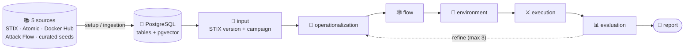

<div align="center">


<a href="#-quick-start">
  
</a>

<br />


<br />


<br /><br />

**[Quick start](#-quick-start)** ·
**[How it works](#-how-it-works)** ·
**[Safety](#-safety)** ·
**[Docs](#-documentation)** ·
**[Layout](#-repository-layout)**

</div>

---

## 🔎 About

Structured CTI says **which** ATT&CK techniques a campaign used, but not the **procedure**: the commands, their
order and their dependencies. STICKS makes that gap measurable. A researcher picks a STIX campaign, a multi-agent AI
loop turns it into commands, an attack flow and a lab, and the campaign runs in an isolated Docker lab through
MITRE Caldera. The output is a report with success rate, per-technique telemetry and a verdict.

> This repository accompanies the paper *"The Procedural Semantics Gap in ATT&CK-in-STIX: Measuring Procedural
> Sufficiency for APT Emulation."*

<div align="center">

| 🎯 Curated campaigns | 🧩 Abilities | 🤖 Agentic phases | 📚 Knowledge sources | 🧪 Tests |
|:---:|:---:|:---:|:---:|:---:|
| **8** | **108** | **5** | **5** | **10** |

</div>

## 🧭 How it works



| Concept | When | What it is |
|---------|------|------------|
| **Setup** | First start, verified on every start | Background, idempotent ingestion that fills the database. Not a screen, not a run phase |
| **Input** | Per run | You pick the STIX version and the campaign. Not an agent phase |
| **Agentic phases** | Per run | `operationalization → flow → environment → execution → evaluation`. The run pauses for your approval after the first three |

Per-phase inputs, processing and outputs: [`docs/pipeline.md`](docs/pipeline.md).

## 🚀 Quick start

> [!NOTE]
> Needs Docker (with Compose), Node.js 18+ and Python 3.11+. The first start downloads about 100 MB of STIX data
> and builds embeddings with [Ollama](https://ollama.com) (`nomic-embed-text`). The lab image build (Caldera,
> about 7 GB) happens later, in the first run's `environment` phase.

```bash
npm run db:up      # PostgreSQL + pgvector on 127.0.0.1:5432
npm run setup      # once: backend venv + frontend dependencies
npm run dev        # migrations, then backend + frontend with hot reload
```

| Service | URL |
|---------|-----|
| 🖥️ UI | <http://localhost:8000> |
| ⚙️ API | <http://localhost:8010> (`GET /health`) |
| 🧪 Caldera | <http://localhost:8888>, only while a run has the lab up |

On the first start, ingestion runs in the background. Watch it in the UI or at `GET /api/ingestion/status`;
when every source is `ready`, setup is done. You also need a language model: the work profile
(`SEPINF_*` in `.env`) or a local Ollama model. Details in [`docs/operations.md`](docs/operations.md).

> [!WARNING]
> Do not edit backend files during a run. `uvicorn --reload` restarts the backend and kills the run in progress.

## 🛡️ Safety

Containment is non-negotiable. Adversary commands never run on the host and never reach external targets.

- `environment` is the only phase with external egress, and only to pull images.
- An **isolation gate** cuts egress and proves it. `execution` cannot start without that proof.
- Every command destination is checked by `is_internal_ip`, and every executed command is audited 1:1.
- Agents only propose. The same containment code that guards a human-curated run guards an AI run.

## 📖 Documentation

| Where | Answers | Read it when |
|-------|---------|--------------|
| **`README.md`** (here) | What is this, how do I run it, where is everything | First contact |
| [`docs/pipeline.md`](docs/pipeline.md) | What each phase and agent takes in, does and puts out | You want to understand the system |
| [`docs/storage.md`](docs/storage.md) | Which databases, which tables, who reads and writes them | You touch data or ingestion |
| [`docs/operations.md`](docs/operations.md) | Config, ingestion details, model profiles, migrations, dev checks | You install, configure or debug |
| [`docs/agentic-phases-literature.md`](docs/agentic-phases-literature.md) | Academic sources behind the phase model | You write or review the paper |
| [`docs/history.md`](docs/history.md) | How the project got here, on one page | You meet an old name or want context |
| [`ops/database/README.md`](ops/database/README.md) | Database helper scripts, curated seed export | You maintain the seeds |


## 📁 Repository layout

```
.
├── apps/
│   ├── backend/     # FastAPI, LangGraph agents, Alembic migrations, tests
│   └── frontend/    # React + TypeScript + Vite + Tailwind + shadcn/ui (pt-BR / en)
├── ops/
│   ├── docker/      # Contained lab: Caldera, Kali attacker, nginx and MariaDB targets, PostgreSQL
│   └── database/    # Platform-agnostic database scripts
├── scripts/         # Cross-platform dev, setup and migrate runners (Node)
└── docs/            # Documentation
```

## 🔬 Research goal

Empirically measure procedural sufficiency in structured CTI: how complete STIX datasets are, how much operational
knowledge a campaign needs to run, what is missing to reproduce APT behavior, and how **human curation** compares with
**AI-generated** curation.

## 📄 License

GNU GPLv3.