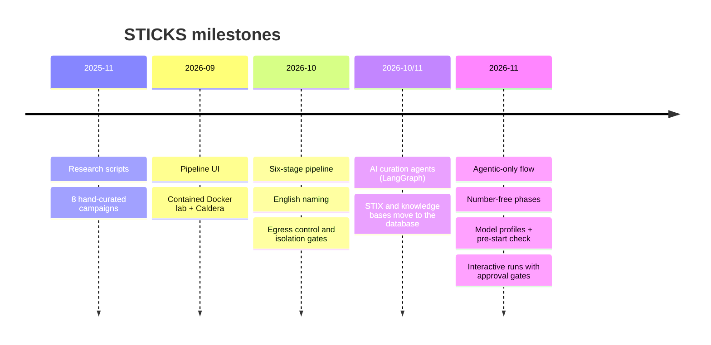

# 🕰️ History

> How STICKS got to its current shape, in one page. For how it works **today**, read [`pipeline.md`](pipeline.md) and [`storage.md`](storage.md).

| When | Change | Why it matters now |
|------|--------|--------------------|
| **2025-11** | First scripts and 8 hand-curated campaigns (the human baseline). Caldera in a Docker lab | The 8 campaigns are today's ground truth, stored with `curated = true` |
| **2026-09** | Pipeline UI (FastAPI + React) over a contained lab. First end-to-end ShadowRay run | Origin of the containment rules and the lab network |
| **2026-10** | Three stages grew into **six**. Schema and code renamed to English. Egress control and isolation gates added | The isolation gate between `environment` and `execution` comes from here |
| **2026-10 / 11** | **AI curation agents** on LangGraph replace the manual translation step | The multi-agent loop and its audit traces |
| **2026-11** | STIX bundles, commands, image catalog and flows move **into the database**, fed by ingestion. Disk JSON is only read-only seeds | The storage model in [`storage.md`](storage.md) |
| **2026-11** | **Agentic-only flow.** The curated pipeline and its numbered `/stage/N` routes are removed. "Curated" is now only a flag. Stages become number-free **phases**. The plain graph becomes the MITRE **attack flow** | The vocabulary used everywhere today |
| **2026-11** | Model profiles with a pre-start check. **Interactive runs** pause for approval after three phases | The run flow in the UI |

## 🔁 Renames you may still meet

| Old | Now |
|-----|-----|
| Stage 1 to 6, `StageService`, `/stage/N` | Phases `input`, `operationalization`, `flow`, `environment`, `execution`, `evaluation` |
| DAG | Attack flow |
| `stage_runs`, `agent_stage_outputs`, `agent_stage_traces` | `phase_runs`, `agent_phase_outputs`, `agent_phase_traces` |
| Curated pipeline | `curated` flag on campaigns |

## ⏳ Still open

- Manual browser validation of the interactive run, forced failures and reconciliation.
- Manual validation of the model selection and pre-start check.
- Measuring the first lab build time.