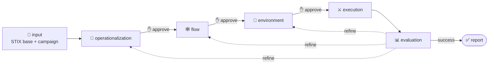
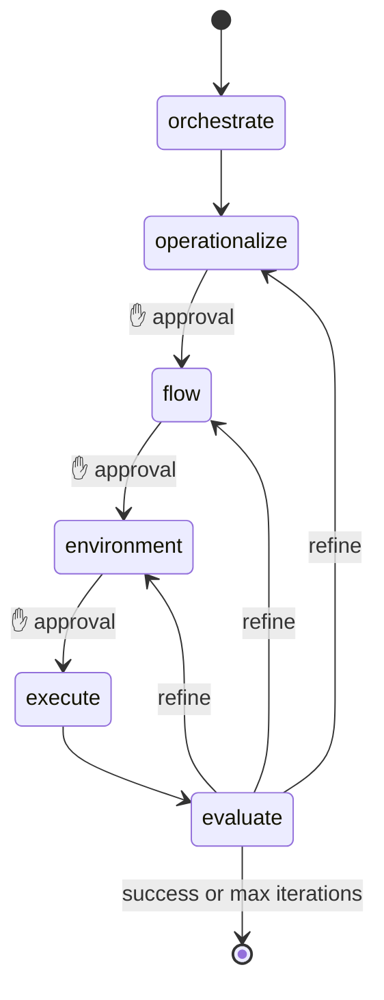
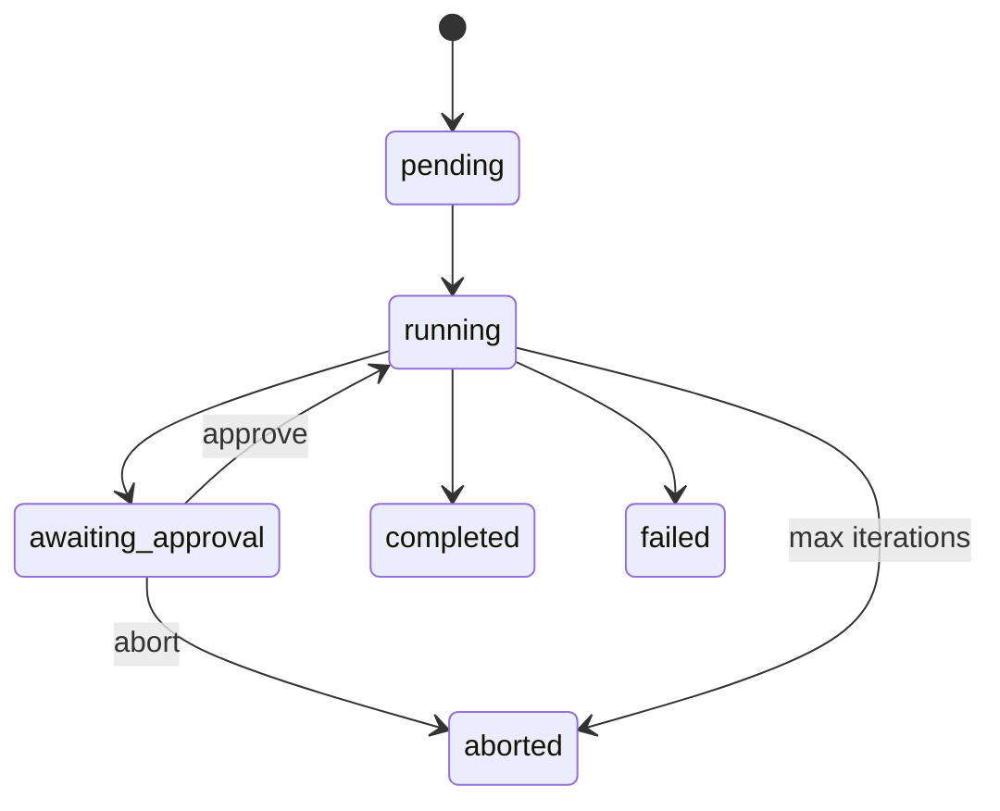

# 🤖 Agentic Pipeline

> One run, from a STIX campaign to a measured execution report. Each phase has a clear **input**, **processing** and **output**,
> and each phase is carried out by one agent of the multi-agent graph.

The phases and the agents are the same thing seen from two sides, so this document covers both.

---

## 🧭 The big picture

| Phase | Done by | Uses a model |
|-------|---------|:------------:|
| `input` | The researcher | ❌ |
| `operationalization` | Operationalization agent | ✅ |
| `flow` | Flow agent | ✅ |
| `environment` | Environment agent | ✅ |
| `execution` | Execution node (Caldera runner) | ❌ |
| `evaluation` | Evaluator | ✅ |

> ✋ After `operationalization`, `flow` and `environment` the run **pauses** until the researcher approves.
> Nothing offensive runs before the third approval.

---

## 📥 `input`: choose the target

The researcher picks a **STIX version** and a **campaign**. This is not an agent phase.

| | |
|---|---|
| **Input** | A STIX package version and a campaign from it |
| **Processing** | Reads the campaign's techniques, relationships, indicators, infrastructure and malware from the `stix_*` tables. No disk, no network |
| **Output** | Campaign identity + list of ATT&CK techniques (the initial context) |

---

## 🧩 `operationalization`: pick the commands

| | |
|---|---|
| **Input** | Campaign identity and techniques |
| **Processing** | For each technique, looks up Atomic Red Team commands by exact technique ID (`technique_commands`). The vector store is only a secondary aid. The agent chooses a command and adapts it to the emulated environment (IPs, hosts, paths). Commands are **never invented** |
| **Output** | Chosen commands per technique, environment requirements per technique (hosts, OS, image hint, ports, services, files), planned emulation coverage |

**Negotiation with the Environment agent.** Each technique's requirements are checked, without provisioning anything.
The Environment agent may object (`port_conflict`, `image_unavailable`, `os_unsupported`, `requires_vm`).
The Operationalization agent adjusts and asks again, up to `OPERATIONALIZATION_NEGOTIATION_MAX_ROUNDS` rounds (default 1).
A technique that is still objected to is marked `not_emulable`. A run never fails because of an objection.

---

## 🕸️ `flow`: build the attack flow

| | |
|---|---|
| **Input** | Techniques and chosen commands |
| **Processing** | Chooses one of three paths (below), validates the structure and repairs it **once** if the model output is malformed |
| **Output** | An [attack flow](https://center-for-threat-informed-defense.github.io/attack-flow/) (objects and edges) with its provenance (path and reference flow IDs) |

| Path | When | Result |
|------|------|--------|
| `exact` | A corpus flow matches the campaign | Used as is |
| `adapted` | No exact match, but similar flows exist | Closest flows are adapted |
| `created` | No reference flow | The agent creates an original flow |

The researcher can **regenerate** the attack flow, or go back to an earlier proposal, while the run is paused on `flow`.
Cycles in a corpus flow are logged and an acyclic execution view is derived. A cycle never stops the application.

---

## 🐳 `environment`: build the lab

| | |
|---|---|
| **Input** | Attack flow, commands and the environment parameters they require |
| **Processing** | Resolves images **catalog-first** (`image_catalog`, then Docker Hub online as a fallback). Builds and starts the lab (Caldera, Kali, nginx target, MariaDB target). **External egress is allowed here** to pull images. Then the **isolation gate** cuts external egress and verifies it |
| **Output** | Provisioning map, environment state and an **isolation proof** |

> 🔒 Isolation means cutting **external egress**, not the network. The internal lab network stays up because
> Caldera needs it to reach the targets.

---

## ⚔️ `execution`: run the campaign

| | |
|---|---|
| **Input** | The provisioned, isolated lab |
| **Processing** | Starts only with a valid isolation proof. Every command destination is validated by `is_internal_ip`. Caldera runs the abilities against the targets. Each executed command writes exactly one audit entry |
| **Output** | Per-technique results, 1:1 audit trail, isolation events, execution report (success rate, procedural coverage, failed nodes) |

The execution node runs no model. It hands the artifacts to the existing runner, which enforces:
containment → isolation → confirmation → execution → audit → report.

---

## 📊 `evaluation`: judge and decide

| | |
|---|---|
| **Input** | The real execution report |
| **Processing** | Reads the runner's verdict and metrics (it never recomputes them). A missing report or a safety-gate rejection counts as a failed iteration. On failure it diagnoses which phase to re-enter |
| **Output** | Verdict and rationale (`agent_evaluations`), experience written to the vector store, decision `FINISH` or `REFINE` |

---

## 🕹️ The agent graph

Built with LangGraph (`apps/backend/app/services/ai/graph.py`) over a Postgres checkpointer.

| Node | Model | Role |
|------|:-----:|------|
| `orchestrate` | ❌ | Seeds the state (campaign, `iteration`, `max_iterations`) and routes |
| `operationalize` | ✅ | Chooses and adapts the Atomic commands |
| `flow` | ✅ | Produces the attack flow |
| `environment` | ✅ | Provisions the contained lab |
| `execute` | ❌ | Runs the commands through Caldera |
| `evaluate` | ✅ | Judges the result and routes |

- 🔁 **Bounded loop.** The run aborts when `iteration + 1 >= max_iterations` (default 3).
- 🧱 **The agents propose, the safety machinery disposes.** Agents never execute anything and never touch the host.
  Every command still passes the unchanged containment check and isolation gate.
- 🤖 **Orchestrator robot.** A persona in the UI that asks for approvals and narrates each phase. It is not a model call.
- 📦 **Degraded mode.** Without a chat model or vector memory, the agents fall back to a deterministic selection.

### Run states

---

## 🔌 API

Prefix `/api/campaigns/{campaign}/ai`.

| Route | Purpose |
|-------|---------|
| `POST /run` | Start a run (202) |
| `GET /runs/active` | Active run of the campaign |
| `GET /runs/{id}` | Run detail: iterations, verdict, approvals, proposals, coverage |
| `POST /runs/{id}/phases/{phase}/approve` | Approve `operationalization`, `flow` or `environment` |
| `POST /runs/{id}/phases/flow/regenerate` | Generate another attack flow |
| `POST /runs/{id}/phases/flow/select` | Go back to an earlier attack flow proposal |
| `POST /runs/{id}/abort` | Abort a paused run and release its lab |

Live technique-by-technique progress during `execution` streams over WebSocket.

---

## 📚 See also

- [`storage.md`](storage.md): databases and what each phase reads and writes
- [`agentic-phases-literature.md`](agentic-phases-literature.md): the academic sources behind the phase model
- [`operations.md`](operations.md): configuration, model profiles, migrations and dev checks
