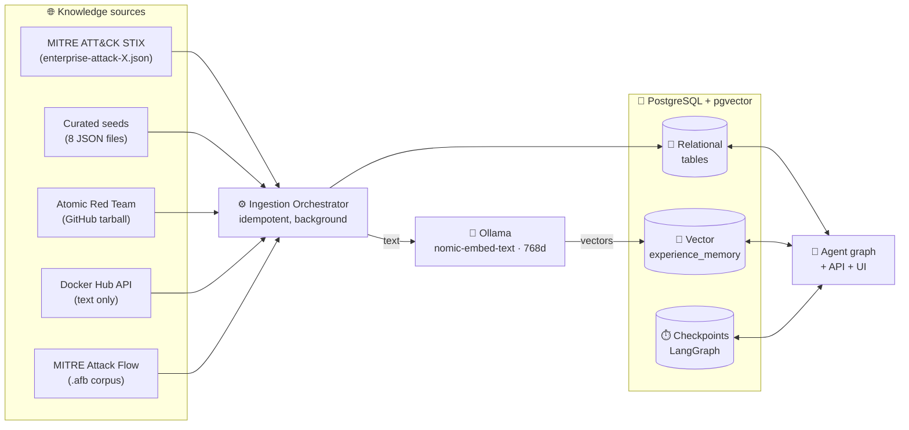
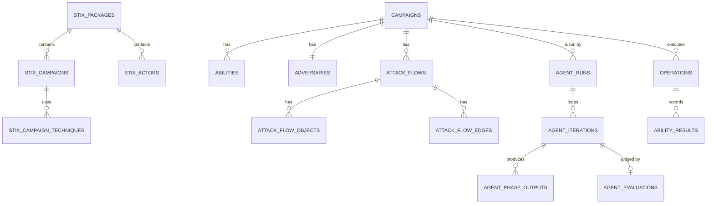
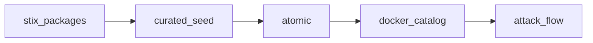

# 🗄️ Storage

> Where STICKS keeps its data, how it gets there, and who reads it.

STICKS has **one PostgreSQL server** (`pgvector/pgvector:pg16`, container `sticks-postgres`, port `5432`).
That single server plays three roles, so there is no second database to install or keep in sync.

| Role | What it holds | Technology |
|------|---------------|------------|
| 🧱 **Relational store** | Facts: campaigns, STIX packages, commands, flows, runs, reports, audit | SQLAlchemy + Alembic (33 migrations) |
| 🧭 **Vector store** | Associative memory: what is *similar* to what | `pgvector`, table `experience_memory` |
| ⏱️ **Checkpoint store** | Short-term memory of a paused or running agent graph | LangGraph `PostgresSaver` |

> 💡 **Rule of thumb.** Exact facts go to tables. Anything retrieved by similarity goes to the vector store.
> Runtime data never lives in JSON files; the only JSON in the repository are the read-only **seeds**.

---

## 🗺️ Overview



---

## 🧱 Relational store

Tables are grouped by who writes them.

### 📥 Written by ingestion (knowledge base)

| Group | Tables | Source |
|-------|--------|--------|
| **STIX** | `stix_packages`, `stix_type_counts`, `stix_campaigns`, `stix_campaign_techniques`, `stix_actors`, `stix_actor_campaigns` | MITRE ATT&CK bundle, one package per version |
| **Commands** | `technique_commands` | Atomic Red Team. Stores the command *template* and its `input_arguments`, never a substituted command |
| **Image catalog** | `image_catalog` | Docker Hub, key `(image, target_os)`, about 1600 images |
| **Attack flows** | `attack_flows`, `attack_flow_objects`, `attack_flow_edges` | MITRE corpus (`origin = mitre_corpus`) |
| **Curated cases** | `campaigns`, `abilities`, `adversaries` (+ `attack_flows`) | Seeds, flagged `curated = true` |
| **Emulability** | `technique_emulability`, `container_emulability` | Derived per technique and per campaign |
| **Ingestion state** | `ingest_source_state` | One row per source: `pending`, `running`, `ready`, `failed` |

### 🏃 Written by a run (per-execution data)

| Group | Tables | Purpose |
|-------|--------|---------|
| **Run control** | `agent_runs`, `agent_iterations`, `phase_runs` | State machine of a run, iterations, current phase |
| **Phase artifacts** | `agent_phase_outputs`, `agent_phase_traces` | What each agent produced, and the input and reasoning behind it |
| **Environment** | `environment_parameters`, `provisioning_map` | What the lab needs and what was provisioned |
| **Execution** | `operations`, `ability_results`, `execution_reports` | Caldera operation, per-technique result, final metrics |
| **Evaluation** | `agent_evaluations` | Verdict, rationale, refinement target |
| **Audit** | `audit` | 1:1 audit trail of every executed command |

### 👤 Application

`preferences` (theme, language) and `session_state` (continuity across machines).

### 🔗 Main relationships



---

## 🧭 Vector store

One table, `experience_memory`, with a fixed-width `VECTOR(768)` column. Embeddings come from Ollama
(`nomic-embed-text`). The width is set by `AI_EMBEDDING_DIM`.

| `metadata.kind` | What it remembers | Written by |
|-----------------|-------------------|------------|
| `command_affinity` | Which Atomic command fits which technique and tool | Atomic ingestion |
| `stix_context` | Identity, description and techniques of a STIX campaign | STIX ingestion |
| `attack_flow` | Description of each corpus flow | Attack Flow ingestion |
| `environment_affinity` | What worked for a given target and image | Evaluation |
| `run_outcome` | Result of past runs (success or failure) | Evaluation |

**How it is read:** top-k cosine similarity (k between 1 and 100, default 5), **excluding the running campaign**.
If the vector store is unreachable, retrieval returns an empty set and the run continues.
Writing an outcome is retried 3 times before it is reported as failed.

> 🧠 Learning happens only through this loop and retrieval. Model weights are never modified.

---

## ⏱️ Checkpoint store

LangGraph's `PostgresSaver` keeps the graph state in the same database, so a run paused in
`awaiting_approval` survives a backend restart. A run left `running` by a restart is marked
`failed` (`interrupted_by_restart`) by the Reconciler at startup.

---

## 📦 Seeds (the only JSON in the repo)

```
apps/backend/app/seeds/data/<slug>.json    # 8 files, about 124 KB, read-only
```

Seeds hold the 8 curated campaigns (108 abilities, 8 adversaries, 8 attack flows). They are loaded through
`importlib.resources` by the `curated_seed` ingestion source and stored with `curated = true`.
They are never read or written at runtime.

---

## 🔄 Ingestion

Runs in the background on the first start and is **verified on every start**: it completes only what is missing.



| Order | Source | Cost on a fresh install |
|-------|--------|-------------------------|
| 1 | `stix_packages` | About 50 MB per version, two versions (newest and 18.0) |
| 2 | `curated_seed` | Local, no network |
| 3 | `atomic` | One tarball stream, then embeddings |
| 4 | `docker_catalog` | Text-only calls to the Docker Hub API |
| 5 | `attack_flow` | Download from a pinned tag |

- `curated_seed` runs before `atomic` because the Atomic affinities are derived from the curated cases.
- A failure in one source never corrupts the others. The next start resumes only the missing work.
- Status is at `GET /api/ingestion/status` and in the UI. Per-source details and variables are in [`operations.md`](operations.md).

> ✅ STIX bundles are downloaded **into memory**. No bundle file is written to disk.

---

## 🙋 Who reads what

| Consumer | Reads |
|----------|-------|
| **Input** (per run) | `stix_*` tables only. No disk, no network |
| **Operationalization** | `technique_commands` (exact), `experience_memory` (secondary aid) |
| **Flow** | `attack_flows*` (relational) + `experience_memory` (similar flows) |
| **Environment** | `image_catalog`, `environment_parameters` |
| **Execution** | `agent_phase_outputs`, writes `operations`, `ability_results`, `audit` |
| **Evaluation** | `execution_reports`, writes `agent_evaluations`, `experience_memory` |

---

## 📁 Where things are

| Item | Location |
|------|----------|
| ORM models | `apps/backend/app/models/domain.py` |
| Migrations | `apps/backend/alembic/versions/` |
| Vector memory | `apps/backend/app/services/ai/memory.py` |
| Checkpointer | `apps/backend/app/services/ai/checkpointer.py` |
| Embedder | `apps/backend/app/services/ai/embedder.py` |
| Seeds | `apps/backend/app/seeds/data/` |
| Database container | `ops/docker/docker-compose.yml` (service `postgres`) |
